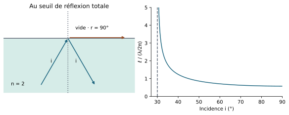
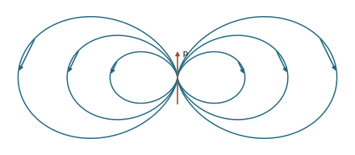
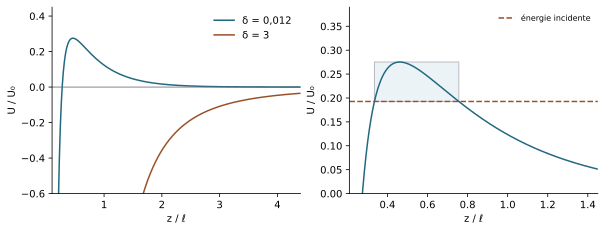
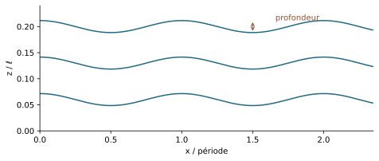

# École polytechnique et ESPCI PC 2016 — Physique A · Corrigé brut

*Corrigé rédigé par IA, non officiel. Signalez toute erreur.*

**Lecture du rapport du jury** · GPT-6.2 Astra Ultra · vitesse non renseignée

**Rédaction** · GPT-6.2 Astra Ultra · vitesse non renseignée

## Miroir à atomes

## I. Onde évanescente du prisme

### Question 1 — Angle limite

L’angle $i$ est mesuré à la normale dans le prisme d’indice $n>1$. L’angle de réflexion vaut $i$ et l’angle de réfraction $r$ dans le vide satisfait $\sin r=n\sin i$. Un rayon réfracté propagatif exige $n\sin i\le1$. Pour $i>i_c=\arcsin(1/n)$, il y a réflexion totale. À $n=2$, $i_c=30^\circ$. À l’incidence limite, la direction réfractée est parallèle à la paroi.

### Question 2 — Raccord des phases tangentielles

Dans un plan d’interface homogène $z=0$, l’excitation porte le facteur $e^{i(k_xx-\omega t)}$. Les conditions locales de Maxwell (continuité du champ électrique tangent et du champ magnétique tangent en l’absence de courant surfacique) imposent le même facteur aux ondes réfléchie et transmise pour tout $x,t$. Une différence de $k_x$ donnerait un déphasage variant avec le point choisi. Ainsi $k'_x=k_x=k\sin i$.

### Question 3 — Dispersion dans le vide

$k=n\omega/c$. L’équation des ondes donne $(k'_x)^2+(k'_z)^2=(\omega/c)^2$ pour la solution complexe. Par substitution, $(k'_z)^2=k^2(n^{-2}-\sin^2 i)$. Il s’agit de carrés algébriques des composantes.

### Question 4 — Longueur de décroissance

Lorsque $n\sin i>1$, $(k'_z)^2<0$. Pour $z>0$ dans le vide et la convention $e^{i(\mathbf k'\cdot\mathbf r-\omega t)}$, on prend $k'_z=i/\ell$. L’amplitude décroît comme $e^{-z/\ell}$ avec

$$
\ell=\frac{1}{k\sqrt{\sin^2 i-n^{-2}}}=\frac{\lambda}{2\pi\sqrt{n^2\sin^2i-1}},
$$

où $\lambda$ est la longueur d’onde dans le vide. La longueur de décroissance de l’intensité est $\ell/2$.

### Question 5 — Variation avec l’incidence

$\ell$ décroît de $+\infty$ à $\lambda/[2\pi\sqrt{n^2-1}]$ avec une tangente horizontale à incidence rasante. Près de $i_c$, le dénominateur varie comme $\sqrt{i-i_c}$. Loin du seuil, pour un indice ordinaire, il est d’ordre unité et $\ell\sim\lambda/(2\pi)\sim10^2\,\mathrm{nm}$ pour $\lambda=780\,\mathrm{nm}$. La figure 1 montre les deux comportements.

## II. Rebond des atomes

### Question 6 — Polarisabilité du modèle de l’électron lié

Le noyau étant fixe, l’électron vérifie $m\ddot{\mathbf r}+m\omega_0^2\mathbf r=-e\mathbf E_0\cos\omega t$. Hors résonance la réponse forcée est $\mathbf r=-e\mathbf E/[m(\omega_0^2-\omega^2)]$. Le moment $\mathbf p=-e\mathbf r=\varepsilon_0\alpha\mathbf E$ donne $\alpha=e^2/[m\varepsilon_0(\omega_0^2-\omega^2)]$. Comme $p/(\varepsilon_0E)$ a l’unité d’un volume, $\alpha$ s’exprime en $\mathrm{m^3}$. L’amortissement réel régularise la singularité du modèle à résonance.

### Question 7 — Moyenne temporelle de l’interaction

Le rapport du jury utilise l’énergie d’interaction $-\mathbf p\cdot\mathbf E$ du dipôle avec le champ appliqué. Avec $\mathbf p=\varepsilon_0\alpha\mathbf E$ et $\langle\cos^2\omega t\rangle=1/2$, sa moyenne est $U=-\tfrac12\varepsilon_0\alpha|\mathbf E_0|^2$, comme à la ligne 234. Si l’on construit, au contraire, l’énergie effective d’induction en comptant aussi le travail de polarisation, un facteur $1/2$ supplémentaire apparaît pour un champ de crête. Dans la suite, $U_0$ est la hauteur de barrière définie par l’article.

### Question 8 — Signe de la force

Au-dessus de la résonance, $\alpha<0$ et le dipôle oscille en opposition avec le champ. Le potentiel $U$ est positif et croît avec l’intensité lumineuse. Comme l’intensité est maximale contre le prisme et décroît en s’en éloignant, $F_z=-dU/dz>0$. La force repousse l’atome. Un désaccord de signe opposé rendrait la force attractive.

### Question 9 — Profil de la barrière lumineuse

$E_0(z)=E_0(0)e^{-z/\ell}$ donne $U(z)=U_0e^{-2z/\ell}$, où $U_0=-\varepsilon_0\alpha |E_0(0)|^2/2>0$. Le potentiel est maximal à la surface et décroît exponentiellement dans le vide.

### Question 10 — Point de rebroussement

L’énergie normale incidente $E_\perp=mv_{z,\infty}^2/2$ se conserve sous la forme $mv_z^2/2+U(z)$. Si $0<E_\perp<U_0$, $v_z=0$ à $z_t=(\ell/2)\ln(U_0/E_\perp)>0$. La force $2U(z_t)/\ell$ est dirigée vers l’extérieur. La vitesse normale change alors de signe et l’atome repart.

### Question 11 — Cohérence de l’échelle d’énergie

Avec les données arrondies $m_{\rm Rb}=M/N_A\sim0,1/10^{24}=10^{-25}\,\mathrm{kg}$. Pour $U_0\sim10^{-25}\,\mathrm J$, la vitesse $\sqrt{2U_0/m_{\rm Rb}}\sim1\,\mathrm{m\,s^{-1}}$ est cohérente avec l’article.

### Question 12 — Agitation thermique ambiante

$m_{\rm Rb}\langle v^2\rangle/2=3k_BT/2$. À $T\sim300\,\mathrm K$, $\sqrt{\langle v^2\rangle}\sim\sqrt{3\times10^{-23}\times300/10^{-25}}\sim3\times10^2\,\mathrm{m\,s^{-1}}$. L’énergie thermique ambiante est donc bien supérieure à la barrière lumineuse.

### Question 13 — Sens de l’incidence rasante

Si $\beta$ est l’angle de la vitesse atomique avec le plan de la surface, $|v_z|=v\sin\beta$. À vitesse thermique ordinaire $v\sim300\,\mathrm{m\,s^{-1}}$, le rebond exige $v\sin\beta\lesssim1\,\mathrm{m\,s^{-1}}$, donc $\beta\lesssim3\times10^{-3}\,\mathrm{rad}$ (environ $0,2^\circ$). Un refroidissement réduit directement la composante normale et autorise une incidence proche de la normale.

### Question 14 — Densité de population

Pour $N=10^8$ et un rayon de $5\times10^{-4}\,\mathrm m$, $n=N/[(4\pi/3)(5\times10^{-4})^3]\simeq2\times10^{17}\,\mathrm{m^{-3}}$. L’air ambiant à $10^5\,\mathrm{Pa}$ et 300 K contient $n_{\rm air}=P/(k_BT)\sim3\times10^{25}\,\mathrm{m^{-3}}$, environ huit ordres de grandeur de plus.

### Question 15 — Pression dans le nuage

Avec $T\sim10\,\mathrm{\mu K}=10^{-5}\,\mathrm K$, $P=nk_BT\sim2\times10^{-11}\,\mathrm{Pa}$. Il s’agit de la pression cinétique équivalente du nuage. L’enceinte doit être maintenue sous ultravide pour limiter les collisions avec des molécules chaudes qui chaufferaient ou expulseraient les atomes. La pression résiduelle admissible dépend de la durée de piégeage et des sections de collision.

### Question 16 — Vitesse de chute

À partir du repos et hors de la mince couche du miroir, $v=\sqrt{2gh}\simeq\sqrt{2\times10\times0,01}=0,45\,\mathrm{m\,s^{-1}}$, compatible avec les $0,5\,\mathrm{m\,s^{-1}}$ de l’article.

## III. Interaction avec la surface diélectrique

### Question 17 — Champ d’un dipôle

Le champ lointain est $\mathbf E=[3(\mathbf p\cdot\mathbf e_r)\mathbf e_r-\mathbf p]/(4\pi\varepsilon_0r^3)$. Ses composantes sont proportionnelles à $(2\cos\theta,\sin\theta)$ en base sphérique. Les lignes de champ vérifient $dr/(r\,d\theta)=2\cot\theta$ et $r=C\sin^2\theta$. Sur le plan équatorial, le champ est opposé au moment dipolaire.

### Question 18 — Attraction par le dipôle image

Pour le dipôle parallèle à la paroi, $\mathbf p'=-\kappa\mathbf p$ avec $\kappa>0$ pour le verre vu depuis le vide. La séparation est $2z$ et le champ équatorial de l’image vaut $\mathbf E_{\rm im}=-\mathbf p'/[4\pi\varepsilon_0(2z)^3]$, de même sens que $\mathbf p$. L’énergie d’interaction est donc négative et proportionnelle à $-p^2/z^3$. Le facteur $1/2$ éventuel lors de l’établissement d’une image induite ne change ni le signe ni l’exposant. Écrite $-A/z^3$, cette énergie donne une force $-3A\mathbf e_z/z^4$, attractive.

### Question 19 — Approximation sans retard

La communication électromagnétique prend un temps de l’ordre de $z/c$ (ou $2z/c$ aller-retour). Si $z/c\ll1/\nu$, le dipôle change peu pendant ce trajet et son image instantanée est une bonne approximation. Cette condition revient à $z\ll c/\nu=\lambda_{\rm opt}$. Même si $\langle\mathbf p\rangle=0$, l’énergie moyenne dépend de $\langle p^2\rangle$, qui est positive.

### Question 20 — Distance expérimentale

Pour $z\sim10^{-7}\,\mathrm m$, $z/c\sim3\times10^{-16}\,\mathrm s$. À 780 nm, $1/\nu=\lambda/c\simeq2,6\times10^{-15}\,\mathrm s$. Le rapport est environ 0,13 et environ 0,06 à 50 nm. L’approximation sans retard est raisonnable en ordre de grandeur dans la zone la plus proche. La séparation des échelles est modérée à 100 nm.

### Question 21 — Deux limites du potentiel

$A>0$ décrit l’attraction. Pour $z\to0^+$, $U\sim-A/z^3\to-\infty$ dans ce modèle. À grande distance, l’exponentielle disparaît plus vite que toute puissance, donc $U\sim-A/z^3\to0$ par valeurs négatives. Le modèle de courte portée ne décrit pas la structure de la matière au contact.

### Question 22 — Paramètre de compétition

$[A]=\mathrm{J\,m^3}$. Un choix naturel est $\delta=A/(U_0\ell^3)$. Avec $u=z/\ell$, la courbe réduite est $W=U/U_0=e^{-2u}-\delta/u^3$.

### Question 23 — Allures des deux régimes

$W'=-2e^{-2u}+3\delta/u^4$. Les extrema vérifient $u^4 e^{-2u}=3\delta/2$. Le membre de gauche est maximal en $u=2$. Si $\delta\gg1$, $W$ croît de $-\infty$ à $0^-$ sans barrière. Si $\delta\ll1$, il existe deux extrema, un maximum positif près de la paroi puis un minimum négatif peu profond, avant le retour à $0^-$. Le maximum visible sur la figure 2 de l’article relève du deuxième régime.

### Question 24 — Deux équations au seuil

Notons $z_b$ la position du maximum et $U_0$ l’intensité convertie en énergie au seuil. À l’échelle nanométrique de la barrière, on néglige la variation de pesanteur devant $mgh$. Les inconnues $A$ et $z_b$ vérifient

$$
U_0e^{-2z_b/\ell}-\frac A{z_b^3}=mgh,\qquad -\frac{2U_0}{\ell}e^{-2z_b/\ell}+\frac{3A}{z_b^4}=0.
$$

Il faut retenir le point de dérivée seconde négative.

### Question 25 — Analogue optique du tunnel

Pour $V>E_c$, l’équation stationnaire de Schrödinger donne un nombre d’onde imaginaire et une amplitude qui décroît exponentiellement dans la barrière. C’est l’analogue de l’onde évanescente créée par réflexion totale. Une barrière mince permet un flux transmis vers une seconde région autorisée. En optique la réflexion totale peut pareillement être frustrée par un second milieu à faible distance.

### Question 26 — Barrière rectangulaire de comparaison

Pour $E_c<V_{\max}$ proche du sommet, les points $z_-<z_+$ sont définis par $U(z_\pm)=E_c$. La zone interdite a la largeur $a=z_+-z_-$. Un rectangle de même largeur, de sommet $V_{\max}$ et de dépassement $V_{\max}-E_c$ donne une estimation de l’atténuation. Le remplacement surestime la barrière entre ses bords et ne vise que l’échelle de l’exposant. La figure 3 donne cette construction.

### Question 27 — Largeur de la transition

Posons $K=-U''(z_b)>0$ et $\Delta=V_{\max}-E_c$. Le développement $U\simeq V_{\max}-K(z-z_b)^2/2$ donne $a\simeq2\sqrt{2\Delta/K}$. Dans la formule du rectangle,

$$
T\sim\exp\!\left[-\frac{8}{\hbar}\sqrt{\frac{m}{K}}\,(V_{\max}-E_c)\right].
$$

Le coefficient croît rapidement avec l’énergie incidente. La transition a une largeur énergétique de l’ordre de $\hbar\sqrt{K/m}$ (un exposant unité donne $\hbar\sqrt{K/m}/8$ dans ce rectangle). La formule asymptotique supposant $T\ll1$ ne fixe pas la valeur exacte de la transmission au sommet.

## IV. Rugosité et diffraction atomique

### Question 28 — Deux ondes évanescentes

En notation complexe avec le temps $e^{-i\omega t}$ sous-entendu, l’onde aller vaut $E_a=E_s e^{-z/\ell}e^{ik_xx}$ et l’onde retour $E_r=\sqrt R\,E_s e^{-z/\ell}e^{-ik_xx+i\phi}$. Les polarisations sont supposées identiques. Une phase constante $\phi$ peut être absorbée dans le choix de l’origine de $x$.

### Question 29 — Contraste de la modulation

Après choix de l’origine, $|E_a+E_r|^2=|E_s|^2 e^{-2z/\ell}[1+R+2\sqrt R\cos(2k_xx)]$. Le potentiel répulsif, proportionnel à cette intensité, s’écrit $U=U_1e^{-2z/\ell}[1+\varepsilon\cos(2k_xx)]$ avec $\varepsilon=2\sqrt R/(1+R)$ et $U_1=U_0(1+R)$ si $U_0$ correspond au seul aller.

### Question 30 — Équipotentielles

Pour la cote $U_c$, $z=(\ell/2)\ln(U_1/U_c)+(\ell/2)\ln[1+\varepsilon\cos(2k_xx)]$. Si $\varepsilon\ll1$,

$$
z\simeq z_c+\tfrac12\ell\varepsilon\cos(2k_xx),\qquad z_c=\tfrac12\ell\ln(U_1/U_c).
$$

Les courbes sont des sinusoïdes parallèles de période $\pi/k_x$ et d’amplitude indépendante du niveau $z_c$.

### Question 31 — Profondeur du réseau

La profondeur crête-à-creux vaut $\Delta z\simeq\ell\varepsilon$, deux fois l’amplitude. Sans développement, elle vaudrait $(\ell/2)\ln[(1+\varepsilon)/(1-\varepsilon)]$.

### Question 32 — Longueur d’onde de matière

$\lambda_{\rm dB}=h/p=2\pi\hbar/(m_{\rm Rb}v)$. Avec les données fortement arrondies de la table, $2\pi\times10^{-34}/(10^{-25}\times0,5)\sim10^{-8}\,\mathrm m$. Avec la masse d’un atome de rubidium proche de $1,4\times10^{-25}\,\mathrm{kg}$, on trouve environ 9 nm, compatible avec les 8 nm de l’article.

### Question 33 — Profondeur observable

Pour $\varepsilon=0,023$ et $\ell\sim100\,\mathrm{nm}$, $\Delta z\sim2$ à $3\,\mathrm{nm}$, à un facteur de quelques unités de $\lambda_{\rm dB}\sim8\,\mathrm{nm}$. La différence de phase crête-à-creux au retour est de l’ordre de $4\pi\Delta z/\lambda_{\rm dB}$, soit plusieurs radians. Le réseau impose une modulation de phase nettement observable.

### Question 34 — Fraction lumineuse réinjectée

$\varepsilon\simeq2\sqrt R$ donne $R\simeq(0,023/2)^2=1,3\times10^{-4}$. La fraction d’intensité ainsi trouvée vérifie l’approximation $R\ll1$.

### Question 35 — Angles des ordres diffractés

Pour une incidence atomique normale et une période $d=\pi/k_x$, les ordres $j$ reçoivent $p_x=2j\hbar k_x$, donc $\sin\theta_j=j\lambda_{\rm dB}/d$. Les valeurs annoncées $d\sim\lambda/2\sim390\,\mathrm{nm}$ et $\lambda_{\rm dB}\sim8\,\mathrm{nm}$ donnent $\theta_{\pm1}\sim\pm0,02\,\mathrm{rad}$ et $\theta_{\pm2}\sim\pm0,04\,\mathrm{rad}$, environ $1^\circ$ et $2^\circ$ de chaque côté. Le maximum central correspond à zéro et les deux ordres d’un même côté ne sont pas résolus sur la figure 3 de l’article.
