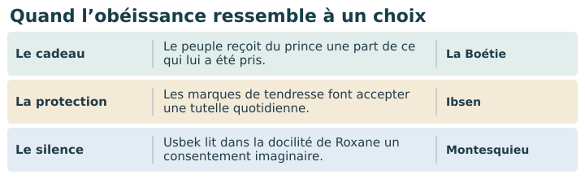

# Banque PT — Français A 2017 · Corrigé guidé

*Corrigé rédigé par IA, non officiel. Signalez toute erreur.*

**Rédaction** · GPT-6.2 Astra Ultra · vitesse non renseignée

[Énoncé officiel](https://www.banquept.fr/documents/2017/fr_a_2017_pt.pdf) · [Rapport du jury](https://www.banquept.fr/documents/ecrit/rapport/2017/rapport_fra_a_ecrit_2017.pdf) · [Programme officiel](https://www.education.gouv.fr/bo/16/Hebdo26/MENS1600411A.htm)

Épreuve de quatre heures. Le thème « Servitude et soumission » réunit les œuvres suivantes. La Boétie, Discours de la servitude volontaire · Montesquieu, Lettres persanes · Ibsen, Une maison de poupée (traduction Éloi Recoing).

David Hume, Essais moraux, politiques et littéraires (1741).

## Préparer la dissertation

Commenter la proposition de David Hume selon laquelle, chez ceux qui ont connu la liberté, la servitude doit avancer par degrés et se déguiser pour obtenir leur acceptation.

**Quelle condition Hume pose-t-il ?**

Entourer le groupe qui désigne les hommes autrefois libres. Ils peuvent comparer deux conditions. La formule sur les degrés décrit un rythme et celle sur les déguisements une erreur de perception. L’acceptation est le résultat recherché. Une simple consigne exécutée sous la menace ne permet pas de l’établir.

**Comment distinguer les deux mécanismes ?**

Chez La Boétie, le don public transforme le prélèvement en faveur. C’est un masque. Chez Nora, le passage du père au mari et la répétition des gestes familiers installent une dépendance dans la durée. C’est une gradation. Faire ensuite varier le point de vue avec la lettre de Roxane, qui démontre que le maître aussi peut être trompé.

**Quelle objection change la portée de la formule ?**

Une armée peut imposer une soumission immédiate. La chaîne des favoris peut ensuite l’entretenir grâce à des avantages que les bénéficiaires perçoivent lucidement. Revenir alors à la différence entre l’acte d’obéir et le jugement par lequel quelqu’un accorde au pouvoir le droit de le faire obéir.

## Dissertation

Dans *Une maison de poupée*, Torvald croit pouvoir effacer en quelques phrases l’effet de la lettre de Krogstad. Le danger passé, il offre à Nora son pardon et sa protection. Ce sont les mots qu’elle entend depuis des années. Cette fois, leur douceur même l’alerte. Une domination peut donc changer de visage sans que celui qui l’exerce ait à changer de langage. Hume soutient que ceux qui ont connu la liberté redoutent assez la servitude pour que celle-ci doive avancer masquée, et par petites étapes. Son propos concerne moins la puissance qui arrache une première obéissance que la transformation de cette obéissance en acceptation. Pourquoi la mémoire de la liberté, qui rend les hommes difficiles à asservir, ne suffit-elle pas toujours à les préserver ?

La liberté acquise donne d’abord un terme de comparaison. Dans le *Discours de la servitude volontaire*, les deux Spartiates qui se rendent auprès du roi de Perse refusent les avantages qu’un dignitaire leur fait miroiter. Celui-ci connaît les récompenses du service, eux connaissent par expérience la saveur de la liberté. Ce que le courtisan tient pour enviable leur paraît proprement insupportable. La distance éclaire aussi l’étrange situation d’Usbek dans les *Lettres persanes*. En voyage, il compare les institutions et reconnaît le despotisme là où l’observateur habitué à obéir ne voit que l’ordre des choses. Pourquoi les femmes du sérail ne bénéficieraient-elles pas du même pouvoir de juger ? Une expérience antérieure du choix ou même la faculté de comparer rendent fragile un ordre qui avouerait trop clairement ce qu’il retranche.

La domination gagne alors à offrir un avantage reconnaissable en échange d’une perte difficile à nommer. La Boétie rappelle que les spectacles et les distributions ont fait aimer des princes auxquels le peuple rendait bien davantage qu’il ne recevait. Le don est réel, mais sa mise en scène fait oublier à qui appartenait d’abord l’argent distribué. Le temps accomplit ce que la fête commence. L’enfant qui grandit sous le tyran prend pour état naturel une manière de vivre que ses parents savaient imposée. Dans la pièce d’Ibsen, le passage de la maison du père à celle du mari prend la forme heureuse d’un établissement. Il reconduit aussi l’habitude de se conformer au goût d’un autre. Il faut des années à Nora pour rapprocher ces deux éducations. Les petits noms d’oiseau, l’argent accordé par Torvald, jusqu’aux conseils donnés pour danser la tarentelle semblent autant de preuves distinctes d’affection. Lorsqu’on les rapproche, une règle commune se dessine. C’est toujours à lui qu’il revient de distribuer les rôles.

Ce mécanisme explique cependant mal l’obéissance lorsque la contrainte se montre au grand jour. Depuis Paris, Usbek confie à ses eunuques le soin de sévir. Les ordres de surveillance, puis les châtiments, ne promettent aucun bien à celles qui les subissent. Produisent-ils pour autant une acceptation ? Le délai des correspondances laisse au maître le temps de prendre l’absence de nouvelles pour la preuve de son autorité. La dernière lettre de Roxane lui apprend que des gestes de soumission qu’il pensait avoir obtenus cachaient une vie clandestine. Ici le déguisement a changé de camp. De même, chez La Boétie, un peuple peut céder à l’invasion sous l’effet de la force. Expliquer cette défaite par une lente persuasion reviendrait à rendre le vaincu responsable de sa défaite. C’est la durée ultérieure du régime qui exige une explication.

Il existe enfin un acquiescement plus embarrassant pour l’hypothèse de Hume. Les proches du tyran voient fort bien le système dont ils profitent. Ce qui les retient tient aux charges qu’ils distribuent à leur tour et à l’espoir d’avoir des obligés au-dessous d’eux. Ils croient exercer une parcelle de liberté précisément au moment où ils dépendent le plus d’une faveur révocable. Inversement, la lucidité peut survenir brusquement au terme d’une lente expérience. Quand Torvald lit la première lettre, Nora attend de lui qu’il assume l’acte commis pour le sauver. Il se préoccupe de sa réputation. Sa générosité reparaît aussitôt que la seconde lettre le rassure. Le rapprochement des deux réactions dévoile en une soirée ce que des années de prévenances lui avaient caché.

La gradation et les masques aident donc la servitude à se faire aimer et surtout à se transmettre. Ils peuvent manquer quand la force suffit à faire obéir, ou quand des avantages bien compris recrutent des complices. Hume invite surtout à examiner l’écart entre les signes d’acceptation visibles du maître et la faculté, parfois intacte chez celui qui obéit, de comparer ce qu’il vit avec ce qu’il pourrait choisir.
