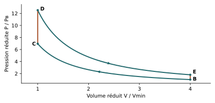
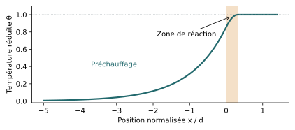
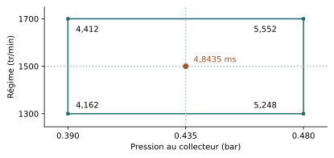
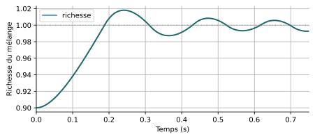

# Banque PT 2017 — Informatique et modélisation · Corrigé brut

*Corrigé rédigé par IA, non officiel. Signalez toute erreur.*

**Rédaction** · GPT-6.2 Astra Ultra · vitesse non renseignée

**Révision (tour 1)** · GPT-6.2 Astra Ultra · vitesse non renseignée

[Sujet officiel](https://www.banquept.fr/documents/2017/info_mod_2017_pt.pdf) · [Rapport du jury](https://www.banquept.fr/documents/ecrit/rapport/2017/rapport_info_model_ecrit_2017.pdf) · [Livret de la session](https://www.banquept.fr/documents/livret/2017/Livret_PT_2017.pdf#page=12)

**Moteurs à allumage commandé.** Épreuve de quatre heures, sans calculatrice. La première partie porte sur le cycle thermodynamique et le profil de température dans un cylindre. La seconde étudie la cartographie des durées d’injection et la boucle de régulation de richesse. Les repères M1 à M23 et I1 à I25 conservent la numérotation propre à chaque partie. Le sujet se termine page 16.

## Modélisation · Cycle thermodynamique

### Question M1 · Échanges thermiques sur le cycle

Le cycle fermé de Beau de Rochas parcourt $B\to C\to D\to E\to B$. Les phases $BC$ et $DE$ sont adiabatiques. Le gaz reçoit de la chaleur de la source chaude sur l’isochore $CD$ et en cède à la source froide sur l’isochore $EB$. Sur chacune, la température du gaz varie alors que celle du thermostat reste fixe. Une différence finie de température pendant le transfert produit de l’entropie et rend l’échange irréversible, même lorsque la transformation est mécaniquement réversible.



### Question M2 · Chaleur reçue de la source chaude

Sur $CD$, le volume est fixe et le travail de pression reçu est nul. Le premier principe donne $Q_c=\Delta U_{CD}$. Pour $n$ moles du gaz parfait à capacité calorifique molaire $C_{V,m}$ constante,
$$Q_c=n C_{V,m}(T_D-T_C)>0.$$
La convention adoptée compte positivement l’énergie reçue par le gaz.

### Question M3 · Chaleur échangée avec la source froide

Le refroidissement $E\to B$ est lui aussi isochore. Avec la même convention, $Q_f=nC_{V,m}(T_B-T_E)<0$. La source froide reçoit du gaz la quantité positive $-Q_f$.

### Question M4 · Rendement en fonction des températures

Sur un cycle complet $\Delta U=0$. Le travail reçu $W$ vérifie $W+Q_c+Q_f=0$, donc le travail fourni à l’extérieur vaut $-W$. Le rendement est
$$\eta=\frac{-W}{Q_c}=1+\frac{Q_f}{Q_c}=1-\frac{T_E-T_B}{T_D-T_C}.$$
Le sens horaire du cycle dans le plan pression–volume confirme que le gaz fournit un travail net.

### Question M5 · Loi de Laplace et rapport volumétrique

Pour une quantité fixe d’un gaz parfait de rapport $\gamma=C_{P,m}/C_{V,m}$ constant, une évolution adiabatique réversible vérifie $PV^\gamma=\mathrm{constante}$, ou $TV^{\gamma-1}=\mathrm{constante}$. Sur $BC$ puis $DE$, avec $\alpha=V_{\max}/V_{\min}$,
$$T_C=T_B\alpha^{\gamma-1},\qquad T_D=T_E\alpha^{\gamma-1}.$$
On en déduit $T_D-T_C=(T_E-T_B)\alpha^{\gamma-1}$, d’où $\eta=1-\alpha^{1-\gamma}$.

### Question M6 · Gain et limite de la compression

Pour $\gamma>1$, la dérivée $(\gamma-1)\alpha^{-\gamma}$ est positive. Le rendement idéal augmente et tend vers 1 quand $\alpha$ tend vers l’infini. Dans un moteur réel la compression échauffe le mélange et peut provoquer son auto-inflammation, source de cliquetis. Les pressions, les températures admissibles et les pertes limitent aussi la compression utilisable.

## Modélisation · Combustion et transferts thermiques

### Question M7 · Bilan atomique de l’isooctane

La combustion complète de l’isooctane en phase gazeuse donne du dioxyde de carbone et de la vapeur d’eau. La conservation de C, puis H et O, conduit à
$$2\,\mathrm{C_8H_{18}}+25\,\mathrm{O_2}\longrightarrow16\,\mathrm{CO_2}+18\,\mathrm{H_2O}.$$
Chaque côté contient 16 atomes de carbone, 36 d’hydrogène et 50 d’oxygène pour les coefficients écrits.

### Question M8 · Quantité de matière gazeuse

Le diazote représente environ quatre cinquièmes de l’air et traverse la réaction comme espèce spectatrice dans ce modèle. Pour les coefficients de M7, en assimilant l’air à quatre moles de diazote par mole de dioxygène, on compte $2+25+100=127$ moles avant et $16+18+100=134$ après. L’écart est d’environ $7/127\simeq5{,}5\,\%$. La conservation de la quantité de gaz constitue donc une approximation, alors que la conservation des atomes est exacte.

### Question M9 · Bilan thermique unidimensionnel

Par symétrie $T=T(x,t)$ et $\vec j_{\rm th}=j_{\rm th}(x,t)\vec u_x$. La divergence devient une dérivée spatiale. L’équation locale sans source donnée dans le sujet s’écrit
$$\frac{\partial j_{\rm th}}{\partial x}+\mu c_P\frac{\partial T}{\partial t}=0.$$
On a pris $j_{\rm th}$ comme composante algébrique orientée selon les abscisses croissantes.

### Question M10 · Puissances par unité de volume

Le flux thermique surfacique s’exprime en W/m$^2$. Sa dérivée suivant $x$ est en W/m$^3$. Le second terme est le produit de kg/m$^3$, de J/(kg·K) et de K/s. Il s’exprime donc lui aussi en W/m$^3$.

### Question M11 · Puissance chimique volumique

Si $n_C$ désigne la quantité de combustible restante dans le volume $V$, la vitesse volumique positive de consommation est $v_r=-(1/V)\,\mathrm dn_C/\mathrm dt$. La chaleur dégagée par mole consommée est $Q>0$. En temps $\mathrm dt$, l’énergie libérée est $Q(-\mathrm dn_C)$. En divisant par $V\,\mathrm dt$, on obtient $P_{\rm vol}=Qv_r$ en W/m$^3$.

### Question M12 · Flux thermique diffusif

La loi de Fourier donne $\vec j_{\rm th}^{\,d}=-\lambda\,\mathrm{grad}\,T$ et donc $j_{\rm th}^{d}=-\lambda\,\partial T/\partial x$. La conductivité est positive. Si la température croît avec $x$, l’énergie est transportée vers les abscisses décroissantes, du milieu chaud vers le milieu froid.

### Question M13 · Flux thermique convectif

Le flux massique $\mu\vec v$ transporte l’enthalpie sensible massique $c_P T$ à une constante de référence près. Le flux convectif vaut donc $\vec j_{\rm th}^{\,c}=\mu c_PT\,\vec v$. Son unité est bien W/m$^2$.

### Question M14 · Profil thermique stationnaire

Le flux total est $j_{\rm th}=-\lambda\,\partial_xT+\mu v c_PT$. En réintroduisant la source et en utilisant la constance spatiale de $\mu v=\mu_f U$, on trouve
$$\mu c_P\,\partial_tT-\lambda\,\partial_{xx}T+\mu_f Uc_P\,\partial_xT=Qv_r.$$
Dans le repère attaché au front stationnaire, $T$ ne dépend plus du temps. Il reste $\mu_f Uc_P T'-\lambda T''=Qv_r$. La convection subsiste dans ce repère.

## Modélisation · Bilan de masse et profil stationnaire

### Question M15 · Dimension du coefficient de diffusion

La fraction massique $w_C$ est sans dimension. Le premier terme $U\,\mathrm dw_C/\mathrm dx$ est en s$^{-1}$. Le rapport $\mu/\mu_f$ étant sans dimension, il faut que $D\,\mathrm d^2w_C/\mathrm dx^2$ soit lui aussi en s$^{-1}$. Ainsi $[D]=L^2\,\mathcal T^{-1}$ et l’unité SI est le m$^2$/s.

### Question M16 · Bornes de la température réduite

Le profil étudié va des gaz frais à $T_f$ aux gaz brûlés à $T_b>T_f$. Ainsi $\theta=(T-T_f)/(T_b-T_f)$ passe de 0 à 1 et $0\leq\theta\leq1$.

### Question M17 · Sens de la concentration réduite

La fraction massique locale $w_C$ est rapportée à la fraction massique du combustible dans les gaz frais $w_{C,f}$. Ainsi $\chi=w_C/w_{C,f}=1-\theta$ représente la part relative de combustible encore présente. Elle vaut 1 en amont et 0 dans les gaz entièrement brûlés.

### Question M18 · Équation par morceaux

Dans chacun des domaines, le second membre $f$ est constant. En posant $g=\theta'$ et $d=D_f/U$, l’équation $U\theta'-D_f\theta''=f$ devient $g'-g/d=-f/D_f$. Une solution particulière constante est $g=f/U$ et la solution homogène est proportionnelle à $e^{x/d}$. Une deuxième intégration donne
$$\theta(x)=A e^{x/d}+\frac fU x+C.$$
Les constantes $A$ et $C$ peuvent changer d’un domaine à l’autre. Le coefficient $B$ du terme linéaire vaut zéro dans les domaines extérieurs et $f_0/(\varepsilon U)$ au milieu.

### Question M19 · Raccordement du profil

Les propriétés du milieu restent finies et $D_f$ est uniforme. Un saut de $\theta$ ferait apparaître un terme de type dérivée de Dirac dans $\theta''$, impossible pour un second membre borné. Le profil est donc continu. En intégrant l’équation de part et d’autre de chaque limite sur une largeur tendant vers zéro, on obtient $U[\theta]-D_f[\theta']=0$. Puisque $[\theta]=0$, la pente est elle aussi continue. En revanche, le saut de $f$ peut changer la courbure.

### Question M20 · Équations de raccordement en zéro

Notons $\ell$ la largeur de la zone où la source est non nulle. Les deux limites de $\theta'$ en zéro donnent
$$1-\varepsilon=\frac{f_0d}{\varepsilon U}\big(1-e^{-\ell/d}\big).$$
La continuité des valeurs en zéro donne aussi
$$1-\varepsilon=1-\frac{f_0\ell}{\varepsilon U}+\frac{f_0d}{\varepsilon U}\big(1-e^{-\ell/d}\big).$$
La soustraction fournit $\ell=\varepsilon U/f_0$. La première égalité devient donc $1-\varepsilon=(1-e^{-z})/z$, avec $z=\varepsilon U/(f_0d)>0$.

### Question M21 · Approximation pour une zone mince

Quand $\varepsilon$ tend vers zéro, le membre de gauche tend vers 1. Pour $z>0$, $(1-e^{-z})/z$ est strictement décroissant de 1 à 0. Il faut donc que $z$ tende vers zéro. Son développement vaut $1-z/2+O(z^2)$. L’égalité impose $z\simeq2\varepsilon$, puis $U/f_0\simeq2d$ à l’ordre dominant.

### Question M22 · Interprétation de la longueur caractéristique

Dans les gaz frais, $\theta=(1-\varepsilon)e^{x/d}$. En allant de $x=0$ à $x=-d$, l’écart thermique réduit est divisé par le nombre $e$. Le préchauffage et l’essentiel de la variation de température s’étendent ainsi sur quelques $d$, ce qui justifie le terme d’épaisseur caractéristique. La zone de source $\ell\simeq2\varepsilon d$ est plus mince dans ce modèle.



### Question M23 · Ordres de grandeur du modèle

Avec $d=D_f/U$ et $U/f_0\simeq2d$, on a $U\simeq\sqrt{2D_f f_0}$ et $d\simeq\sqrt{D_f/(2f_0)}$. Les données $D_f\sim10^{-5}$ m$^2$/s et $f_0\sim10^4$ s$^{-1}$ donnent
$$U\simeq0{,}45\ {\rm m/s},\qquad d\simeq2{,}2\times10^{-5}\ {\rm m}\ \text{(environ 22 micromètres)}.$$
Ces chiffres caractérisent le front plan stationnaire idéalisé du sujet.

## Informatique · Cible moteur et mémoires

### Question I1 · Cadence des fronts

Avec soixante dents et autant d’espaces, il y a 120 changements d’état par tour. À 7 000 tr/min, le délai minimal entre fronts est $60/(7000\times120)=1/14000$ s, soit environ $71{,}4\ \mu$s. Une lecture toutes les 2 ms couvre jusqu’à 28 intervalles et peut manquer plusieurs fronts. Le traitement dédié annoncé à 400 kHz possède un pas de 2,5 µs.

### Question I2 · Vitesse de rotation

La figure 1 mesure le délai entre **deux fronts successifs**, soit un demi-pas dentaire. Un tour dure donc $120\,t_{\rm dent}$ secondes. La vitesse en tr/min est $60/(120t_{\rm dent})$. Pour $t_{\rm dent}=1/14000$ s, on retrouve 7 000 tr/min.

```python
from math import isclose

def vitesse_moteur(tdent):
    if tdent <= 0:
        raise ValueError("La durée entre fronts doit être positive")
    return 60 / (120 * tdent)
```

### Question I3 · Mémoires du calculateur

La ROM est non volatile et conserve les cartographies et le programme à l’arrêt du véhicule. La RAM est une mémoire de travail, accessible en lecture et en écriture, dont le contenu est normalement perdu à la coupure. Dans l’architecture décrite, la partie active du programme est chargée en RAM au démarrage pour son exécution avec des accès rapides. Les mesures et états intermédiaires peuvent y être modifiés à chaque cycle.

### Question I4 · Capacités en bits

Avec la convention binaire admise dans le rapport, la RAM de 3 Kio contient $3\times2^{13}$ bits et la ROM de 32 Kio contient $1\times2^{18}$ bits. Les triplets $(a,b,i)$ sont ainsi $(3,2,13)$ et $(1,2,18)$. Avec 1 ko décimal égal à 1 000 octets, les réponses sont respectivement $24\times10^3$ et $256\times10^3$ bits. On a utilisé 8 bits par octet.

### Question I5 · Espace adressable

Chaque fil du bus possède deux états, indépendants sur les 24 positions. Il existe donc $2^{24}=16\,777\,216$ adresses, de zéro à $2^{24}-1$. L’adresse maximale en binaire se compose de vingt-quatre bits à un, soit **1111 1111 1111 1111 1111 1111**.

### Question I6 · Conversion de l’adresse 320

L’égalité $320=256+64=2^8+2^6$ donne $101000000$ en binaire. Sur les 24 bits du bus, on écrit **0000 0000 0000 0001 0100 0000**, soit **000140** en hexadécimal. La vérification en base dix est $1\times16^2+4\times16=320$.

### Question I7 · Écriture hexadécimale

Un chiffre hexadécimal correspond exactement à quatre bits. Les adresses de 24 bits se lisent en six chiffres, avec une conversion immédiate par groupes de quatre. Cette notation facilite la lecture et la vérification humaines. Le mot binaire gardé en mémoire conserve la même taille.

## Informatique · Cartographie et interpolation

### Question I8 · Recherche de la cellule de grille

Dans la liste triée, maintenir deux bornes vérifiant $A[\mathrm{bas}]\le v<A[\mathrm{haut}]$. La comparaison au milieu conserve cet invariant et réduit l’écart jusqu’à un. L’indice recherché est alors la borne basse. La recherche coûte $O(\log n)$, pour une liste de $n$ valeurs, et respecte la borne large du côté inférieur.

```python
def Indice(A, val):
    if len(A) < 2 or not A[0] <= val < A[-1]:
        raise ValueError("Valeur hors des intervalles de la table")
    bas, haut = 0, len(A) - 1
    while haut - bas > 1:
        milieu = (bas + haut) // 2
        if A[milieu] <= val:
            bas = milieu
        else:
            haut = milieu
    return bas
```

### Question I9 · Extraction des quatre mesures

La première ligne de la sous-table contient les deux durées du régime inférieur, puis la pression et le régime inférieurs. La seconde contient les durées du régime supérieur et les deux bornes hautes. Cette disposition respecte précisément les quatre colonnes de la figure 3 et de la question.

```python
def extraire(T, P, Nm, i, j):
    return [[T[i][j], T[i][j + 1], P[j], Nm[i]],
            [T[i + 1][j], T[i + 1][j + 1], P[j + 1], Nm[i + 1]]]
```

### Question I10 · Enchaînement de la recherche et de l’extraction

Rechercher le régime sur l’axe des lignes et la pression sur l’axe des colonnes, puis appeler l’extraction avec ces indices dans cet ordre. On conserve le résultat dans la variable $ST$. Pour 1 500 tr/min et 0,435 bar, les indices à partir de zéro sont $i=2$ et $j=1$. La table intégrale ci-dessous conserve la valeur 3,388 ms effectivement imprimée au croisement 3 200 tr/min et 0,645 bar.

```python
# Table numérique de la figure 2 : pression en bar, régime en tr/min, durées en ms.
P = [.295, .39, .48, .565, .645, .72, .79]
Nm = [600, 900, 1300, 1700, 2200, 2700, 3200, 3800, 4400, 5000, 5600, 6300, 7000]
T = [
    [2.42, 3.454, 4.408, 5.44, 6.484, 7.522, 8.548],
    [2.702, 3.776, 4.852, 5.9, 6.962, 8.004, 9.036],
    [3.064, 4.162, 5.248, 6.33, 7.418, 8.432, 9.434],
    [3.27, 4.412, 5.552, 6.644, 7.734, 8.774, 9.766],
    [3.432, 4.63, 5.804, 6.952, 8.062, 9.126, 10.154],
    [3.498, 4.71, 5.916, 7.09, 8.23, 9.334, 10.39],
    [3.56, 4.778, 6.022, 7.214, 3.388, 9.552, 10.614],
    [3.658, 4.878, 6.168, 7.358, 8.558, 9.742, 10.844],
    [3.74, 5.008, 6.324, 7.51, 8.738, 9.962, 11.066],
    [3.816, 5.134, 6.48, 7.708, 8.962, 10.204, 11.32],
    [3.908, 5.29, 6.622, 7.89, 9.174, 10.408, 11.582],
    [3.99, 5.39, 6.754, 8.076, 9.372, 10.612, 11.79],
    [4.03, 5.436, 6.808, 8.152, 9.452, 10.7, 11.898],
]


def sous_table(T, P, Nm, Pcol, Nmot):
    i = Indice(Nm, Nmot)
    j = Indice(P, Pcol)
    ST = extraire(T, P, Nm, i, j)
    return ST
```

### Question I11 · Élimination de Gauss et remontée

Former une copie du système. Pour $k$ de 0 à $n-1$, choisir une ligne pivot, la placer en rang $k$, puis pour chaque ligne $i>k$ soustraire la ligne pivot multipliée par $M_{ik}/M_{kk}$, second membre compris. À la fin, pour $i$ décroissant de $n-1$ à zéro, calculer $b_i=(c_i-\sum_{j>i}M_{ij}b_j)/M_{ii}$. Ce pseudo-code est détaillé ci-dessous sous forme exécutable. La sélection du plus grand pivot en module évite un pivot nul lorsqu’une autre ligne est disponible.

```python
def gauss(A, c):
    n = len(c)
    M = [list(ligne) for ligne in A]
    rhs = list(c)
    if len(M) != n or any(len(ligne) != n for ligne in M):
        raise ValueError("Système carré requis")
    for k in range(n):
        pivot = max(range(k, n), key=lambda i: abs(M[i][k]))
        if M[pivot][k] == 0:
            raise ValueError("Matrice singulière")
        M[k], M[pivot] = M[pivot], M[k]
        rhs[k], rhs[pivot] = rhs[pivot], rhs[k]
        for i in range(k + 1, n):
            facteur = M[i][k] / M[k][k]
            M[i][k] = 0
            for j in range(k + 1, n):
                M[i][j] -= facteur * M[k][j]
            rhs[i] -= facteur * rhs[k]
    b = [0.0] * n
    for i in range(n - 1, -1, -1):
        suite = sum(M[i][j] * b[j] for j in range(i + 1, n))
        b[i] = (rhs[i] - suite) / M[i][i]
    return b
```

### Question I12 · Coût du pivot de Gauss

Après le pivot d’indice $k$, il reste $n-k-1$ lignes et autant de colonnes à mettre à jour. Le coût dominant est proportionnel à $\sum_{m=1}^{n-1}m^2=(n-1)n(2n-1)/6$. L’élimination est donc en $\Theta(n^3)$. La remontée est en $\Theta(n^2)$ et laisse inchangé l’ordre total.

### Question I13 · Coût d’une substitution

Pour une matrice triangulaire générale de taille $n$, la substitution cumule $1+2+\cdots+(n-1)$ produits, soit $\Theta(n^2)$ au lieu de l’élimination générale en $\Theta(n^3)$. Ici la matrice normalisée de taille quatre est fixée. Les quatre formules explicites demandent un nombre constant d’opérations à chaque lecture de la carte.

### Question I14 · Interpolation bilinéaire

Appelons $a,b,c,d$ les durées lues aux quatre coins dans l’ordre des lignes. Les coefficients sont $b_0=a$, $b_1=b-a$, $b_2=c-a$, $b_3=d-b-c+a$. La dernière formule imprimée page 11 comporte le signe opposé devant $a$. En effet, $t(1,1)=b_0+b_1+b_2+b_3=d$ impose ce **plus**. En fonction des coordonnées réduites $x$ (pression) et $y$ (régime), le résultat est $a+(b-a)x+(c-a)y+(d-b-c+a)xy$. Il reproduit chacun des quatre coins. À 0,435 bar et 1 500 tr/min, $x=y=1/2$ et les quatre poids valent $1/4$. La moyenne de 4,162, 5,248, 4,412 et 5,552 donne **4,8435 ms**.

```python
def interpol(ST, Pcol, Nmot):
    a, b, p0, n0 = ST[0]
    c, d, p1, n1 = ST[1]
    x = (Pcol - p0) / (p1 - p0)
    y = (Nmot - n0) / (n1 - n0)
    return a + (b - a)*x + (c - a)*y + (d - b - c + a)*x*y
```



## Informatique · Boucle de régulation

### Question I15 · Réponse de la sonde

Pour la richesse positive $r=1/\lambda$, la condition $\lambda\ge1$ équivaut à $r\le1$. Dans ce cas le modèle impose 0,1 V, y compris à égalité. Au-delà, la tension vaut 0,9 V.

```python
def sonde(r):
    return 0.1 if r <= 1 else 0.9
```

### Question I16 · Commande d’injection et réinitialisation

On représente par la variable intégrale la **contribution signée**, gain $K_i$ inclus. Pour une tension d’au plus 0,5 V, la commande proportionnelle vaut $K_{pp}t_{\rm injc0}$ et l’incrément intégral vaut $+K_i t_{\rm injc0}\,dt$. Au-dessus du seuil on emploie $K_{pn}t_{\rm injc0}$ et l’incrément opposé. Si l’ancien cumul est du signe contraire à la phase courante, un franchissement vient d’avoir lieu. On le remet à zéro à l’instant de lecture, avant d’intégrer le premier rectangle de la nouvelle phase. À l’instant suivant on renvoie la somme des deux contributions et le nouveau cumul.

```python
def duree_injection(Usonde, Kpp, Kpn, Ki, tinjc0, integi, dt):
    croissance = Usonde <= 0.5
    signe = 1 if croissance else -1
    if signe * integi < 0:
        integi = 0.0
    integrale = integi + signe * Ki * tinjc0 * dt
    proportion = tinjc0 * (Kpp if croissance else Kpn)
    return proportion + integrale, integrale
```

### Question I17 · Récurrence d’Euler explicite

De $\tau\,s'+s=Ke$, on tire $s'(t_i)=(Ke_i-s_i)/\tau$. La tangente au début du pas donne
$$s_{i+1}=s_i+\frac{dt}{\tau}(Ke_i-s_i).$$
Le second membre se calcule entièrement à l’instant $t_i$.

### Question I18 · Un pas de premier ordre

La fonction reçoit dans l’ordre la constante de temps, le gain, le pas, l’état actuel et l’entrée. La valeur renvoyée est celle du prochain échantillon. Si $s_i=Ke_i$, le pas laisse l’état inchangé.

```python
def Euler(tau, K, dt, si, ei):
    return si + dt * (K * ei - si) / tau
```

### Question I19 · Deux retards successifs

L’état intermédiaire $w$ répond à $K t_{\rm inj}$ avec la constante $\tau_1$. La richesse $r$ répond à $w$ avec la constante $\tau_2$ et un gain unitaire. Pour rester explicite dans les deux équations, le calcul de $r_{i+1}$ doit employer $w_i$. La fonction renvoie la richesse puis l’état intermédiaire, dans l’ordre de la question.

```python
def richesse(tau1, tau2, K, dt, ri, wi, tinji):
    suivant_w = Euler(tau1, K, dt, wi, tinji)
    suivant_r = Euler(tau2, 1, dt, ri, wi)
    return suivant_r, suivant_w
```

### Question I20 · Durée entre cycles du calculateur

Le sujet compte **deux cycles moteur par tour** pour cette simulation. À 4 000 tr/min, la fréquence de ces événements vaut $2\times4000/60$ Hz. D’où $T_{\rm cycle}=60/8000=0{,}0075$ s, soit **7,5 ms**.

### Question I21 · Liste des instants

La simulation dure $100T_{\rm cycle}=0{,}75$ s. Avec $dt=2$ µs, on compte 375 000 intervalles et **375 001 instants**. Les indices entiers évitent les dérives dues à l’addition répétée du pas. L’instruction `temps = base_temps(t0, tn, dt)` crée la liste demandée.

```python
Tcycle = 60 / (4000 * 2)
dt = 2e-6
t0 = 0.0
tn = 100 * Tcycle


def base_temps(debut, fin, pas):
    if pas <= 0 or fin < debut:
        raise ValueError("Pas positif et bornes croissantes requis")
    intervalles = round((fin - debut) / pas)
    if not isclose(debut + intervalles*pas, fin):
        raise ValueError("Les bornes doivent être espacées d'un nombre entier de pas")
    return [debut + i * pas for i in range(intervalles + 1)]
```

### Question I22 · Simulation de la boucle échantillonnée

Au rang $i$, la dynamique utilise la durée d’injection déjà connue et l’intégrateur utilise la lecture de sonde déjà mémorisée. On avance d’un pas avec ces données, puis on mémorise la nouvelle tension si l’indice atteint un multiple de $T_{\rm cycle}/dt=3750$. Entre lectures on recopie la tension précédente. L’initialisation reprend les trois listes demandées, $w_0=0{,}9$, un cumul nul et $t_{\rm injc0}=0{,}0123$ s. Cette dernière conversion fixe une unité commune avec $dt$. Le gain est son inverse. Les lectures qui font basculer la tension ont lieu aux cycles 25, 42, 58, 70, 83 et 94, soit pour la première à 0,1875 s.

```python
def simuler(temps, dt, Tcycle, tau1, tau2, K, Kpp, Kpn, Ki, tinjc0):
    periode = round(Tcycle / dt)
    if periode < 1 or not isclose(periode * dt, Tcycle):
        raise ValueError("Nombre entier de pas par lecture requis")
    w = 0.9
    integ = 0.0
    liste_richesse = [0.9]
    liste_tinj = [tinjc0]
    liste_U = [sonde(liste_richesse[0])]
    for i in range(len(temps) - 1):
        r, w = richesse(tau1, tau2, K, dt, liste_richesse[i], w, liste_tinj[i])
        tinj, integ = duree_injection(liste_U[i], Kpp, Kpn, Ki, tinjc0, integ, dt)
        u = sonde(r) if (i + 1) % periode == 0 else liste_U[i]
        liste_richesse.append(r)
        liste_tinj.append(tinj)
        liste_U.append(u)
    return liste_richesse, liste_tinj, liste_U


def simulation_sujet():
    temps = base_temps(t0, tn, dt)
    tinjc0 = 0.0123
    donnees = simuler(temps, dt, Tcycle, 10*Tcycle, 20*Tcycle, 1/tinjc0,
                      1.03, 0.95, 0.8, tinjc0)
    return temps, *donnees
```

### Question I23 · Tracé de la richesse

Tracer le temps en abscisse, porter la suite des richesses en ordonnée, puis afficher une légende et une grille. Les paramètres officiels fournissent un dépassement modéré au-dessus de la richesse unité, suivi d’oscillations rythmées par la lecture périodique de la sonde. Le maximum calculé est 1,018105 et la richesse finale est 0,992762 à 0,75 s. La figure est recalculée à partir des sorties du programme.

```python
def tracer(temps, liste_richesse):
    from matplotlib import pyplot as plt
    fig, ax = plt.subplots()
    ax.plot(temps, liste_richesse, label="richesse")
    ax.set_xlabel("Temps (s)")
    ax.set_ylabel("Richesse du mélange")
    ax.grid()
    ax.legend()
    return fig, ax


if __name__ == "__main__":
    from matplotlib import pyplot
    temps, liste_richesse, liste_tinj, liste_U = simulation_sujet()
    tracer(temps, liste_richesse)
    pyplot.show()
```



## Informatique · Requêtes sur la cartographie

### Question I24 · Conserver les enregistrements de qualité supérieure à 95 %

La requête crée la table de destination à partir de toutes les colonnes. La comparaison stricte exclut les lignes dont la qualité est exactement 95. Le champ est supposé enregistré sur l’échelle en pourcentage indiquée dans le sujet.

```sql
CREATE TABLE table_injection_95 AS
SELECT *
FROM table_injection
WHERE "Qualité" > 95;
```

### Question I25 · Sélectionner les mesures optimales dans la plage

On restreint d’abord la table à la plage de pression et à la plage de rotation, bornes incluses. On cherche ensuite le maximum de la qualité **dans cette même sélection** et l’on renvoie les trois colonnes demandées pour chaque ex æquo. Si la sélection est vide, le résultat est vide.

```sql
WITH admissibles AS (
    SELECT Pression, Rotation, "Durée_injection", "Qualité"
    FROM table_injection_95
    WHERE Pression BETWEEN 0.3 AND 0.4
      AND Rotation BETWEEN 1300 AND 1700
)
SELECT Pression, Rotation, "Durée_injection"
FROM admissibles
WHERE "Qualité" = (SELECT MAX("Qualité") FROM admissibles);
```
