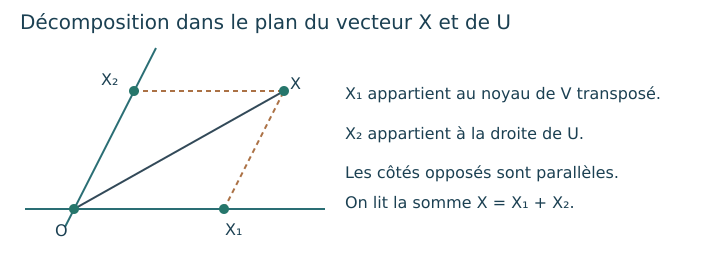

# Banque PT — Mathématiques A · 2017 · Corrigé guidé

*Corrigé rédigé par IA, non officiel. Signalez toute erreur.*

**Rédaction** · GPT-6.2 Astra Ultra · vitesse non renseignée

Le problème porte sur les puissances de matrices et les perturbations de rang un. L’exercice indépendant étudie deux temps d’attente géométriques. Les références I, II, III désignent les parties d’algèbre et P l’exercice de probabilités.

## Algèbre, partie I · Puissances d’une matrice symétrique

### Question I.1

> [!INDICATION]
> Observer les coefficients de part et d’autre de la diagonale.

#### Solution

La matrice réelle $A$ est symétrique, donc orthogonalement diagonalisable par le théorème spectral.

### Question I.2

> [!INDICATION]
> Écrire la matrice en utilisant celle dont tous les coefficients valent un.

#### Solution

Posons $e=(1,1,1)^T$ et $J=ee^T$. Alors $A=2I_3-J$ et $Jx=(x_1+x_2+x_3)e$. Ainsi $Ae=-e$ et $Ax=2x$ pour $x\in e^\perp$. La droite $\mathbb Re$ et le plan $x_1+x_2+x_3=0$, de base $(1,-1,0),(1,0,-1)$, sont supplémentaires. Les valeurs propres sont respectivement $-1$ et $2$, avec exactement ces espaces propres.

### Question I.3

> [!INDICATION]
> Utiliser le polynôme qui s’annule sur les deux valeurs propres.

#### Solution

Dans la base propre, $(A+I_3)(A-2I_3)=0$ car les deux coefficients diagonaux possibles annulent le produit. D’où $A^2=A+2I_3$. En multipliant par $A^{n-1}$, on trouve $A^{n+1}=A^n+2A^{n-1}$ pour $n\ge1$.

### Question I.4

> [!INDICATION]
> Une récurrence à deux pas demande deux initialisations.

#### Solution

Dans $I_3$, diagonale et hors-diagonale valent $(u_0,v_0)=(1,0)$. Pour $A$, ce couple vaut $(u_1,v_1)=(1,-1)$. Si les puissances d’indices $n-1,n$ ont chacune une diagonale constante et des termes hors diagonale constants, leur combinaison en I.3 a la même forme, avec $u_{n+1}=u_n+2u_{n-1}$ et $v_{n+1}=v_n+2v_{n-1}$. Cela établit simultanément la forme et les deux récurrences.

### Question I.5

> [!INDICATION]
> Résoudre la même récurrence avec deux jeux de conditions initiales.

#### Solution

L’équation caractéristique $r^2-r-2=0$ a pour racines $2,-1$. En imposant les valeurs initiales de I.4 à $c2^n+d(-1)^n$, on obtient $u_n=[2\cdot2^n+(-1)^n]/3$ et $v_n=[(-1)^n-2^n]/3$. Ces formules restituent aussi $A^0=I_3$.

## Algèbre, partie II · Polynôme annulateur et stabilité du rang

### Question II.1

> [!INDICATION]
> Éliminer successivement $V$ et $U$ à partir des deux premières puissances.

#### Solution

Les paramètres $\lambda,\mu$ sont distincts et non nuls. En soustrayant des multiples de $A$ à $A^2$, on trouve
$$
U=\frac{A^2-\mu A}{\lambda(\lambda-\mu)},\qquad
V=\frac{A^2-\lambda A}{\mu(\mu-\lambda)}.
$$
Dans $(\lambda+\mu)A^2-\lambda\mu A$, les coefficients de $U,V$ deviennent $\lambda^3,\mu^3$. La troisième identité de l’énoncé donne donc $A^3=(\lambda+\mu)A^2-\lambda\mu A$.

### Question II.2

> [!INDICATION]
> Les puissances scalaires de $\lambda$ et $\mu$ suivent la même récurrence.

#### Solution

Les deux premiers rangs sont les hypothèses. Pour $p\ge2$, on multiplie le résultat de II.1 par $A^{p-2}$ pour obtenir $A^{p+1}=(\lambda+\mu)A^p-\lambda\mu A^{p-1}$. Si la formule vaut aux rangs $p$ et $p-1$, le coefficient de $U$ devient $(\lambda+\mu)\lambda^p-\lambda\mu\lambda^{p-1}=\lambda^{p+1}$. Il en va de même pour $V$ avec $\mu$. Ainsi $A^p=\lambda^pU+\mu^pV$ pour tout $p\ge1$.

### Question II.3.a

> [!INDICATION]
> Composer par $f$ un vecteur déjà envoyé sur zéro.

#### Solution

Si $f(x)=0$, alors $f^p(x)=f^{p-1}(0)=0$ pour tout $p\ge1$. D’où $\ker f\subset\ker f^p$.

### Question II.3.b

> [!INDICATION]
> Vérifier la plus petite valeur de l’exposant avant de multiplier la relation cubique.

#### Solution

Pour $p\ge2$, la relation de II.2 appliquée à $x$ donne
$$
\lambda\mu\, f^{p-1}(x)=(\lambda+\mu)f^p(x)-f^{p+1}(x).
$$
Le sujet introduit $p\in\mathbb N^*$, qui inclut $p=1$. À ce rang la formule est fausse en général. Par exemple $A=U=V=0$, $\lambda=1,\mu=2$ satisfont les trois hypothèses, mais demanderaient $2x=0$ pour tout $x$. La suite requiert seulement la formule aux rangs $p\ge2$.

### Question II.3.c

> [!INDICATION]
> Descendre jusqu’à la première puissance, sans descendre à la puissance zéro.

#### Solution

Si $f^p(x)=0$ et $p\ge2$, alors $f^{p+1}(x)=0$. L’identité précédente et $\lambda\mu\ne0$ imposent $f^{p-1}(x)=0$. On répète cette implication jusqu’à $f(x)=0$. Pour $p=1$, l’inclusion est immédiate. Ainsi $\ker f^p\subset\ker f$ pour tout $p\ge1$.

### Question II.3.d

> [!INDICATION]
> Comparer les dimensions des noyaux dans le même espace de départ.

#### Solution

Les inclusions de II.3.a et II.3.c donnent $\ker f=\ker f^p$. Le théorème du rang appliqué aux endomorphismes de $\mathbb R^n$ donne $\operatorname{rg}(A)=n-\dim\ker f=n-\dim\ker f^p=\operatorname{rg}(A^p)$.

## Algèbre, partie III · Une matrice de rang un ajoutée à une homothétie

### Question III.1

> [!INDICATION]
> Le facteur à gauche a une seule ligne, celui à droite une seule colonne.

#### Solution

Le produit $V^TU$ est une matrice à une ligne et une colonne, identifiée au scalaire $k=\sum_{i=1}^n v_i u_i$.

### Question III.2

> [!INDICATION]
> Regrouper les deux facteurs centraux du produit de quatre matrices.

#### Solution

Pour $R=UV^T$, on a $R^2=U(V^TU)V^T=kR$. Comme $aI_n$ commute avec $R$, la matrice $A=aI_n+R$ vérifie $A^2=a^2I_n+(2a+k)R=(2a+k)A-(a^2+ak)I_n$. Le choix $\alpha=2a+k$ et $\beta=-a^2-ak$ convient.

### Question III.3

> [!INDICATION]
> Distinguer les entrées du produit colonne-ligne et celles de l’identité.

#### Solution

Le coefficient vaut $a_{ij}=a\delta_{ij}+u_i v_j$. La somme sur la diagonale donne $\operatorname{tr} A=na+\sum_i u_i v_i=na+V^TU$.

### Question III.4

> [!INDICATION]
> Remplacer le produit scalaire dans les coefficients précédents.

#### Solution

En reportant $k=\operatorname{tr} A-na$ dans III.2, on trouve $\alpha=\operatorname{tr} A-(n-2)a$ et $\beta=(n-1)a^2-a\operatorname{tr} A$.

### Question III.5

> [!INDICATION]
> Conserver un même vecteur propre non nul dans les deux identités.

#### Solution

Si $Ax=\lambda x$ avec $x\ne0$, alors $A^2x=\lambda^2x$, donc $\lambda^2$ est valeur propre de $A^2$. Par III.2, ce vecteur vaut aussi $(\alpha\lambda+\beta)x$. Comme $x\ne0$, on conclut $\lambda^2-\alpha\lambda-\beta=0$.

### Question III.6

> [!INDICATION]
> Factoriser avec $a$ et $k$ avant de substituer la trace.

#### Solution

Le polynôme est $(X-a)(X-a-k)$. Toute valeur propre appartient donc à $\{\lambda_1,\lambda_2\}$ où $\lambda_1=a$ et $\lambda_2=a+k=\operatorname{tr} A-(n-1)a$. Si $n=1$, la première valeur peut ne pas être atteinte.

### Question III.7.a

> [!INDICATION]
> Ici la trace de la perturbation est le produit scalaire $k$.

#### Solution

Comme $\operatorname{tr}(UV^T)=k\ne0$, les deux nombres sont distincts. Si $x$ appartient aux deux noyaux propres, $(\lambda_1-\lambda_2)x=0$ et donc $x=0$.

### Question III.7.b

> [!INDICATION]
> Analyser une éventuelle décomposition puis vérifier les candidats.

#### Solution

L’équation $X=X_1+X_2$ imposerait $AX=aX_1+(a+k)X_2$, donc $X_2=RX/k$ et $X_1=X-RX/k$. Réciproquement ces vecteurs ont somme $X$ et, puisque $R^2=kR$, vérifient $RX_1=0$ et $RX_2=kX_2$. Ils appartiennent donc aux espaces annoncés. Cela donne en particulier $E_1=\ker V^T$ et $E_2=\mathbb RU$.

### Question III.7.c

> [!INDICATION]
> Réunir des bases sur les deux espaces de la décomposition.

#### Solution

D’après III.7.a–b, $\mathbb R^n=E_1\oplus E_2$. La réunion de bases de ces espaces donne une base de vecteurs propres. Ainsi $A$ est diagonalisable, y compris lorsqu’un des espaces est nul.

### Question III.8

> [!INDICATION]
> Reprendre la matrice de tous les uns du début.

#### Solution

La matrice de la partie I vaut $2I_3-ee^T$. On choisit $a=2$, $U=e$, $V=-e$. Ici $k=-3\ne0$, et $a+k=-1$. On retrouve la droite et le plan de I.2.

## Probabilités · Deux temps d’attente géométriques

### Question P.1.a

> [!INDICATION]
> Sommer à partir du premier entier strictement supérieur à $n$.

#### Solution

Avec $q=1-p$, pour tout $n\ge0$, $\mathbb P(X>n)=\sum_{j=n+1}^\infty p q^{j-1}=q^n$. En particulier $\mathbb P(X>0)=1$.

### Question P.1.b

> [!INDICATION]
> Le premier succès en $j$ impose des échecs puis un succès.

#### Solution

Par indépendance, $\mathbb P(T=j)=\mathbb P(X_1=\cdots=X_{j-1}=0,\ X_j=1)=q^{j-1}p$ pour $j\ge1$. La probabilité de n’observer aucun succès est $\lim_{n\to\infty}q^n=0$. C’est bien la même loi que celle de $X$.

### Question P.2.a

> [!INDICATION]
> Écrire la série génératrice puis utiliser l’indépendance pour la somme.

#### Solution

Pour $|s|<1/q$, $G_X(s)=\sum_{j\ge1}p q^{j-1}s^j=ps/(1-qs)$. Comme $X,Y$ sont indépendantes et de même loi, $G_{X+Y}(s)=G_X(s)G_Y(s)=p^2s^2/(1-qs)^2$.

### Question P.2.b

> [!INDICATION]
> Identifier le coefficient de degré $n$ dans la série du carré.

#### Solution

Le développement $(1-u)^{-2}=\sum_{j\ge0}(j+1)u^j$ donne $\mathbb P(X+Y=n)=p^2(n-1)q^{n-2}$ pour $n\ge2$, et zéro pour $n<2$.

### Question P.2.c

> [!INDICATION]
> Sur la diagonale de somme $n$, calculer chaque probabilité conjointe.

#### Solution

Pour $1\le j\le n-1$, l’indépendance donne $\mathbb P(X=j,Y=n-j)=p^2q^{n-2}$. En divisant par le résultat précédent, on obtient $1/(n-1)$ pour chaque $j$ de cet intervalle, et zéro ailleurs. La loi conditionnelle est uniforme sur $\{1,\ldots,n-1\}$.

### Question P.3.a

> [!INDICATION]
> Dans chaque réalisation, ranger les deux nombres.

#### Solution

La plus petite valeur est $Z$ et la plus grande $T$. Les identités $X+Y=T+Z$ et $|X-Y|=T-Z$ en découlent y compris en cas d’égalité.

### Question P.3.b

> [!INDICATION]
> Décomposer l’événement d’égalité par sa valeur commune.

#### Solution

Les événements $\{X=Y=j\}$ sont disjoints. On a $\mathbb P(X=Y)=\sum_{j\ge1}p^2q^{2j-2}=p^2/(1-q^2)=p/(1+q)$.

### Question P.3.c

> [!INDICATION]
> Le minimum dépasse $n$ si les deux variables dépassent $n$.

#### Solution

Pour $n\ge0$, l’indépendance donne $\mathbb P(Z>n)=q^{2n}$. Ainsi $\mathbb P(Z=j)=(1-q^2)(q^2)^{j-1}$ pour $j\ge1$. Le minimum suit la loi géométrique de paramètre $1-q^2$.

### Question P.3.d

> [!INDICATION]
> Pour le maximum, travailler sur l’événement complémentaire de celui utilisé pour le minimum.

#### Solution

Pour $n\ge0$, $\mathbb P(T\le n)=\mathbb P(X\le n,Y\le n)=(1-q^n)^2$. Par différence, pour $j\ge1$,
$$
\mathbb P(T=j)=(1-q^j)^2-(1-q^{j-1})^2
=2p q^{j-1}-(1-q^2)q^{2j-2}.
$$
La probabilité est nulle pour les autres entiers.

## Sources et rapport du jury

Le rapport 2017, p. 2–3, demande de justifier la récurrence sur les puissances et de distinguer le produit colonne-ligne de son produit scalaire transposé. Il souligne aussi le rôle des séries géométriques dans l’exercice de probabilités. Le contre-exemple donné en II.3.b relève de notre vérification du texte imprimé.

[Énoncé de la Banque PT](https://www.banquept.fr/documents/2017/math_a_2017_pt.pdf) · [Rapport du jury](https://www.banquept.fr/documents/ecrit/rapport/2017/rapport_math_a_ecrit_2017.pdf)
