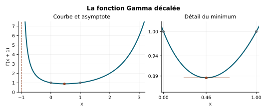
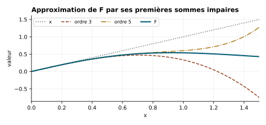

# Banque PT — Mathématiques C · Session 2017 · Corrigé brut

*Corrigé rédigé par IA, non officiel. Signalez toute erreur.*

**Rédaction** · GPT-6.2 Astra Ultra · vitesse non renseignée

Le préambule compare une fonction à ses tangentes. En I, on étudie $G(x)=\int_0^\infty e^{-t}t^x dt$ pour $x\ge0$. En II, le produit d’une exponentielle et d’une primitive fournit une identité binomiale.

Écrit de quatre heures, sans calculatrice. Une feuille de papier millimétré est à rendre avec la copie. La grille d’admissibilité attribue à Math C le coefficient 6 pour l’École polytechnique et 3 pour chacune des ENS Paris-Saclay et Rennes. [Sujet](https://www.banquept.fr/documents/2017/math_c_2017_pt.pdf) · [Livret, p. 12](https://www.banquept.fr/documents/livret/2017/Livret_PT_2017.pdf#page=12)

Le rapport, pages 4 et 6–8, demande notamment de justifier les majorants des dérivées sous l’intégrale, la limite à l’infini et le produit de Cauchy final. [Rapport du jury](https://www.banquept.fr/documents/ecrit/rapport/2017/rapport_math_c_ecrit_2017.pdf)

## Préambule. Une courbe et ses tangentes

### Question P.1

Si $u<v$, que $f$ est continue sur $[u,v]$ et dérivable sur $]u,v[$, le théorème des accroissements finis assure l’existence de $c\in]u,v[$ tel que $f(v)-f(u)=(v-u)f'(c)$.

### Question P.2

Pour $x\ne x_0$ dans $I$, le segment d’extrémités $x,x_0$ est inclus dans $I$. La dérivabilité de $f$ y assure la continuité nécessaire. P.1 fournit un point $c_{x,x_0}$ strictement entre ces abscisses tel que $(f(x)-f(x_0))/(x-x_0)=f'(c_{x,x_0})$, quel que soit leur ordre.

### Question P.3

Si $x<x_0$, alors $c_{x,x_0}<x_0$ et la stricte croissance de $f'$ donne $f'(c_{x,x_0})-f'(x_0)<0$. Ainsi $f(x)-f(x_0)-(x-x_0)f'(x_0)=(x-x_0)(f'(c_{x,x_0})-f'(x_0))>0$, produit de deux quantités négatives.

### Question P.4

Pour $x>x_0$, on a $c_{x,x_0}>x_0$. La stricte croissance de $f'$ donne $f'(c_{x,x_0})-f'(x_0)>0$. Le produit de cette différence par $x-x_0>0$ est strictement positif, ce qui donne la même inégalité.

### Question P.5

La tangente en $x_0$ a pour équation $y=f(x_0)+(x-x_0)f'(x_0)$.

### Question P.6

P.3 et P.4 donnent pour toute abscisse $x\ne x_0$ une ordonnée de la courbe strictement supérieure à celle de la tangente en $x_0$. Il y a égalité au point de tangence. La même propriété vaut pour chaque $x_0$.

## I. Intégrale à paramètre et prolongement de la fonction Gamma

### Question I.1

Pour $x\ge0$, l’intégrande $e^{-t}t^x$ est continu sur $]0,+\infty[$, borné par 1 sur $]0,1]$ et dominé sur $[1,+\infty[$ par $C_x e^{-t/2}$ car $t^xe^{-t/2}$ y est borné. Les deux majorants sont intégrables. L’intégrale $G(x)$ converge.

### Question I.2

On obtient $G(0)=\int_0^\infty e^{-t}dt=[-e^{-t}]_0^\infty=1$.

### Question I.3

Avec $t=u^2$, $G(1/2)=2\int_0^\infty u^2 e^{-u^2}du$. Sur $[0,B]$, intégrer $u\cdot 2u e^{-u^2}$ donne $[-ue^{-u^2}]_0^B+\int_0^B e^{-u^2}du$. Le terme de bord tend vers zéro. La valeur gaussienne donnée est donc $G(1/2)=\sqrt\pi/2$.

### Question I.4.a

Si $0<t\le1$ et $0\le x\le A$, alors $t^x\le1$. Si $t\ge1$, on a $t^x\le t^A$. Dans les deux cas $|e^{-t}t^x|\le (1+t^A)e^{-t}$.

### Question I.4.b

Pour tout $t>0$, l’intégrande est continu en $x$. La borne de I.4.a est indépendante de $x\in[0,A]$ et intégrable par I.1 appliqué aux exposants 0 et $A$. Le théorème de continuité des intégrales à paramètre donne la continuité de $G$ sur $[0,A]$.

### Question I.4.c

La dérivée partielle d’ordre $m$ en $x$ est $e^{-t}t^x(\log t)^m$, continue en $x$ pour chaque $t>0$. Sur $]0,1]$, son module est majoré par $|\log t|^m$, intégrable puisque $t=e^{-u}$ ramène l’intégrale à $\int_0^\infty u^m e^{-u}du$. Sur $[1,+\infty[$, $t^A(\log t)^m e^{-t}\le C_{A,m}e^{-t/2}$, aussi intégrable. Ces bornes uniformes pour tout ordre permettent de dériver successivement sous le signe intégral. On obtient $G\in C^\infty([0,A])$, avec dérivées unilatérales aux bords.

### Question I.4.d

Tout réel $x\ge0$ appartient à un segment $[0,A]$ avec $A>x$. La formule précédente est indépendante de $A$. On a donc $G\in C^\infty(\mathbb R_+)$ et, pour tout $n\ge0$,
$$
G^{(n)}(x)=\int_0^\infty e^{-t}t^x(\log t)^n dt .
$$

### Question I.5

Sur un segment compact de $]0,+\infty[$, intégrer $t^{x+1}e^{-t}$ par parties donne le bord $-t^{x+1}e^{-t}$ et l’intégrale de $(x+1)t^x e^{-t}$. Le bord tend vers zéro en zéro car $x+1>0$, et à l’infini par domination exponentielle. Donc $G(x+1)=(x+1)G(x)$.

### Question I.6

On a $G(0)=1=0!$. Si $G(n)=n!$, alors I.5 donne $G(n+1)=(n+1)n!=(n+1)!$. Par récurrence $G(n)=n!$ pour tout entier naturel $n$.

### Question I.7

Pour $x>-1$, $x+1>0$, si bien que $\widetilde G(x)=G(x+1)/(x+1)$ est de classe $C^\infty$ par composition et quotient. Pour $x\ge0$, I.5 donne $\widetilde G(x)=G(x)$. C’est le prolongement demandé.

### Question I.8

Lorsque $x\to-1^+$, $(x+1)\widetilde G(x)=G(x+1)\to G(0)=1$ par continuité. Donc $\widetilde G(x)\sim1/(x+1)$.

### Question I.9

Posons $s=x+1>0$. Deux dérivations donnent
$$
\widetilde G''(x)=G''(s)/s-2G'(s)/s^2+2G(s)/s^3 .
$$
D’après I.4.d, les trois expressions sous l’intégrale ont le même facteur, d’où
$$
s^3\widetilde G''(x)=\int_0^\infty e^{-t}t^s\big[(s\log t)^2-2s\log t+2\big]dt.
$$

### Question I.10

Pour tout $X\in\mathbb R$, $X^2-2X+2=(X-1)^2+1\ge1$. L’intégrande de I.9 est donc au moins $e^{-t}t^s>0$ pour $t>0$. Son intégrale est strictement positive et $s^3>0$, donc $\widetilde G''(x)>0$ sur $]-1,+\infty[$.

### Question I.11

La positivité stricte de $\widetilde G''$ entraîne la stricte croissance de $\widetilde G'$. P.6 s’applique à $\widetilde G$. Son graphe se trouve strictement au-dessus de chacune de ses tangentes en dehors de leur point de contact.

### Question I.12

I.6 donne $\widetilde G(0)=0!=1=1!=\widetilde G(1)$. La fonction est continue sur $[0,1]$ et dérivable sur $]0,1[$. Le théorème de Rolle fournit $c\in]0,1[$ tel que $\widetilde G'(c)=0$. La tangente y est horizontale.

### Question I.13

La dérivée strictement croissante s’annule une seule fois. Elle est négative sur $]-1,c[$ et positive sur $]c,+\infty[$. À gauche I.8 donne la limite $+\infty$. À droite, $\widetilde G$ est croissante et $\widetilde G(n)=n!\to+\infty$, donc sa limite est encore $+\infty$. Le tableau de variations est
$$
\begin{array}{c|ccccc}
x&-1&&c&&+\infty\\\hline
\widetilde G'(x)&&-&0&+&\\
\widetilde G(x)&+\infty&\searrow&\widetilde G(c)&\nearrow&+\infty
\end{array}
$$

### Question I.14

La droite $x=-1$ est asymptote verticale. La branche descend jusqu’au minimum donné $(0{,}46,0{,}89)$ puis remonte. Elle passe par $(0,1),(1,1),(2,2),(3,6)$. Elle est convexe sur tout son domaine et tangente à l’horizontale au minimum. Le dessin utilise $\widetilde G(x)=\Gamma(x+1)$, notation usuelle de la fonction intégrale prolongée.

## II. Équation différentielle et produit de séries

### Question II.1

La formule $F(x)=e^{-x^2}\int_0^x e^{t^2}dt$, donnée pour les réels positifs, a un sens pour tout $x\in\mathbb R$ par l’intégrale orientée. L’intégrande est continu sur $\mathbb R$, donc $H(x)=\int_0^x e^{t^2}dt$ est dérivable, de dérivée $e^{x^2}$. Le produit de $H$ par la fonction dérivable $e^{-x^2}$ est dérivable sur $\mathbb R$.

### Question II.2

La série exponentielle a un rayon infini. Les substitutions $t^2$ et $-x^2$ donnent les séries de $e^{t^2}$ et $e^{-x^2}$, convergentes pour tout réel. La primitivation terme à terme, valable sur tout compact avec conservation du rayon, donne une série de rayon infini pour $H$. Le produit de Cauchy de ces deux séries entières à convergence absolue en tout $x$ représente $F$ sur $\mathbb R$.

### Question II.3

La règle du produit et II.1 donnent $F'(x)=-2xe^{-x^2}H(x)+e^{-x^2}e^{x^2}=-2xF(x)+1$. On a aussi $F(0)=0$.

### Question II.4

Écrivons $F=\sum_{n\ge0}a_nx^n$. Le terme constant donne $a_0=F(0)=0$. La dérivation des séries de rayon infini fournit $F'=\sum_{n\ge0}(n+1)a_{n+1}x^n$. En identifiant à $1-2xF$, on trouve $a_1=1$ et $(n+1)a_{n+1}=-2a_{n-1}$ pour $n\ge1$.

### Question II.5

Les coefficients pairs sont tous nuls, en partant de $a_0=0$. Pour $p\ge0$, $a_{2p+1}=(-2)^p/(3\cdot5\cdots(2p+1))$, le produit vide valant 1. Comme $(2p+1)!=2^p p!\,(1\cdot3\cdots(2p+1))$, on obtient $a_{2p+1}=(-1)^p4^p p!/(2p+1)!$.

### Question II.6

Pour tout réel $x$, la série obtenue est
$$
F(x)=\sum_{p=0}^\infty\frac{(-1)^p4^p p!}{(2p+1)!}x^{2p+1}.
$$

### Question II.7

Pour $u_n=4^n n!/(2n+1)!$, $u_{n+1}/u_n=4(n+1)/((2n+3)(2n+2))=2/(2n+3)\to0$. Le critère de d’Alembert donne la convergence de $\sum u_n$, donc la série proposée converge absolument. Sa somme est $F(1)$ par II.6.

### Question II.8

En primitivant terme à terme sur tout segment, on a $H(x)=\sum_{k\ge0}x^{2k+1}/((2k+1)k!)$. Dans $F=e^{-x^2}H$, le coefficient de $x^{2n+1}$ est
$$
\sum_{k=0}^n\frac{(-1)^{n-k}}{(n-k)!(2k+1)k!}
=\frac{(-1)^n4^n n!}{(2n+1)!},
$$
où l’égalité à droite vient de II.5 et de l’unicité des coefficients. Multiplier par $(-1)^n n!$ et utiliser $\binom{2n}{n}=(2n)!/(n!)^2$ donne
$$
\sum_{k=0}^n\frac{(-1)^k}{2k+1}\binom nk
=\frac{4^n}{(2n+1)\binom{2n}{n}} .
$$
