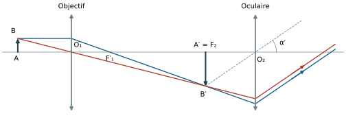
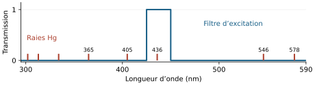
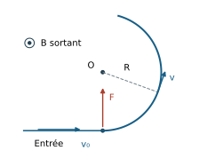
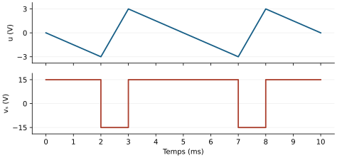
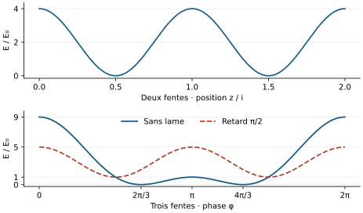
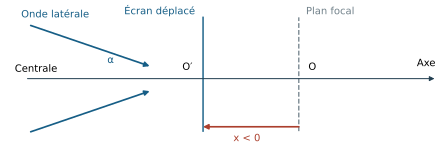

# Banque PT 2017 — Physique A · Corrigé guidé

*Corrigé rédigé par IA, non officiel. Signalez toute erreur.*

**Rédaction** · GPT-6.2 Astra Ultra · vitesse non renseignée · 26 novembre 2026

**Révision (tour 1)** · GPT-6.2 Astra Ultra · vitesse non renseignée · 26 novembre 2026

**Microscopie et mesure d’épaisseur.** Épreuve de quatre heures, sans calculatrice. Les quatre parties utilisent successivement un microscope optique, un microscope électronique à balayage, son électronique et un interféromètre à trois fentes. Les mesures sur les figures sont exprimées à la précision du feuillet.

[Sujet officiel](https://www.banquept.fr/documents/2017/ph_a_2017_pt.pdf) · [Rapport du jury](https://www.banquept.fr/documents/ecrit/rapport/2017/rapport_phys_a_ecrit_2017.pdf)

## A · Microscope optique

### A.1.1 · Conditions de Gauss

**Indication.** Compare à l’axe à la fois la position et la direction d’un rayon.

On utilise des rayons proches de l’axe optique et faiblement inclinés par rapport à cet axe. Dans cette approximation paraxiale, le sinus et la tangente d’un angle s’identifient à sa valeur en radians. On peut appliquer les relations de conjugaison aux rayons ainsi sélectionnés.

### A.1.2 · Intervalle optique

**Indication.** Repère les deux foyers utiles sur un axe orienté partant de l’objectif.

Les abscisses de $F'_1$ et $F_2$, comptées depuis $O_1$ vers la droite, sont $f'_1$ et $D_0-f'_2$. Leur différence donne $\Delta=D_0-f'_1-f'_2=120-5-15=100\,\mathrm{mm}$.

### A.1.3.1 · Placer l’objet

**Indication.** Le plan focal objet de l’oculaire est déjà la position de l’image intermédiaire. Utilise d’abord cette distance signée.

Le pied de l’image intermédiaire est $A'=F_2$ et $\overline{O_1A'}=f'_1+\Delta=105\,\mathrm{mm}$. L’objet est réel à gauche, donc $\overline{O_1A}=-d$. La conjugaison donne $1/(f'_1+\Delta)+1/d=1/f'_1$, d’où
$$d=f'_1\frac{f'_1+\Delta}{\Delta}=5{,}25\,\mathrm{mm}.$$
L’objet est légèrement en amont du foyer objet de l’objectif.

### A.1.3.2 · Grandissement de l’objectif

**Indication.** Avec le même sens positif pour les abscisses sur toute la figure, le pied de l’objet et celui de son image sont de part et d’autre de l’objectif.

Par le rayon non dévié en $O_1$, $\gamma_1=\overline{O_1A'}/\overline{O_1A}=-(f'_1+\Delta)/d=-\Delta/f'_1=-20$. L’image intermédiaire est réelle, renversée et vingt fois plus grande en dimension linéaire.

### A.1.3.3 · Observer sans accommoder

**Indication.** Demande-toi où l’oculaire forme l’image d’un point de son plan focal objet.

Chaque point de l’image intermédiaire est dans le plan focal objet de l’oculaire. Les rayons qui en sont issus ressortent parallèles, donc l’image finale est à l’infini. L’œil emmétrope observe ainsi sans effort d’accommodation.

### A.1.3.4 · Construction des deux images

**Indication.** Trace d’abord deux rayons issus du sommet de l’objet. À la sortie de l’oculaire, construis la direction plutôt qu’un point de rencontre à distance finie.

Depuis $B$, le rayon passant par $O_1$ traverse l’objectif sans changer de direction. Un second rayon incident parallèle à l’axe ressort en passant par $F'_1$. Ils se rencontrent en $B'$ au-dessous de l’axe. Le rayon de $B'$ passant par $O_2$ fixe la direction du faisceau final. Les deux rayons émergeant de l’oculaire sont parallèles. Les distances sont schématiques sur le dessin afin de rendre visibles les angles.

### A.1.4 · Grossissement commercial

**Indication.** Compare l’angle dû à l’image intermédiaire et l’angle que sous-tendait l’objet initial à 25 cm.

En valeur absolue, $|\alpha'|\simeq|A'B'|/f'_2$ et $|\alpha|\simeq|AB|/D$. On en déduit $|G|=\Delta D/(f'_1 f'_2)=100\times250/(5\times15)\simeq333$. L’instrument grossit donc environ 333 fois. Si les deux angles apparents sont orientés par rapport à la même verticale de l’objet observé, l’image étant renversée, le grossissement algébrique vaut $-333$.

### A.1.5.1 · Lire la vis micrométrique

**Indication.** Sur le cliché agrandi, distingue la rangée des millimètres de celle des demi-millimètres. Prolonge leur ligne de séparation sur le tambour et compte les divisions depuis 40 dans le sens du déplacement.

Sur la figure 3, la ligne de référence se situe entre les graduations entières et les demi-millimètres du manchon. Son prolongement coupe le tambour environ deux divisions sous le zéro, à **48** sur les 50 divisions. Un tour d’une vis micrométrique de pas $0{,}5\,\mathrm{mm}$ vaut 50 divisions, soit $0{,}01\,\mathrm{mm}$ chacune. Pour le petit déplacement par dévissage, on passe de 40 à 48, d’où $\varepsilon\simeq0{,}080\,\mathrm{mm}$.

Avec la position initiale donnée sur un trait, une demi-division de lecture finale représente une borne de $0{,}005\,\mathrm{mm}$ et une incertitude-type de $0{,}005/\sqrt3\simeq0{,}003\,\mathrm{mm}$ pour une loi uniforme. Si les deux lectures sont jugées également incertaines et indépendantes, l’incertitude-type de leur différence vaut environ $0{,}004\,\mathrm{mm}$. La lecture du cliché et l’hypothèse d’un petit déplacement ne permettent pas de compter des tours supplémentaires.

### A.1.5.2 · Épaisseur réelle et profondeur apparente

**Indication.** Trace le prolongement, dans le verre, d’un rayon réellement réfracté dans l’air. Le microscope vise le point d’où semble venir ce rayon.

En sortant du verre, un rayon issu de la pastille bleue et arrivant sur la face droite à la hauteur $h$ vérifie $h=e\tan i=\varepsilon\tan r$. Dans l’air, Snell-Descartes donne $n\sin i=\sin r$, donc $r\simeq ni$. Ainsi $\varepsilon=e/n$ et **$e=n\varepsilon\simeq0{,}120\,\mathrm{mm}$**. Avec $n$ tenu pour exact et une incertitude-type de $0{,}003\,\mathrm{mm}$ sur le déplacement, celle sur $e$ est voisine de $0{,}005\,\mathrm{mm}$. Le déplacement correspond à la séparation apparente des deux pastilles.

### A.2.1.1 · Domaines de la lampe

**Indication.** Lis les raies de part et d’autre de la limite voisine de 400 nm.

Les raies vers 302, 313, 334 et 365 nm sont dans l’ultraviolet. Celles vers 405, 436, 546 et 578 nm se trouvent dans le visible, du violet au jaune. Ce sont les deux domaines présents sur le profil de la figure 5.

### A.2.1.2 · Filtre barrière devant le détecteur

**Indication.** Un filtre devant le détecteur doit écarter la lumière incidente diffusée, qui peut être beaucoup plus intense que la fluorescence.

Le FITC absorbe surtout du côté des courtes longueurs d’onde et émet du côté du vert. Si l’on veut protéger le détecteur de la lumière d’excitation, le **filtre 2** est le mieux adapté des deux profils de la figure 6. Sa transmission est voisine de zéro dans le domaine d’excitation et il transmet une partie de la fluorescence aux longueurs d’onde plus grandes. Le filtre 1 transmet davantage de fluorescence, mais son plateau résiduel à courte longueur d’onde peut laisser un fond d’excitation important. Le choix dépend donc ici de la fonction de rejet demandée.

### A.2.1.3 · Profil du filtre d’excitation

**Indication.** Il faut choisir simultanément une bande d’absorption de l’échantillon et une raie effectivement émise par la lampe.

On peut utiliser un filtre passe-bande transmettant fortement autour de la raie bleue de 436 nm et bloquant l’UV ainsi que le vert et le jaune. Par exemple, une fenêtre idéale de 425 à 450 nm sélectionne une raie recouvrant la bande d’absorption du FITC et bloque les raies du mercure qui contamineraient la fluorescence. Un filtre plus large peut aussi retenir la raie de 405 nm si cette contribution est voulue.

### A.2.1.4 · Source laser

**Indication.** Compare par exemple la propagation spatiale des deux sources.

Un laser peut fournir un faisceau très directif et spatialement cohérent dans une bande spectrale étroite. Une lampe spectrale ordinaire émet dans de multiples directions et le mercure présente ici plusieurs raies séparées. La directivité du faisceau est déjà une différence suffisante.

### A.2.2.1 · Propagation et polarisation

**Indication.** Pour déterminer dans quel sens avance un maximum, maintiens constante la phase du cosinus.

Une surface de phase constante vérifie $\omega t-kz=\mathrm{constante}$. Elle se déplace vers les $z$ croissants à la vitesse $\omega/k$. Le champ électrique oscille selon $\vec u_x$, ce qui correspond à une polarisation rectiligne suivant $x$.

### A.2.2.2 · Célérité dans le vide

**Indication.** Vérifie que l’inverse du produit des constantes électromagnétiques a l’unité d’une vitesse au carré.

Les équations de Maxwell dans le vide donnent $c=1/\sqrt{\mu_0\varepsilon_0}$. Les données du sujet conduisent à $\mu_0\varepsilon_0=1/(9\times10^{16})$ en unités SI et donc $c=3{,}0\times10^8\,\mathrm{m\,s^{-1}}$.

### A.2.2.3 · Nombre d’onde et pulsation

**Indication.** Utilise une longueur d’onde en mètres et distingue la fréquence de la pulsation.

Avec $\lambda=628\times10^{-9}\,\mathrm m$, $k=2\pi/\lambda\simeq1{,}0\times10^7\,\mathrm{rad\,m^{-1}}$ et $\omega=ck\simeq3{,}0\times10^{15}\,\mathrm{rad\,s^{-1}}$.

### A.2.2.4 · Champ magnétique

**Indication.** Le trièdre électrique, magnétique, propagation doit être direct.

Pour une onde plane progressive dans le vide, $\vec B=\vec u_z\times\vec E/c$. Le trièdre direct donne
$$\vec B=(E_0/c)\cos(\omega t-kz)\,\vec u_y.$$
Les deux champs ont même phase et $\vec E\times\vec B$ est orienté vers $+z$.

### A.2.2.5 · Amplitude électrique du laser

**Indication.** Passe du flux énergétique moyen à la puissance moyenne à travers toute la section. Une aire en millimètres carrés demande un facteur d’un million.

La valeur moyenne du vecteur de Poynting a pour module $E_0^2/(2\mu_0c)$, car la moyenne de $\cos^2$ est $1/2$. Pour le faisceau uniforme décrit, $P=sE_0^2/(2\mu_0c)$, d’où
$$E_0=\sqrt{\frac{2\mu_0cP}{s}}\simeq1{,}0\times10^4\,\mathrm{V\,m^{-1}},$$
avec $s=0{,}75\times10^{-6}\,\mathrm{m^2}$.

### A.2.3 · Résolution du microscope

**Indication.** Imagine l’image donnée par l’objectif d’une source ponctuelle.

La diffraction par la pupille de l’objectif transforme l’image d’un point en une tache. Deux points trop proches donnent des taches difficilement séparables. Pour une pupille circulaire, la résolution latérale typique est de l’ordre de $0{,}61\lambda/\mathrm{ON}$ selon le critère de Rayleigh, où $\mathrm{ON}$ est l’ouverture numérique.

## B · Microscope électronique à balayage

### B.1.1 · Choix de l’électrode d’émission

**Indication.** Une charge négative gagne de l’énergie cinétique en allant vers un potentiel plus élevé.

Le champ électrique va du potentiel le plus élevé $V_1$ vers le plus faible $V_2$. L’électron de charge négative s’accélère en sens opposé au champ. Il doit donc être émis sur l’armature 2 et atteint l’armature 1.

### B.1.2 · Équation de Poisson

**Indication.** Applique Maxwell-Gauss au gradient du potentiel, en conservant le signe de la relation entre champ et potentiel.

Maxwell-Gauss donne $\operatorname{div}\vec E=\rho/\varepsilon_0$. Avec $\vec E=-\operatorname{grad} V$ en électrostatique, $\nabla^2 V=-\rho/\varepsilon_0$. En négligeant la charge d’espace des électrons dans le vide du canon, on retrouve l’équation de Laplace $\nabla^2V=0$.

### B.1.3 · Potentiel et champ entre les armatures

**Indication.** Fixe la constante d’intégration grâce à l’armature de départ avant de calculer le gradient.

L’axe $+z$ va de l’électrode 2 à l’électrode 1. L’intégration de $V''(z)=0$ avec $V(0)=V_2$ et $V(d)=V_1$ donne $V(z)=V_2+Uz/d$. Le champ est uniforme, $\vec E=-(U/d)\vec u_z$. Pour $d=1\,\mathrm{cm}$ et $U=10^5\,\mathrm V$, son module vaut $10^7\,\mathrm{V\,m^{-1}}$.

### B.1.4.1 · Vitesse classique

**Indication.** Calcule le travail de la force électrique entre les armatures. Compare ensuite la vitesse trouvée à celle de la lumière.

Le travail électrique entre les électrodes vaut $q(V_2-V_1)=eU$. Partant du repos, l’électron acquiert $mv^2/2=eU$. Les valeurs arrondies de l’énoncé donnent $v=\sqrt{2eU/m}=2{,}0\times10^8\,\mathrm{m\,s^{-1}}$, environ deux tiers de la vitesse de la lumière. La mécanique classique est donc insuffisante pour une grande précision.

### B.1.4.2 · Longueur d’onde classique

**Indication.** L’impulsion dans cette sous-question est celle du modèle classique.

Par la relation de de Broglie, $\lambda_{\rm cl}=h/(mv)=(h/m)/v$. Avec $h/m\simeq7\times10^{-4}\,\mathrm{m^2\,s^{-1}}$, on obtient $3{,}5\times10^{-12}\,\mathrm m$, soit $3{,}5\,\mathrm{pm}$.

### B.1.5.1 · Correction relativiste

**Indication.** Le travail de la force électrique est connu. Élimine ensuite la vitesse entre l’impulsion et le facteur relativiste.

Le travail électrique reste $eU$. Ainsi $(\gamma-1)mc^2=eU$, soit $\gamma=1+eU/(mc^2)$. De la définition de $\gamma$, on tire $\gamma v=c\sqrt{\gamma^2-1}$. L’impulsion est donc $p=mc\sqrt{\gamma^2-1}$ et la longueur d’onde corrigée vaut $\lambda_{\rm rel}=h/[mc\sqrt{\gamma^2-1}]$.

### B.1.5.2 · Application relativiste

**Indication.** Commence par le rapport sans dimension de l’énergie électrique à l’énergie de masse.

Les données approchées conduisent à $\gamma=1+2/9=11/9$. Puis $\sqrt{\gamma^2-1}\simeq0{,}70$ et $\lambda_{\rm rel}\simeq (7\times10^{-4})/(3\times10^8\times0{,}70)\simeq3{,}3\,\mathrm{pm}$. On aurait alors $v=c\sqrt{1-\gamma^{-2}}\simeq1{,}72\times10^8\,\mathrm{m\,s^{-1}}$.

### B.1.5.3 · Portée des résultats

**Indication.** Compare les deux longueurs d’onde électroniques, puis compare-les à une longueur d’onde optique.

La longueur d’onde classique est supérieure d’environ 5 % à la valeur relativiste pour les constantes imposées. L’ordre de grandeur est inchangé, mais la correction est mesurable. La longueur d’onde électronique est environ cent mille fois plus courte que celle de la lumière visible. La limite de résolution par diffraction peut donc être beaucoup plus fine. L’ouverture, les aberrations et les interactions de l’échantillon influent sur la résolution effectivement atteinte.

### B.2.1 · Pourquoi la norme de la vitesse est constante

**Indication.** Un produit scalaire avec la vitesse permet de décider si la force change l’énergie.

La force magnétique $\vec F=-e\vec v\times\vec B$ est orthogonale à $\vec v$. Sa puissance est nulle, donc l’énergie cinétique et la norme de la vitesse restent constantes. La direction de la vitesse change.

### B.2.2.1 · Courbure du trajet

**Indication.** Fixe explicitement le sens du champ par rapport au plan du dessin avant d’appliquer la règle du produit vectoriel.

Choisissons un champ $\vec B$ sortant du plan et une vitesse d’entrée vers la droite. Alors $\vec v_0\times\vec B$ pointe vers le bas de la figure. Pour la charge négative, la force est vers le haut, en direction du centre du cercle. À tout instant, la vitesse est tangente au cercle.

### B.2.2.2 · Rayon non relativiste

**Indication.** La vitesse est perpendiculaire au champ. La force magnétique doit fournir l’accélération normale.

En norme, l’équation normale donne $mv_0^2/R=e v_0B$. Pour une incidence perpendiculaire au champ, $R=mv_0/(eB)$. Une particule plus rapide est moins fortement courbée pour un même champ.

### B.2.3 · Rayon relativiste

**Indication.** Cherche la dérivée d’un vecteur de norme constante qui tourne à la vitesse angulaire du mouvement.

L’énergie reste constante et $\gamma$ aussi. On identifie la norme de $\mathrm d\vec p/\mathrm dt$, égale à $pv_0/R$, à $e v_0B$. Il vient $R=p/(eB)=\gamma mv_0/(eB)$, avec la vitesse relativiste du faisceau.

### B.3.1 · Symétrie cylindrique du champ

**Indication.** Une réflexion dans un plan méridien renverse le sens des courants azimutaux. Le champ magnétique est un vecteur axial.

Des rotations autour de l’axe laissent le bobinage idéal inchangé. Dans la base cylindrique, les composantes ne dépendent donc pas de $\theta$. Tout plan méridien contenant l’axe est un plan d’antisymétrie de la distribution azimutale des courants. Le champ magnétique, vecteur axial, appartient à ce plan en chacun de ses points. Sa composante azimutale est nulle, d’où $\vec B=B_r(r,z)\vec u_r+B_z(r,z)\vec u_z$.

### B.3.2 · Zone de champ intense

**Indication.** Compare l’espacement des lignes aux différentes positions près de l’axe.

Sur la figure 8, les lignes de champ se resserrent dans la zone centrale intérieure du bobinage, au voisinage de l’axe et du plan médian. Pour des tubes portant le même flux, la densité des lignes y indique le champ le plus intense.

### B.3.3 · Équations cylindriques de la lentille

**Indication.** Développe d’abord le produit vectoriel dans la base locale directe. Les termes d’accélération dus à la rotation de la base demeurent.

La vitesse est $\dot r\vec u_r+r\dot\theta\vec u_\theta+\dot z\vec u_z$. Ses composantes d’accélération sont $\ddot r-r\dot\theta^2$, $r\ddot\theta+2\dot r\dot\theta$ et $\ddot z$. Le produit vectoriel par le champ a pour composantes $r\dot\theta B_z$, $\dot zB_r-\dot rB_z$ et $-r\dot\theta B_r$. Par $m\vec a=-e\vec v\times\vec B$, on obtient exactement
$$\begin{aligned}
\ddot r-r\dot\theta^2&=-\frac em r\dot\theta B_z,\\
\frac1r\frac{\mathrm d}{\mathrm dt}(r^2\dot\theta)&=\frac em(\dot rB_z-\dot zB_r),\\
\ddot z&=\frac em r\dot\theta B_r.
\end{aligned}$$

### B.3.4 · Relation de conjugaison magnétique

**Indication.** Intègre sur l’épaisseur de la lentille pour obtenir une différence de pentes. À l’entrée, la distance objet est algébriquement négative.

Intégrons l’équation admise entre $-z_0$ et $+z_0$. Avec $I=\int_{-z_0}^{z_0}B_z^2\,\mathrm dz$, la variation de pente vaut $r'(+z_0)-r'(-z_0)=-e^2r_0 I/(4m^2v_0^2)$. Les deux prolongements rectilignes donnent respectivement les pentes de sortie $-r_0/\overline{OA'}$ et d’entrée $-r_0/\overline{OA}$. Après simplification,
$$\frac1{\overline{OA'}}-\frac1{\overline{OA}}=\frac1{f'},\qquad f'=\frac{4m^2v_0^2}{e^2 I}.$$
L’intégrale est positive. La lentille est convergente et cette expression a bien la dimension d’une longueur.

### B.3.5 · Réglage de la focale

**Indication.** Cherche ce qui change l’intégrale du carré du champ sans toucher à l’énergie des électrons.

À tension accélératrice fixée, la vitesse d’entrée est fixée. On agit sur $I$ en modifiant le courant du bobinage. Pour une bobine linéaire de géométrie fixe, $B_z$ est proportionnel au courant et $f'$ varie comme son inverse au carré. La géométrie, le nombre de spires ou un circuit magnétique modifient aussi $I$ à la conception. Renverser seulement le courant conserve $I$.

## C · Électronique du microscope

### C.1.1 · Modèle de l’ALI idéal

**Indication.** Précise quand l’égalité des tensions d’entrée est applicable.

Le gain différentiel en boucle ouverte est infini, les courants d’entrée sont nuls, l’impédance d’entrée est infinie, celle de sortie nulle et la réponse est instantanée. Avec les alimentations imposées, la sortie est bornée à $\pm V_0$. En régime linéaire à rétroaction négative, les potentiels d’entrée sont égaux. En saturation, le signe de $V_+-V_-$ détermine la saturation correspondante.

### C.1.2 · Identifier le comparateur

**Indication.** Suis chaque retour de la sortie vers l’entrée correspondante.

L’ALI 2 reçoit sa propre sortie sur son entrée positive à travers $R_4$. Cette réaction positive rend instable un éventuel état intermédiaire. Il se comporte en comparateur saturé, avec $v_s=+V_0$ ou $-V_0$. La connexion du haut de la figure 10 impose $v_e=v_s$.

### C.1.3 · Fonctionnement de l’intégrateur

**Indication.** Repère la sortie représentée sur la photographie et compare ses extrêmes aux rails d’alimentation.

L’ALI 1 présente un retour sur l’entrée inverseuse par le condensateur. Surtout, la figure 11 montre que sa tension de sortie $u$ évolue en rampes entre environ $-3$ et $+3\,\mathrm V$, loin de ses valeurs de saturation $\pm15\,\mathrm V$. L’observation confirme le régime linéaire et son entrée inverseuse se trouve à la masse virtuelle.

### C.1.4 · Première rampe

**Indication.** Détermine la diode conductrice, puis écris le bilan de courant à la masse virtuelle.

À $t=0$, $v_e=+V_0$ ferme D1 et ouvre D2. Dans $R_1$ circule le courant constant $V_0/R_1$ vers la masse virtuelle. Ce courant traverse le condensateur vers la sortie et vaut $-C\dot u$. Comme $u(0)=0$, jusqu’au premier basculement on a $u(t)=-V_0t/(R_1C)$.

### C.1.5 · Premier basculement

**Indication.** La sortie du second ALI est encore positive quand la première rampe atteint le seuil bas.

L’entrée négative de l’ALI 2 est à la masse. À son entrée positive, la loi des nœuds donne
$$V_+=\frac{R_4u+R_3v_s}{R_3+R_4}.$$
Posons $b=R_3/R_4$. Pour $v_s=+V_0$, le seuil $V_+=0$ est atteint lorsque $u=-bV_0$. La première rampe y arrive à $t_1=bR_1C$. Juste après, la sortie bascule à $-V_0$.

### C.1.6 · Continuité de la tension de sortie

**Indication.** Identifie entre quels nœuds se trouve le condensateur et lequel reste à un potentiel fixe.

Le potentiel de l’entrée inverseuse de l’ALI 1 reste nul en régime linéaire. La tension aux bornes du condensateur est donc $u$ à un choix de signe près. Les résistances limitent son courant à des valeurs finies même lors d’un basculement du comparateur. Or un saut de tension du condensateur exigerait une impulsion de courant. Ainsi $u(t)$ est continue, bien que sa pente change.

### C.1.7 · Rampe de remontée et second passage par zéro

**Indication.** La nouvelle droite doit partir du seuil bas. Le premier passage par zéro ne marque pas une période complète.

Après $t_1$, $v_e=-V_0$ ouvre D1 et ferme D2. Le courant dans $R_2$ change de signe. Avec $u(t_1)=-bV_0$,
$$u(t)=-bV_0+\frac{V_0}{R_2C}(t-t_1).$$
Le premier retour à zéro a lieu à $t_2=t_1+bR_2C=b(R_1+R_2)C$. La montée continue ensuite jusqu’à $+bV_0$, à $t_1+2bR_2C$. L’instant $t_2$ est un passage à zéro en montée, tandis que $t=0$ était un passage à zéro en descente.

### C.1.8.1 · Période du balayage

**Indication.** Un cycle complet comporte une montée de seuil à seuil et une descente de seuil à seuil.

La rampe descendante parcourt $2bV_0$ à la vitesse $V_0/(R_1C)$ et dure $2bR_1C$. La rampe montante dure $2bR_2C$. On en tire $T=2bC(R_1+R_2)=2CR_3(R_1+R_2)/R_4=2t_2$.

### C.1.8.2 · Mesurer les trois résistances

**Indication.** Le pic donne un rapport de résistances, alors que chacune des deux pentes donne une résistance différente.

La figure 11 présente environ 6 divisions crête à crête, soit une excursion de 6 V et $bV_0=3\,\mathrm V$. Ainsi $b=3/15=0{,}20$ et $R_3=0{,}20\,\mathrm{k\Omega}$ pour $R_4=1\,\mathrm{k\Omega}$. La descente occupe environ 4 divisions horizontales, soit 4 ms. La montée en occupe 1, soit 1 ms. Avec $C=1\,\mathrm{\mu F}$,
$$R_1=\frac{15\times4\,\mathrm{ms}}{6\times1\,\mathrm{\mu F}}=10\,\mathrm{k\Omega},\qquad
R_2=\frac{15\times1\,\mathrm{ms}}{6\times1\,\mathrm{\mu F}}=2{,}5\,\mathrm{k\Omega}.$$
On vérifie $T\simeq5\,\mathrm{ms}$. Les calibres et les durées sont lus sur l’oscillogramme. Le dessin ci-dessous reconstruit le signal idéal à partir de ces lectures.

### C.2.1 · Seuil de la photodiode dans le noir

**Indication.** Lis le coude de la caractéristique sans lumière, au moment où le courant commence à s’écarter du plateau nul.

La caractéristique $E_0=0$ de la figure 12 présente un coude vers $0{,}6$ à $0{,}7\,\mathrm V$. On retient un seuil d’environ $0{,}6\,\mathrm V$ pour le début de la montée visible. Un seuil lu sur une caractéristique progressive dépend du critère de courant choisi.

### C.2.2 · Fonctionnement récepteur ou générateur

**Indication.** Calcule le signe de la puissance reçue dans chacun des trois cadrans numérotés sur la figure.

Les flèches $u$ et $i$ sont opposées sur la figure 12. Dans cette convention récepteur, la puissance électrique reçue est $p=ui$. Le cadran 1 ($u>0$, $i>0$) et le cadran 2 ($u<0$, $i<0$) correspondent à $p>0$, donc au mode récepteur. Le cadran 3 ($u>0$, $i<0$) correspond à $p<0$, donc au mode générateur. Sur un axe la puissance électrique instantanée est nulle.

### C.2.3.1 · Point de fonctionnement sous éclairement

**Indication.** Écris la tension de la photodiode en fonction de la source et de la tension du résistor. Vérifie l’hypothèse de polarisation inverse.

La polarité de la figure 13 est prévue pour la photodiode en inverse, dans le **cadran 2**, où $i<0$ et $u<0$. Précisons la condition. Les flèches du montage donnent $U_1=-Ri$ et $u=U_1-U_0$. À 1 000 lux, le plateau est à $i\simeq-0{,}010\,\mathrm{mA}$, ce qui donne $U_1\simeq10\,\mathrm{mV}$ avec le kilohm de la question suivante. Il faut donc $U_0>10\,\mathrm{mV}$ environ pour garantir $u<0$. La seule indication $U_0>0$ autoriserait aussi, pour une très faible tension, un point du cadran 3.

### C.2.3.2 · Étalonnage en éclairement

**Indication.** Lis l’écart de courant entre deux plateaux successifs et convertis les milliampères en ampères.

Sur les plateaux de la figure 12, passer de $E_1$ à $2E_1$, puis à $3E_1$, fait passer le courant de $-0{,}010$ à $-0{,}020$, puis $-0{,}030\,\mathrm{mA}$. Le photocourant est donc $i\simeq-sE$ avec $s\simeq10^{-5}/10^3=10^{-8}\,\mathrm{A/lux}$. Ainsi $U_1=-Ri=RsE=kE$ et $k\simeq10^{-5}\,\mathrm{V/lux}$ pour $R=10^3\,\Omega$. L’indication affinée du luxmètre sur la photographie ne change pas l’ordre de grandeur.

### C.2.4 · Amplifier la tension du détecteur

**Indication.** Détermine d’abord le gain requis avec son unité de conversion d’éclairement. Vérifie ensuite la plage réelle de sortie.

Le montage non inverseur est en régime linéaire. Le diviseur de contre-réaction donne $U_1=U_2R_1/(R_1+R_2)$. Ainsi $U_2=K E$, où $K=(1+R_2/R_1)k$. Si l’exigence numérique $K=1$ s’entend en $\mathrm{V/lux}$, il faut $R_2/R_1=(1\,\mathrm{V/lux})/k-1\simeq10^5-1$. Par exemple $R_1=1\,\mathrm{k\Omega}$ et $R_2\simeq100\,\mathrm{M\Omega}$ donnent le rapport demandé dans le modèle. À 1 000 lux, cette échelle exigerait environ 1 000 V en sortie. Un montage alimenté en $\pm15\,\mathrm V$ ne pourrait garder le régime linéaire à cet éclairement.

## D · Mesure par interférences

### D.1.1 · Déphasage entre fentes

**Indication.** La distance entre les deux fentes extrêmes est deux fois leur distance au centre. Leur déphasage mutuel est lui aussi deux fois celui d’une fente par rapport au centre.

Le théorème de Malus relie les surfaces d’onde aux plans perpendiculaires aux rayons dans chaque faisceau parallèle. La source au foyer crée une onde incidente plane normale aux fentes. Pour le point $M$ du plan focal image, la direction sélectionnée avant la lentille fait un angle $\theta$ tel que $\sin\theta\simeq z/f'$. La différence de marche des deux fentes extrêmes vaut $2a\sin\theta$. Leur différence de phase a donc pour module $2\phi=4\pi a\sin\theta/\lambda$ pour $z>0$. Avec les amplitudes et l’orientation du sujet, $\phi=2\pi az/(\lambda f')$.

### D.1.2 · Éclairement de deux fentes

**Indication.** Additionne les amplitudes complexes avant d’en prendre le module au carré.

Les amplitudes s’ajoutent, $s=s_0(e^{\mathrm j\phi}+e^{-\mathrm j\phi})=2s_0\cos\phi$. Leur module au carré donne $E=4E_0\cos^2\phi$. Les maxima de $4E_0$ sont aux positions $z=m i$ et les zéros à $z=(m+1/2)i$, avec l’interfrange $i=\lambda f'/(2a)$. Le tracé du haut emploie cette distance comme unité horizontale.

### D.2.1.1 · Éclairement de trois fentes

**Indication.** Le troisième terme a la phase choisie comme origine.

La fente centrale ajoute l’amplitude $s_0$ sans déphasage par rapport à l’onde de référence. Ainsi $s=s_0(1+2\cos\phi)$ et
$$E=E_0(1+2\cos\phi)^2.$$
Élever au carré après l’addition rend compte de tous les termes d’interférence entre les trois ondes.

### D.2.1.2 · Valeurs remarquables

**Indication.** Calcule d’abord le cosinus à chaque angle du tableau, puis élève la somme au carré.

| $\phi$ (rad) | $0$ | $2\pi/3$ | $\pi$ | $4\pi/3$ | $2\pi$ |
|---|---:|---:|---:|---:|---:|
| $E/E_0$ | 9 | 0 | 1 | 0 | 9 |

En particulier, à $\phi=\pi$ les deux fentes extérieures sont en phase entre elles et opposées à la fente centrale. L’amplitude totale vaut alors $-s_0$, ce qui donne le maximum secondaire d’intensité $E_0$.

### D.2.1.3 · Forme du profil à trois fentes

**Indication.** Ne relie pas directement les deux pics principaux. La valeur au centre de l’intervalle révèle un pic secondaire.

Sur $[0,2\pi]$, la courbe part de 9, tombe à zéro à $2\pi/3$, remonte à 1 en $\pi$, revient à zéro à $4\pi/3$ et remonte à 9 en $2\pi$. Elle est symétrique par rapport à $\pi$ et se répète tous les $2\pi$. Le panneau du bas de la figure d’interférences montre ce profil en bleu.

### D.2.2.1 · Introduire un retard d’un quart de tour

**Indication.** Les fentes extrêmes fournissent ensemble une amplitude réelle. Que devient le produit croisé avec une amplitude purement imaginaire ?

Un retard de $\pi/2$ multiplie l’amplitude centrale par $e^{-\mathrm j\pi/2}=-\mathrm j$ avec la convention temporelle usuelle. La somme vaut alors $s_0(2\cos\phi-\mathrm j)$. Les deux termes étant en quadrature,
$$E/E_0=4\cos^2\phi+1.$$
Les maxima valent tous 5, pour $\phi=m\pi$. Les minima valent tous 1, pour $\phi=(m+1/2)\pi$. On retrouve une alternance régulière de franges brillantes et de franges sombres de même profondeur. Ces dernières restent éclairées. Le tracé rouge de la figure permet la comparaison avec les trois fentes sans lame.

### D.2.2.2 · Choisir la longueur d’onde

**Indication.** La lame remplace l’air. Compte uniquement l’excès de marche par rapport à cette même distance dans l’air.

La lame remplace l’air par du verre sur une épaisseur $e$ et introduit la marche supplémentaire $(n-1)e$. Pour un retard de $\pi/2$, on veut $(2\pi/\lambda)(n-1)e=\pi/2$. Au premier ordre de retard, $\lambda=4(n-1)e=4\times0{,}5\times0{,}3\,\mathrm{\mu m}=0{,}60\,\mathrm{\mu m}=600\,\mathrm{nm}$.

### D.2.2.3 · Déplacer l’écran pour retrouver la phase centrale

**Indication.** À un point décalé sur l’axe, la phase d’une onde plane varie comme la projection de son vecteur d’onde sur le déplacement. Suis un même ordre de frange.

Fixons l’axe longitudinal positif de $O$ vers la droite de la figure 16. Le déplacement axial $x=\overline{OO'}$ augmente la phase spatiale de l’onde centrale de $kx$, et celle de chaque onde latérale de $kx\cos\alpha$, projection du vecteur d’onde latéral sur l’axe. À $O$, la lame a ajouté au chemin central $(n-1)e$. Au point $O'$, la différence de marche centrale moins latérale devient donc
$$\delta=(n-1)e+x(1-\cos\alpha).$$
Pour retrouver l’ordre central suivi depuis l’état sans lame, on impose $\delta=0$, d’où $x=-(n-1)e/(1-\cos\alpha)$. Le déplacement doit être négatif. Si on ne suivait pas l’ordre lors de la translation, la condition de phase seule ne donnerait $\delta$ qu’à un multiple entier de $\lambda$ près.

Ici $\alpha\simeq a/f'=0{,}1\,\mathrm{mm}/100\,\mathrm{mm}=10^{-3}$. Le développement $1-\cos\alpha\simeq\alpha^2/2$ fournit
$$e\simeq\frac{-x\alpha^2}{2(n-1)}=\frac{10^{-2}\times10^{-6}}{2\times0{,}5}=10^{-8}\,\mathrm m.$$
L’épaisseur de cette mesure est donc de l’ordre de **10 nm**. Les $0{,}3\,\mathrm{\mu m}$ de la question précédente décrivaient un autre réglage.

### D.2.3 · Âge de Frits Zernike

**Indication.** La légende du portrait fournit la date de naissance et le texte précise l’année d’attribution.

La légende du portrait indique 1888 comme année de naissance et le texte indique 1953 pour le prix Nobel. Frits Zernike avait **65 ans** lors de la remise du prix.
