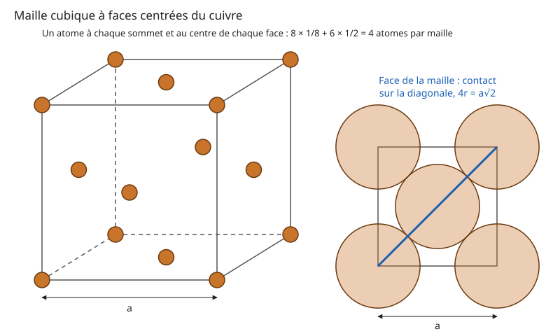
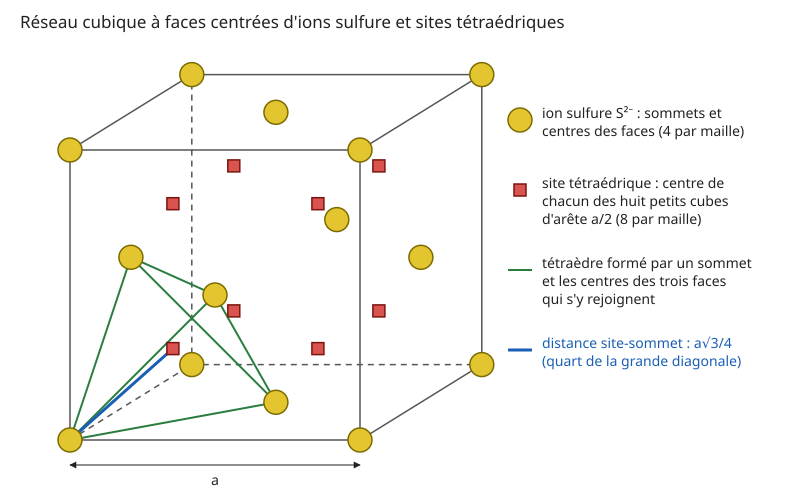
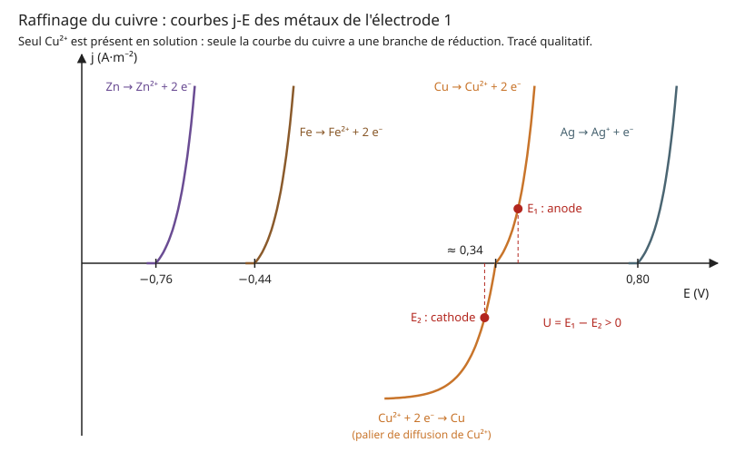
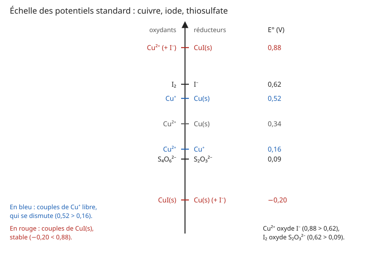

# Banque PT PT — Physique B - Chimie 2017 · Corrigé brut

*Corrigé rédigé par IA, non officiel. Signalez toute erreur.*

**Rédaction** · modèle exact non renseigné (famille Claude) · effort non renseigné · vitesse non renseignée

Épreuve de 2 heures, sans calculatrice, sur le cuivre : propriétés atomiques, passage du minerai au métal, dosage du cuivre dans un laiton. Le sujet compte 50 questions repérées par sous-partie et par lettre (de A-1.a à C-3.f), en trois parties indépendantes ; toutes sont traitées. Les valeurs lues sur la courbe de désintégration (document 4) sont signalées à l'endroit où elles servent. Les constantes usuelles que l'énoncé ne rappelle pas (constante de Faraday, produit ionique de l'eau, constante des gaz parfaits) sont signalées lorsqu'elles interviennent.

[Sujet officiel](https://www.banquept.fr/documents/2017/ph_b_ch_2017_pt.pdf) · [Rapport du jury](https://www.banquept.fr/documents/ecrit/rapport/2017/rapport_phys_b_ecrit_2017.pdf)

## Partie A — Propriétés atomiques

**A-1 — L'élément cuivre**

### Question A-1.a — Numéro atomique et composition du noyau

D'après le document 2, le numéro atomique du cuivre est $Z = 29$.

Le cuivre naturel contient environ 70 % de $^{63}\mathrm{Cu}$ et 30 % de $^{65}\mathrm{Cu}$ : l'isotope majoritaire est $^{63}\mathrm{Cu}$, de nombre de masse $A = 63$. Son noyau contient $Z$ protons et $N = A - Z$ neutrons :

$$N = 63 - 29 = 34$$

$$\boxed{Z = 29 \ ;\quad {}^{63}\mathrm{Cu} : 29\ \text{protons et}\ 34\ \text{neutrons}}$$

### Question A-1.b — Configuration électronique du zinc

Le zinc est situé juste à droite du cuivre dans la même période : $Z(\mathrm{Zn}) = 30$. Il faut placer 30 électrons.

Règles appliquées :

- **règle de Klechkowski** : à l'état fondamental, les sous-couches se remplissent par valeurs croissantes de $n + \ell$ et, à égalité, par valeurs croissantes de $n$, soit l'ordre 1s, 2s, 2p, 3s, 3p, 4s, 3d ;
- **principe d'exclusion de Pauli** : deux électrons d'un même atome ne peuvent avoir leurs quatre nombres quantiques identiques ; une orbitale contient au plus deux électrons, de spins opposés, donc une sous-couche s au plus 2 électrons, p au plus 6, d au plus 10 ;
- **règle de Hund** : dans une sous-couche incomplète, les électrons occupent le maximum d'orbitales avec des spins parallèles. Elle n'a pas à intervenir ici, toutes les sous-couches étant complètes.

$$\boxed{\mathrm{Zn}\ (Z = 30) : 1s^2\,2s^2\,2p^6\,3s^2\,3p^6\,4s^2\,3d^{10}}$$

On vérifie le décompte : $2 + 2 + 6 + 2 + 6 + 2 + 10 = 30$. Le zinc a bien sa couche de valence en $n = 4$ (quatrième période) et dix électrons d : il termine le bloc d.

### Question A-1.c — Estimation du nombre d'Avogadro

D'après le document 1, un atome de $^{12}\mathrm{C}$ a une masse de 12 u et une mole de ces atomes ($N_A$ atomes) a une masse de 12 g :

$$N_A \times 12\ \mathrm{u} = 12\ \mathrm{g}$$

$$N_A = \frac{1\ \mathrm{g}}{1\ \mathrm{u}}$$

Avec $1\ \mathrm{u} \approx 1{,}6605\cdot 10^{-27}\ \mathrm{kg} = 1{,}6605\cdot 10^{-24}\ \mathrm{g}$ :

$$N_A = \frac{1}{1{,}6605\cdot 10^{-24}}\ \mathrm{mol^{-1}}$$

À la main, $1/1{,}66 \approx 0{,}602$ (en effet $1{,}66 \times 0{,}6 = 0{,}996$ et $1{,}66 \times 0{,}602 \approx 0{,}9993$), d'où

$$\boxed{N_A \approx 6{,}02\cdot 10^{23}\ \mathrm{mol^{-1}}}$$

**A-2 — Isotopes naturels**

### Question A-2.a — Isotopes naturels du cuivre

D'après le document 2, seuls deux isotopes sont stables et constituent le cuivre naturel, les 27 autres étant radioactifs et artificiels :

$$\boxed{{}^{63}\mathrm{Cu}\ (\text{environ } 70\ \%)\quad\text{et}\quad {}^{65}\mathrm{Cu}\ (\text{environ } 30\ \%)}$$

Tous deux ont 29 protons ; ils diffèrent par leur nombre de neutrons (34 et 36).

### Question A-2.b — Masse atomique des deux isotopes

L'unité de masse atomique est le douzième de la masse d'un atome de carbone 12, qui compte 12 nucléons : un nucléon engagé dans un noyau a donc une masse voisine de 1 u (le défaut de masse dépend peu du noyau), et la masse des électrons est négligeable (celle des 29 électrons représente environ 0,02 u). La masse d'un atome vaut donc approximativement son nombre de masse exprimé en u :

$$\boxed{m({}^{63}\mathrm{Cu}) \approx 63\ \mathrm{u}\ ;\qquad m({}^{65}\mathrm{Cu}) \approx 65\ \mathrm{u}}$$

Il s'agit d'une estimation : la masse d'un proton ou d'un neutron isolé dépasse 1 u (document 1), mais l'énergie de liaison du noyau ramène la masse par nucléon très près de 1 u.

### Question A-2.c — Masse molaire du cuivre naturel

Comme $N_A \times 1\ \mathrm{u} = 1\ \mathrm{g}$ (question A-1.c), un atome de masse 63 u correspond à une masse molaire de $63\ \mathrm{g\cdot mol^{-1}}$. La masse molaire du cuivre naturel est la moyenne pondérée par les abondances $x_{63} = 0{,}70$ et $x_{65} = 0{,}30$ :

$$M_{\mathrm{Cu}} = x_{63}\,M_{63} + x_{65}\,M_{65}$$

$$M_{\mathrm{Cu}} = 0{,}70 \times 63 + 0{,}30 \times 65 = 44{,}1 + 19{,}5$$

$$\boxed{M_{\mathrm{Cu}} \approx 63{,}6\ \mathrm{g\cdot mol^{-1}}}$$

Les proportions n'étant données qu'à deux chiffres (« environ 70/30 »), on retiendra $M_{\mathrm{Cu}} \approx 64\ \mathrm{g\cdot mol^{-1}}$, en accord avec la valeur tabulée dans la partie B ($63{,}55\ \mathrm{g\cdot mol^{-1}}$).

**A-3 — Isotopes radioactifs**

### Question A-3.a — Temps de demi-réaction

Le temps de demi-réaction $t_{1/2}$ (ici la demi-vie) est la durée au bout de laquelle la moitié des noyaux de cuivre 64 initialement présents s'est désintégrée. Sur la courbe du document 4 (un point toutes les deux heures), la fraction restante vaut environ 0,52 à 12 h et 0,47 à 14 h : elle passe par 0,5 entre ces deux dates.

$$\boxed{t_{1/2} \approx 13\ \mathrm{h}}$$

(Lecture graphique à une heure près.)

### Question A-3.b — Fraction restante à deux et trois demi-vies

Avec $t_{1/2} \approx 13\ \mathrm{h}$ :

$$t_1 = 2\,t_{1/2} \approx 26\ \mathrm{h}$$

$$t_2 = 3\,t_{1/2} \approx 39\ \mathrm{h}$$

Lecture sur le document 4 : à 26 h, le point se situe au milieu de l'intervalle entre 0,2 et 0,3 ; à 39 h, la courbe passe juste au-dessus de 0,1.

$$\boxed{\text{fraction restante} \approx 0{,}25\ \text{à}\ t_1\ ;\qquad \approx 0{,}12\ \text{à}\ t_2}$$

Ces valeurs sont $1/4$ et $1/8$ : la fraction est divisée par deux à chaque nouvelle durée $t_{1/2}$.

### Question A-3.c — Désintégration d'ordre 1

Pour une loi d'ordre 1, le nombre $N$ de noyaux restants vérifie

$$-\frac{\mathrm dN}{\mathrm dt} = \lambda\,N$$

$$\frac{N(t)}{N_0} = \mathrm e^{-\lambda t}$$

Le temps de demi-réaction vaut alors

$$t_{1/2} = \frac{\ln 2}{\lambda}$$

Il est **indépendant de la quantité initiale** : c'est la propriété caractéristique de l'ordre 1 (pour un ordre 0, $t_{1/2}$ serait proportionnel à $N_0$ ; pour un ordre 2, inversement proportionnel).

Vérification sur la courbe : la fraction passe de 1 à 0,5 en 13 h, de 0,5 à 0,25 en 13 h encore (de 13 h à 26 h), puis de 0,25 à 0,125 en 13 h (de 26 h à 39 h). En prenant une autre origine, elle passe de 0,8 (à 4 h) à 0,4 (à 17 h environ), soit encore 13 h. Quelle que soit la quantité de départ, la durée de division par deux est la même :

$$\boxed{\text{la désintégration du cuivre 64 suit une loi d'ordre 1}}$$

### Question A-3.d — Constante de désintégration

Pour un ordre 1 :

$$\lambda = \frac{\ln 2}{t_{1/2}}$$

$$\lambda = \frac{0{,}69}{13} \approx 0{,}053\ \mathrm{h^{-1}}$$

Avec un chiffre significatif :

$$\boxed{\lambda \approx 5\cdot 10^{-2}\ \mathrm{h^{-1}}}$$

soit, en divisant par $3\,600\ \mathrm{s\cdot h^{-1}}$, environ $1{,}5\cdot 10^{-5}\ \mathrm{s^{-1}}$.

**A-4 — Structure cristalline**

### Question A-4.a — Maille cubique à faces centrées

Dans la maille cubique à faces centrées, un atome de cuivre occupe chacun des huit sommets du cube d'arête $a$ et le centre de chacune des six faces.

### Question A-4.b — Rayon atomique

Les plus proches voisins sont un atome de sommet et l'atome du centre d'une face adjacente, distants d'une demi-diagonale de face. Le contact a donc lieu le long de la diagonale d'une face, de longueur $a\sqrt2$, qui porte quatre rayons (figure 1) :

$$4\,r = a\sqrt2$$

$$\boxed{r = \frac{a\sqrt2}{4}}$$

Numériquement, $r = 3{,}60\cdot 10^{-10} \times 1{,}414 / 4 \approx 1{,}27\cdot 10^{-10}\ \mathrm m$, soit 127 pm.

### Question A-4.c — Nombre d'atomes par maille

Un atome de sommet est partagé entre huit mailles, un atome de centre de face entre deux :

$$Z_{\mathrm{maille}} = 8 \times \frac18 + 6 \times \frac12 = 1 + 3$$

$$\boxed{4\ \text{atomes de cuivre par maille}}$$

### Question A-4.d — Compacité

La compacité $C$ est la fraction du volume de la maille réellement occupée par la matière, les atomes étant assimilés à des sphères dures de rayon $r$ :

$$C = \frac{\text{volume des atomes de la maille}}{\text{volume de la maille}} = \frac{4 \times \dfrac43\pi r^3}{a^3}$$

Avec $r = a\sqrt2/4$, soit $r^3 = a^3\,\dfrac{2\sqrt2}{64} = a^3\,\dfrac{\sqrt2}{32}$ :

$$C = \frac{16\pi}{3} \times \frac{\sqrt2}{32}$$

$$\boxed{C = \frac{\pi\sqrt2}{6} \approx 0{,}74}$$

C'est la compacité maximale d'un empilement de sphères identiques : 74 % du volume est occupé, 26 % reste vide (sites interstitiels).

### Question A-4.e — Masse volumique

La maille, de volume $a^3$, contient 4 atomes de masse $M_{\mathrm{Cu}}/N_A$ chacun :

$$\rho = \frac{m_{\mathrm{maille}}}{V_{\mathrm{maille}}}$$

$$\boxed{\rho = \frac{4\,M_{\mathrm{Cu}}}{N_A\,a^3}}$$

Contrôle d'homogénéité : $\mathrm{kg\cdot mol^{-1}}$ divisé par $\mathrm{mol^{-1}\cdot m^3}$ donne bien des $\mathrm{kg\cdot m^{-3}}$. Ordre de grandeur (non demandé) : avec $M_{\mathrm{Cu}} = 63{,}55\cdot 10^{-3}\ \mathrm{kg\cdot mol^{-1}}$, $N_A = 6{,}02\cdot 10^{23}\ \mathrm{mol^{-1}}$ et $a = 3{,}60\cdot 10^{-10}\ \mathrm m$, on obtient $\rho \approx 9{,}0\cdot 10^{3}\ \mathrm{kg\cdot m^{-3}}$, valeur cohérente avec la masse volumique connue du cuivre (environ $8{,}9\cdot 10^{3}\ \mathrm{kg\cdot m^{-3}}$).

## Partie B — Passage du minerai au métal

**B-1 — Étude d'un minerai de cuivre : la chalcopyrite**

### Question B-1.a — Formule de la chalcopyrite

Une mole de $\mathrm{CuFe}_x\mathrm{S}_y$ contient $63{,}55\ \mathrm g$ de cuivre, $55{,}84\,x$ grammes de fer et $32{,}06\,y$ grammes de soufre. Les trois éléments représentant chacun environ un tiers de la masse, les trois masses sont voisines :

$$55{,}84\,x \approx 63{,}55 \quad\Rightarrow\quad x = 1$$

$$32{,}06\,y \approx 63{,}55 \quad\Rightarrow\quad y = 2$$

Avec $x = 1$ et $y = 2$, la masse de fer ($55{,}84\ \mathrm g$) est un peu inférieure à celle du cuivre et celle du soufre ($64{,}12\ \mathrm g$) un peu supérieure. La masse molaire vaut $63{,}55 + 55{,}84 + 64{,}12 = 183{,}51\ \mathrm{g\cdot mol^{-1}}$, dont le tiers est $61{,}2\ \mathrm g$ : le cuivre en représente environ un tiers (34,6 %), le soufre un peu plus d'un tiers (34,9 %), le fer un peu moins (30,4 %), conformément à l'analyse.

$$\boxed{x = 1,\quad y = 2 : \text{la chalcopyrite a pour formule } \mathrm{CuFeS_2}}$$

### Question B-1.b — Nombres d'oxydation du fer et du cuivre

Le soufre est présent sous forme d'ions sulfure $\mathrm{S^{2-}}$ (nombre d'oxydation $-\mathrm{II}$). L'électroneutralité de $\mathrm{CuFeS_2}$ impose

$$\mathrm{n.o.(Cu)} + \mathrm{n.o.(Fe)} + 2 \times (-2) = 0$$

$$\mathrm{n.o.(Cu)} + \mathrm{n.o.(Fe)} = +4$$

Avec les ions courants du tableau ($\mathrm{Cu^+}$, $\mathrm{Cu^{2+}}$, $\mathrm{Fe^{2+}}$, $\mathrm{Fe^{3+}}$), deux répartitions donnent $+4$ : $\mathrm{Cu^{2+}}$ avec $\mathrm{Fe^{2+}}$, ou $\mathrm{Cu^{+}}$ avec $\mathrm{Fe^{3+}}$. La première donnerait le même nombre d'oxydation aux deux cations, ce qu'exclut l'étude cristallographique.

$$\boxed{\text{cuivre}\ +\mathrm{I}\ (\mathrm{Cu^+})\ ;\qquad \text{fer}\ +\mathrm{III}\ (\mathrm{Fe^{3+}})}$$

### Question B-1.c — Maille cubique à faces centrées des ions sulfure

Les ions sulfure occupent les huit sommets et les centres des six faces du cube d'arête $a$, soit $8 \times \frac18 + 6 \times \frac12 = 4$ ions $\mathrm{S^{2-}}$ par maille.

### Question B-1.d — Sites tétraédriques

Un site tétraédrique est une cavité située au centre d'un tétraèdre régulier formé par quatre ions voisins : un ion de sommet et les ions des centres des trois faces qui se rejoignent à ce sommet. Ces sites sont les centres des huit petits cubes d'arête $a/2$ obtenus en partageant la maille (figure 2), aux positions du type $(a/4,\ a/4,\ a/4)$. Ils sont tous intérieurs à la maille, donc comptés entièrement :

$$\boxed{8\ \text{sites tétraédriques par maille}}$$

Avec 4 ions sulfure par maille, la formule $\mathrm{CuFeS_2}$ demande 2 ions cuivre et 2 ions fer par maille : les cations occupent la moitié des sites tétraédriques.

### Question B-1.e — Le réseau des anions est-il compact ?

Le paramètre de maille est à lire en picomètres ($a \approx 528\ \mathrm{pm}$, soit 0,528 nm) : avec des ions de rayon 180 pm, la valeur « 528 nm » de l'énoncé est manifestement une coquille d'unité, et les valeurs approchées fournies ($530\sqrt2$, $530\sqrt3$) le confirment.

La structure serait compacte si les ions sulfure étaient en contact le long de la diagonale d'une face, c'est-à-dire si $4\,r(\mathrm{S^{2-}}) = a\sqrt2$. Or

$$4\,r(\mathrm{S^{2-}}) = 4 \times 180 = 720\ \mathrm{pm}$$

$$a\sqrt2 \approx 530\sqrt2 \approx 750\ \mathrm{pm}$$

$$4\,r(\mathrm{S^{2-}}) < a\sqrt2$$

Les anions ne se touchent pas : il reste environ $30\ \mathrm{pm}$ de jeu sur la diagonale (les centres de deux anions voisins sont distants de $a\sqrt2/2 \approx 375\ \mathrm{pm}$, pour $2r = 360\ \mathrm{pm}$).

$$\boxed{\text{le réseau des ions sulfure n'est pas compact : les anions sont écartés}}$$

### Question B-1.f — Rayon maximal d'un cation en site tétraédrique

Le site tétraédrique est au centre d'un petit cube d'arête $a/2$ ; sa distance à l'ion sulfure le plus proche est la demi-diagonale de ce petit cube, soit le quart de la grande diagonale de la maille (figure 2) :

$$d = \frac12 \times \frac a2\sqrt3 = \frac{a\sqrt3}{4}$$

Le cation le plus gros que le site peut accueillir sans déformer le réseau est tangent aux quatre anions :

$$r_{\max} + r(\mathrm{S^{2-}}) = \frac{a\sqrt3}{4}$$

$$r_{\max} = \frac{a\sqrt3}{4} - r(\mathrm{S^{2-}})$$

Avec $530\sqrt3 \approx 920$ :

$$r_{\max} \approx \frac{920}{4} - 180 = 230 - 180$$

$$\boxed{r_{\max} \approx 50\ \mathrm{pm}}$$

valeur bien inférieure à 60 pm, comme annoncé par l'énoncé.

### Question B-1.g — Comparaison avec les rayons ioniques

Les cations présents sont $\mathrm{Cu^+}$ (96 pm) et $\mathrm{Fe^{3+}}$ (64 pm). Tous deux, et d'ailleurs aussi $\mathrm{Cu^{2+}}$ (70 pm) et $\mathrm{Fe^{2+}}$ (78 pm), ont un rayon supérieur à $r_{\max} \approx 50\ \mathrm{pm}$.

Dans le modèle des sphères dures, aucun de ces cations ne peut donc se loger dans un site tétraédrique sans écarter les anions. On en déduit que :

- les cations écartent effectivement les anions : c'est pourquoi le réseau des ions sulfure n'est pas compact (question B-1.e) ;
- l'écart reste trop grand pour être expliqué par ce seul effet : pour $\mathrm{Cu^+}$, la somme des rayons ioniques vaut $96 + 180 = 276\ \mathrm{pm}$, alors que la distance cation-anion disponible n'est que de $a\sqrt3/4 \approx 230\ \mathrm{pm}$. Le **modèle ionique de sphères dures indéformables n'est pas adapté** à la chalcopyrite : les liaisons métal-soufre ont un caractère covalent marqué (les nuages électroniques s'interpénètrent), et la structure réelle n'est pas parfaitement cubique, comme le suggère l'énoncé en parlant de structure simplifiée.

**B-2 — Obtention du cuivre métallique**

### Question B-2.a — Équation (1) du grillage en fonction de x et y

Les réactifs sont la chalcopyrite et le dioxygène ; les produits sont $\mathrm{Cu_2S}$, $\mathrm{FeS}$ et $\mathrm{SO_2}$. Pour deux équivalents de $\mathrm{CuFe}_x\mathrm{S}_y$ :

- cuivre : 2 atomes, donc $1\ \mathrm{Cu_2S}$ ;
- fer : $2x$ atomes, donc $2x\ \mathrm{FeS}$ ;
- soufre : $2y$ atomes, dont $1 + 2x$ dans les sulfures, donc $(2y - 2x - 1)\ \mathrm{SO_2}$ ;
- oxygène : $2(2y - 2x - 1)$ atomes, donc $(2y - 2x - 1)\ \mathrm{O_2}$.

$$\boxed{2\,\mathrm{CuFe}_x\mathrm{S}_y(\mathrm s) + (2y - 2x - 1)\,\mathrm{O_2}(\mathrm g) = \mathrm{Cu_2S}(\mathrm s) + 2x\,\mathrm{FeS}(\mathrm s) + (2y - 2x - 1)\,\mathrm{SO_2}(\mathrm g)}$$

### Question B-2.b — Équation (1) avec les valeurs de x et y

Avec $x = 1$ et $y = 2$, $2y - 2x - 1 = 1$ :

$$\boxed{2\,\mathrm{CuFeS_2}(\mathrm s) + \mathrm{O_2}(\mathrm g) = \mathrm{Cu_2S}(\mathrm s) + 2\,\mathrm{FeS}(\mathrm s) + \mathrm{SO_2}(\mathrm g) \qquad (1)}$$

Vérification : 2 Cu, 2 Fe, 4 S ($1 + 2 + 1$) et 2 O de chaque côté.

### Question B-2.c — Équation (2)

$$\boxed{\mathrm{Cu_2S}(\mathrm s) + \mathrm{O_2}(\mathrm g) = 2\,\mathrm{Cu}(\mathrm s) + \mathrm{SO_2}(\mathrm g) \qquad (2)}$$

### Question B-2.d — Quotient de réaction

Les solides $\mathrm{Cu_2S}$ et $\mathrm{Cu}$, seuls dans leur phase, ont une activité égale à 1. Les gaz, supposés parfaits, ont pour activité $P_i/P^\circ$ avec $P^\circ = 1\ \mathrm{bar}$ :

$$Q_r = \frac{a(\mathrm{Cu})^2\,a(\mathrm{SO_2})}{a(\mathrm{Cu_2S})\,a(\mathrm{O_2})}$$

$$\boxed{Q_r = \frac{P(\mathrm{SO_2})}{P(\mathrm{O_2})} = \frac{n(\mathrm{SO_2})}{n(\mathrm{O_2})}}$$

La dernière égalité vient de $P_i = n_i RT/V$ pour deux gaz dans la même enceinte : $P^\circ$, la pression totale et le volume disparaissent.

### Question B-2.e — Enthalpies standard de formation nulles

L'enthalpie standard de formation d'un constituant est l'enthalpie standard de la réaction qui forme une mole de ce constituant à partir des corps simples correspondant aux éléments qui le composent, chacun pris dans son **état standard de référence** à la température considérée.

À 298 K, l'état standard de référence de l'élément cuivre est le cuivre métallique solide $\mathrm{Cu(s)}$, et celui de l'élément oxygène est le dioxygène gazeux $\mathrm{O_2(g)}$. Pour ces deux corps, la réaction de formation consiste à former le corps à partir de lui-même ($\mathrm{Cu(s)} = \mathrm{Cu(s)}$) : rien ne se transforme, donc

$$\boxed{\Delta_f H^\circ(\mathrm{Cu,\,s}) = \Delta_f H^\circ(\mathrm{O_2,\,g}) = 0}$$

### Question B-2.f — Enthalpie standard de réaction de l'étape (2)

**Loi de Hess** : l'enthalpie standard d'une réaction est la somme des enthalpies standard de formation de ses constituants, pondérées par leurs nombres stœchiométriques algébriques $\nu_i$ (positifs pour les produits, négatifs pour les réactifs) :

$$\Delta_r H^\circ = \sum_i \nu_i\,\Delta_f H^\circ_i$$

Pour la réaction (2) :

$$\Delta_r H^\circ_2 = 2\,\Delta_f H^\circ(\mathrm{Cu}) + \Delta_f H^\circ(\mathrm{SO_2}) - \Delta_f H^\circ(\mathrm{Cu_2S}) - \Delta_f H^\circ(\mathrm{O_2})$$

$$\Delta_r H^\circ_2 = 0 + (-297) - (-80) - 0$$

$$\boxed{\Delta_r H^\circ_2 = -217\ \mathrm{kJ\cdot mol^{-1}}}$$

Le signe est négatif : la réaction est **exothermique**. À température et pression constantes, elle cède de l'énergie thermique à l'extérieur, ce qui contribue à entretenir la température élevée du four.

### Question B-2.g — Entropie standard de réaction de l'étape (2)

$$\Delta_r S^\circ = \sum_i \nu_i\,S^\circ_{m,i}$$

$$\Delta_r S^\circ_2 = 2\,S^\circ_m(\mathrm{Cu}) + S^\circ_m(\mathrm{SO_2}) - S^\circ_m(\mathrm{Cu_2S}) - S^\circ_m(\mathrm{O_2})$$

$$\Delta_r S^\circ_2 = 2 \times 33 + 248 - 121 - 205 = 314 - 326$$

$$\boxed{\Delta_r S^\circ_2 = -12\ \mathrm{J\cdot K^{-1}\cdot mol^{-1}}}$$

Cette valeur est faible en valeur absolue : la réaction ne modifie pas la quantité de gaz (une mole de $\mathrm{O_2}$ consommée, une mole de $\mathrm{SO_2}$ formée), donc le désordre varie peu.

### Question B-2.h — Enthalpie libre standard de réaction

Par définition, à la température $T$ :

$$\boxed{\Delta_r G^\circ(T) = \Delta_r H^\circ - T\,\Delta_r S^\circ}$$

Le paramètre d'état supplémentaire est la **température** $T$ (en kelvins). Comme $\Delta_r H^\circ$ et $\Delta_r S^\circ$ sont supposées indépendantes de $T$ (approximation d'Ellingham), $\Delta_r G^\circ_2$ est une fonction affine de la température :

$$\Delta_r G^\circ_2(T) = -217\cdot 10^{3} + 12\,T \quad (\mathrm{J\cdot mol^{-1}})$$

### Question B-2.i — Constante d'équilibre de la réaction (2)

La constante d'équilibre est définie par

$$\Delta_r G^\circ_2(T) = -RT\,\ln K_2$$

$$K_2 = \exp\left(-\frac{\Delta_r G^\circ_2}{RT}\right)$$

$$\boxed{K_2(T) = \exp\left(-\frac{\Delta_r H^\circ_2}{RT} + \frac{\Delta_r S^\circ_2}{R}\right)}$$

Ordre de grandeur (non demandé, la constante $R$ n'étant pas fournie) : à 900 K, $\Delta_r G^\circ_2 = -217\cdot 10^{3} + 12 \times 900 \approx -206\ \mathrm{kJ\cdot mol^{-1}}$, d'où $\ln K_2 \approx 27{,}6$ et $K_2 \approx 10^{12}$ avec $R = 8{,}31\ \mathrm{J\cdot K^{-1}\cdot mol^{-1}}$ : la réaction est très favorable.

### Question B-2.j — Pression partielle du dioxygène, quantités initiale et formée

**Pression partielle du dioxygène.** L'air contient environ 20 % de dioxygène et 80 % de diazote en quantité de matière. Sous la pression atmosphérique $P_{\mathrm{atm}} \approx 1\ \mathrm{bar}$, la loi de Dalton donne

$$P(\mathrm{O_2}) = x(\mathrm{O_2})\,P_{\mathrm{atm}}$$

$$\boxed{P(\mathrm{O_2}) \approx 0{,}2\ \mathrm{bar}}$$

**Quantité initiale de dioxygène.** Le dioxygène, gaz parfait, occupe le volume $V$ à la température $T = 900\ \mathrm K$ (le volume du solide est négligé) :

$$\boxed{n_1 = \frac{P(\mathrm{O_2})\,V}{RT} = \frac{x(\mathrm{O_2})\,P_{\mathrm{atm}}\,V}{RT}}$$

avec $P$ en pascals, $V$ en mètres cubes, $x(\mathrm{O_2}) = 0{,}2$ et $T = 900\ \mathrm K$.

**Quantité de dioxyde de soufre formé.** Le sulfure de cuivre est en excès : il reste du solide et l'équilibre chimique est atteint. Tableau d'avancement pour les gaz :

| | $\mathrm{O_2(g)}$ | $\mathrm{SO_2(g)}$ |
|---|---|---|
| état initial | $n_1$ | $0$ |
| équilibre | $n_1 - n_2$ | $n_2$ |

À l'équilibre, $Q_r = K_2$, soit avec l'expression de la question B-2.d :

$$K_2 = \frac{n_2}{n_1 - n_2}$$

$$K_2\,n_1 = n_2\,(1 + K_2)$$

$$\boxed{n_2 = \frac{K_2}{1 + K_2}\,n_1}$$

Cas limites : si $K_2 \gg 1$ (c'est le cas à 900 K), $n_2 \approx n_1$, le dioxygène est presque entièrement consommé ; si $K_2 \ll 1$, $n_2 \approx K_2\,n_1$. La quantité totale de gaz ne varie pas, donc la pression dans le récipient reste constante.

### Question B-2.k — Déplacements d'équilibre

On part d'un état d'équilibre ($Q_r = K_2$) et on compare, après la perturbation, $Q_r$ à $K_2$.

**Augmentation de la température à pression constante.** La loi de Van't Hoff s'écrit

$$\frac{\mathrm d\ln K_2}{\mathrm dT} = \frac{\Delta_r H^\circ_2}{RT^2}$$

Comme $\Delta_r H^\circ_2 < 0$, $K_2$ diminue quand $T$ augmente. Juste après l'élévation de température, $Q_r$ n'a pas changé et devient supérieur à la nouvelle valeur de $K_2$ : le système évolue dans le **sens indirect** (sens endothermique, consommation de $\mathrm{SO_2}$ et de cuivre).

**Ajout de $\mathrm{Cu_2S}$ solide à température et pression constantes.** L'activité du solide vaut 1 quelle que soit sa quantité : $Q_r = n(\mathrm{SO_2})/n(\mathrm{O_2})$ n'est pas modifié et $K_2$ non plus. On a toujours $Q_r = K_2$ : **l'équilibre n'est pas déplacé**.

**Augmentation de la pression à température constante.** $K_2$ ne dépend que de $T$ et reste inchangée. Le quotient $Q_r = P(\mathrm{SO_2})/P(\mathrm{O_2}) = n(\mathrm{SO_2})/n(\mathrm{O_2})$ ne dépend pas de la pression totale, car la réaction ne modifie pas la quantité de gaz ($\sum \nu_{i,\mathrm{gaz}} = 0$). On a toujours $Q_r = K_2$ : **l'équilibre n'est pas déplacé**, la pression n'est pas un facteur d'équilibre pour cette réaction.

$$\boxed{T \nearrow : \text{sens indirect}\ ;\qquad \text{ajout de } \mathrm{Cu_2S} : \text{aucun déplacement}\ ;\qquad P \nearrow : \text{aucun déplacement}}$$

**B-3 — Raffinage du cuivre métallique**

### Question B-3.a — Courbes densité de courant-potentiel

Par convention, une branche à $j > 0$ correspond à une oxydation (fonctionnement anodique) et une branche à $j < 0$ à une réduction (fonctionnement cathodique). Les potentiels standard se classent ainsi : $E^\circ(\mathrm{Zn^{2+}/Zn}) < E^\circ(\mathrm{Fe^{2+}/Fe}) < E^\circ(\mathrm{Cu^{2+}/Cu}) < E^\circ(\mathrm{Ag^+/Ag})$. Les courbes s'attribuent donc de gauche à droite au zinc, au fer, au cuivre et à l'argent.

La solution ne contient au départ que des ions $\mathrm{Cu^{2+}}$ comme cations métalliques : seule la courbe du cuivre présente une branche de réduction (elle se termine par un palier, limité par la diffusion des ions $\mathrm{Cu^{2+}}$ vers l'électrode). Les trois autres courbes n'ont qu'une branche d'oxydation du métal, sans palier puisque le réactif est le métal de l'électrode lui-même.

Demi-réactions, dans le sens où elles se produisent :

- première courbe : $\mathrm{Zn(s)} \rightarrow \mathrm{Zn^{2+}(aq)} + 2\,\mathrm e^-$ ;
- deuxième courbe : $\mathrm{Fe(s)} \rightarrow \mathrm{Fe^{2+}(aq)} + 2\,\mathrm e^-$ ;
- troisième courbe, branche $j > 0$ : $\mathrm{Cu(s)} \rightarrow \mathrm{Cu^{2+}(aq)} + 2\,\mathrm e^-$ ; branche $j < 0$ : $\mathrm{Cu^{2+}(aq)} + 2\,\mathrm e^- \rightarrow \mathrm{Cu(s)}$ ;
- quatrième courbe : $\mathrm{Ag(s)} \rightarrow \mathrm{Ag^+(aq)} + \mathrm e^-$.

Potentiels à courant nul : les courbes partent de l'axe sans décalage notable (systèmes rapides), donc au voisinage des potentiels standard.

$$\boxed{E_{j=0} \approx -0{,}8\ \mathrm V\ (\mathrm{Zn})\ ;\quad -0{,}4\ \mathrm V\ (\mathrm{Fe})\ ;\quad +0{,}3\ \mathrm V\ (\mathrm{Cu})\ ;\quad +0{,}8\ \mathrm V\ (\mathrm{Ag})}$$

Pour le cuivre, seul couple dont les deux espèces sont présentes, il s'agit d'un véritable potentiel d'équilibre donné par la relation de Nernst, $E = 0{,}34 + 0{,}03\,\log[\mathrm{Cu^{2+}}]$, proche de 0,3 V pour une solution usuelle.

### Question B-3.b — Signe de U et nature de l'électrode 1

Une **anode** est une électrode siège d'une oxydation ; une **cathode** est une électrode siège d'une réduction.

Sur l'électrode 2, le cuivre se dépose : $\mathrm{Cu^{2+}} + 2\,\mathrm e^- \rightarrow \mathrm{Cu}$ est une réduction, donc l'électrode 2 est la cathode. Sur l'électrode 1, les métaux sont oxydés et passent en solution : l'électrode 1 est l'**anode**.

Sur la courbe du cuivre (figure 3), le point de fonctionnement anodique ($j > 0$) est à un potentiel $E_1$ supérieur au potentiel d'équilibre $E_{\mathrm{eq}} \approx 0{,}34\ \mathrm V$, et le point de fonctionnement cathodique ($j < 0$, même intensité en valeur absolue) à un potentiel $E_2$ inférieur à $E_{\mathrm{eq}}$ :

$$E_2 < E_{\mathrm{eq}} < E_1$$

$$\boxed{U = E_1 - E_2 > 0\ ;\qquad \text{l'électrode 1 est l'anode}}$$

L'électrode 1 est reliée à la borne positive du générateur.

**Rôle de la valeur de $U$.** Comme $E_1 - E_{\mathrm{eq}} < U < 0{,}4\ \mathrm V$, on a $E_1 < 0{,}74\ \mathrm V < E^\circ(\mathrm{Ag^+/Ag})$ : l'argent n'est pas oxydé. De même $E_2 > 0{,}34 - 0{,}4 = -0{,}06\ \mathrm V$, bien au-dessus de $-0{,}44\ \mathrm V$ et de $-0{,}76\ \mathrm V$ : les ions $\mathrm{Fe^{2+}}$ et $\mathrm{Zn^{2+}}$ passés en solution ne peuvent pas être réduits à la cathode. Seul le cuivre s'y dépose.

### Question B-3.c — Devenir du fer, du zinc et de l'argent

À l'anode, le potentiel $E_1$ est légèrement supérieur à 0,34 V et inférieur à 0,74 V. À la cathode, $E_2$ est légèrement inférieur à 0,34 V et supérieur à $-0{,}06\ \mathrm V$.

**Fer.** $E^\circ(\mathrm{Fe^{2+}/Fe}) = -0{,}44\ \mathrm V < E_1$ : le fer est oxydé à l'anode en $\mathrm{Fe^{2+}}$ et passe en solution. À la cathode, $E_2 \gg -0{,}44\ \mathrm V$ : les ions $\mathrm{Fe^{2+}}$ ne sont pas réduits. On récupère le fer **sous forme oxydée $\mathrm{Fe^{2+}}$, dans la solution électrolytique**.

**Zinc.** $E^\circ(\mathrm{Zn^{2+}/Zn}) = -0{,}76\ \mathrm V < E_1$ : même raisonnement, le zinc est oxydé en $\mathrm{Zn^{2+}}$, qui ne peut pas se réduire à la cathode. On le récupère **sous forme oxydée $\mathrm{Zn^{2+}}$, dans la solution électrolytique**.

**Argent.** $E^\circ(\mathrm{Ag^+/Ag}) = 0{,}80\ \mathrm V > E_1$ : l'argent n'est pas oxydé. Quand le cuivre qui l'entoure se dissout, il se détache de l'anode et tombe au fond de la cuve. On le récupère **sous forme métallique, dans les boues solides**.

$$\boxed{\mathrm{Fe} : \mathrm{Fe^{2+}}\ \text{en solution}\ ;\quad \mathrm{Zn} : \mathrm{Zn^{2+}}\ \text{en solution}\ ;\quad \mathrm{Ag} : \text{métal dans les boues}}$$

### Question B-3.d — Masse de cuivre déposée par heure et par mètre carré

Pendant la durée $\Delta t$, la charge qui traverse une surface $S$ d'électrode est $q = j\,S\,\Delta t$. Elle correspond à une quantité d'électrons $n_{e} = q/\mathcal F$, où $\mathcal F$ est la constante de Faraday. La masse déposée est maximale si tout le courant sert à la réduction $\mathrm{Cu^{2+}} + 2\,\mathrm e^- \rightarrow \mathrm{Cu}$ (rendement faradique de 100 %) :

$$n(\mathrm{Cu}) = \frac{n_e}{2} = \frac{j\,S\,\Delta t}{2\,\mathcal F}$$

$$\boxed{m_{\max} = \frac{j\,S\,\Delta t\,M_{\mathrm{Cu}}}{2\,\mathcal F}}$$

Application numérique avec $j = 300\ \mathrm{A\cdot m^{-2}}$, $S = 1\ \mathrm{m^2}$, $\Delta t = 3\,600\ \mathrm s$, $M_{\mathrm{Cu}} = 63{,}55\ \mathrm{g\cdot mol^{-1}}$ et $\mathcal F \approx 9{,}65\cdot 10^{4}\ \mathrm{C\cdot mol^{-1}}$ (valeur usuelle, non rappelée par l'énoncé) :

$$m_{\max} = \frac{300 \times 3\,600 \times 63{,}55}{2 \times 9{,}65\cdot 10^{4}} \approx 3{,}6\cdot 10^{2}\ \mathrm g$$

soit environ **0,36 kg de cuivre par heure et par mètre carré** d'électrode (0,4 kg avec un seul chiffre significatif, la densité de courant n'étant donnée qu'en ordre de grandeur).

## Partie C — Dosage du cuivre dans un laiton simple

**C-1 — Dissolution d'un échantillon de laiton**

### Question C-1.a — Intérêt d'un acide à anion oxydant

Dans un acide « ordinaire » (acide chlorhydrique par exemple), le seul oxydant disponible est l'ion oxonium, oxydant du couple $\mathrm{H^+/H_2}$ de potentiel standard $0\ \mathrm V$. Or :

- $E^\circ(\mathrm{Zn^{2+}/Zn}) = -0{,}76\ \mathrm V < 0\ \mathrm V$ : le zinc est oxydé par les ions $\mathrm{H^+}$ ;
- $E^\circ(\mathrm{Cu^{2+}/Cu}) = +0{,}34\ \mathrm V > 0\ \mathrm V$ : le cuivre **n'est pas oxydé** par les ions $\mathrm{H^+}$. Le cuivre de l'alliage resterait solide.

L'ion nitrate est un oxydant bien plus fort : $E^\circ(\mathrm{NO_3^-/NO}) = +0{,}96\ \mathrm V$, supérieur à $0{,}34\ \mathrm V$ et à $-0{,}76\ \mathrm V$. Il oxyde à la fois le cuivre et le zinc.

$$\boxed{\text{l'acide nitrique dissout totalement le laiton, cuivre compris, ce que } \mathrm{H^+} \text{ seul ne peut pas faire}}$$

### Question C-1.b — Réaction des ions nitrate sur le cuivre

Demi-équations en milieu acide :

$$\mathrm{NO_3^-(aq)} + 4\,\mathrm{H^+(aq)} + 3\,\mathrm e^- = \mathrm{NO(g)} + 2\,\mathrm{H_2O(\ell)}$$

$$\mathrm{Cu(s)} = \mathrm{Cu^{2+}(aq)} + 2\,\mathrm e^-$$

On multiplie la première par 2 et la seconde par 3 (six électrons échangés) :

$$\boxed{3\,\mathrm{Cu(s)} + 2\,\mathrm{NO_3^-(aq)} + 8\,\mathrm{H^+(aq)} = 3\,\mathrm{Cu^{2+}(aq)} + 2\,\mathrm{NO(g)} + 4\,\mathrm{H_2O(\ell)}}$$

Vérification : 3 Cu, 2 N, 6 O, 8 H de chaque côté ; charges $-2 + 8 = +6$ à gauche et $+6$ à droite. Les ions $\mathrm{Cu^{2+}}$ hydratés donnent la couleur bleue. Le monoxyde d'azote, incolore, est ensuite oxydé par le dioxygène de l'air en dioxyde d'azote roux, $2\,\mathrm{NO(g)} + \mathrm{O_2(g)} = 2\,\mathrm{NO_2(g)}$, d'où le travail sous hotte.

**C-2 — Stabilité du cuivre(I) en solution aqueuse**

### Question C-2.a — Potentiel standard du couple cuivre(II)/cuivre

À une demi-équation de réduction échangeant $n$ électrons, de potentiel standard $E^\circ$, on associe l'enthalpie libre standard $\Delta_{r} G^\circ = -n\,\mathcal F\,E^\circ$.

$$\mathrm{Cu^{2+}} + \mathrm e^- = \mathrm{Cu^+} \qquad \Delta_r G^\circ_1 = -\mathcal F\,E^\circ(\mathrm{Cu^{2+}/Cu^+})$$

$$\mathrm{Cu^{+}} + \mathrm e^- = \mathrm{Cu(s)} \qquad \Delta_r G^\circ_2 = -\mathcal F\,E^\circ(\mathrm{Cu^{+}/Cu})$$

$$\mathrm{Cu^{2+}} + 2\,\mathrm e^- = \mathrm{Cu(s)} \qquad \Delta_r G^\circ_3 = -2\,\mathcal F\,E^\circ(\mathrm{Cu^{2+}/Cu})$$

La troisième demi-équation est la somme des deux premières, donc $\Delta_r G^\circ_3 = \Delta_r G^\circ_1 + \Delta_r G^\circ_2$ :

$$\boxed{E^\circ(\mathrm{Cu^{2+}/Cu}) = \frac{E^\circ(\mathrm{Cu^{2+}/Cu^+}) + E^\circ(\mathrm{Cu^{+}/Cu})}{2}}$$

Vérification numérique :

$$\frac{0{,}16 + 0{,}52}{2} = \frac{0{,}68}{2} = 0{,}34\ \mathrm V$$

On retrouve exactement la valeur fournie : les données sont cohérentes.

### Question C-2.b — Ions du cuivre stables à pH = 0

L'ion $\mathrm{Cu^+}$ est l'oxydant du couple $\mathrm{Cu^+/Cu}$ ($E^\circ = 0{,}52\ \mathrm V$) et le réducteur du couple $\mathrm{Cu^{2+}/Cu^+}$ ($E^\circ = 0{,}16\ \mathrm V$). Le potentiel du couple où il est oxydant est supérieur à celui du couple où il est réducteur : ses domaines de prédominance en tant qu'oxydant et en tant que réducteur sont disjoints, il réagit sur lui-même. C'est une **dismutation** :

$$2\,\mathrm{Cu^+(aq)} = \mathrm{Cu^{2+}(aq)} + \mathrm{Cu(s)}$$

$$\log K^\circ = \frac{E^\circ(\mathrm{Cu^+/Cu}) - E^\circ(\mathrm{Cu^{2+}/Cu^+})}{\alpha} = \frac{0{,}52 - 0{,}16}{0{,}06} = 6$$

$$K^\circ = 10^{6} \gg 1$$

L'ion $\mathrm{Cu^+}$ n'est donc pas stable en solution aqueuse. L'ion $\mathrm{Cu^{2+}}$, lui, ne peut pas se dismuter (c'est le degré d'oxydation le plus élevé considéré) et, à pH = 0, il ne précipite pas sous forme d'hydroxyde.

$$\boxed{\text{à pH} = 0\text{, le seul ion stable du cuivre est } \mathrm{Cu^{2+}}}$$

### Question C-2.c — Oxydation des ions iodure par les ions cuivre(II)

Les couples en jeu sont $\mathrm{I_2/I^-}$ ($E^\circ = 0{,}62\ \mathrm V$) et $\mathrm{Cu^{2+}/Cu^+}$ ($E^\circ = 0{,}16\ \mathrm V$), ou $\mathrm{Cu^{2+}/Cu}$ ($E^\circ = 0{,}34\ \mathrm V$). Dans les deux cas, le potentiel standard du couple du cuivre est inférieur à celui du couple du diiode : $\mathrm{Cu^{2+}}$ est un oxydant plus faible que $\mathrm{I_2}$. Pour la réaction

$$2\,\mathrm{Cu^{2+}} + 2\,\mathrm{I^-} = 2\,\mathrm{Cu^+} + \mathrm{I_2}$$

$$\log K^\circ = \frac{2\,(0{,}16 - 0{,}62)}{0{,}06} \approx -15$$

$$\boxed{\text{a priori non : la réaction est très défavorable } (K^\circ \approx 10^{-15})}$$

Cette prévision ne tient pas compte de la précipitation de l'iodure de cuivre(I), qui change la conclusion (questions suivantes).

### Question C-2.d — Potentiels standard des couples faisant intervenir l'iodure de cuivre(I)

En présence du précipité, $K_s = [\mathrm{Cu^+}]\,[\mathrm{I^-}]$ (concentrations rapportées à $c^\circ = 1\ \mathrm{mol\cdot L^{-1}}$), soit $[\mathrm{Cu^+}] = K_s/[\mathrm{I^-}]$, avec $\mathrm pK_s = 12$. Le potentiel d'une solution est unique : on l'écrit de deux façons.

**Couple $\mathrm{Cu^{2+}/CuI(s)}$** : $\mathrm{Cu^{2+}} + \mathrm{I^-} + \mathrm e^- = \mathrm{CuI(s)}$.

$$E = E^\circ(\mathrm{Cu^{2+}/Cu^+}) + \alpha\,\log\frac{[\mathrm{Cu^{2+}}]}{[\mathrm{Cu^+}]}$$

$$E = E^\circ(\mathrm{Cu^{2+}/Cu^+}) + \alpha\,\mathrm pK_s + \alpha\,\log\left([\mathrm{Cu^{2+}}]\,[\mathrm{I^-}]\right)$$

En identifiant avec $E = E^\circ(\mathrm{Cu^{2+}/CuI}) + \alpha\,\log\left([\mathrm{Cu^{2+}}]\,[\mathrm{I^-}]\right)$ :

$$E^\circ(\mathrm{Cu^{2+}/CuI}) = E^\circ(\mathrm{Cu^{2+}/Cu^+}) + \alpha\,\mathrm pK_s$$

$$E^\circ(\mathrm{Cu^{2+}/CuI}) = 0{,}16 + 0{,}06 \times 12 = 0{,}16 + 0{,}72$$

$$\boxed{E^\circ(\mathrm{Cu^{2+}/CuI}) = 0{,}88\ \mathrm V}$$

**Couple $\mathrm{CuI(s)/Cu(s)}$** : $\mathrm{CuI(s)} + \mathrm e^- = \mathrm{Cu(s)} + \mathrm{I^-}$.

$$E = E^\circ(\mathrm{Cu^{+}/Cu}) + \alpha\,\log[\mathrm{Cu^+}]$$

$$E = E^\circ(\mathrm{Cu^{+}/Cu}) - \alpha\,\mathrm pK_s - \alpha\,\log[\mathrm{I^-}]$$

En identifiant avec $E = E^\circ(\mathrm{CuI/Cu}) - \alpha\,\log[\mathrm{I^-}]$ :

$$E^\circ(\mathrm{CuI/Cu}) = E^\circ(\mathrm{Cu^{+}/Cu}) - \alpha\,\mathrm pK_s$$

$$E^\circ(\mathrm{CuI/Cu}) = 0{,}52 - 0{,}72$$

$$\boxed{E^\circ(\mathrm{CuI/Cu}) = -0{,}20\ \mathrm V}$$

**Stabilité du cuivre(I).** En présence d'ions iodure, le cuivre(I) existe sous forme de $\mathrm{CuI(s)}$, oxydant du couple $\mathrm{CuI/Cu}$ ($-0{,}20\ \mathrm V$) et réducteur du couple $\mathrm{Cu^{2+}/CuI}$ ($0{,}88\ \mathrm V$). Cette fois, le potentiel du couple où il est oxydant est **inférieur** à celui du couple où il est réducteur : l'ordre est inversé par rapport à la question C-2.b, $\mathrm{CuI}$ possède un domaine d'existence (entre $-0{,}20$ et $0{,}88\ \mathrm V$ dans les conditions standard) et ne se dismute pas. La dismutation $2\,\mathrm{CuI} = \mathrm{Cu^{2+}} + \mathrm{Cu} + 2\,\mathrm{I^-}$ a pour constante $10^{(-0{,}20 - 0{,}88)/0{,}06} = 10^{-18}$.

$$\boxed{\text{le cuivre(I) est stabilisé par précipitation sous forme de } \mathrm{CuI(s)}}$$

On vérifie au passage la cohérence : $(0{,}88 + (-0{,}20))/2 = 0{,}34\ \mathrm V$, potentiel standard du couple $\mathrm{Cu^{2+}/Cu}$.

### Question C-2.e — Réaction des ions iodure avec les ions cuivre(II)

Avec la précipitation, le couple à considérer est $\mathrm{Cu^{2+}/CuI}$, de potentiel standard $0{,}88\ \mathrm V > E^\circ(\mathrm{I_2/I^-}) = 0{,}62\ \mathrm V$ : les ions $\mathrm{Cu^{2+}}$ oxydent maintenant les ions iodure. Demi-équations :

$$\mathrm{Cu^{2+}(aq)} + \mathrm{I^-(aq)} + \mathrm e^- = \mathrm{CuI(s)}$$

$$2\,\mathrm{I^-(aq)} = \mathrm{I_2(aq)} + 2\,\mathrm e^-$$

En multipliant la première par 2 :

$$\boxed{2\,\mathrm{Cu^{2+}(aq)} + 4\,\mathrm{I^-(aq)} = 2\,\mathrm{CuI(s)} + \mathrm{I_2(aq)}}$$

$$\log K^\circ = \frac{2\,(0{,}88 - 0{,}62)}{0{,}06} \approx 8{,}7$$

La réaction est quantitative ($K^\circ \approx 10^{8{,}7}$). C'est l'équation donnée dans le mode opératoire de la partie C-3 : les ions iodure jouent à la fois le rôle de réducteur et d'agent précipitant, d'où la nécessité d'un large excès.

**C-3 — Dosage indirect des ions cuivre(II) par iodométrie**

### Question C-3.a — pH de la solution d'hydroxyde de sodium

L'hydroxyde de sodium est une base forte, totalement dissociée dans l'eau : $[\mathrm{HO^-}] = c = 1{,}00\cdot 10^{-2}\ \mathrm{mol\cdot L^{-1}}$ (l'autoprotolyse de l'eau est négligeable devant cette concentration). Avec le produit ionique de l'eau à 298 K, $K_e = [\mathrm{H_3O^+}]\,[\mathrm{HO^-}] = 10^{-14}$ (valeur usuelle, non rappelée par l'énoncé) :

$$\mathrm{pH} = \mathrm pK_e + \log[\mathrm{HO^-}]$$

$$\mathrm{pH} = 14 + \log\left(1{,}00\cdot 10^{-2}\right) = 14 - 2{,}00$$

$$\boxed{\mathrm{pH} = 12{,}0}$$

La valeur est bien supérieure à 7, comme il se doit pour une solution basique.

### Question C-3.b — Réaction du thiosulfate avec le diiode

Demi-équations :

$$\mathrm{I_2(aq)} + 2\,\mathrm e^- = 2\,\mathrm{I^-(aq)}$$

$$2\,\mathrm{S_2O_3^{2-}(aq)} = \mathrm{S_4O_6^{2-}(aq)} + 2\,\mathrm e^-$$

$$\boxed{\mathrm{I_2(aq)} + 2\,\mathrm{S_2O_3^{2-}(aq)} = 2\,\mathrm{I^-(aq)} + \mathrm{S_4O_6^{2-}(aq)}}$$

Vérification : 2 I, 4 S, 6 O de chaque côté ; charge $-4$ de chaque côté.

### Question C-3.c — Constante de la réaction de dosage

À l'équilibre, les potentiels des deux couples sont égaux :

$$E^\circ(\mathrm{I_2/I^-}) + \frac{\alpha}{2}\,\log\frac{[\mathrm{I_2}]}{[\mathrm{I^-}]^2} = E^\circ(\mathrm{S_4O_6^{2-}/S_2O_3^{2-}}) + \frac{\alpha}{2}\,\log\frac{[\mathrm{S_4O_6^{2-}}]}{[\mathrm{S_2O_3^{2-}}]^2}$$

En regroupant les logarithmes, on fait apparaître $K^\circ = \dfrac{[\mathrm{I^-}]^2\,[\mathrm{S_4O_6^{2-}}]}{[\mathrm{I_2}]\,[\mathrm{S_2O_3^{2-}}]^2}$ :

$$\boxed{\log K^\circ = \frac{2\left(E^\circ(\mathrm{I_2/I^-}) - E^\circ(\mathrm{S_4O_6^{2-}/S_2O_3^{2-}})\right)}{\alpha}}$$

$$\log K^\circ = \frac{2\,(0{,}62 - 0{,}09)}{0{,}06} = \frac{1{,}06}{0{,}06} \approx 17{,}7$$

$$K^\circ \approx 10^{17{,}7} \approx 5\cdot 10^{17}$$

**Commentaire.** $K^\circ \gg 1$ : la réaction est quantitative, condition nécessaire pour servir de réaction support de titrage (elle est par ailleurs rapide, et son équivalence est repérable par la disparition de la couleur du diiode, renforcée par l'empois d'amidon).

### Question C-3.d — Quantité de diiode formé

À l'équivalence du titrage, repérée par la décoloration pour le volume versé $v_3$, le thiosulfate a été introduit dans les proportions stœchiométriques de la réaction de la question C-3.b (deux ions thiosulfate pour une molécule de diiode) :

$$n(\mathrm{I_2}) = \frac{n(\mathrm{S_2O_3^{2-}})_{\text{versé}}}{2}$$

$$\boxed{n(\mathrm{I_2}) = \frac{c_3\,v_3}{2}}$$

### Question C-3.e — Quantité d'ions cuivre(II) dans la solution S1

La réduction des ions cuivre(II) par les ions iodure, en large excès, est totale : $4\,\mathrm{I^-} + 2\,\mathrm{Cu^{2+}} = \mathrm{I_2} + 2\,\mathrm{CuI}$. Deux ions $\mathrm{Cu^{2+}}$ donnent une molécule de diiode, donc dans la prise d'essai de volume $v_1$ :

$$n(\mathrm{Cu^{2+}})_{v_1} = 2\,n(\mathrm{I_2}) = c_3\,v_3$$

La solution $S_1$ est homogène : la quantité contenue dans la fiole de volume $V_f$ s'obtient par proportionnalité.

$$\boxed{n_{\mathrm{Cu}} = c_3\,v_3\,\frac{V_f}{v_1}}$$

Numériquement : $c_3\,v_3 = 2{,}50\cdot 10^{-2} \times 11{,}1\cdot 10^{-3} = 2{,}775\cdot 10^{-4}\ \mathrm{mol}$ et $V_f/v_1 = 200/10 = 20$, d'où $n_{\mathrm{Cu}} \approx 5{,}55\cdot 10^{-3}\ \mathrm{mol}$.

Vérification de l'excès d'iodure : on a introduit $c_2\,v_2 = 0{,}50 \times 10\cdot 10^{-3} = 5{,}0\cdot 10^{-3}\ \mathrm{mol}$ d'ions iodure, pour $2 \times 2{,}775\cdot 10^{-4} \approx 5{,}6\cdot 10^{-4}\ \mathrm{mol}$ nécessaires : l'excès est d'un facteur 9 environ.

### Question C-3.f — Pourcentage massique du cuivre dans le laiton

Tout le cuivre de l'échantillon de masse $m$ se retrouve sous forme d'ions $\mathrm{Cu^{2+}}$ dans la solution $S_1$. Sa masse vaut $n_{\mathrm{Cu}}\,M_{\mathrm{Cu}}$, d'où le pourcentage massique

$$w_{\mathrm{Cu}} = \frac{n_{\mathrm{Cu}}\,M_{\mathrm{Cu}}}{m}$$

$$\boxed{w_{\mathrm{Cu}} = \frac{c_3\,v_3\,V_f\,M_{\mathrm{Cu}}}{v_1\,m} \times 100\ \%}$$

Application numérique avec $v_3 = 11{,}1\ \mathrm{mL}$, $M_{\mathrm{Cu}} = 63{,}55\ \mathrm{g\cdot mol^{-1}}$ et $m = 0{,}500\ \mathrm g$ :

$$w_{\mathrm{Cu}} = \frac{5{,}55\cdot 10^{-3} \times 63{,}55}{0{,}500} = \frac{0{,}353}{0{,}500} \approx 0{,}705$$

$$\boxed{w_{\mathrm{Cu}} \approx 70{,}5\ \%}$$

On retrouve le pourcentage d'environ 70 % annoncé par l'énoncé. Le laiton étudié contient donc environ 70 % de cuivre et 30 % de zinc en masse, composition d'un laiton courant.
