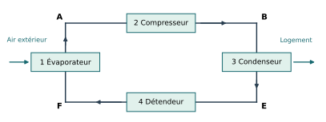
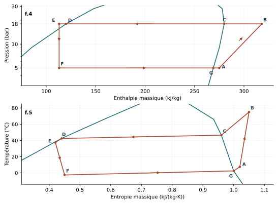
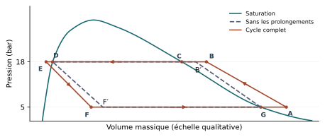

# Banque PT 2017 — Physique B · Thermodynamique · Corrigé guidé

*Corrigé rédigé par IA, non officiel. Signalez toute erreur.*

**Rédaction** · GPT-6.2 Astra Ultra · vitesse non renseignée

**Révision (tour 1)** · GPT-6.2 Astra Ultra · vitesse non renseignée

[Sujet et document réponse](https://www.banquept.fr/documents/2017/ph_b_th_2017_pt.pdf) · [Rapport du jury](https://www.banquept.fr/documents/ecrit/rapport/2017/rapport_phys_b_ecrit_2017.pdf) · [Coefficients de la session](https://www.banquept.fr/documents/livret/2017/Livret_PT_2017.pdf#page=12)

**Chauffage d’une habitation par une pompe à chaleur au R407C.** Les puissances et transferts sont orientés explicitement dans les bilans. Les valeurs relevées graphiquement sont arrondies à la précision des diagrammes du sujet.

## Documents · Le mélange R407C

### Question 1 · Nomenclature des fluides

**Piste de résolution**

Le préfixe précède le numéro propre à chaque fluide ou mélange.

La lettre R signifie « réfrigérant », de l’anglais *refrigerant*.

### Question 2 · Filtration des ultraviolets

**Piste de résolution**

Situer la substance qui absorbe les ultraviolets dans la stratosphère.

La couche d’ozone stratosphérique absorbe une grande partie des ultraviolets solaires énergétiques.

### Question 3 · Bilan radiatif terrestre

**Piste de résolution**

Identifier le rayonnement absorbé et réémis par les gaz atmosphériques.

Il s’agit de l’effet de serre, que renforce une augmentation de la teneur atmosphérique en gaz absorbant les infrarouges.

### Question 4 · Pente dans le domaine diphasé

**Piste de résolution**

Suivre d’abord une isobare de la bulle vers la rosée, puis imaginer comment maintenir la température.

Sur une isobare, la vaporisation augmente le volume massique et la température du mélange. À volume fixé, une élévation de pression relève aussi la température d’équilibre. Pour augmenter le volume à température constante, il faut donc abaisser la pression. La pente $(\partial P/\partial v)_T$ est négative entre les branches de saturation. C’est le glissement à pression fixée qui renseigne ici sur la pente dans la zone diphasée.

## Cycle et diagrammes

### Question 5 · Repérage de la pompe à chaleur

**Piste de résolution**

La flèche extérieure entre dans l’échangeur de gauche. Suivre ensuite le fluide dans le sens indiqué.

Le rectangle de la figure f.2 porte **1 évaporateur** à gauche, **2 compresseur** en haut, **3 condenseur** à droite et **4 détendeur** en bas. Les sommets successifs sont A en haut à gauche, B en haut à droite, E en bas à droite et F en bas à gauche. G est intérieur à l’évaporateur et C et D sont intérieurs au condenseur.

### Question 6 · Travail d’un cycle récepteur

**Piste de résolution**

Comptabiliser le travail mécanique reçu sur un tour entier.

Le fluide reçoit un travail net positif du compresseur pendant chaque cycle. Cette dépense permet de transférer de la chaleur vers le logement plus chaud que la source extérieure.

### Question 7 · Échangeur du logement

**Piste de résolution**

Lors d’une liquéfaction, observer de quel côté part la chaleur.

Le condenseur se trouve à l’intérieur du logement. Il cède à l’air intérieur la chaleur de désurchauffe de la vapeur, de liquéfaction du mélange et de sous-refroidissement du liquide.

### Question 8 · Isobare d’un gaz parfait

**Piste de résolution**

À pression fixée, remplacer la différentielle d’enthalpie par celle de la deuxième loi de Joule.

Pour une vapeur parfaite à capacité massique constante, $dh=c_p\,dT$. Sur l’isobare, $dP=0$, donc $c_p\,dT=T\,ds$. Entre deux états de la même isobare, $s-s_0=c_p\ln(T/T_0)$ et $T=T_0\exp[(s-s_0)/c_p]$. La température employée dans l’exponentielle est absolue. Passer en degrés Celsius translate l’ordonnée de 273,15.

### Question 9 · Trois diagrammes du cycle

**Piste de résolution**

Fixer d’abord les paliers de pression, puis les intersections avec les branches de rosée et de bulle.

**a) Figure f.3.** Sur l’isobare basse, F est sous la cloche, G sur la branche vapeur et A à sa droite. A→B monte vers la gauche. Sur l’isobare haute, B→C→D→E va vers les petits volumes, C est sur la branche vapeur et D sur la branche liquide. E→F descend vers les volumes croissants. Le tracé commun aux questions 9a et 30 figure à la question 30.

**b) Figure f.4.** La pression vaut 5,00 bar sur F–G–A et 18,0 bar sur B–C–D–E. À partir de E, descendre verticalement jusqu’à 5,00 bar puisque $h_F=h_E$. **c) Figure f.5.** Reporter les couples $(s,\theta)$ du tableau. C→D et F→G restent inclinés car la température glisse pendant le changement d’état. L’entropie croît sur A→B et E→F. Les flèches suivent l’ordre alphabétique, puis G rejoint A.

| État | A | B | C | D | E | F | G |
|:--|--:|--:|--:|--:|--:|--:|--:|
| Pression (bar) | 5,00 | 18,0 | 18,0 | 18,0 | 18,0 | 5,00 | 5,00 |
| Température (°C) | 7,50 | 75,0 | 46,5 | 42,5 | 37,5 | −2,50 | 2,50 |
| Enthalpie (kJ/kg) | 275 | 318 | 280 | 120 | 113 | 113 | 269 |
| Entropie (kJ/(kg·K)) | 1,02 | 1,05 | 0,960 | 0,440 | 0,420 | 0,450 | 1,00 |

### Question 10 · Irréversibilité dans les échangeurs

**Piste de résolution**

Décrire les températures de part et d’autre de la surface d’échange.

Un écart fini de température entre les deux fluides crée de l’entropie. Un échangeur à contre-courant de surface suffisante rapproche les profils de température et réduit cette création.

## Compression

### Question 11 · Capacité thermique de la vapeur

**Piste de résolution**

Passer de la relation de Mayer molaire à la relation massique.

Les capacités massiques vérifient $c_p-c_v=r$ et $c_p/c_v=\gamma$. On obtient $c_{p,\mathrm{vap}}=\gamma r/(\gamma-1)$, en J/(kg·K).

### Question 12 · Température de compression idéale

**Piste de résolution**

Intégrer la variation d’entropie entre les deux pressions en imposant une compression isentropique.

L’adiabaticité et la réversibilité imposent $ds=0$. Pour le gaz parfait, $ds=c_p\,dT/T-r\,dP/P$. Avec des capacités constantes, l’intégration donne $T_{B,s}=T_A(P_B/P_A)^{(\gamma-1)/\gamma}$, en kelvins. L’indice $s$ distingue cette température idéale de celle mesurée en B.

### Question 13 · Production d’entropie dans le compresseur

**Piste de résolution**

Une variation d’entropie se partage entre échange et production.

Le compresseur est adiabatique, donc l’entropie échangée est nulle. Le bilan massique donne $s_{\mathrm{créée}}=s_B-s_A=1{,}05-1{,}02=0{,}03$ kJ/(kg·K). Cette production positive établit l’irréversibilité de la compression réelle.

### Question 14 · Variations d’enthalpie et d’entropie

**Piste de résolution**

Employer des fonctions d’état, y compris pour relier les extrémités d’un trajet irréversible.

En assimilant la vapeur à un gaz parfait à capacités constantes, $\Delta h_{AB}=\gamma r(T_B-T_A)/(\gamma-1)$. L’intégration de la différentielle d’entropie donne $\Delta s_{AB}=[\gamma r/(\gamma-1)]\ln(T_B/T_A)-r\ln(P_B/P_A)$. Les rapports de températures sont formés en kelvins.

### Question 15 · Bilan du système ouvert

**Piste de résolution**

Entourer le compresseur d’une surface fixe traversée par le fluide.

En régime permanent, par kilogramme de fluide, $w_i+q=\Delta h+\Delta e_c+\Delta e_p$, les transferts étant positifs vers le fluide. Les variations d’énergie cinétique et potentielle sont négligeables et la compression adiabatique impose $q=0$. Le travail indiqué reçu vaut donc $w_{AB}=h_B-h_A$.

### Question 16 · Travail et entropie de compression

**Piste de résolution**

La figure f.1 donne les valeurs expérimentales nécessaires aux deux différences.

**a)** Le compresseur fournit au fluide $318-275=43$ kJ/kg, à la précision de la différence d’enthalpies tabulées. **b)** L’entropie augmente de $1{,}05-1{,}02=0{,}03$ kJ/(kg·K), soit environ 30 J/(kg·K). La dernière décimale est limitée par la précision des deux lectures.

## Condenseur

### Question 17 · Première étape du condenseur

**Piste de résolution**

Le premier contact avec la courbe de rosée se produit en C.

La désurchauffe isobare refroidit la vapeur surchauffée de B à C jusqu’à la vapeur saturante.

### Question 18 · Dernière étape du condenseur

**Piste de résolution**

En D la liquéfaction est achevée.

Le sous-refroidissement isobare refroidit le liquide de D à E de 5,0 K sous la température de bulle.

### Question 19 · Enthalpie de vaporisation et transfert au logement

**Piste de résolution**

Séparer le trajet entre états saturés du bilan sur l’ensemble du condenseur.

**a)** L’enthalpie massique de vaporisation à 18,0 bar vaut $h_C-h_D=280-120=160$ kJ/kg. **b)** Sur B→E, l’échangeur fixe ne reçoit aucun travail indiqué. Le fluide reçoit $q_{\rm cond}=h_E-h_B=113-318=-205$ kJ/kg. Le logement reçoit 205 kJ/kg de fluide, dont 38 kJ/kg pendant la désurchauffe, 160 pendant la condensation et 7 pendant le sous-refroidissement.

## Détendeur

### Question 20 · Détente de Joule-Thomson

**Piste de résolution**

Appliquer le même principe qu’au compresseur et identifier les deux transferts nuls.

Le détendeur est un système ouvert en régime permanent. Le tube est indéformable et sans arbre, donc $w_i=0$. Il est adiabatique, donc $q=0$. Les variations d’énergies cinétique et potentielle sont négligeables, ce qui réduit le premier principe à $h_F-h_E=0$. Le laminage conserve l’enthalpie, ici 113 kJ/kg.

### Question 21 · Entropies du laminage

**Piste de résolution**

La chute de pression dissipative se produit dans un capillaire calorifugé.

La détente est adiabatique et irréversible. Le second principe impose donc à l’avance $\Delta s=s_c>0$. Avec la figure f.1, $s_e=0$ et $s_c=s_F-s_E=0{,}450-0{,}420=0{,}030$ kJ/(kg·K), soit 30 J/(kg·K).

### Question 22 · Fraction massique de vapeur en F

**Piste de résolution**

À l’intersection de l’isenthalpe 113 kJ/kg et de l’isobare 5 bar, lire une isochore, puis effectuer une moyenne des volumes.

Le volume total est la somme des volumes des deux phases. Ainsi $v_F=(1-x_v)v_\ell+x_vv_v$ et $x_v=(v_F-v_\ell)/(v_v-v_\ell)$. Sur f.4, F est tout près de l’isochore 0,010 m³/kg, du côté des volumes supérieurs. Avec la lecture arrondie $v_F\simeq0{,}010$ m³/kg, on obtient $(0{,}010-0{,}000830)/(0{,}0500-0{,}000830)\simeq0{,}19$. Une interpolation à 0,012 m³/kg donne 0,23. La précision du tracé justifie **environ un cinquième de vapeur en masse**.

## Évaporateur

### Question 23 · Dernière étape de l’évaporateur

**Piste de résolution**

Comparer la température de sortie à la température de rosée à la même pression.

Le chauffage de G à A est une surchauffe isobare de la vapeur de 5 K.

### Question 24 · Protection du compresseur

**Piste de résolution**

Réfléchir à l’effet d’une fluctuation de température au voisinage de la saturation.

En G, la vapeur est sèche mais juste saturante. Une fluctuation ou des gouttes entraînées peuvent alors envoyer du liquide presque incompressible dans le compresseur. La surchauffe donne une marge contre les coups de liquide et leurs dommages mécaniques.

### Question 25 · Chaleur fournie par l’air extérieur

**Piste de résolution**

Écrire le bilan du fluide entre l’entrée F et la sortie A.

L’évaporateur fixe échange uniquement de la chaleur. Le fluide reçoit $q_{\rm évap}=h_A-h_F=275-113=162$ kJ/kg. On vérifie $162+43-205=0$ kJ/kg sur le cycle.

## Coefficient de performance

### Question 26 · Performance électrique du chauffage

**Piste de résolution**

Définir séparément le service rendu et l’énergie payée.

Le service rendu est la chaleur livrée au logement. La consommation électrique par kilogramme est $w_{\rm él}=w_{AB}/(\rho_{\rm él}\rho_m)$. Ainsi $\mathrm{COP}_{\rm hiver}=|q_{\rm cond}|/w_{\rm él}=\rho_{\rm él}\rho_m(h_B-h_E)/(h_B-h_A)$. Ce rapport de deux énergies est sans dimension.

### Question 27 · Ordre de grandeur domestique

**Piste de résolution**

Une partie de la chaleur livrée provient de l’air extérieur.

Un COP de l’ordre de 3 à 4 est usuel dans des conditions favorables. Il varie avec la température extérieure et la température demandée au chauffage.

### Question 28 · Application au fonctionnement hivernal

**Piste de résolution**

Inclure le rendement électrique de 0,800 avant de comparer au chauffage direct.

Le travail électrique vaut $43/0{,}800\simeq53{,}8$ kJ/kg. La performance du chauffage est $0{,}800\times205/43\simeq3{,}81$.

### Question 29 · Avantages et contraintes d’une PAC air-air

**Piste de résolution**

Comparer les consommations pour une même chaleur utile et considérer le fonctionnement hivernal.

Pour 1 kWh de chaleur, la machine étudiée consomme environ 0,26 kWh d’électricité, contre 1 kWh pour une résistance. La différence vient de l’extérieur, ce qui réduit la facture à tarif égal et les émissions liées à l’électricité à mix identique. Le groupe extérieur fait du bruit, son échangeur peut givrer et le COP diminue lorsque le froid augmente. L’investissement et l’entretien sont aussi plus importants.

### Question 30 · Cycle sans surchauffe ni sous-refroidissement

**Piste de résolution**

Conserver les deux isobares. La compression part maintenant de G et le détendeur est alimenté en D.

Sur f.3, suivre en pointillés $G\to B'\to C\to D\to F'\to G$. À 18 bar, la sortie de compression $B'$ se place près de B, un peu à sa gauche pour la même loi de compression. De D, la détente conserve $h_D=120$ kJ/kg. À 5 bar, $F'$ se trouve donc à droite de F, qui a l’enthalpie plus faible de 113 kJ/kg. Les portions communes des isobares se recouvrent.

### Question 31 · Effet des deux prolongements

**Piste de résolution**

Discuter le numérateur et le dénominateur du COP avec les hypothèses du cycle comparé.

Le sous-refroidissement abaisse l’enthalpie de sortie du condenseur et augmente la chaleur livrée par kilogramme. La surchauffe relève l’enthalpie à l’aspiration et au refoulement. Dans la comparaison qualitative du sujet, le saut d’enthalpie du compresseur est sensiblement maintenu tandis que la chaleur cédée augmente, d’où une hausse du COP. À rapport de pressions et rendement isentropique fixés pour un gaz parfait, le travail varie en fait comme la température absolue d’aspiration. Les 5 K représentent ici moins de 2 %, ce qui précise la portée de l’approximation.

## Installation domestique

### Question 32 · Refroidissement de la maison

**Piste de résolution**

Prendre pour système l’air intérieur à température uniforme et appliquer un bilan de puissance.

**a)** Pour $T>T_e$, la chaleur quitte la maison et la puissance reçue est négative. Elle s’annule pour $T=T_e$. Le produit $C(T-T_e)$ est une énergie, donc $k$ est en s⁻¹. **b)** Sans chauffage, $C\,dT/dt=-kC(T-T_e)$ avec $T(0)=T_h$. **c)** La solution est $T(t)=T_e+(T_h-T_e)e^{-kt}$. L’écart est divisé par deux à $t=\tau$, d’où $k=(\ln2)/\tau$.

### Question 33 · Puissance électrique et débit de réfrigérant

**Piste de résolution**

En régime stationnaire, les pertes sont exactement compensées au condenseur.

**a)** La puissance à fournir au logement est $\dot Q_h=kC(T_h-T_e)$. La puissance électrique est $P_{\rm él}=kC(T_h-T_e)/\mathrm{COP}_{\rm hiver}$. **b)** Chaque kilogramme dépose $|q_{\rm cond}|$, d’où $D_{m,\rm fl}=kC(T_h-T_e)/|q_{\rm cond}|$ en kg/s.

### Question 34 · Couplage des débits dans l’échangeur intérieur

**Piste de résolution**

Écrire l’égalité des puissances reçue par l’air et cédée par le fluide.

Le débit d’air reçoit $D_{m,a}c_{p,a}\Delta T_a$ et le débit de réfrigérant cède $D_{m,\rm fl}|q_{\rm cond}|$. Ainsi $D_{m,a}=D_{m,\rm fl}|q_{\rm cond}|/(c_{p,a}\Delta T_a)$, pour un échangeur sans pertes vers un troisième milieu.

### Question 35 · Bilan numérique du logement

**Piste de résolution**

Utiliser le COP et la chaleur massique propres à cette dernière question.

Avec les données de la question, $k=0{,}693/693=1{,}00\times10^{-3}$ s⁻¹. La perte vaut 10,0 kW. La puissance électrique est $10{,}0/4{,}00=2{,}50$ kW. Le débit de réfrigérant vaut $10{,}0/200=0{,}0500$ kg/s et le débit d’air $10{,}0/(1{,}00\times10{,}0)=1{,}00$ kg/s. Les trois derniers quotients utilisent des kW et des kJ pour garder la seconde comme unité de temps.
