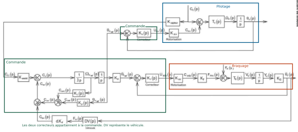
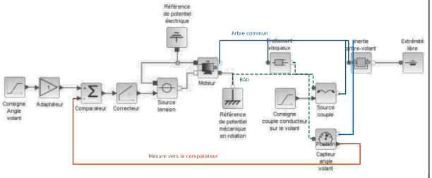
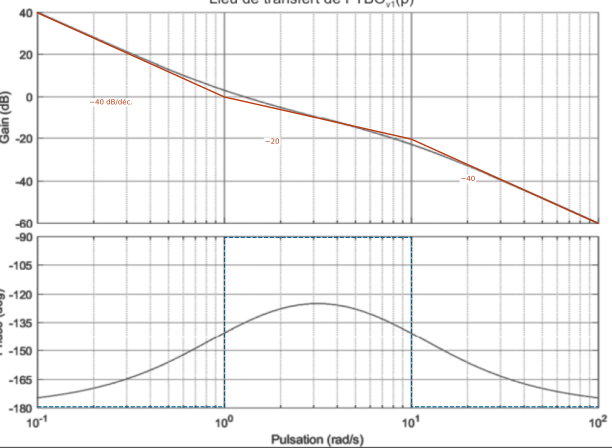
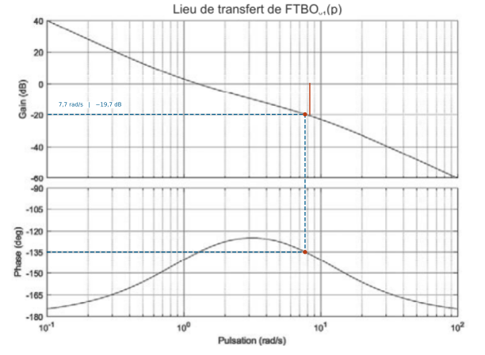
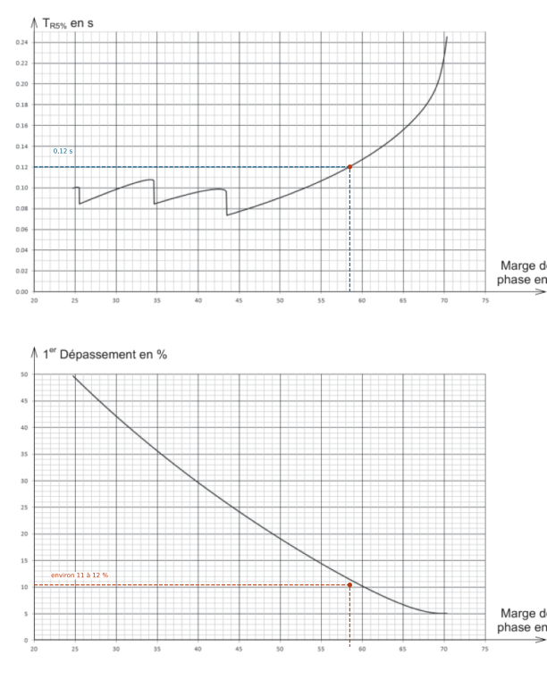
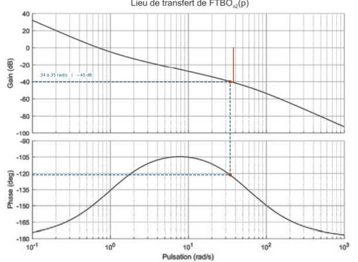
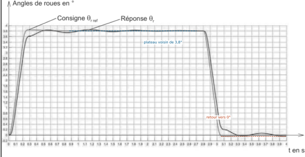

# Banque PT 2017 — Sciences industrielles A · Corrigé guidé

*Corrigé rédigé par IA, non officiel. Signalez toute erreur.*

**Rédaction** · GPT-6.2 Astra Ultra · vitesse non renseignée · 26 novembre 2026

**Révision (tour 1)** · GPT-6.2 Astra Ultra · vitesse non renseignée · 26 novembre 2026

**Direction automobile découplée.** Épreuve de cinq heures, calculatrice interdite. Le sujet est accompagné de huit annexes et d’un cahier de réponses. Ses 49 questions se répartissent en quatre parties.

[Sujet et cahier officiels](https://www.banquept.fr/documents/2017/si_a_2017_pt.pdf) · [Rapport du jury](https://www.banquept.fr/documents/ecrit/rapport/2017/rapport_si_a_ecrit_2017.pdf)

Le jury attire l’attention sur l’erreur de régulation, la lecture des gains en décibels et la distinction entre mobilités utiles et interne. Dans les calculs de statique, conservez les orientations du schéma jusqu’à l’application numérique.

## A. Architecture de la direction

### Question 1 — Interface de puissance

> [!INDICATION]
> Distinguer l'ordre de faible puissance et la source qui alimente le moteur.

#### Solution

L'interface est un **préactionneur**. Elle module ou distribue l'énergie électrique disponible en fonction de l'ordre de commande. Le moteur en assure ensuite la conversion en énergie mécanique.

[Sujet p. 8](https://www.banquept.fr/documents/2017/si_a_2017_pt.pdf#page=8) · [Cahier p. 38 du PDF](https://www.banquept.fr/documents/2017/si_a_2017_pt.pdf#page=38)

### Question 2 — Les cinq flux

> [!INDICATION]
> Suivre le fil de chaque numéro jusqu'à sa source sur la figure A3.

#### Solution

1 est une information de commande, la tension $U_{mv}$ envoyée à l'interface. 2 est l'information de position mesurée du volant. 3 transmet au capteur la grandeur physique à mesurer, la position mécanique du pignon, information à l'entrée de la chaîne d'acquisition. 4 est l'information de couple $C_{ci}$ délivrée au contrôleur de modèles. 5 est un échange d'énergie mécanique entre le boîtier et les bielles, caractérisé par un effort et une vitesse.

### Question 3 — Trois unités

> [!INDICATION]
> Repérer les sorties des deux correcteurs et celles des deux actionneurs.

#### Solution

La commande élabore les références avec le modèle du volant et les gains d'assistance, de raideur et d'amortissement. Elle comprend également les deux comparateurs et les correcteurs $K_v,K_r$ qui produisent $U_{mv},U_{mb}$. Le pilotage contient la mesure du couple conducteur, le moteur $K_{mv}$, le sommateur des couples, la dynamique $T_v$ et l'intégrateur conduisant à l'angle du volant. Le braquage va de $K_{mr}$ à l'angle de roue par $K_F$, le bilan des forces, $T_b$, l'intégrateur et $K_G$. Le bloc $DV$ représente le véhicule extérieur. Le cahier annoté reprend ces frontières sur la figure A4.

[Sujet p. 8](https://www.banquept.fr/documents/2017/si_a_2017_pt.pdf#page=8) · [Cahier p. 39 du PDF](https://www.banquept.fr/documents/2017/si_a_2017_pt.pdf#page=39)

## B. Pilotage et retour d’effort

### Question 4 — Connexion du modèle acausal

> [!INDICATION]
> Relier les ports physiques du même arbre. La sortie de mesure est un signal.

#### Solution

Relier la bride mobile du moteur, l'inertie du volant, la bride mobile du frottement, celle de la source de couple conducteur et l'entrée mécanique du capteur d'angle au même arbre. Relier les brides de référence des composants qui en possèdent une au bâti mécanique. La sortie de mesure rejoint l'entrée négative du comparateur. Le côté positif reçoit la consigne adaptée. Les couples appliqués au nœud s'additionnent et l'angle est commun aux brides solidaires.

[Sujet p. 10](https://www.banquept.fr/documents/2017/si_a_2017_pt.pdf#page=10) · [Cahier p. 40 du PDF](https://www.banquept.fr/documents/2017/si_a_2017_pt.pdf#page=40)

### Question 5 — Dynamique de l'arbre-volant

> [!INDICATION]
> Projeter le théorème du moment cinétique sur l'axe fixe du pivot.

#### Solution

On isole l'arbre-volant $v$ dans le référentiel galiléen du châssis. En $G_v$ et suivant $\vec x_v$, le pivot idéal ne transmet aucun moment axial. Le couple visqueux vaut $-f_v\dot\theta_v$. Le théorème du moment cinétique donne $J_v\ddot\theta_v+f_v\dot\theta_v=C_c+C_{mv}$. Le moteur peut fournir un couple algébrique négatif.

### Question 6 — Relation couple-vitesse

> [!INDICATION]
> La transformée de la vitesse est $p\Theta_v$ sous conditions initiales nulles.

#### Solution

On obtient $(J_vp^2+f_vp)\Theta_v=C_c+C_{mv}$, donc $T_v=\Omega_v/(C_c+C_{mv})=1/(f_v+J_vp)=g_v/(1+\tau_vp)$ avec $g_v=1/f_v$ et $\tau_v=J_v/f_v$.

### Question 7 — Précision avec P ou PI

> [!INDICATION]
> Appliquer le théorème de la valeur finale aux deux entrées séparément.

#### Solution

Avec le seul gain $K$, la boucle contient déjà l'intégrateur angle/vitesse. L'erreur de consigne est nulle sur un échelon, vaut $\Omega_{v0}/(KK_{mv}g_v)$ sur une rampe. Pour un échelon de couple $C_0$, l'erreur de régulation tend à $-C_0/(KK_{mv})$. Elle croît sur une rampe de couple. Le PI porte la boucle en classe 2 : les deux erreurs de consigne et l'erreur de couple en échelon s'annulent. L'erreur sur une rampe de couple devient finie et réglable. Ces valeurs finales supposent la boucle stable. L'intégrateur ajouté apporte du retard de phase, que le zéro du PI doit compenser autour de la coupure.

### Question 8 — Fonction de boucle

> [!INDICATION]
> Factoriser les deux intégrateurs, puis normaliser la partie restante à gain unitaire.

#### Solution

Le produit des blocs est $L_1=K_iK_{mv}g_v(1+\alpha\tau_vp)/[\alpha\tau_v p^2(1+\tau_vp)]$. Ainsi $K_{BOv1}=K_iK_{mv}g_v/(\alpha\tau_v)$ et $H=(1+\alpha\tau_vp)/(1+\tau_vp)$, avec $H(0)=1$. Les deux intégrateurs apportent $-180^\circ$. Pour que $H$ fournisse une avance de phase à fréquence finie, il faut placer son zéro avant son pôle, donc $\alpha>1$.

### Question 9 — Gain minimal du PI

> [!INDICATION]
> La perturbation entre après le gain moteur. La traiter sans la confondre avec la consigne.

#### Solution

Pour une consigne nulle, $E/C_c=-(T_v/p)/(1+L_1)\sim-\tau_i p/(K_iK_{mv})$. Pour $C_c(p)=C_{c0}/p^2$, la valeur finale est $-C_{c0}\tau_i/(K_iK_{mv})$. Comme $\tau_i=1$ s et $K_{mv}=0{,}4$, demander $|e_\infty|\le0{,}10 C_{c0}$ donne $K_i\ge25\ \mathrm{V\,rad^{-1}}$. En utilisant toute la flexibilité jusqu'à 15 %, la borne descend à $16{,}7$. Les trois autres erreurs de régime permanent sont nulles.

### Question 10 — Asymptotes de Bode

> [!INDICATION]
> Écrire les facteurs pour le gain de référence de 0,5 avant de tracer.

#### Solution

Ici $L_1=(1+p)/[p^2(1+0{,}1p)]$. Les cassures sont 1 et $10\ \mathrm{rad\,s^{-1}}$. Les pentes du gain sont successivement $-40,-20,-40$ dB/décade, avec des asymptotes passant par $(0{,}1;40),(1;0),(10;-20),(100;-60)$. La phase asymptotique par paliers est $-180^\circ,-90^\circ,-180^\circ$. La phase réelle est $-180^\circ+\arctan\omega-\arctan(0{,}1\omega)$ ; le chevauchement des transitions la limite à environ $-125^\circ$.

[Sujet p. 11](https://www.banquept.fr/documents/2017/si_a_2017_pt.pdf#page=11) · [Cahier p. 43 du PDF](https://www.banquept.fr/documents/2017/si_a_2017_pt.pdf#page=43)

### Question 11 — Marge de phase de 45 degrés

> [!INDICATION]
> Repérer le deuxième passage à −135 degrés, puis remonter au gain.

#### Solution

La haute intersection se lit vers $7{,}7$ à $8\ \mathrm{rad\,s^{-1}}$. À ce point le lieu de référence vaut environ $-20$ dB. On décale le gain d'environ $+20$ dB en multipliant $K_i$ par 10, soit $K_i\simeq5\ \mathrm{V\,rad^{-1}}$. Le calcul donne $\omega=(9+\sqrt{41})/2=7{,}70$ et $K_i\simeq4{,}82$.

[Sujet p. 11](https://www.banquept.fr/documents/2017/si_a_2017_pt.pdf#page=11) · [Cahier p. 44 du PDF](https://www.banquept.fr/documents/2017/si_a_2017_pt.pdf#page=44)

### Question 12 — Limite du réglage par PI

> [!INDICATION]
> Lire la borne supérieure de la pulsation sur B1.

#### Solution

L'abaque B1 fait tendre la plus haute intersection à $45^\circ$ vers $1/\tau_v=10\ \mathrm{rad\,s^{-1}}$. On retrouve cette borne car $\arctan(\alpha\tau_v\omega)<90^\circ$ et il faut donc $\arctan(\tau_v\omega)<45^\circ$. Changer le gain translate le module sans modifier la phase. Une coupure à au moins 30 avec la marge de phase prescrite est impossible avec ce seul PI.

### Question 13 — Bilan du premier réglage

> [!INDICATION]
> Tester les six lignes du cahier des charges et leurs tolérances.

#### Solution

Avec $K_i\simeq4{,}8$, la marge de phase vaut $45^\circ$ et la marge de gain est infinie dans le modèle. La coupure est seulement $7{,}7$ au lieu d'au moins $30\ \mathrm{rad\,s^{-1}}$. B2 donne un temps proche de $0{,}65$ s et un dépassement d'environ 30 %, au-delà de 0,12 s et 15 %. Les deux consignes et la perturbation en échelon ont une erreur finale nulle. Sur la perturbation en rampe, l'erreur vaut en module $2{,}5/4{,}8\simeq0{,}52$ fois la pente, au-delà même de 0,15. Sur B2 le dépassement minimal reste supérieur à 20 %. Aucun simple changement de gain ne satisfait l'ensemble.

### Question 14 — Objectif du retour de vitesse

> [!INDICATION]
> Identifier le pôle mécanique qui limite la phase et la rapidité.

#### Solution

Le retour négatif de vitesse accélère la boucle mécanique intérieure. Il déplace sa cassure haute vers une pulsation supérieure et permet de conserver une avance de phase à une coupure plus élevée. On vise ainsi à la fois un temps de réponse plus court et un amortissement suffisant, tout en gardant le PI pour la précision.

### Question 15 — Dynamique avec retour tachymétrique

> [!INDICATION]
> Faire la fermeture de la boucle intérieure avant d'étudier l'angle.

#### Solution

La relation $\Omega_v=T_v(\varepsilon_{cv}-K_{rt}\Omega_v)$ donne $T_{vrt}=T_v/(1+K_{rt}T_v)$. En posant $\beta=(1+K_{rt}g_v)^{-1}$, on obtient $T_{vrt}=\beta g_v/(1+\beta\tau_vp)=T_v\,\beta(1+\tau_vp)/(1+\beta\tau_vp)$.

### Question 16 — Nouvelle boucle ouverte

> [!INDICATION]
> Remplacer le bloc vitesse par sa forme réduite de Q15.

#### Solution

Le produit corrigé est $L_2=K_{BOv2}(1+\alpha\tau_vp)/[p^2(1+\beta\tau_vp)]$ avec $K_{BOv2}=K_iK_{mv}g_v\beta/(\alpha\tau_v)$. Pour les valeurs choisies, $L_2=(K_i/3)(1+p)/[p^2(1+p/60)]$.

### Question 17 — Déplacement du pôle

> [!INDICATION]
> Comparer les deux cassures hautes et la phase à une même pulsation.

#### Solution

La pulsation du pôle mécanique passe de $1/\tau_v$ à $1/(\beta\tau_v)$. Il faut $0<\beta<1$ pour la déplacer vers la droite. Le terme de retard $\arctan(\beta\tau_v\omega)$ diminue alors. Une nouvelle augmentation du gain peut placer la coupure dans la zone où la marge reste suffisante. Pour $\beta=1/6$, la cassure passe de 10 à 60 rad/s.

### Question 18 — Marge retenue sur B3

> [!INDICATION]
> Retenir l'intersection des deux intervalles autorisés en temps et dépassement.

#### Solution

Le dépassement descend sous 15 % vers $55^\circ$. Sur la branche utile de B3, la courbe de temps atteint 0,12 s vers $58$ à $59^\circ$ et dépasse ensuite cette limite. Le plus grand réglage compatible est donc voisin de $58{,}5^\circ$ ; le premier dépassement y vaut environ 11 à 12 %.

[Sujet p. 13](https://www.banquept.fr/documents/2017/si_a_2017_pt.pdf#page=13) · [Cahier p. 47 du PDF](https://www.banquept.fr/documents/2017/si_a_2017_pt.pdf#page=47)

### Question 19 — Gain avec retour tachymétrique

> [!INDICATION]
> Une translation verticale du gain préserve toute la courbe de phase.

#### Solution

On vise la phase $-180^\circ+58{,}5^\circ=-121{,}5^\circ$ sur la branche descendante. Sur le tracé pour $K_i=1{,}2$, elle se situe vers $34$ à $35\ \mathrm{rad\,s^{-1}}$, au gain voisin de $-40$ dB. Il faut multiplier le gain par $10^{40/20}=100$. On choisit $K_i\simeq120\ \mathrm{V\,rad^{-1}}$. L'intersection de basse fréquence donnerait une coupure insuffisante.

[Sujet p. 13](https://www.banquept.fr/documents/2017/si_a_2017_pt.pdf#page=13) · [Cahier p. 48 du PDF](https://www.banquept.fr/documents/2017/si_a_2017_pt.pdf#page=48)

### Question 20 — Validation du pilotage

> [!INDICATION]
> Relier chaque modification du modèle au critère qu'elle améliore.

#### Solution

Le PI assure les zéros d'erreur de Q7 ; le retour tachymétrique déplace le pôle limitant, puis le gain règle la coupure. Pour $K_i\simeq120$, celle-ci est voisine de 35 rad/s, au-dessus de 30. B3 donne environ 0,12 s, à la borne de l'intervalle 0,08–0,12 s, et un dépassement voisin de 11 %, inférieur à 15 %. La marge de phase avoisine $58^\circ$ et celle de gain est infinie dans le modèle. L'erreur de consigne s'annule pour l'échelon et la rampe. L'erreur due à un échelon de couple s'annule aussi ; pour la rampe elle vaut environ $2{,}5/120=2{,}1\,\%$ de la pente. Le modèle temporel donne 0,1198 s au gain arrondi 120, contre 0,1205 s au gain 118,96 lu pour $58{,}5^\circ$. Le premier de ces deux réglages respecte la limite stricte.

### Question 21 — Limite physique du réglage

> [!INDICATION]
> Comparer l'amplitude de commande du modèle avec les possibilités d'un actionneur réel.

#### Solution

Un grand gain peut demander lors d'un transitoire un courant et un couple excessifs, échauffer la machine ou endommager l'électronique. Une limitation de courant dans le variateur borne le couple. Une protection de l'intégrateur pendant la saturation évite une accumulation excessive de commande. Lorsqu'une limite agit, la montée est plus lente et les performances du modèle linéaire doivent être revérifiées.

## C. Dynamique du véhicule et du braquage

### Question 22 — Mobilités et hyperstatisme

> [!INDICATION]
> Distinguer le guidage apparent du triangle et les deux liaisons qui le réalisent.

#### Solution

Le triangle 5 est guidé sur 1 par un pivot glissant d'axe longitudinal et une rotule en E sur ce même axe. Leur association réalise un pivot et reprend deux contraintes redondantes. La rotule C relie 5 à 6, le pivot glissant de l'amortisseur relie 6 à 7 et la rotule D relie 7 à 1. Il y a deux mobilités utiles, le débattement commandé par la sollicitation verticale et équilibré par la suspension, et le pivotement de la roue imposé par la bielle. Une rotation propre de la tige 7 autour de son axe laisse la fusée et la roue à la même place : c'est une mobilité interne. Pour les trois solides mobiles, les trois rotules et les deux pivots glissants apportent $3\times3+2\times4=17$ contraintes scalaires. La relation $m-h=18-17=1$ avec $m=3$ donne **$h=2$**.

[Sujet p. 15](https://www.banquept.fr/documents/2017/si_a_2017_pt.pdf#page=15) · [Cahier p. 50 du PDF](https://www.banquept.fr/documents/2017/si_a_2017_pt.pdf#page=50)

### Question 23 — Axe de pivotement

> [!INDICATION]
> Écrire un produit vectoriel dans la base du châssis et identifier son rang.

#### Solution

Dans le repère d'origine C, les équations sont $yz_D-zy_D=0$, $zx_D-xz_D=0$, $xy_D-yx_D=0$. Le produit vectoriel avec un vecteur non nul est de rang deux. Comme $z_D\ne0$, la droite admet la paramétrisation $(x,y,z)=(z/z_D)(x_D,y_D,z_D)$, qui entraîne la troisième équation.

### Question 24 — Déport longitudinal

> [!INDICATION]
> Déterminer l'abscisse de Q au niveau du sol puis celle de I.

#### Solution

Le sol est au niveau $z=-h$. Donc $x_Q=-hx_D/z_D$ et $x_I=0$, puisque le centre de la roue est à la verticale longitudinale de C. L'orientation $\overrightarrow{IQ}=d\vec x_1$ conduit à $d=-hx_D/z_D=-(0{,}200)(-0{,}060)/0{,}600=0{,}020\ \mathrm m$, soit 20 mm vers l'avant.

### Question 25 — Moment autour de la droite CD

> [!INDICATION]
> Transporter le moment de I vers Q, également situé sur l'axe de projection.

#### Solution

Posons $N=\sqrt{x_D^2+y_D^2+z_D^2}$. Le moment projeté sur la droite CD est identique en C et en Q. Comme $\overrightarrow{QI}=-d\vec x_1$, son moment en Q est $dF_{n1}\vec y_1-dF_{t1}\vec z_1$. Par projection, $M_{rp}=d(y_DF_{n1}-z_DF_{t1})/N=(h x_D/z_D)(z_D F_{t1}-y_DF_{n1})/N$. Le poids et les réactions de liaison n'interviennent pas dans ce torseur du sol.

### Question 26 — Moment simplifié

> [!INDICATION]
> Évaluer séparément la norme du vecteur directeur et la contribution normale.

#### Solution

Les hypothèses imprimées sont $x_D^2\ll z_D^2$, $y_D^2\ll z_D^2$ et $F_{n1}\ll F_{t1}$ en valeur absolue. Ainsi $N\simeq z_D>0$ et le terme $y_DF_{n1}$ est négligeable. Le moment algébrique vaut $M_{rp}\simeq-dF_{t1}$.

### Question 27 — Bielle à deux forces

> [!INDICATION]
> Recenser les actions extérieures sur la seule pièce 8.

#### Solution

La bielle de poids négligé reçoit une force de la crémaillère en $A_1$ et une force de la fusée en B par deux rotules parfaites. L'équilibre en moment impose que leurs supports passent par les deux centres. L'équilibre de résultante les rend opposées. Comme la droite $A_1B$ est pratiquement parallèle à $\vec y_1$, le torseur de 4 sur 8 en $A_1$ est $(Y_{48}\vec y_1,\vec 0)$.

### Question 28 — Effort sur la crémaillère

> [!INDICATION]
> Prendre les moments sur CD, où les réactions des rotules C et D disparaissent.

#### Solution

Sur l'ensemble isolé, la force $Y_{48}\vec y_1$ peut glisser jusqu'en B. Son moment axial est $Y_{48}(x_Bz_D-z_Bx_D)/N$. L'équilibre avec $M_{rp}\simeq-dF_{t1}$ donne $Y_{48}\simeq dF_{t1}z_D/(x_Bz_D-z_Bx_D)$. Avec la convention imprimée $F_{rc}=-2Y_{48}$, on a $K_{G1}=-2/(x_B-z_Bx_D/z_D)=-2/(0{,}200+0{,}007)\simeq-9{,}7\ \mathrm{m^{-1}}$. Le facteur 2 tient aux deux roues. Le signe utilise les deux orientations de Q24 et Q28.

### Question 29 — Vitesses aux points de contact

> [!INDICATION]
> Le décalage vertical entre M et I est parallèle à l'axe de lacet.

#### Solution

La relation de champ des vitesses est $\vec V_I=\vec V_G+\dot\psi\vec z_1\times\overrightarrow{GI}$. La composante verticale de $GI$ disparaît du produit vectoriel. En base $(\vec x_1,\vec y_1)$ les deux vitesses ont pour première composante $V\cos\alpha$. Les secondes valent respectivement $V\sin\alpha+\ell_1\dot\psi$ et $V\sin\alpha-\ell_2\dot\psi$.

### Question 30 — Direction des vitesses

> [!INDICATION]
> Le vecteur normal à la direction d'angle $u$ a pour composantes $(-\sin u,\cos u)$.

#### Solution

Posons $u_1=\theta_r+\delta_1$, $u_2=\delta_2$. Dans la base du véhicule $\vec g_i=-\sin u_i\,\vec x_1+\cos u_i\,\vec y_1$. Les produits scalaires nuls donnent $(V\sin\alpha+\ell_1\dot\psi)\cos u_1-V\cos\alpha\sin u_1=0$ et $(V\sin\alpha-\ell_2\dot\psi)\cos u_2-V\cos\alpha\sin u_2=0$.

### Question 31 — Relations trigonométriques

> [!INDICATION]
> Isoler les tangentes dans les deux équations de projection.

#### Solution

On divise par $V\cos\alpha\cos u_i$, non nul dans les conditions de marche considérées. Il vient $\tan(\theta_r+\delta_1)=(V\sin\alpha+\ell_1\dot\psi)/(V\cos\alpha)$ et $\tan\delta_2=(V\sin\alpha-\ell_2\dot\psi)/(V\cos\alpha)$.

### Question 32 — Linéarisation des dérives

> [!INDICATION]
> Conserver les termes du premier ordre en angles exprimés en radians.

#### Solution

Avec $\cos\alpha\simeq1$, $\sin\alpha\simeq\alpha$ et $\tan u\simeq u$, on trouve $\delta_1=-\theta_r+\alpha+\ell_1\dot\psi/V$ et $\delta_2=\alpha-\ell_2\dot\psi/V$. La roue avant seule reçoit la consigne de braquage.

### Question 33 — Accélération du centre d'inertie

> [!INDICATION]
> La direction absolue de la vitesse du centre fait l'angle $\psi+\alpha$.

#### Solution

À norme $V$ constante, avec $\dot{\vec x}_1=\dot\psi\vec y_1$ et $\dot{\vec y}_1=-\dot\psi\vec x_1$, on obtient $\vec a_G=V(\dot\alpha+\dot\psi)(-\sin\alpha\vec x_1+\cos\alpha\vec y_1)$. La résultante dynamique est $M\vec a_G$. Une dérivation faite dans la seule base mobile ferait disparaître à tort le terme de lacet.

### Question 34 — Moment dynamique en lacet

> [!INDICATION]
> Projeter la dérivée du moment cinétique sur la verticale fixe.

#### Solution

En G, $\vec\Omega=\dot\psi\vec z_0$. La projection du moment cinétique sur la verticale est $J_{zz}\dot\psi$. L'axe est fixe et l'inertie autour de cet axe constante, donc $\vec\delta_G\cdot\vec z_0=J_{zz}\ddot\psi$.

### Question 35 — Équilibre dynamique latéral

> [!INDICATION]
> La force latérale avant est exprimée dans la base de la roue braquée.

#### Solution

Le poids et les réactions verticales n'ont ni composante latérale ni moment de lacet. Les roues sont supposées solidaires du véhicule. La projection sur $\vec y_1$ donne $MV(\dot\alpha+\dot\psi)\cos\alpha=F_{Y1}\cos\theta_r+F_{Y2}$. Au point G, le bilan de lacet est $J_{zz}\ddot\psi=\ell_1F_{Y1}\cos\theta_r-\ell_2F_{Y2}$.

### Question 36 — Coefficients des deux équations

> [!INDICATION]
> Substituer les lois de dérive puis normaliser chaque équation pour obtenir un coefficient unitaire devant le braquage.

#### Solution

Au premier ordre, $MV(\dot\alpha+\dot\psi)=D[\theta_r-2\alpha-(\ell_1-\ell_2)\dot\psi/V]$. De même $J_{zz}\ddot\psi=D[\ell_1\theta_r+(\ell_2-\ell_1)\alpha-(\ell_1^2+\ell_2^2)\dot\psi/V]$. Dans l'ordre demandé, $A=MV/D+(\ell_1-\ell_2)/V$, $B_1=-MV/D$, $B_2=-2$, $C=J_{zz}/(D\ell_1)$, $E=(\ell_1^2+\ell_2^2)/(V\ell_1)$ et $F=(\ell_2-\ell_1)/\ell_1$.

### Question 37 — Rapport de transmission

> [!INDICATION]
> Combiner réduction puis roulement du pignon sur la crémaillère.

#### Solution

En convention positive de la figure C1, $\dot y_c=R_{pc}\dot\theta_r^{\rm arbre}=R_{pc}r_2\dot\theta_m$, où $r_2<1$ est le rapport cinématique du réducteur. L'égalité des puissances idéales donne aussi $F_{mc}\dot y_c=C_{mb}\dot\theta_m$. Ainsi $K_F=1/(r_2R_{pc})$, en $\mathrm{m^{-1}}$.

### Question 38 — Masse équivalente

> [!INDICATION]
> Égaler les deux expressions de l'énergie cinétique totale.

#### Solution

Deux fois l'énergie cinétique vaut $J_2\dot\theta_m^2+J_3\dot\theta_3^2+M_c\dot y_c^2$. Avec $\dot\theta_m=\dot y_c/(r_2R_{pc})$ et $\dot\theta_3=\dot y_c/R_{pc}$, on identifie $M_{eq}=M_c+J_3/R_{pc}^2+J_2/(r_2R_{pc})^2$. Chaque terme s'exprime en kilogrammes.

### Question 39 — Bilan de puissance

> [!INDICATION]
> Compter le couple moteur comme apport, l'effort résistant et le frottement comme retraits.

#### Solution

Pour l'ensemble 2, 3, 4 du bâti galiléen, $\mathrm d(M_{eq}\dot y_c^2/2)/\mathrm dt=C_{mb}\dot\theta_m-F_{rc}\dot y_c-f_{eq}\dot y_c^2$. Les liaisons parfaites et le réducteur sans pertes n'apportent aucune dissipation. Après simplification, $M_{eq}\ddot y_c+f_{eq}\dot y_c=K_F C_{mb}-F_{rc}$. L'équation se prolonge aux instants de vitesse nulle par continuité.

### Question 40 — Dynamique de la crémaillère

> [!INDICATION]
> Mettre la relation vitesse/force sous forme canonique du premier ordre.

#### Solution

Sous conditions initiales nulles, $(M_{eq}p+f_{eq})V_c=F_{mc}-F_{rc}$. Ainsi $T_b=g_b/(1+\tau_bp)$ avec $g_b=1/f_{eq}$ et $\tau_b=M_{eq}/f_{eq}$. L'entrée est la différence des deux efforts.

## D. Motorisation et validation

### Question 41 — Courant au point nominal demandé

> [!INDICATION]
> Le gain de couple a pour unité le newton-mètre par ampère.

#### Solution

La machine vérifie $C_{mb}=k_t I$. Il faut $I_{\rm moy}=1{,}25/0{,}01=125$ A pour l'effort de 2 500 N. À 480 rad/s, la force contre-électromotrice vaut $4{,}8$ V et la tension moyenne d'induit $4{,}8+0{,}015\times125\simeq6{,}68$ V.

[Sujet p. 22](https://www.banquept.fr/documents/2017/si_a_2017_pt.pdf#page=22) · [Cahier p. 60 du PDF](https://www.banquept.fr/documents/2017/si_a_2017_pt.pdf#page=60)

### Question 42 — Capacité du pont

> [!INDICATION]
> Au courant maximal positif, le pont applique la diagonale positive en permanence.

#### Solution

Le maximum positif est obtenu pour $\alpha_c=1$. Dans cette maille, la batterie, les deux MOSFET passants et l'induit représentent $R_\Sigma=0{,}020+2(0{,}0075)+0{,}015=0{,}050\ \Omega$. À 480 rad/s, $I_{\max}=(12-4{,}8)/0{,}050=144$ A. Il dépasse les 125 A nécessaires tout en restant sous le calibre de 150 A. À cette vitesse le point de fonctionnement de Q41 est accessible, ce qui valide les deux premiers critères.

### Question 43 — Ondulation du courant

> [!INDICATION]
> Appliquer le bilan de volt-secondes de l'inductance sur une période.

#### Solution

Le pont impose $+V_{bat}$ puis $-V_{bat}$, donc $\overline V=(2\alpha_c-1)V_{bat}=E$ en régime périodique dans le modèle sans résistance. Pendant $\alpha_c/f$, la pente du courant vaut $(V_{bat}-E)/L$. D'où l'ondulation crête à crête $\Delta I=2V_{bat}\alpha_c(1-\alpha_c)/(Lf)$, maximale en $\alpha_c=1/2$ par dérivation.

### Question 44 — Ondulation de l'effort

> [!INDICATION]
> Passer du courant au couple, puis du couple à la force.

#### Solution

On a $\Delta F_{mc}=K_F k_t\Delta I$. Au maximum, $\Delta I_{\max}=12/[2(500\times10^{-6})(10^4)]=1{,}2$ A et $\Delta F_{\max}=2\,000\times0{,}01\times1{,}2=24$ N. L'ondulation crête à crête est inférieure à la limite de 25 N, avec 1 N de marge dans le modèle.

### Question 45 — Écriture du PID filtré

> [!INDICATION]
> Réduire les trois termes au même dénominateur avant d'identifier.

#### Solution

En partant de $K_r=K_P+K_I/p+K_Dp/(1+\tau_fp)$, on obtient $K_r=K_I(1+c_1p+c_2p^2)/[p(1+\tau_fp)]$ avec $c_1=K_P/K_I+\tau_f=\tau_i+\tau_f$ et $c_2=\tau_i\tau_f+K_D/K_I$.

### Question 46 — Compensation des pôles

> [!INDICATION]
> Identifier terme à terme les polynômes du second degré.

#### Solution

Pour reproduire le dénominateur du procédé, il faut $\tau_i=2\xi_0/\omega_{n0}-\tau_f$ et $K_D=K_I(1/\omega_{n0}^2-\tau_i\tau_f)$. Le produit en boucle ouverte se réduit à $L_b=KK_I/[p(1+\tau_fp)]$. Cette compensation est exacte pour les paramètres du modèle nominal.

### Question 47 — Réponse optimale et traînage

> [!INDICATION]
> Identifier la pulsation propre et l'amortissement du dénominateur fermé.

#### Solution

Le retour unitaire donne $T_b^*=1/[1+p/(KK_I)+\tau_f p^2/(KK_I)]$. Ainsi $\omega_n=\sqrt{KK_I/\tau_f}$ et $\xi=1/(2\sqrt{KK_I\tau_f})$. Le réglage usuel du temps à 5 % le plus court est $\xi\simeq0{,}69$, arrondi à $1/\sqrt2$. Avec cet arrondi, $KK_I=1/(2\tau_f)=50\ \mathrm{s^{-1}}$, soit $K_I=500$, $\omega_n\simeq70{,}7\ \mathrm{rad\,s^{-1}}$. La formule imposée donne $t_{5\%}\simeq3/\omega_n=42$ ms ; le traînage vaut $2\xi/\omega_n=1/(KK_I)=20$ ms. En prenant 0,69 exactement, on trouve environ 525, 41 ms et 19 ms.

### Question 48 — Bilan du braquage

> [!INDICATION]
> Comparer séparément le temps visé et la limite explicitement écrite dans la table.

#### Solution

Pour $KK_I=50$ et $\tau_f=0{,}01$, la condition de coupure est $\omega_c\sqrt{1+(0{,}01\omega_c)^2}=50$, soit $\omega_c\simeq45{,}5$ rad/s, supérieure à 30. La marge de phase est $90^\circ-\arctan(0{,}455)\simeq65{,}5^\circ$, celle de gain est infinie. L'intégrateur annule l'erreur sur échelon, le traînage est de 20 ms pour 100 ms maximum et le dépassement est $100e^{-\pi}\simeq4{,}3$ % pour 5 % maximum. Le temps de 42 ms est plus rapide que 100 ms. Pris littéralement, l'intervalle imprimé $100\pm20$ ms commence à 80 ms : cette seule cible bilatérale n'est pas respectée. Si la ligne est lue comme un temps maximal de 120 ms, elle est satisfaite.

### Question 49 — Portée de la simulation

> [!INDICATION]
> Lire l'amplitude du plateau, le décalage des fronts et le retour vers zéro sur C4.

#### Solution

À 80 km/h, le plateau de consigne vaut environ $3{,}8^\circ$ et la réponse converge vers cette même valeur. Les fronts autour de 0,2 s et 3 s montrent un léger retard et un résidu oscillatoire amorti. Après le retour la réponse rejoint le voisinage de zéro. La faisabilité du principe est étayée au point simulé, avec le dimensionnement statique et les limites de Q48. Cet essai d'un modèle à vitesse et véhicule donnés ne permet pas de conclure pour toutes les charges, adhérences, saturations ou défaillances.

[Sujet p. 24](https://www.banquept.fr/documents/2017/si_a_2017_pt.pdf#page=24) · [Cahier p. 65 du PDF](https://www.banquept.fr/documents/2017/si_a_2017_pt.pdf#page=65)
