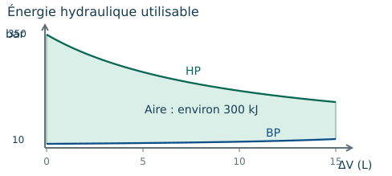
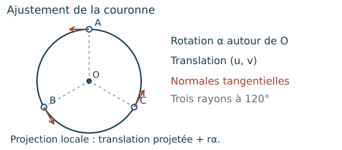
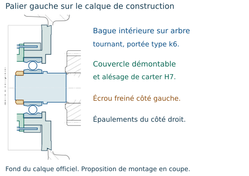
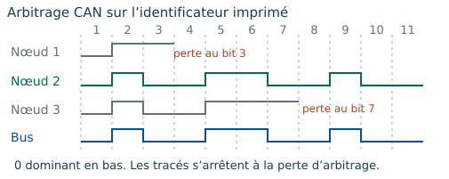
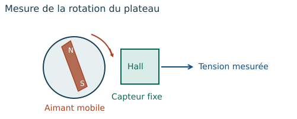
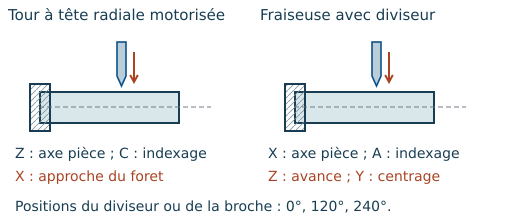

# Banque PT 2017 — Sciences industrielles C · Corrigé guidé

*Corrigé rédigé par IA, non officiel. Signalez toute erreur.*

**Rédaction** · GPT-6.2 Astra Ultra · vitesse non renseignée · 26 novembre 2026

**Révision (tour 1)** · GPT-6.2 Astra Ultra · vitesse non renseignée · 26 novembre 2026

**Propulsion automobile oléopneumatique Hybrid Air.** Épreuve de six heures. Les 40 questions portent sur les accumulateurs, les transmissions, le guidage, la commande et l’industrialisation. Le jury donne les poids de 25 %, 20 %, 25 %, 10 % et 20 % respectivement. Les points individuels ne sont pas publiés.

[Sujet et planches](https://www.banquept.fr/documents/2017/si_c_2017_pt.pdf) · [Rapport du jury](https://www.banquept.fr/documents/ecrit/rapport/2017/rapport_si_c_ecrit_2017.pdf)

## I · Stocker et restituer une énergie de traction

### Q1 · Énergie du démarrage

**Indication.** Identifier la seule forme d’énergie modifiée entre l’arrêt et la vitesse finale dans les hypothèses annoncées.

À 50 km/h la vitesse vaut 50/3,6 = 13,89 m/s. Le travail des actions motrices sur route horizontale sans résistance est la variation d’énergie cinétique, soit 1 500 × 13,89²/2 = **145 kJ**. Avec les 14 m/s de l’énoncé, on trouve 147 kJ. Cette valeur se rapporte à un seul démarrage.

### Q2 · Quantité de diazote

**Indication.** Conserver la quantité de gaz et la température en comparant deux couples pression absolue–volume.

La vessie initiale contient 25 L à 10 bar absolus. À température constante, pour la même masse de gaz, pV se conserve. À 1 bar il faut donc **250 L de diazote**. Ce volume mesuré à la pression atmosphérique ne doit pas être confondu avec les 25 L de volume matériel du réservoir.

### Q3 · Travail de compression isotherme

**Indication.** Écrire le volume final avec pV constant puis intégrer la pression. Ne pas prendre la pression finale comme constante.

Le produit pV vaut 250 bar·L. Le volume final est 250/350 = **0,714 L**. Le travail reçu par le gaz pendant la compression vaut l’opposé de l’intégrale de p dV, donc **Wi = piVi ln(pf/pi) = 25 000 ln 35 = 88,9 kJ**. Le facteur de conversion est 1 bar·L = 100 J. Cette quantité est inférieure aux 145 kJ requis, avant même les pertes.

### Q4 · Choix de la masse de gaz

**Indication.** La meilleure courbe est celle qui délimite la plus grande aire utile. Comparer les deux extrêmes et les courbes du milieu.

Sur VII, pour chaque masse, partir de l’intersection avec l’horizontale 350 bar et intégrer sous l’hyperbole jusqu’à 25 L. À petite masse la pression est basse sur une grande partie de la course, à grande masse le volume échangeable devient petit. Les courbes successives donnent environ 89, 282, **321**, 268 et 157 kJ pour 0,287, 2,011, 4,022, 6,033 et 8,044 kg. Elles correspondent à des pressions de départ proches de 10, 70, 140, 210 et 280 bar à 25 L. Le choix parmi les courbes est donc **4,022 kg**. On peut vérifier en maximisant pᵢVᵢ ln(350/pᵢ), dont le maximum continu est à 350/e ≈ 129 bar.

### Q5 · Bilan des deux accumulateurs

**Indication.** La pompe travaille entre deux pressions. Chaque barre verticale du graphique doit donc être limitée en haut et en bas.

Le moteur hydraulique travaille avec la différence de pression. Sur VII, figure 2, calculer l’aire **entre les deux courbes**, pour environ 0 à 15 L transférés. À 0, 5, 10 et 15 L, la haute pression est proche de 350, 233, 175, 140 bar, la basse pression proche de 10, 12,5, 17 et 25 bar. Une quadrature ou le comptage des carreaux donne environ **300 kJ**, contre 145 kJ à fournir aux roues. À titre de vérification, les isothermes lues sont proches de 3 500/(10 + ΔV) et 250/(25 − ΔV) en bar si ΔV est en litres. Leur différence intégrée donne 100 × 3 250 ln(2,5) = 298 kJ. Le stockage idéal satisfait le besoin et laisse une marge pour les pertes.

### Q6 · Évolution pendant un cycle rapide

**Indication.** Comparer la durée du transfert hydraulique et le temps nécessaire au gaz pour échanger sa chaleur avec la paroi.

Une isotherme suppose un échange thermique suffisant avec le milieu pour maintenir la température. Pendant un freinage bref ou un démarrage la paroi, la vessie et le gaz n’échangent pas instantanément la chaleur produite ou absorbée. Pour une évolution quasi statique avec échanges partiels on peut approcher la trajectoire par pVⁿ constant, avec n entre 1 et l’exposant adiabatique, proche de 1,4 pour le diazote dans le modèle du sujet. Le jury a adapté le barème de cette question sur les polytropes.

### Q7 · Détente brusque

**Indication.** Partir du même état chargé pour tracer les deux détentes. Laquelle se trouve la plus basse après expansion ?

À partir du **même état HP chargé**, la détente brusque refroidit le diazote. Pour V > Vi, p = pi(Vi/V)ⁿ avec n > 1 décroît plus vite que l’isotherme piVi/V. La courbe passe sous l’isotherme, donc l’aire récupérable est plus petite pour le même volume échangé. À pression minimale imposée on l’atteint également plus tôt. Les échanges thermiques ultérieurs ne constituent pas du travail déjà livré au véhicule pendant le démarrage.

## II · Transmettre la puissance au différentiel

### Q8 · Relation du train de répartition

**Indication.** Écrire les deux engrènements en se plaçant sur le porte-satellites. Le contact intérieur et le contact extérieur ont des signes différents.

Relativement au porte-satellites 4, le soleil 3 engrène extérieurement avec le satellite 2, puis le satellite engrène intérieurement avec la couronne 1 solidaire de l’entrée thermique. D’où (N3 − N4)/(Nm − N4) = −Z1/Z3. En multipliant sans diviser par une vitesse potentiellement nulle, **Z1 Nm + Z3 N3 − (Z1 + Z3) N4 = 0**. Pour l’ordre aNm + bN3 + cN4, choisir a = Z1, b = Z3, c = −(Z1 + Z3). La ressource X donne 20 Nm + 9 N3 − 29 N4 = 0.

### Q9 · Rapport court

**Indication.** Relier d’abord la vanne fermée à la vitesse de la pompe. Suivre ensuite chaque couple de pignons vers le différentiel.

La vanne bloquante empêche le débit, donc la rotation de la pompe supposée de cylindrée non nulle et sans fuite. Nph = 0 impose N3 = 0 via les roues 9 et 3′. Le train donne N4/Nm = Z1/(Z1 + Z3) = 20/29. Depuis 4, les deux couples extérieurs 4–5 puis 5′–6 donnent Ndiff/N4 = (Z4/Z5)(Z5′/Z6) = (4/3)/4 = 1/3. Ainsi **Ndiff/Nm = 20/87 ≈ 0,230**. Les deux engrènements inversent deux fois le sens.

### Q10 · Rapport long

**Indication.** Observer ce qui arrive aux trois organes du train lorsqu’on en solidarise deux. Contrôler la cohérence de la position de la vanne.

Le crabot S1 solidarise le soleil et le porte-satellites. En appliquant Willis, N3 = N4 = Nm, les trois grandes pièces du train tournent ensemble. La même descente d’engrenages donne **Ndiff/Nm = (Z4/Z5)(Z5′/Z6) = 1/3**. La pompe est entraînée par 3′, la vanne doit permettre la circulation de l’huile pour ne pas imposer simultanément Nph = 0.

### Q11 · Variation continue

**Indication.** Écrire une relation de vitesse sur chaque branche avant d’utiliser Willis. Vérifier le signe du pignon qui entraîne la pompe.

S1 ouvert laisse libres les deux branches de puissance, S2 fermé couple le moteur hydraulique à la roue 8. Posons g = (Z4/Z5)(Z5′/Z6), h = (Z8/Z7′)(Z7/Z6), j = Z3′/Z9. Les liaisons donnent respectivement Ndiff = g N4, Ndiff = h Nmh et Nph = −j N3. Avec Nmh = k Nph, on obtient après substitution dans Willis **Ndiff/Nm = g h j Z1 k / [g Z3 + h j (Z1 + Z3) k]**. Cette expression reste valable en k = 0 par continuité et le rapport varie continûment sur tout intervalle où le dénominateur reste non nul.

### Q12 · Plage numérique

**Indication.** Vérifier que le dénominateur ne s’annule pas sur l’intervalle et que la fonction est monotone avant de substituer les bornes.

Sur X, g = 1/3, h = 1/4 et j = 1/2. On trouve **Ndiff/Nm = 20k/(72 + 87k)**. Le dénominateur reste positif entre −0,5 et 10, et la dérivée 1 440/(72 + 87k)² est positive. Les bornes sont −10/28,5 = **−0,351** et 200/942 = **0,212**. En k = 0, le différentiel peut être immobile alors que le moteur thermique tourne.

### Q13 · Point de fonctionnement du moteur

**Indication.** Sur une même courbe de puissance le couple et le régime peuvent changer. Rechercher le point de rendement optimal sur XI.

Pour une puissance demandée, le couple et le régime du moteur ne sont pas imposés séparément. Un rapport continu permet de les choisir près de la zone de meilleur rendement de XI, tout en satisfaisant la vitesse des roues. On limite ainsi consommation de carburant et pertes lors des changements de point de fonctionnement.

### Q14 · Marche arrière

**Indication.** Tester le signe du rapport global lorsque la cylindrée variable fait passer k sous zéro.

Un réglage de cylindrée donnant k négatif inverse le signe de Ndiff/Nm. Le débit et le sens de rotation du moteur-pompe de la branche entraînant les roues changent. Le véhicule peut reculer sans inverser le sens du moteur thermique ni ajouter un pignon inverseur au rapport considéré.

### Q15 · Rôle du différentiel

**Indication.** Comparer les longueurs décrites par les deux roues motrices dans un virage.

Le différentiel transmet le couple aux deux roues motrices en laissant leurs vitesses différer dans un virage. Pour deux planétaires de roue identiques, la vitesse du porte-différentiel est la moyenne des vitesses des demi-arbres. La roue extérieure peut ainsi parcourir davantage de chemin sans imposer un glissement au pneu intérieur.

## III · Guider le train et équilibrer les contacts

### Q16 · Mobilité et hyperstatisme

**Indication.** Compter séparément les grands pivots, les trois pivots satellites et les six contacts, puis utiliser la mobilité déjà démontrée par Willis.

On compte six solides mobiles, couronne, soleil, porte-satellites et trois satellites. Les trois pivots des grandes pièces avec le bâti et les trois pivots de satellites fournissent 6 × 5 inconnues d’action. Les six contacts dentaires ponctuels en ajoutent 6, soit 36 contraintes scalaires pour 36 composantes de vitesse libres. Il subsiste **deux mobilités indépendantes** de fonctionnement, puisque deux des trois vitesses principales fixent la troisième et celles des satellites. Le nombre de contraintes redondantes est donc **h = 36 − 36 + 2 = 2**. Les trois satellites ne fournissent pas trois rapports indépendants.

### Q17 · Trois ajustements pour trois contacts

**Indication.** Transporter le petit déplacement de O à chacun des points. Le jeu se mesure sur la normale au contact.

Orienter les trois normales tangentielles dans le sens direct autour de O et définir Ji comme le jeu à fermer par un déplacement positif de la couronne. Aux contacts situés en haut A, en bas à gauche B et en bas à droite C, les normales choisies sont (−1,0), (1/2,−√3/2), (1/2,√3/2). La projection du déplacement u x + v y + α z × OP sur chaque normale donne **JA = rα − u = 0, JB = rα + u/2 − √3 v/2, JC = rα + u/2 + √3 v/2**. Ainsi α = (JB + JC)/(3r), u = (JB + JC)/3, v = (JC − JB)/√3. Pour des jeux arbitraires et différents ces trois paramètres sont nécessaires et la solution est unique. Une convention de projection opposée change les signes des déplacements correspondants.

### Q18 · Liaison isostatique

**Indication.** Compter les libertés de la nouvelle liaison et vérifier leur direction, pas seulement leur nombre.

Remplacer, dans le modèle, le pivot de la couronne avec le bâti par un **appui plan de normale z**. Il autorise les translations u et v dans le plan et la rotation α autour de z, tout en interdisant les deux basculements et la translation axiale. Deux contraintes ont été supprimées, exactement le degré d’hyperstatisme trouvé en Q16. Les trois contacts déterminent alors le centrage en service. Un simple coulissement axial supplémentaire ne résoudrait pas le problème des jeux dans le plan des engrenages.

### Q19 · Concentricité des appuis droits

**Indication.** Une petite rotation autour d’un point déplace-t-elle un deuxième point situé à distance de ce centre ?

Dans le schéma XIII les deux liaisons de type rotule à droite ont le même centre réel et sont écartées sur le schéma pour la lisibilité. Un arbre qui prend un très petit angle autour de ce centre n’impose ainsi aucune translation parasite à l’autre appui. Deux centres distincts fixeraient une direction par leur entraxe et feraient apparaître une contrainte supplémentaire ou un moment de basculement. Cette disposition permet l’auto-positionnement recherché sous charge.

### Q20 · Palier gauche sur le calque

**Indication.** Avant de placer les arrêts, simuler l’introduction et l’extraction de la bague serrée. Suivre les deux chemins d’effort axial.

Prolonger à gauche la portée de l’arbre et réaliser un épaulement avant la roue. Monter le roulement rigide à billes de XIII avec bague intérieure serrée sur l’arbre tournant sous charge de direction sensiblement fixe par rapport au carter, par exemple k6. La bague extérieure se monte dans l’alésage H7 du logement fixe. Immobiliser axialement la bague intérieure entre épaulement et écrou freiné ou anneau adapté. Tenir la bague extérieure entre épaulement du logement et couvercle vissé démontable, avec des diamètres d’appui qui dégagent billes, cage et congés. Prévoir les dégagements d’outil et les chanfreins d’entrée. La bague intérieure peut s’enfiler depuis la gauche avant son arrêt, et le couvercle libère le roulement en maintenance. Transmettre les efforts de montage à la bague serrée. Un seul roulement localise le centre à gauche, avec le petit défaut angulaire admissible de ce type de roulement. La rotule est un modèle cinématique local de ce palier.

## IV · Lire les signaux et identifier le mode

### Q21 · Multiplexage

**Indication.** Distinguer le support matériel commun et l’adresse logique des informations.

Plusieurs calculateurs partagent un même support physique en y transmettant successivement des messages identifiés. Un capteur peut ainsi informer plusieurs fonctions avec la même trame. Les faisceaux comportent moins de fils et de connecteurs, d’où un gain de masse et un câblage plus simple pour le véhicule.

### Q22 · Caractéristiques du bus

**Indication.** Expliquer en termes distincts l’ordre des bits, la synchronisation et le partage du sens de transmission.

**Série** signifie que les bits se suivent dans le temps sur le même canal. **Asynchrone** signifie qu’il n’existe pas de fil d’horloge commun distinct, les nœuds règlent leur temps de bit et se resynchronisent sur les fronts. **Half-duplex** signifie que les informations peuvent circuler dans les deux sens, avec une seule transmission de données gagnante à la fois sur le support partagé.

### Q23 · Arbitrage de la feuille réponse

**Indication.** Comparer les identificateurs depuis la gauche. À chaque colonne où un émetteur lit zéro après avoir proposé un, le retirer des suivantes.

En lisant l’identificateur de gauche à droite, les deux premiers bits sont 0 et 1 pour tous. Au **3e bit**, le nœud 1 émet 1 et lit le 0 dominant émis par 2 et 3, il cesse d’émettre. Les nœuds 2 et 3 coïncident jusqu’au 6e bit. Au **7e bit**, le nœud 3 émet 1, le nœud 2 émet 0, donc le nœud 3 perd. Le **nœud 2** poursuit avec son identificateur **01001100100** sur le bus. Après avoir perdu, un nœud ne participe plus au ET câblé de ce message.

### Q24 · Mesure de l’inclinaison

**Indication.** Tracer l’axe du plateau puis attribuer l’aimant et le circuit alimenté à deux solides différents.

Une plaquette semi-conductrice parcourue par un courant subit la déviation de ses porteurs par un champ magnétique perpendiculaire. La tension de Hall transversale est proportionnelle au courant de polarisation et à la composante de champ. Fixer l’aimant sur l’axe du plateau mobile et le capteur alimenté sur le carter. L’inclinaison fait varier le champ vu par le capteur. Un étalonnage sur la course utile relie tension et angle, donc angle et cylindrée. Deux composantes en quadrature permettent également une mesure angulaire non ambiguë sur un tour.

### Q25 · Moteur de sélection

**Indication.** Repérer ce qui remplace la commutation mécanique d’un moteur à balais et ce qui détermine la position du barillet.

Le rotor porte des aimants permanents et le stator des enroulements commutés par un onduleur. L’électronique impose le courant des phases selon la position du rotor pour créer un champ tournant et le couple voulu. L’asservissement amène le barillet à l’une de ses quatre positions et le maintient. L’absence de balais limite l’usure et l’entretien. L’actionneur est compact et adapté aux nombreux cycles d’une sélection automobile.

### Q26 · Ordre des cames

**Indication.** Parcourir les quatre secteurs successifs de XIV et compter les bits modifiés entre voisins.

La figure XIV montre sur un tour la succession cyclique 00, 10, 11, 01, puis 00, en partant de la droite dans le sens horaire. Deux positions voisines changent **un seul** accouplement. Cet ordre de Gray évite qu’un passage réclame deux commutations exactement simultanées et limite les états transitoires imprévus entre cames. Le sens inverse donne la même propriété.

### Q27 · Codeur incrémental et réinitialisation

**Indication.** Comparer l’information dont dispose le calculateur après redémarrage pour les deux types de codeur.

Le comptage d’impulsions renseigne un déplacement depuis une référence. Une remise à zéro efface cette origine ou le compteur, même si le barillet est resté physiquement en position. L’angle et les accouplements engagés peuvent alors être mal identifiés. Avant d’ordonner une commutation, le superviseur doit rétablir une référence vérifiée, par index en conditions appropriées, information de position conservée et vérifiée ou diagnostic des rapports. Un codeur absolu fournit une information de position directement à la lecture.

### Q28 · Indices tachymétriques

**Indication.** Écrire les deux égalités qu’imposerait un crabot fermé. Examiner ensuite si l’inverse est toujours vrai à l’arrêt.

Avec les conventions de X, N3 = −2Nph et N4 = 3Ndiff. Si S1 est engagé, les deux vitesses sont égales, donc **−2Nph = 3Ndiff** et, par Willis, Nth = 3Ndiff. Si S2 est engagé, la chaîne 8–7′–7–6 impose **Nmh = 4Ndiff**. Le tableau logique des tests est alors 00 pour aucune égalité, 10 pour le seul premier test, 01 pour le seul second et 11 pour les deux. Utiliser la vitesse du différentiel, reconstruite à partir de la vitesse moyenne des roues si nécessaire, et une tolérance de mesure. Une égalité instantanée peut aussi survenir sur deux organes désaccouplés, notamment à l’arrêt. Un écart exclut l’engagement, mais confirmer une égalité persistante en régime discriminant ou retrouver l’index avant de déclarer le mode certain.

## V · Obtenir et contrôler l’arbre

### Q29 · Trois fiches GPS

**Indication.** Repérer exactement sur XV les trois portées et la face visée. CZ contraint l’ensemble des lignes médianes à une même zone.

**Cylindricité 0,01.** L’élément tolérancé est la surface extraite de la portée centrale b. Tous ses points doivent être compris entre deux cylindres idéaux coaxiaux dont les rayons diffèrent de 0,01 mm. La zone est unique, libre en orientation et en position, sans élément de référence.

**Rectitude Ø0,01 CZ.** L’indication commune vise les lignes médianes extraites des trois portées de roulement a, b, c de diamètres différents. Les trois lignes doivent être contenues **simultanément dans un seul cylindre droit de diamètre 0,01 mm**. CZ impose une zone commune et donc l’alignement mutuel des portées. La zone de rectitude reste libre par rapport aux autres surfaces de la pièce. Le dessin associe ensuite l’axe commun de ces portées à la référence A.

**Battement total axial 0,02 par rapport à A.** La flèche vise la face d’épaulement près de la denture hélicoïdale. L’élément tolérancé est la surface entière de cette face. La référence est l’axe associé au montage commun des portées a, b, c. Pendant une rotation complète autour de A et un balayage radial sur toute la face, la variation axiale maximale doit rester au plus égale à 0,02 mm. La zone est formée de deux plans parallèles perpendiculaires à A, distants de 0,02 mm. Ne pas réinitialiser le comparateur entre deux rayons.

### Q30 · Taille locale et rugosité

**Indication.** Ajouter chaque écart à 25 mm. Ne pas confondre la hauteur moyenne du profil et une limite de taille.

Pour la portée a, Ø25 avec écarts +0,008 et +0,021 mm impose **25,008 ≤ diamètre local deux points ≤ 25,021 mm**, soit un intervalle de 13 µm. Un diamètre moyen ne suffit pas à vérifier toutes les tailles locales. Sur la portée c, **Ra 3,2** indique la limite supérieure usuelle de la moyenne arithmétique des écarts absolus du profil de rugosité à sa ligne moyenne, exprimée en micromètres. Le symbole barré demande un enlèvement de matière. Le jury indique que l’item d’état de surface était hors programme et a été neutralisé.

### Q31 · Pourquoi cémenter

**Indication.** La teneur en carbone de la couche est-elle suffisante pour la dureté finale requise ?

L’acier 16 Ni Cr Mo 13 ne contient au départ qu’environ 0,16 % de carbone. Une trempe peut transformer sa structure, mais ne donne pas en surface la dureté d’une couche enrichie. La cémentation apporte du carbone aux portées, cannelures et dents pour qu’elles durcissent fortement à la trempe. Le cœur conserve une teneur plus faible, favorable à la ténacité sous les chocs et les variations de couple.

### Q32 · Mécanisme de la cémentation

**Indication.** Distinguer le transfert de carbone depuis le milieu et sa diffusion sous la surface.

Après préparation des surfaces à traiter et protection éventuelle des autres zones, on porte l’acier dans le domaine austénitique, en présence d’un milieu à potentiel carbone contrôlé. Le carbone est transféré à la surface puis diffuse dans l’austénite. La durée et la température gouvernent l’épaisseur enrichie. La phase de diffusion règle un profil progressif de teneur en carbone, maximum près de la peau et proche de la nuance initiale au cœur. Il faut prévoir une profondeur de couche suffisante après rectification.

### Q33 · Transformer la structure par trempe

**Indication.** Suivre la microstructure entre austénitisation et refroidissement. Identifier le rôle d’une éventuelle détente ultérieure.

Après cémentation, maintenir ou ramener la couche à sa température d’austénitisation appropriée, puis refroidir assez rapidement dans un milieu industriel adapté à la nuance et à la géométrie. La transformation martensitique procure la dureté de surface. Limiter gradients, déformations et fissuration par le choix du cycle. Un revenu bas de détente peut ensuite stabiliser les propriétés en conservant la dureté utile. On choisit le mode de chauffage pour obtenir la couche transformée voulue. L’enrichissement en carbone et la trempe sont deux phénomènes distincts.

### Q34 · Propriétés modifiées

**Indication.** Séparer la résistance à la plastification, le comportement à la rupture et la raideur élastique.

Dans la partie durcie, la dureté, la résistance à la plastification et à l’usure augmentent. En contrepartie, ductilité et ténacité à l’état brut de trempe diminuent. Le traitement peut introduire contraintes résiduelles et distorsion géométrique. Il modifie avant tout la microstructure et les limites de résistance. Le module d’Young reste du même ordre.

### Q35 · Surface et cœur

**Indication.** Comparer la composition et l’histoire thermique de la peau et du cœur avant de donner un sens d’évolution.

Dans la couche cémentée et trempée, **HV et la résistance à la traction Rm augmentent**, tandis que l’allongement à rupture A % et la résilience K diminuent globalement à l’état brut de trempe. Au cœur pauvre en carbone, la cémentation modifie peu la composition. Dans l’hypothèse de trempe superficielle voulue, les propriétés initiales du cœur sont largement conservées. S’il est lui aussi refroidi assez vite, il peut se transformer partiellement, avec un durcissement moindre. Le résultat recherché est une peau dure sur un cœur plus ductile et résilient. Les valeurs précises nécessiteraient un profil de dureté et les données de traitement.

### Q36 · Nécessité de rectifier

**Indication.** Relire à la fois les tolérances géométriques et l’indication d’état de surface.

Après traitement thermique, corriger d’une part les dispersions de taille, de cylindricité et d’alignement des portées de roulement, dont plusieurs tolérances se mesurent en centièmes. D’autre part, obtenir une rugosité compatible avec un ajustement de bague et une bonne portée de contact. La rectification enlève la faible surépaisseur prévue même sur une couche très dure.

### Q37 · Rectification cylindrique extérieure

**Indication.** Identifier les deux rotations et les deux avances possibles d’une machine de rectification extérieure.

Faire tourner l’arbre autour d’un axe de référence stable, par exemple entre pointes, et la meule abrasive autour d’un axe parallèle. La meule est dressée et mise à la cote. Son approche radiale règle le diamètre. En plongée elle couvre une portée étroite, sinon la translation axiale balaie sa longueur. Des passes légères, l’arrosage et une passe d’étincelage limitent l’échauffement et les écarts géométriques. Rectifier si possible les trois portées dans la même prise pour respecter la zone commune.

### Q38 · Gamme proposée

**Indication.** Classer les opérations d’enlèvement important, le durcissement et les reprises de précision dans cet ordre.

Débiter la barre laminée avec surlongueur, dresser les extrémités et préparer les centres. Ébaucher puis semi-finir au tour le profil, les épaulements et les portées a, b, c en réservant la surépaisseur de rectification. Préparer le perçage axial de lubrification et les perçages radiaux possibles à ce stade. Tailler cannelures et denture hélicoïdale sur les diamètres préparés, puis ébavurer les intersections de conduits. Cémenter les zones prévues, tremper, poursuivre par le traitement de stabilisation retenu et contrôler dureté, profondeur et déformation. Reprendre les centres si nécessaire, puis rectifier les trois portées suivant la même référence. Contrôler les tailles, la rectitude commune, le battement de face, les états de surface et la propreté des canaux. Tailler avant durcissement facilite l’usinage, rectifier après traitement rétablit la précision.

### Q39 · Trois perçages radiaux à 120 degrés

**Indication.** Tracer l’axe de broche des deux machines. Sur chacune, nommer l’axe autour duquel la pièce doit prendre trois positions.

**Sur tour à outil tournant**, retenir deux translations X radiale et Z axiale, plus l’indexation C de la broche porte-pièce autour de Z. Positionner la station suivant Z, immobiliser C successivement à 0°, 120°, 240°, faire tourner le foret radial et l’avancer suivant X. La rotation de coupe du foret est fournie par l’outil motorisé et n’est pas cet axe d’indexation. **Sur fraiseuse**, monter l’arbre horizontal suivant X sur un diviseur d’axe A et forer avec la broche d’axe Z. X positionne la section, Y centre la broche sur l’axe de la pièce et Z donne l’avance. Indexer A de 120° entre perçages. Une fraiseuse usuelle XYZ avec diviseur réalise donc ces perçages en une prise. Sur un montage dédié préréglé, les mouvements réellement répétés sont l’avance et l’indexation seules.

### Q40 · Choix économique

**Indication.** Comparer les reprises de pièce, l’équipement déjà disponible et la quantité de pièces attendue.

Si le tour d’ébauche possède déjà une broche indexable et une tête radiale motorisée, profiter de la prise de tournage pour percer la surface 1. On supprime transfert, réglage du diviseur et reprise de références, ce qui réduit temps et coût variable. Si l’équipement n’existe pas, comparer son surcoût au coût du poste fraiseuse déjà disponible et au nombre de pièces. Sans coût horaire ni taille de série, la préférence pour l’intégration au tournage est conditionnelle.
