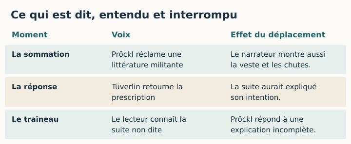

# BEL A/L — Allemand (commentaire et traduction) 2017 · Corrigé guidé

*Corrigé rédigé par IA, non officiel. Signalez toute erreur.*

**Rédaction** · GPT-6.2 Astra Ultra · vitesse non renseignée

**Révision (tour 1)** · GPT-6.2 Astra Ultra · vitesse non renseignée

[Sujet officiel](https://www.ens-lyon.fr/sites/default/files/2017-11/17-bel-commentaire-et-traduction-lve_1506586192589_0.pdf#page=2) · [Rapport du jury](https://www.ens-lyon.fr/sites/default/files/2018-03/ALLEMAND_2017.pdf#page=1)

L’extrait d’Erfolg de Lion Feuchtwanger (1930) se déroule en Bavière au début des années 1920. Le commentaire examine le débat entier et son interruption. La version commence à la demande de Pröckl et inclut le retour du narrateur à la route enneigée.

## Préparer l’épreuve

Relever cinq moments : la présentation des chaussures et des voix, le programme de l’ingénieur, la relance du narrateur qui situe les hommes sur la route, la réponse de l’écrivain, enfin la réponse qu’il voulait encore donner. Cette dernière étape appartient à ce que le lecteur sait et que Pröckl n’a pas entendu. L’obstacle matériel devient une condition du débat.

Dans la version, rendre les diminutifs dépréciatifs chez l’ingénieur, puis ses questions qui croient déjà connaître leur réponse. Les formes de discours rapporté et les infinitifs ne distribuent pas tous les jugements au narrateur. Les traîneaux viennent tantôt en face, tantôt de derrière et dépassent les promeneurs.

Comparer *müsse* et *sei* à leurs formes d’indicatif. Cette série signale que les exigences finales sont attribuées à Pröckl. Dans *Winterkurort*, le noyau *Kurort* désigne une station de cure.

## Commentaire

### Zwei Ansichten von der Zeit auf einer verschneiten Straße

Was muss ein Schriftsteller sehen, damit er seine Zeit richtig darstellt? Diese Frage beschäftigt die beiden Männer, die auf einer Straße bei Garmisch-Partenkirchen so eifrig diskutieren, dass ihnen die berühmte Winterlandschaft gleichgültig bleibt. Der Erzähler von Lion Feuchtwangers *Erfolg* sieht allerdings mehr. Er bemerkt, wie die Hosen sitzen, wann eine Stimme aussetzt und was ein Schlitten mit einem noch nicht ausgesprochenen Gedanken machen kann. Der Gegensatz der beiden Kunstauffassungen ist ernst. Doch die Straße, auf der ihn der Roman austrägt, ermöglicht eine Prüfung, die über die Entscheidung für eine der beiden Reden hinausgeht.

Bevor eine These formuliert wird, unterscheiden sich die beiden Männer in ihrem Verhältnis zum Boden. Tüverlins feste Stiefel schützen ihn, während Pröckls Gummisohlen für eine solche Wanderung kaum geeignet sind. Das ist besonders vergnüglich bei einem Ingenieur, von dem man sachgerechte Entscheidungen erwarten könnte. Es wäre aber zu einfach, daraus sofort die Überlegenheit des Schriftstellers abzuleiten. Auch er nimmt beim Reden wenig von seiner Umgebung wahr. Und die Schneefläche kann einen Satz aus dem denkbar unsachlichsten Grund zum Stillstand bringen. Das leichte, wiederholte Ausgleiten hat mit den Thesen der Sprecher nichts zu tun und gehört doch zu dem, was wir von diesen Thesen zu hören bekommen. Die Kleidung verhindert, dass die Figuren zu bloßen Sprechern von Lehrmeinungen werden. Sie erlaubt zugleich zu beobachten, wie eine Theorie vorgetragen wird, wenn ihr Urheber gerade das Gleichgewicht verliert.

Für Pröckl hat der Schriftsteller nur eine Wahl. Seine Arbeit muss aktiv in den politischen Kampf eingreifen, andernfalls könnte er gleich schweigen. Auffällig ist der Wechsel der sprachlichen Größenordnungen. Hier die stärkste weltgeschichtliche Umwälzung, der zerrissene Planet, der Brand der Welt. Dort die winzigen Empfindungen, die modischen Spielereien und schließlich die Seelenbewegungen kleiner Haustiere. Der Ingenieur braucht den gegnerischen Text gar nicht zu lesen, wenn seine Gegenstände schon durch die Wahl der Wörter so zusammengeschrumpft sind. Auch die von ihm imaginierte Frage nach der eigenen Leistung ist von vornherein an ein Tribunal gerichtet. Der Schriftsteller soll vor dem Gericht der Nachwelt sagen können, was er damals getan hat. Gleichzeitig verdankt Pröckls eigene Sprache ihre Überzeugungskraft gerade den Bildern und Empfindungen, denen er nur als Dienern einer richtigen Sache Geltung zugesteht. Wenn eine Welt brennt oder die Zeit einem Schriftsteller Wind in den Rücken bläst, hat die Metapher bereits für ihn gearbeitet.

Bemerkenswert ist die Art, wie diese Rede überhaupt in den Roman gelangt. Auf eine zusammenfassende Forderung folgen Fragen, die sich unmittelbar an einen Angesprochenen zu richten scheinen. Am Schluss der Rede markieren die Formen „müsse“, „sei“ und nochmals „sei“ den Übergang zur indirekten Rede. So lässt der Erzähler Pröckls Gebote hören, ohne deren Gültigkeit selbst zu behaupten. Eine einzige Ebene, auf der ein verlässlicher Erzähler uns erklärt, was das Zeitalter wesentlich bestimmt, gibt es also nicht. Nach der Steigerung bis zur Behauptung über den Sinn der Existenz des Schriftstellers meldet sich die Erzählstimme mit dem vollständigen Namen und der Berufsbezeichnung des Redners zurück. Sie liefert das genaue zeitgenössische Dokument, das er verlangt: Man erhält die Straße, die Lederjacke und den Schweiß dazu. Ob diese Einzelheiten im Sinne des Ingenieurs geschichtswirksam sind, ist mindestens fraglich. Für unsere Auffassung seiner Gebieterpose sind sie unverzichtbar.

Dem Angriff begegnet Tüverlin zunächst mit einer Form der Höflichkeit, die im Text zählbar wird. Er hört nicht nur bis zum Ende zu, sondern lässt sogar zwei Gelegenheiten zu einer Erwiderung verstreichen. Sein Einwand zielt auf die Kriterien dessen, was überhaupt als geschichtswirksam anerkannt werden soll. Nehmen wir an, ein Schriftsteller beobachte statt der Umordnung der europäischen Klassen die Begegnung alter asiatischer Kulturen mit einem jungen, barbarischen Europa. Plötzlich ist Europa nicht länger das selbstverständlich maßgebende Zentrum der Weltgeschichte. Tüverlin kann für die größere Mobilität der Menschen und die Mischung der Kulturen Beispiele einer ganz anderen Perspektive nennen. Die Rede enthält allerdings einen kleinen Probelauf für eine Zumutung. Er verlangt von Pröckl seinerseits, er müsse unter genau diesem und unter keinem anderen Gesichtswinkel arbeiten. Die Förmlichkeit, mit der er den Herrn anspricht, und die Wiederholung des Nur machen hörbar, dass er eine eben erfahrene Vorschrift zurückschickt.

Was damit beabsichtigt war, erfährt der Leser genauer als der Gesprächspartner. Tüverlin *wollte* hinzufügen, dass seine Weltanschauung sehr wohl verbindlich sei, jedoch für ihn allein. Freiheit der Kunst bedeutet unter dieser Voraussetzung mehr als Beliebigkeit. Sie verpflichtet den Einzelnen gegenüber seiner eigenen Auffassung und verbietet ihm, die gleiche Grundlage allen anderen aufzuzwingen. Freilich mündet auch diese geplante Verteidigung in eine Reihe von Schimpfwörtern. Die Anhänger verpflichtender Ansichten erscheinen als Machtmenschen, Politiker, Pfaffen und Hohlköpfe. Der Schriftsteller ist dem Ton seines Gegners näher, als sein geduldiges Zuhören zunächst vermuten ließ. Das bewahrt die Szene davor, ein ungestörtes Plädoyer zugunsten von Tüverlins Position zu werden.

Dann klingelt der Schlitten. Das Geräusch tritt genau in die Lücke zwischen die Umkehrung des Gebots und seine Erklärung. Beide Männer müssen ausweichen, und als sie wieder nebeneinander gehen, hält Pröckl die ihm aufgezwungene neue Perspektive bereits für unerträglichen Unsinn. Das vorläufig letzte Urteil ist deutlich in seiner Sprache gefärbt, gerade weil er eine Erläuterung nicht gehört hat, die der Leser kennt. Dieser Unterschied liefert das präzise Schlussbild für die Schwierigkeit des Streits. Jeder möchte festlegen, wie die Gegenwart zu sehen ist. Die Zeit, in der einer tatsächlich bis zu Ende sprechen könnte, steht beiden nur begrenzt zur Verfügung. Der Roman hat die Gegenwart seiner Figuren dargestellt, indem er die beiden Überzeugungen, ihre soziale Situation, ihre Komik und den unbequemen Zwischenfall zusammen erzählt. Was wesentlich war, lässt sich hier erst erkennen, wenn man auch die schmutzigen Schneehaufen beachtet.

## Version française

L’ingénieur Pröckl exigeait impérieusement de Tüverlin qu’il fasse de la littérature militante, politique, révolutionnaire, ou qu’il n’en fasse pas du tout. À quoi bon, en plein bouleversement du monde, le plus formidable qu’il eût connu, consigner les ridicules petits états d’âme d’une société moribonde ? Faire de la poésie de sanatorium, de station de cure hivernale, alors que la lutte des classes déchirait la planète ? Le jour où l’on vous demanderait « Et toi, qu’as-tu fait pendant ce temps-là ? », qu’aurait-on à montrer ? Des badinages érotiques tarabiscotés, fleurant des parfums désuets, de pures affaires de mode auxquelles, dans dix ans, personne ne comprendrait plus rien. On n’avait rien pigé au sens de l’époque. Pendant que le monde brûlait, on avait observé les émois de petits animaux familiers. La littérature, si elle veut durer, doit avoir dans le dos le vent de son époque. Autrement, justement, elle ne durera pas. L’écrivain devait produire des documents sur son temps. Telle était sa fonction. En dehors de cela, son existence n’avait aucun sens.

Voilà les thèses qu’avançait l’ingénieur Kaspar Pröckl tandis que, dans sa veste de cuir tout imprégnée de sueur et si mal adaptée à la marche, il se promenait avec l’écrivain Tüverlin sur la grand-route qui partait de Garmisch-Partenkirchen vers le sud. Il devenait très agressif, hurlait ses exigences à la figure de M. Tüverlin, dérapant à plusieurs reprises et sautant parfois dans les tas de neige sale au bord de la route pour éviter un traîneau qui arrivait en face ou qui les dépassait.
