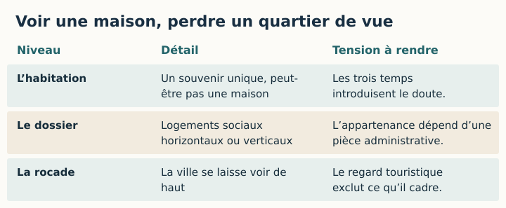

# BEL A/L — Allemand (thème Lyon) 2017 · Corrigé guidé

*Corrigé rédigé par IA, non officiel. Signalez toute erreur.*

**Rédaction** · GPT-6.2 Astra Ultra · vitesse non renseignée

**Révision (tour 1)** · GPT-6.2 Astra Ultra · vitesse non renseignée

[Sujet officiel](https://www.ens-lyon.fr/sites/default/files/2017-11/17-bel-epreuves-de-specailite-lyon_1506586608686_0.pdf#page=8) · [Rapport du jury](https://www.ens-lyon.fr/sites/default/files/2018-03/ALLEMAND_2017.pdf#page=8)

L’original du thème allemand de quatre heures, sans dictionnaire, donne un passage de Des gens du monde de Catherine Lépront (2003). Le narrateur situe la maison des Diez au nord de La Rochelle.

## Préparer l’épreuve

Conserver les trois temps de la première phrase. La maison était sans précédent, elle est restée unique jusqu’au présent du narrateur, elle le restera vraisemblablement dans l’avenir. Les termes urbains du second paragraphe distinguent le centre, les grands ensembles verticaux et les logements horizontaux. « Plus de solution de continuité » signifie qu’il n’existait plus de coupure dans le tissu bâti.

Restituer le rythme du mot isolé « Dehors ». Le moindre élément manquant au dossier menace toute l’existence des plus pauvres. La dernière image combine une position littéralement surélevée, la rocade, et une façon socialement surplombante de regarder. Formuler son titre de tableau comme une légende en allemand.

Dans *jener Zeit nachtrauern*, le datif indique l’objet du regret. Le verbe rend la nostalgie entretenue par les anciens des chantiers.

## Proposition de thème

Es war ein Haus, wie ich noch nie eines gesehen hatte, bis heute kein zweites gesehen habe und wahrscheinlich nie wieder eines sehen werde. Vielleicht war es gar kein Haus.

Um ein Uhr mittags passte es am besten, denn die Familie Diez wohnte nördlich von La Rochelle, und wenn ich in die Stadt hinunterfuhr, kam ich ganz in ihrer Nähe vorbei. Nur zu solchen Zeiten konnte ich manchmal zwei Stunden in der Stadt bleiben. Das Viertel war eine ehemalige kleine Arbeitersiedlung, weit draußen gelegen, früher sogar auf freiem Feld, lauter ebenerdige Häuser, eines wie das andere. Dort lebten noch ein paar wenige, geradezu vorsintflutliche Rentner. Die einen hatten auf den Werften gearbeitet, als diese in voller Blüte standen, und trauerten jener Zeit nach. Die anderen hatten bei Peugeot gearbeitet, in den Werken, deren Schließung zum Jahresende angekündigt war, und diese Männer schüttelten den Kopf und schüttelten noch einmal den Kopf, bevor sie sagen konnten, sie hätten nie gedacht, dass sie ihre Fabrik überleben würden. Die meisten Häuser aber hatte man in sogenannte Sozialwohnungen für Ausgegrenzte und Arme umgewandelt. Nun gab es zwar zwischen der Stadt und dieser Siedlung für Mittellose keine Lücke mehr, doch war sie immerhin ebenso weit vom Zentrum entfernt wie das Viertel Mireuil. Dort war, wenn auch in die Höhe gestapelt, ein statistisch gesehen etwas besser gestellter Bevölkerungsquerschnitt untergebracht, ebenfalls nach Aktenlage ausgewählt. Hier verteilte sich die Bevölkerung in der Waagerechten, doch lebte sie noch ungesicherter als in den Sozialwohnblocks, denn bei einem Menschen aus der Vierten Welt genügt schon eine fehlende Unterlage in der Akte, und er gehört überhaupt nicht mehr zur Welt. Draußen. So war die Siedlung, wenn schon nicht in der Stadt selbst, so doch im Ballungsraum aufgegangen, ein wenig wie eine Warze. In den Reiseführern stand sie aber nicht, besichtigt wurde sie nicht. Und im Detail war sie längst nicht auf jedem Stadtplan von La Rochelle verzeichnet. Man kam dort auch nicht durch, man wohnte dort, das war alles. Das Viertel war unsichtbar. Es sei denn, man wollte annehmen, dass die Touristen auf der Ringstraße, die es jetzt überragte, auf seiner Höhe langsamer fuhren, um es von oben zu betrachten, als städtische Sehenswürdigkeit, als ethnosoziales Tableau – *Verlassenheit eines Arbeiterviertels aus den fünfziger Jahren*.
