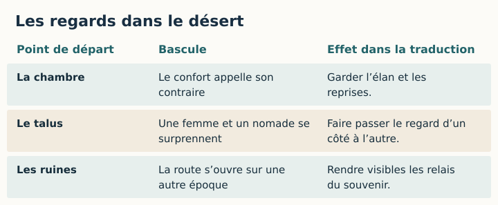

# BEL A/L — Anglais (thème Lyon) 2017 · Corrigé brut

*Corrigé rédigé par IA, non officiel. Signalez toute erreur.*

**Rédaction** · GPT-6.2 Astra Ultra · vitesse non renseignée

[Sujet officiel](https://www.ens-lyon.fr/sites/default/files/2017-11/17-bel-epreuves-de-specailite-lyon_1506586608686_0.pdf#page=9) · [Rapport du jury](https://www.ens-lyon.fr/sites/default/files/2018-03/ANGLAIS_2017%20.pdf#page=11)

Ce thème anglais de quatre heures, sans dictionnaire, provient de Boussole de Mathias Énard (2015). D’une chambre obscure, la voix se transporte vers un trajet entre Palmyre et Deir ez-Zor.

## Proposition de thème

I'd rather be in bed, eyes open in the dark, flat on my back, the nape of my neck against a soft pillow, than out in the desert, even with Félicien David for company, even with Sarah, the desert is an extraordinarily uncomfortable place, and I don’t even mean the sandy kind, where you get a mouthful of silica all day long and all night long, it gets into every opening, your ears, your nostrils, even your belly button. I mean the stony desert, Syrian style, pebbles, scree, rocky mountains, heaps, cairns, hills with an oasis here and there where, heaven knows how, a glowing red earth comes to the surface and the badiyeh is suddenly covered in fields, winter wheat or date palms. In Syria, admittedly, “desert” was a thoroughly undeserved name, there were people even in the remotest places, nomads or soldiers, and a woman had only to stop for a pee behind a mound at the roadside for a Bedouin to pop up at once and gaze with a jaded air at the milky backside of the flabbergasted Western woman, Sarah in this instance, whom we saw tearing back towards the car in disarray, holding up her trousers with one hand as if she’d caught sight of a ghoul. At first Bilger and I thought a jackal, or even a snake or a scorpion, had had a go at her bottom, but once the fright had worn off she explained, laughing fit to burst, that a red-and-white keffiyeh had appeared from behind a rock, and under it had stood a sun-browned nomad, arms folded, face expressionless, silently watching what must have been a strange apparition to him too, an unfamiliar woman squatting in his desert.

Straight out of a cartoon, Sarah was saying in fits of laughter as she pulled her trousers back on in the back seat, what a fright he gave me, to which Bilger added grandly, “People have lived in this region since the third millennium BC. There’s your proof.”

Yet all we could make out around us were miles of dull dust beneath a milky sky. We were between Palmyra and Deir ez-Zor, on the endless road from Syria’s most famous ancient city to the Euphrates and its impenetrable reeds, following in the footsteps of Annemarie Schwarzenbach and Marga d’Andurain, the disquieting queen of Palmyra who, in the days of the French Mandate in Syria, had run the Zenobia Hotel by the ruins of the caravan city, on the edge of those fields of broken columns and temples whose soft stone took on a tint of ochre in the evening sun.

