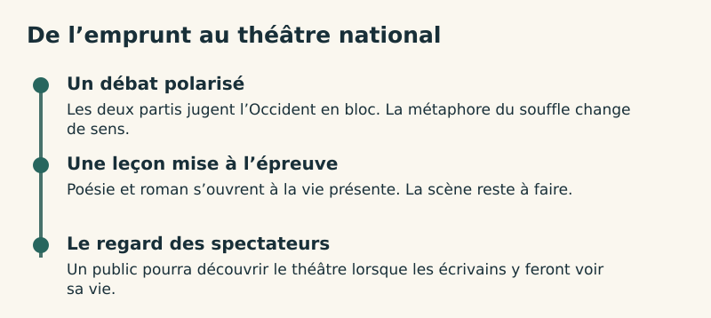

# BEL A/L — Arabe (commentaire et traduction) 2017 · Corrigé brut

*Corrigé rédigé par IA, non officiel. Signalez toute erreur.*

**Rédaction** · GPT-6.2 Astra Ultra · vitesse non renseignée

[Sujet officiel](https://www.ens-lyon.fr/sites/default/files/2017-11/17-bel-commentaire-et-traduction-lve_1506586192589_0.pdf#page=6) · [Rapport du jury](https://www.ens-lyon.fr/sites/default/files/2018-03/ARABE_2017.pdf#page=1)

Mikhaïl Nouaïmé, *Le Tamis* (*الغربال*, 1923), édition Nawfal, Beyrouth, 1991, p. 29-33. Le commentaire porte sur les deux pages de l’extrait. La traduction s’arrête à l’annonce du théâtre, à la fin de la page 6.

## Commentaire

ما الذي يجعل الأدب حيا؟ يطرح ميخائيل نعيمة في «الغربال» هذه المسألة انطلاقا من الخلاف حول أثر الغرب في الأدب العربي، وينتهي بطلب شيء يمكن أن يراه الناس بأعينهم: مسرح تعرض عليه مشاهد من حياتهم. كيف يستخرج الناقد من قضية تبدو متعلقة بالأخذ عن الأجنبي حجة تدعو الكاتب إلى النظر فيما حوله؟

يفتتح نعيمة كلامه بعرض صوتين يتنازعان الساحة. يتصور الفريق الأول حياة عربية طاهرة لا يدخلها الفساد إلا بنفخة من الغرب، ويبلغ حماس الفريق الثاني حد الدعوة إلى عبادة الغرب. تمنح صورة الأجنحة الملائكية والإفراط في التمجيد هذين الموقفين شيئا من الهزل، ثم يبلغ التهكم أقصاه حين يترك لهما الكاتب فض الخلاف بالسلاح. أما ضمير «نحن» فينشئ موضعا ثالثا يمكن القارئ أن يقف فيه مع الناقد. وهذا الحياد محدود بما أعلن عنه الكاتب نفسه: إنه يريد أن يعترف بفضل معين، فضل الآداب الغربية على آدابنا. والدليل أن النفخة التي قيل إنها تنشر الفسق تعود نسمة آتية من حدائق، تسري في قريحة الشاعر كما تسري العافية في أعضاء الناقه. لا تكفي استعارة الريح وحدها للحكم على مصدرها، بل ينبغي النظر في أثرها.

ويتدرج وصف اللغة من الشلل إلى الجيفة التي تعيش عليها أقلام المقلدين. المفارقة أن هؤلاء يتغذون من الأدب في الوقت الذي يعطلون فيه صلته بالحياة. ومن هنا قوة صورة التوأمين في الفقرة نفسها: الأدب والحياة يسند أحدهما الآخر، ويكشف كل منهما شيئا من صورة الآخر. فإذا كان الغرب تلميذا بالأمس أمكن أن نتعلم منه اليوم من غير أن يتحول التعلم إلى عبادة. ويختبر الكاتب مبدأه في نوعين أدبيين. فالشاعر الذي يعبر «الحدود المقدسة» يغير النغمة التي ينتظر السامع أن يسمعها، والروائي يكتشف في الحياة المعاصرة مادة يمس بها العقل والقلب معا. واستدعاء اللفظين الإنجليزي والفرنسي لاسم الرواية لا يمنع أن تصير الروايات «وطنية». محليّة العمل إذن لا تتوقف على بلد نشأة الجنس الأدبي، بل على ما يجعله الكاتب مرئيا من حياة الناس.

بعد الجملة القصيرة التي تقر بهذه الخطوة إلى الأمام، يعرض الكاتب نهضته في هيئة طفل مقمط يحاول الكلام. تعود بذلك مسألة النمو التي أثارتها صورة المريض، ولكن النظر الآن متجه إلى المستقبل. لا يلام الطفل على ضعفه، إنما يقل الرجاء حين يهمل الكتاب بابا كبيرا من الأدب. يؤخر نعيمة اسم ذلك الباب حتى آخر الفقرة، ثم يصف المسرح في الغرب باعتباره مكانا يقصده المتعب في حياته اليومية مثلما يعرف المدرسة والبيت والكنيسة. ويتحول الحكم النظري إلى امتحان عملي بمجرد أن يسأل: «فماذا فعلنا نحن؟». تكشف الكلمات التي يطلقها الناس على الممثل والممثلة ودار العرض أن للمسرح سمعة تحول دون دخوله في حياتهم. ولكنهم لم يروا بعد مشهدا يعرفونه؛ والمؤلفون هم الذين قدموا إليهم مسرحيات معرّبة بعيدة عن أذواقهم.

يمكن أن نستدل الآن على معنى تلك المرآة المتبادلة بين الحياة والأدب: حين يرى الجمهور نفسه على الخشبة يستطيع أن يدرك أهمية التمثيل، وحين يلتفت الكاتب إلى ذلك الجمهور يجد مادة غنية لعمله. لهذا تنتهي المقالة بفعل البحث الذي يخص الكاتب. ما أُخذ عن الغرب من إمكان فني لا يكتمل بمجرد نقله؛ إنما يكتمل يوم يذهب المتفرج إلى المسرح فيتعرف فيه إلى عالم كان يظنه بعيدا عن الأدب.

## Version française

Ce qu’il est devenu habituel chez certains d’appeler chez nous une « renaissance littéraire » se réduit à un souffle venu des jardins des lettres occidentales. Il a touché quelques-uns de nos poètes et de nos écrivains, s’est insinué dans leur imagination et dans leur génie comme la santé revient peu à peu dans les membres d’un malade qui se relève d’une longue épreuve. Le mal dont notre langue a souffert des générations durant était une paralysie. Elle avait suspendu en elle le mouvement de la vie et, de cette langue autrefois glorieuse, fait une charogne où trouvaient leur pâture les plumes de valets asservis et les talents des faiseurs de vers et des imitateurs. Aujourd’hui, nous sommes retournés vers l’Occident, hier encore notre élève, pour y emprunter une leçon dont nous avons fait la pierre d’angle de notre « renaissance littéraire ». La vie et la littérature, nous enseigne-t-elle, sont deux jumelles inséparables. La littérature prend appui sur la vie, la vie sur la littérature. Elle, la littérature veux-je dire, a l’étendue de la vie, la profondeur de ses secrets. Elle se mire en elle et la vie s’y mire à son tour. Nous avons compris, grâce à l’Occident, qu’il était possible de faire des vers en dehors de la poésie amoureuse et du prélude galant, du panégyrique et de la satire, de la description, de la déploration funèbre, de la glorification de soi et des chants de bravoure. Aussi avons-nous pris plaisir à la musique de ceux de nos poètes modernes qui ont osé passer ces frontières sacrées. C’est également grâce à l’Occident que nous est parvenu le genre qu’on nomme *novel* en anglais et *roman* en français. Nous l’avons adopté avec empressement, car nous y avons trouvé un vaste champ où dépeindre la vie et agir par la plume sur les intelligences et sur les cœurs. Nous avons compris que la prose ne se bornait pas à aligner des phrases rimées, à prodiguer des mots insolites enfouis au ventre des dictionnaires ou à noircir des articles fastidieux sur des sujets rebattus. Quelques-uns d’entre nous ont alors tenté de représenter notre vie présente dans des romans de chez nous.

C’est un pas en avant.

Mais notre « renaissance littéraire » est encore au maillot. Tout ce qu’elle a dit à ce jour se ramène au balbutiement d’un enfant dont la langue se délie à peine, dont les sentiments ont peu d’étendue et les muscles peu de force. Peut-être serions-nous mal venus de lui reprocher cette faiblesse. Nous avouons cependant que notre confiance en son avenir faiblit quand nous la voyons négliger tout un domaine des lettres que l’Occident, s’il lui fallait choisir entre celui-ci et les autres formes d’écriture, préférerait à toutes. Nous voulons parler du théâtre.
