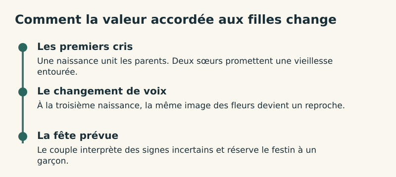

# BEL A/L — Chinois (commentaire et traduction) 2017 · Corrigé guidé

*Corrigé rédigé par IA, non officiel. Signalez toute erreur.*

**Rédaction** · GPT-6.2 Astra Ultra · vitesse non renseignée

[Sujet officiel](https://www.ens-lyon.fr/sites/default/files/2017-11/17-bel-commentaire-et-traduction-lve_1506586192589_0.pdf#page=8) · [Rapport du jury](https://www.ens-lyon.fr/sites/default/files/2018-03/CHINOIS_2017.pdf#page=1)

Ye Shengtao, *Le Fils posthume* (*遗腹子*, 1926). L’extrait suit un entretien entre Wenqing et sa femme autour de la naissance attendue. La version porte sur les lignes 5 à 14 incluses du sujet.

## Construire le commentaire

**Qui imagine la promenade au jardin ?** La ponctuation interrompt la tirade par un regard de la femme. La description du poêle et du vin appartient au mari. La femme se représente ensuite sa propre vieillesse, au discours du narrateur. On peut donc bâtir l’analyse sur un effet précis de la parole du mari sur l’imagination de son épouse.

**Que devient une comparaison quand on passe de deux filles à trois ?** Avec deux enfants, les fleurs attirent les regards. Avec trois, le père se demande s’il a l’air d’un jardinier. Conserver l’image commune permet de montrer ce qui a changé dans son jugement. On peut appliquer le même procédé au goût et au repas annoncé à la fin.

**Comment situer le texte ?** Dans la Chine républicaine des années 1920, la préférence pour un fils s’inscrit dans une société qui valorise la continuité de la lignée paternelle. L’auteur donne à lire la manière dont une norme s’installe dans les paroles d’un couple particulier. La répétition par l’épouse de l’image du goût en fournit une preuve dans le passage.

## Commentaire

叶圣陶的《遗腹子》写到一对已有四个女儿的夫妇猜测第五个孩子的性别。事情尚未发生，孩子没有出场，夫妻却已经把该买什么酒菜都商量好了。一场看起来颇为亲热的家常谈话，如何使读者听出这份亲热所附带的条件？

文卿先生开口就说要换口味。妻子谈的是孩子是否一样可爱，他回答的却是吃咸了会想吃甜的。用日常经验来打比方，仿佛人人都应该赞成他。接着他请妻子回想头一个婴儿的哭声。这里的父爱并非伪装：他把孩子当作两人亲手铸成的宝贝，夫妻二人都是创造者。第二个孩子的哭声同头一个并无两样，理由却已经悄悄变了。他设想姐妹俩穿戴整齐，好比一对耀眼的鲜花，旁人一定羡慕。第一个女儿的可贵在于她同父母血肉相连，第二个女儿的到来却逐渐需要拿好处来说明。散步时有一个搀扶，一个作伴；冬天有一个照料炉火，一个斟酒。句式如此对称，生活似乎也安排得恰到好处。然而这幅画里每个女儿都被分配了差事，却没有一个人开口。

说到第三个女儿，鲜花忽然多得得请个花匠来照管了。花本身没有变，变的是赏花人心中的数目。写出转折的首先是叙述者，他特意让我们注意文卿的声音。等到第四个女儿，他连连感叹，又怀疑起妻子的身体来。从前说的是两个人共同创造了生命，现在他却把生不出儿子的责任归到妻子一人身上。吃饭的比方也随之加重：开头只是想换个口味，后来竟说只吃米饭会生病。从个人爱好说成身体需要，偏爱男孩也就仿佛成了不可争辩的道理。民国时期重视父系传承的观念，在这段对话里甚至不必明说家族的规矩，就可以通过口味和健康的常识来替自己辩护。

叙述者没有派一个人出来反驳丈夫。妻子先想起往日，又看见自己福寿双全的模样。这两个瞬间都没有说出口，读者却借此看到了丈夫的言语对她的吸引力。随后她咽了一口唾沫，接过他的口头禅，还请他看自己的肚子。她拿肚皮的形状、脸色的变化作证，由外表不同推出里面也应当不同。这个推论并不可靠，但对话很快把猜测变成肯定。她说的是这一回“应该”不同，他却已经说到“待你生下男的”，连酒和火腿都计好了数。叙述至此停在未出生的孩子之前。从第一声啼哭到这顿还没吃上的饭，最能说明问题的并非文卿不爱女儿，而是夫妻俩要共享下一回的喜悦，竟得先认定孩子是个男孩。

## Préparer la version

Repérer d’abord les guillemets. « 又 » peut marquer une deuxième fille dans le dialogue ou le retour d’une rêverie dans la narration. « 只差得两岁 » indique la différence d’âge, tandis que les noms 大小姐 et 二小姐 reprennent les filles dans leur ordre de naissance. Garder le partage des personnes dans le jardin, l’aînée avec « toi », la cadette avec « moi ». « 多福多寿 » associe bonheur et longévité. Le modèle français du rapport s’arrête à cette rêverie. La ligne 14 du fascicule contient encore l’exclamation sur le troisième enfant et le changement de voix de Wenqing.

## Version française

« Pense un peu. Quand le premier bébé a poussé son cri et qu’on nous a dit que c’était une fille, comment ne pas se réjouir ? En elle se mêlaient notre chair et notre sang à tous les deux. Ce trésor, nous l’avions façonné de nos propres mains. »

Sa femme le regardait avec tendresse. Ces mots lui rappelaient la douceur d’autrefois. « Au deuxième cri, encore une fille. Passe encore. Les deux petites n’ont que deux ans d’écart. Plus tard, on les habillera avec soin, elles seront comme deux fleurs dont l’éclat attirera tous les regards. Quelle envie elles feront ! Et puis, dans nos vieux jours, il nous faudra bien une fille ou deux auprès de nous pour nous tenir compagnie. Quand nous irons nous promener au jardin, l’aînée te donnera le bras, et la cadette marchera à mes côtés. Au cœur de l’hiver, l’aînée attisera le feu du poêle et la petite versera du bon vin. Comme on sera bien ! »

De nouveau, elle croyait se voir en dame comblée de bonheur et promise à une longue vie.

« Mais le troisième enfant, une fille ! » La voix de M. Wenqing se fit moins douce.
