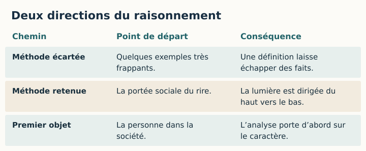

# BEL A/L · Chinois (thème Lyon) 2017 — Corrigé brut

*Corrigé rédigé par IA, non officiel. Signalez toute erreur.*

**Rédaction** · GPT-6.2 Astra Ultra · vitesse non renseignée

Le sujet de quatre heures propose un extrait de *Le Rire. Essai sur la signification du comique* de Henri Bergson (1940, date portée sur le sujet). Le dictionnaire bilingue est autorisé.

[Sujet officiel, p. 10](https://www.ens-lyon.fr/sites/default/files/2017-11/17-bel-epreuves-de-specailite-lyon_1506586608686_0.pdf#page=10) · [Rapport du jury, section du thème](https://www.ens-lyon.fr/sites/default/files/2018-03/CHINOIS_2017.pdf#page=2)

## Proposition de thème

我们循着可笑之处一路追踪，看它怎样转折变化，怎样渗入某种外形、某种神态、一个动作、一种处境、一桩行为，乃至一句话。现在，我们着手分析可笑的人物性格，也就来到了整个研究中最重要的部分。假如当初我们经不起诱惑，单凭几个格外醒目、因而也比较粗浅的例子就给可笑之物下了定义，那么这也会是最难的一部分。因为我们越是上升到喜剧性的高级表现形式，就越会发现，那个定义原想网住事实，网眼却太大，事实都从中漏了过去。

其实，我们走的恰恰是相反的路：我们把光从上往下照。我们相信，笑有它的社会含义，也能在社会中起作用；可笑之处首先表现在个人以某种特有的方式同社会格格不入；归根到底，只有人才会成为可笑的对象。正因为如此，我们一开始就把目光对准了人，对准了人的性格。

