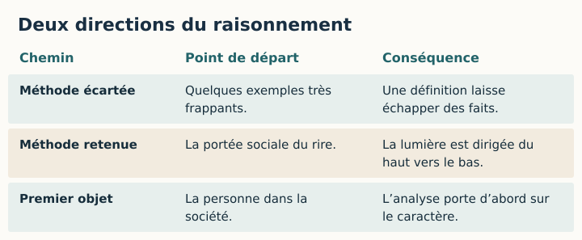

# BEL A/L · Chinois (thème Lyon) 2017 — Corrigé guidé

*Corrigé rédigé par IA, non officiel. Signalez toute erreur.*

**Rédaction** · GPT-6.2 Astra Ultra · vitesse non renseignée

Le sujet de quatre heures propose un extrait de *Le Rire. Essai sur la signification du comique* de Henri Bergson (1940, date portée sur le sujet). Le dictionnaire bilingue est autorisé.

[Sujet officiel, p. 10](https://www.ens-lyon.fr/sites/default/files/2017-11/17-bel-epreuves-de-specailite-lyon_1506586608686_0.pdf#page=10) · [Rapport du jury, section du thème](https://www.ens-lyon.fr/sites/default/files/2018-03/CHINOIS_2017.pdf#page=2)

### Retrouver la démonstration

Le premier pluriel fait de la lecture le récit d’une enquête. Conservez-le dès la première phrase et à la reprise finale. La succession va du perceptible au verbal, et de l’apparition ponctuelle du comique à l’étude des caractères. En chinois, la répétition mesurée de déterminants et de classificateurs garde le rythme de la liste. *一句话* permet de comprendre « un mot » au sens d’une parole ou d’une expression. Plus loin, distinguez l’objet qui fait rire, *可笑之物*, du rire, *笑*, dont il s’agit de déterminer la portée.

### Construire l’hypothèse

Le conditionnel passé développe une méthode que Bergson a écartée. Annoncez l’hypothèse avec *假如当初*, ouvrez sa conséquence avec *那么*, puis expliquez ce qui se serait produit au fur et à mesure de l’ascension. Le lecteur chinois n’a pas besoin d’un temps verbal à valeur de conditionnel si la relation est clairement construite. Les faits sont ce que la définition voudrait retenir. Traduire la définition comme un objet qui tomberait entre les mailles ferait disparaître le mécanisme de l’exemple.

### Garder les deux images et l’alternative lexicale

Le filet échoue à retenir les faits. La lumière, elle, est dirigée par le chercheur. Gardez un verbe de visée ou d’orientation dans la seconde image et reprenez ensuite le regard porté sur l’homme. « Caractère » peut désigner une disposition personnelle ou des caractéristiques. Le rapport accepte les deux lectures. Le choix de *性格* donne ici une continuité entre l’analyse des caractères comiques et le dernier membre de phrase. *社会含义* et *在社会中起作用* distinguent le sens du rire de ce qu’il produit dans la vie sociale. Relisez enfin les trois motifs qui précèdent la conclusion. Aucun ne doit devenir, par inadvertance, la simple conséquence du précédent.

## Proposition de thème

我们循着可笑之处一路追踪，看它怎样转折变化，怎样渗入某种外形、某种神态、一个动作、一种处境、一桩行为，乃至一句话。现在，我们着手分析可笑的人物性格，也就来到了整个研究中最重要的部分。假如当初我们经不起诱惑，单凭几个格外醒目、因而也比较粗浅的例子就给可笑之物下了定义，那么这也会是最难的一部分。因为我们越是上升到喜剧性的高级表现形式，就越会发现，那个定义原想网住事实，网眼却太大，事实都从中漏了过去。

其实，我们走的恰恰是相反的路：我们把光从上往下照。我们相信，笑有它的社会含义，也能在社会中起作用；可笑之处首先表现在个人以某种特有的方式同社会格格不入；归根到底，只有人才会成为可笑的对象。正因为如此，我们一开始就把目光对准了人，对准了人的性格。

