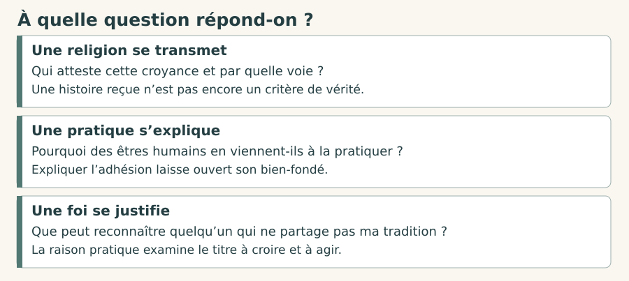

# BEL A/L — Deuxième composition de philosophie (Lyon), 2017 · Corrigé brut

*Corrigé rédigé par IA, non officiel. Signalez toute erreur.*

**Lecture du rapport du jury** · GPT-6.2 Astra Ultra · vitesse non renseignée

**Rédaction** · GPT-6.2 Astra Ultra · vitesse non renseignée

**Autocontrôle** · GPT-6.2 Astra Ultra · vitesse non renseignée

**Révision (tour 1)** · GPT-6.2 Astra Ultra · vitesse non renseignée

**Révision (tour 2)** · GPT-6.2 Astra Ultra · vitesse non renseignée

## La religion naturelle

Deux voyageurs se disent croyants. Chacun a reçu de sa famille un récit de la révélation divine, et chacun découvre que l’autre aurait pu être à sa place s’ils étaient nés dans le même village. De cette dépendance du témoignage à l’égard du lieu de naissance, ils peuvent conclure que chacun doit garder sa confession. Ils peuvent aussi chercher un moyen de juger qui soit accessible à l’un comme à l’autre. C’est à cette seconde exigence que correspond le projet d’une religion naturelle. Mais que restera-t-il de religieux dans ce que chacun pourra admettre par ses seules facultés humaines ?

« Naturelle » ne désigne pas d’abord une première religion que l’on pourrait retrouver par des fouilles, ni l’adoration de phénomènes naturels. Le terme porte sur le titre qui autorise la croyance et la pratique. Est naturelle en ce sens une religion dont les raisons ne requièrent pas l’autorité première d’une révélation particulière. Il faut comprendre à la fois sa promesse d’universalité et sa difficulté propre. L’usage commun de la raison peut mettre en échec une prétention exclusive. Peut-il donner positivement à un être humain une raison de prier, de rendre un culte ou d’interpréter son existence devant Dieu ?

### I. Un titre commun à croire

Lorsqu’une personne croit un fait historique, elle doit ordinairement se fier à des témoins. Rien là d’irrationnel. Mais si mon salut dépend absolument de l’adhésion à la révélation racontée par ces seuls témoins, celui qui n’a pu les rencontrer risque d’être tenu pour coupable d’une ignorance involontaire. La prétention d’une religion à concerner tout homme réclame donc une distinction entre la diffusion contingente d’une croyance et les raisons susceptibles d’être reconnues par chacun. Dans la *Profession de foi du vicaire savoyard*, au livre IV de l’*Émile*, Rousseau prête au vicaire l’examen de cette disproportion. La multiplication des miracles et des témoignages soumettrait la recherche du vrai à un voyage interminable à travers langues et traditions. Le vicaire cherche dans son expérience et sa conscience une règle de jugement qu’aucune institution ne puisse confisquer.

Il est possible d’apprendre une proposition dans un livre et de la justifier ensuite par des raisons accessibles à ceux qui ne l’ont jamais lu. L’histoire de sa transmission et la nature de son autorité peuvent donc recevoir deux réponses différentes. C’est cette différence qui donne un sens exigeant à l’idée de religion naturelle.

Une première voie est de regarder le monde visible comme l’indice d’un ordre intelligible. Si plusieurs pièces ajustées entre elles permettent à un outil de fonctionner, je reconnais une disposition qui suppose le travail d’un artisan. Le monde où des organismes se maintiennent et s’ajustent les uns aux autres semble à son tour témoigner d’une intelligence. L’intérêt du raisonnement est son point de départ. Il s’adresse à des personnes qui ne partagent encore aucune Écriture. Une conclusion établie sur un terrain commun pourrait alors tenir lieu de seuil pour toute croyance ultérieure.

Encore faut-il distinguer deux propositions. Expliquer par la sociabilité, la crainte ou l’habitude le fait que des hommes croient, c’est avancer une hypothèse sur la genèse de croyances. Une prédisposition humaine à imaginer des agents invisibles, si elle était démontrée, rendrait compréhensible la diffusion de certaines religions. Elle ne déciderait pas si nous avons raison de leur donner notre assentiment. Le projet de la religion naturelle cherche ce second titre. Il serait donc une erreur d’inférer de l’ancienneté ou de la fréquence d’une croyance sa vérité.

### II. La nature sous-détermine l’objet du culte

Un examen plus rigoureux de l’analogie éprouve cette ambition. Dans les *Dialogues sur la religion naturelle* de Hume, Cléanthe défend une argumentation de l’ordre analogue à la reconnaissance d’un dessein. Philon en interroge les conditions. Je connais des maisons et j’ai pu voir d’autres maisons se construire. Ce qui soutient l’inférence manque lorsque je passe de l’ordre entier du monde à l’auteur du monde. Et dans l’expérience familière, un grand édifice suppose souvent plusieurs artisans, des essais et des corrections. Si je tire de la ressemblance avec les ouvrages humains un argument en faveur d’un auteur, pourquoi ne pas tirer de cette même ressemblance un argument en faveur de plusieurs auteurs limités ? Cette objection borne la conclusion que l’analogie permet. Elle ne prononce pas à elle seule l’inexistence de Dieu.

La borne est décisive pour la religion. Admettre une cause intelligente serait encore loin de croire à un Dieu unique, bon, soucieux de mon action et auquel je puisse m’adresser. Des maux que personne n’a voulus atteignent les êtres sensibles. Je ne peux déduire sans autre appui de ce mélange d’ordre et de souffrance la bienveillance d’un créateur. Surtout, expliquer une succession d’événements et reconnaître une obligation ne constituent pas le même acte. Une intelligence dont je reconnaîtrais théoriquement le pouvoir ne deviendrait pas, de ce seul fait, digne de ma confiance. Entre la théologie qui raisonne sur une cause et la religion qui engage une existence, une distance subsiste.

L’échec d’une preuve ambitieuse n’oblige pourtant pas à choisir entre une révélation imposée et une absence totale de foi. La conscience qui reconnaît qu’un acte est juste ou injuste fait l’expérience d’une autorité que l’intérêt immédiat ne suffit pas à expliquer. Chez le vicaire, le sentiment intérieur oriente la relation à Dieu et le culte du cœur. Ce sentiment n’est pas n’importe quelle inclination du moment. Une inclination peut me pousser à préférer mon avantage précisément lorsque je sais ce que je dois à autrui. La conscience rend la divergence sensible. Reste à comprendre si ce passage à la vie morale conserve une signification religieuse propre.

### III. Une religion de la raison qui accepte d’être une foi

Dans la quatrième partie de *La Religion dans les limites de la simple raison*, Kant donne au contraste une portée pratique. Dans la religion naturelle, je dois pouvoir reconnaître qu’un acte est un devoir avant de le tenir pour commandé par Dieu. Dans la religion qui exige une révélation comme condition déterminante, l’ordre de reconnaissance s’inverse. Supposons qu’une prescription cultuelle m’enjoigne de mentir pour sauver le prestige d’un sanctuaire. Si le seul titre de l’obligation est l’autorité prétendue de celui qui commande, aucune critique interne du mensonge ne reste possible. Si je dois reconnaître le devoir par ma raison, la prétention religieuse d’une règle ne soustrait pas sa maxime à l’examen moral. L’adjectif « naturel » désigne alors une autonomie de jugement compatible avec l’interprétation religieuse du devoir.

Supposons qu’une tradition enseigne aux enfants un devoir de secours en racontant un épisode sacré. Une personne qui ignore ce récit peut reconnaître, dans la détresse d’autrui et dans sa propre capacité de lui répondre, une raison de l’aider. Cette rencontre valide une exigence commune. Elle ne démontre encore ni que le récit ait eu lieu ni que ce devoir soit un commandement divin. L’écart est décisif. La religion naturelle ne se confond avec la morale qu’au prix de perdre ce qu’elle devait expliquer, la manière de rapporter une obligation à Dieu. Elle peut maintenir ce rapport comme interprétation pratique de l’obligation, à condition de reconnaître ce que l’accord moral, à lui seul, laisse indéterminé. Deux personnes pourront alors secourir le même inconnu sans que leur accord dans l’action décide entre la foi de l’une et la réserve de l’autre.

Pourquoi conserver le mot « religion » ? Celui qui accomplit son devoir peut y reconnaître une exigence morale suffisante sans croire en Dieu. Celui qui le reconnaît en outre comme commandement divin rapporte ses engagements à une totalité de sens et à une espérance. Il ne possède pas une nouvelle preuve physique qu’un être divin surveille ses gestes. Ce qu’il fait différemment, c’est comprendre sa vie entière, ses devoirs et ses relations avec autrui dans cet horizon. La prière qui exprime cette disposition et la communauté qui l’entretient peuvent être des médiations historiques. Elles cessent de prétendre constituer la seule source de l’obligation. Une religion transmise par une tradition peut donc contenir des convictions qu’une personne est en droit d’examiner par elle-même : histoire de leur apprentissage et fondement de leur validité ne coïncident pas nécessairement.

La religion naturelle est ainsi défendable comme exigence adressée à la croyance. Elle demande que les raisons d’adhérer ne dépendent pas exclusivement du privilège d’être né parmi certains témoins. Elle donne un critère pour juger des prétentions d’un culte et rend possible une foi pratique. Elle perd sa cohérence lorsqu’elle promet de déduire de l’ordre visible toute la bonté divine, ou lorsqu’elle transforme une croyance partagée en savoir contraignant. L’accord possible sur une norme n’impose à personne de la vivre religieusement. Il ouvre à ceux qui la vivent ainsi un espace commun de discussion.

[Sujet officiel](https://www.ens-lyon.fr/sites/default/files/2017-11/17-bel-epreuves-de-specailite-lyon_1506586608686_0.pdf#page=2) · [Rapport du jury](https://www.ens-lyon.fr/sites/default/files/2018-03/PHILO_TC_SP_2017.pdf) · [Rousseau, Émile, livre IV](https://fr.wikisource.org/wiki/%C3%89mile%2C_ou_De_l%E2%80%99%C3%A9ducation/%C3%89dition_1782/Livre_IV) · [Kant, La Religion dans les limites de la simple raison, IV](https://fr.wikisource.org/wiki/La_Religion_dans_les_limites_de_la_simple_raison/Quatri%C3%A8me_partie)
