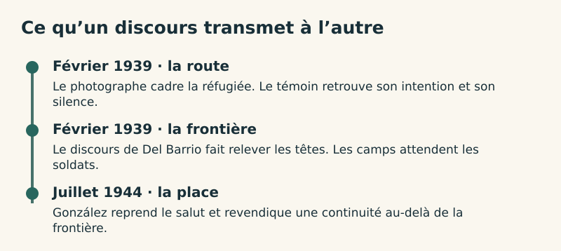

# BEL A/L — Espagnol (commentaire et traduction) 2017 · Corrigé brut

*Corrigé rédigé par IA, non officiel. Signalez toute erreur.*

**Rédaction** · GPT-6.2 Astra Ultra · vitesse non renseignée

**Révision (tour 1)** · GPT-6.2 Astra Ultra · vitesse non renseignée

[Sujet officiel](https://www.ens-lyon.fr/sites/default/files/2017-11/17-bel-commentaire-et-traduction-lve_1506586192589_0.pdf#page=10) · [Rapport du jury](https://www.ens-lyon.fr/sites/default/files/2018-03/ESPAGNOL_2017.pdf#page=1)

Almudena Grandes, *Inés y la alegría* (2010). González se souvient de l’exode de février 1939 au moment de s’adresser à ses hommes en Haute-Garonne en juillet 1944. La version va du regard sur les soldats fatigués au cri du narrateur qui couvre le leur.

## Commentaire

El pueblo francés cuyo nombre González no da y la mujer cuyo nombre nunca supo tienen algo en común: a ambos les tocó entrar en la Historia sin poder decidir cómo. La foto de la refugiada dio la vuelta al mundo; la liberación del pueblo, según el narrador, quedará fuera de los libros. Entre esos dos extremos, *Inés y la alegría* concede a uno de los combatientes el tiempo de contar qué le ocurrió a su ejército cuando dejó de figurar en los partes de guerra. Para entender una decisión que cabe en diez minutos, González tiene que volver sobre cinco años.

Al principio, la repetición de «Era cierto» parece conceder la razón a los soldados agotados. Pero para quien va a hablarles la espera se alarga de otra manera. La voz distante de Comprendes se pierde entre los gritos de 1939. Los imperfectos prolongan la marcha por una carretera jalonada de posesiones abandonadas. La cuerda de un animal sin nadie que sujete el otro extremo condensa en una imagen la descomposición del grupo. Cuando las voces sirven para llamar a quien se ha perdido, el «silencio» de la mujer entra, paradójicamente, en el inventario de lo que se oye. A la cámara le bastará un pecho descubierto; González restituye la finalidad del gesto, calmar al niño, y con ella una intimidad que el encuadre deja fuera. También reconoce su propio fracaso: ahuyentó al fotógrafo y le dejó el carrete. Su relato devuelve a la mujer una intención que su intervención de entonces no pudo proteger.

El teniente coronel, que mira a la misma mujer, no pide la leche que González imagina. Pide tiempo. En el puesto de mando un viejo general condecorado sólo sabe repetir un insulto contra los suyos, mientras que el discurso de Del Barrio logra que unos hombres encorvados vuelvan a enderezarse. El paso de «vi» a «íbamos» incorpora al testigo a ese movimiento. La frase sobre la guerra perdida entra en el relato sin comillas: en la memoria de uno siguen hablando los demás. Cruzar la frontera afeitados, cantando y en formación tiene un resultado material idéntico al de la huida en desorden, los campos franceses. Precisamente por eso la fórmula «En apariencia» importa. La dignidad de aquel gesto no se mide por el trato que los vencedores o los anfitriones dispensaron a los vencidos. Cinco años después proporciona palabras y postura al hombre que toma la palabra en la plaza.

El ademán del torero que dedica su faena introduce una pausa antes del discurso de 1944. El saludo aprendido del superior se convierte en una intervención propia cuando González afirma que el camino no acaba en París. El desconcierto obliga al auditorio a escuchar: para quienes han liberado suelo francés, ¿en nombre de quién, y con qué horizonte, se combate todavía? Una serie de negaciones descarta identidades que otros podrían imponerles. La afirmación de que *siguen siendo* el Ejército de la República convierte una aparente fundación en un acto de continuidad. La réplica del grupo es un rugido y el narrador rivaliza con él. Sin embargo, el relato que envuelve el discurso deja oír también al orador incierto, pendiente del rostro de cada hombre.

Los últimos renglones someten la estampa heroica a una prueba decisiva. El general condecorado de 1939 lloraba «como un niño de sesenta años». En 1944, la serie final de negaciones —sin sable, sin academia, sin galones ni medallas— da la vuelta a ese retrato. González sólo puede acreditar lo que comparte con los oyentes. La enumeración final barre las distancias entre el minero, el internado de Argelès y el guerrillero. Los tratados que pasen por alto aquel pueblo perderán justamente esto: la relación que, para esos hombres, existía entre una derrota a la que sobrevivieron y una liberación que pudieron protagonizar.

## Version française

Je les ai vus. J’ai vu leur fatigue, leur désespoir si proche du mien, je voyais tout cela s’estomper à la fois. Un à un, nous nous redressions peu à peu, nous reprenions courage et nous relevions la tête à mesure que nous entendions ces mots, nous avons perdu la guerre mais nous avons gardé notre honneur, nous avons perdu la guerre mais nous avions le droit pour nous, trois ans durant nous avons combattu pour que soit respectée la Constitution de notre pays, nous qui étions la seule armée légitime d’Espagne… Le lendemain, nous avons tous franchi la frontière, nous les hommes du XVIIIᵉ corps, rasés de près, propres, soigneusement coiffés, défilant en rangs impeccables au chant de l’Hymne de Riego, et cela pour échouer dans les mêmes camps que les autres, comme si nous étions des vagabonds, comme si nous étions des malfaiteurs. Ce geste n’avait, à première vue, servi à rien. Pourtant, le 2 juillet 1944, lorsque je suis entré sur la place de ce village de Haute-Garonne dont aucun ouvrage sur la Seconde Guerre mondiale ne mentionnera jamais la libération, j’ai levé les yeux vers le ciel, comme font les toreros quand ils veulent dédier un taureau à quelqu’un qui n’est plus auprès d’eux, avant de commencer comme commençait mon lieutenant-colonel quand nous avions bien travaillé.

« Bravo, camarades ! Bravo et merci à tous. Nous avons pris cette position à un ennemi qui avait l’avantage du nombre, sans un seul mort dans nos rangs. Et ce n’est qu’un début. Mais notre route ne s’arrête pas à Paris. » Ces mots les déconcertèrent tellement que c’est seulement en les entendant qu’ils commencèrent à m’écouter pour de bon. « Voilà d’abord ce que je tiens à vous faire savoir. Nous ne nous battons pas pour atteindre Paris, et nous ne sommes pas non plus des soldats de fortune. Nous ne sommes ni des mercenaires ni des hors-la-loi. Nous ne sommes ni des brigands ni des voleurs de grand chemin. » Je marquai une pause et haussai la voix. « Nous sommes toujours l’Armée de la République espagnole ! » Ils rugirent, mais je rugis plus fort qu’eux.
