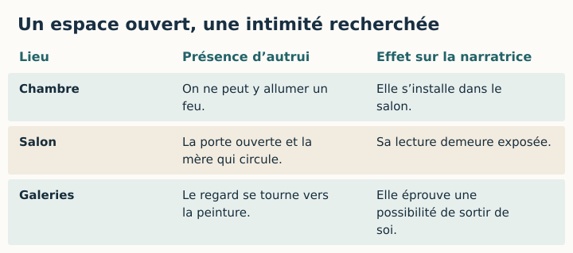

# BEL A/L · Espagnol (thème Lyon) 2017 — Corrigé brut

*Corrigé rédigé par IA, non officiel. Signalez toute erreur.*

**Rédaction** · GPT-6.2 Astra Ultra · vitesse non renseignée

Le sujet de quatre heures propose un extrait de *Mémoires d’une jeune fille rangée* de Simone de Beauvoir (1958). L’épreuve se déroule sans dictionnaire.

[Sujet officiel, p. 11](https://www.ens-lyon.fr/sites/default/files/2017-11/17-bel-epreuves-de-specailite-lyon_1506586608686_0.pdf#page=11) · [Rapport du jury, section du thème](https://www.ens-lyon.fr/sites/default/files/2018-03/ESPAGNOL_2017.pdf#page=11)

## Proposition de thème

Otro motivo de conflicto eran mis lecturas. A mi madre le costaba resignarse. Palideció al hojear *La noche kurda*, de Jean-Richard Bloch. A todo el mundo le hablaba de los disgustos que yo le daba: a mi padre, a la señora Mabille, a mis tías, a mis primas, a sus amigas. Yo no acababa de resignarme a aquella desconfianza que sentía a mi alrededor. ¡Qué largas se me hacían las veladas, y los domingos! Mi madre decía que no se podía encender la chimenea de mi cuarto. Así que instalaba una mesa de bridge en el salón, donde ardía una estufa y cuya puerta, como era costumbre, permanecía abierta de par en par. Mi madre entraba, salía, iba y venía y se asomaba por encima de mi hombro. «¿Qué haces? ¿Qué libro es ese?». Dotada de una vitalidad vigorosa que apenas tenía ocasión de gastar, creía en las virtudes de la alegría. Cantando, riendo, gastando bromas, intentaba revivir ella sola el alegre alboroto que llenaba la casa cuando mi padre no nos dejaba solas todas las noches y reinaba el buen humor. Reclamaba mi complicidad y, si me faltaba entusiasmo, se inquietaba: «¿En qué piensas? ¿Qué te pasa? ¿Por qué pones esa cara? Claro, a tu madre no quieres contarle nada…».

Cuando por fin se acostaba, yo estaba demasiado cansada para disfrutar de aquel respiro. ¡Cómo me habría gustado poder ir al cine, sin más! Me tendía en la alfombra con un libro, pero me pesaba tanto la cabeza que muchas veces me quedaba dormida. Me iba a la cama con el ánimo revuelto. Me despertaba por la mañana sumida en el tedio y los días se me hacían interminables y tristes. Estaba harta de los libros. Había leído demasiados que machacaban siempre lo mismo y no me ofrecían ninguna esperanza nueva. Prefería matar el tiempo en las galerías de la rue de Seine o de la rue La Boétie. La pintura me hacía salir de mí misma. Eso era lo que yo intentaba.

