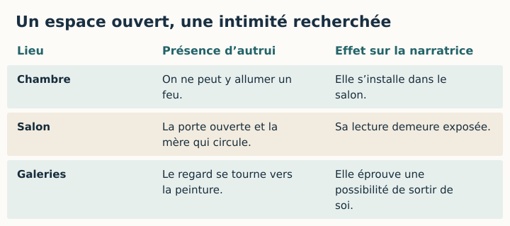

# BEL A/L · Espagnol (thème Lyon) 2017 — Corrigé guidé

*Corrigé rédigé par IA, non officiel. Signalez toute erreur.*

**Rédaction** · GPT-6.2 Astra Ultra · vitesse non renseignée

Le sujet de quatre heures propose un extrait de *Mémoires d’une jeune fille rangée* de Simone de Beauvoir (1958). L’épreuve se déroule sans dictionnaire.

[Sujet officiel, p. 11](https://www.ens-lyon.fr/sites/default/files/2017-11/17-bel-epreuves-de-specailite-lyon_1506586608686_0.pdf#page=11) · [Rapport du jury, section du thème](https://www.ens-lyon.fr/sites/default/files/2018-03/ESPAGNOL_2017.pdf#page=11)

### Placer la voix et les objets

La narratrice évoque une situation habituelle, trouée par quelques faits précis. Utilisez l’imparfait pour les allées et venues et, pour l’épisode de la lecture de Bloch, un prétérit qui en marque le caractère ponctuel. Les deux groupes de personnes de la première énumération demandent une attention particulière. *Mis tías, mis primas* désignent les parentes de la narratrice. *Sus amigas* sont les amies de la mère. La « salamandre » est un poêle. La table de bridge est le petit meuble qu’installe la jeune fille, sans que le passage dise qu’elle joue aux cartes.

### Faire entendre une surveillance affectueuse et pesante

La succession des verbes de déplacement prépare les interrogations par-dessus l’épaule. Prononcez en espagnol les deux questions comme deux interventions réelles, puis distinguez-les de la série plus longue qui survient quand la jeune fille manque d’entrain. *¿En qué piensas?* et *¿Qué te pasa?* sont des tours simples et expressifs. Dans *a tu madre no quieres contarle nada*, la reprise par *le* maintient le reproche affectif. Les participes « chantant, riant, plaisantant » éclairent l’activité de la mère. Son énergie et l’ennui de sa fille doivent pouvoir coexister dans la traduction, sans transformer la mère en caricature.

### Choisir une fin défendable

« Le cœur brouillé » suggère ici un malaise qui accompagne le coucher. Une traduction par un terme de pathologie physique serait trop déterminée. Les temps itératifs reviennent avec le réveil, la lecture et les promenades dans les galeries. Le féminin de *mí misma* identifie clairement la même voix jusqu’à la dernière phrase. Le jury reconnaît plusieurs antécédents grammaticalement possibles pour « en ». Cette proposition relie la dernière phrase à l’effet de la peinture, qui permet de sortir de soi. Si l’on choisit un autre antécédent permis par le texte, il faut en vérifier la continuité dans les deux dernières phrases ensemble.

## Proposition de thème

Otro motivo de conflicto eran mis lecturas. A mi madre le costaba resignarse. Palideció al hojear *La noche kurda*, de Jean-Richard Bloch. A todo el mundo le hablaba de los disgustos que yo le daba: a mi padre, a la señora Mabille, a mis tías, a mis primas, a sus amigas. Yo no acababa de resignarme a aquella desconfianza que sentía a mi alrededor. ¡Qué largas se me hacían las veladas, y los domingos! Mi madre decía que no se podía encender la chimenea de mi cuarto. Así que instalaba una mesa de bridge en el salón, donde ardía una estufa y cuya puerta, como era costumbre, permanecía abierta de par en par. Mi madre entraba, salía, iba y venía y se asomaba por encima de mi hombro. «¿Qué haces? ¿Qué libro es ese?». Dotada de una vitalidad vigorosa que apenas tenía ocasión de gastar, creía en las virtudes de la alegría. Cantando, riendo, gastando bromas, intentaba revivir ella sola el alegre alboroto que llenaba la casa cuando mi padre no nos dejaba solas todas las noches y reinaba el buen humor. Reclamaba mi complicidad y, si me faltaba entusiasmo, se inquietaba: «¿En qué piensas? ¿Qué te pasa? ¿Por qué pones esa cara? Claro, a tu madre no quieres contarle nada…».

Cuando por fin se acostaba, yo estaba demasiado cansada para disfrutar de aquel respiro. ¡Cómo me habría gustado poder ir al cine, sin más! Me tendía en la alfombra con un libro, pero me pesaba tanto la cabeza que muchas veces me quedaba dormida. Me iba a la cama con el ánimo revuelto. Me despertaba por la mañana sumida en el tedio y los días se me hacían interminables y tristes. Estaba harta de los libros. Había leído demasiados que machacaban siempre lo mismo y no me ofrecían ninguna esperanza nueva. Prefería matar el tiempo en las galerías de la rue de Seine o de la rue La Boétie. La pintura me hacía salir de mí misma. Eso era lo que yo intentaba.

