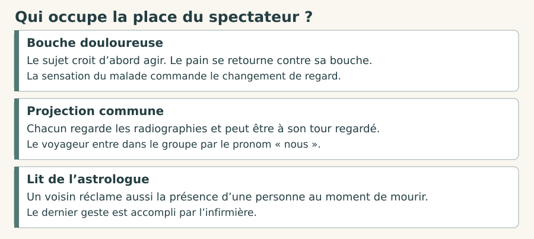

# BEL A/L — Étude de texte français (Lyon), 2017 · Corrigé guidé

*Corrigé rédigé par IA, non officiel. Signalez toute erreur.*

**Lecture du rapport du jury** · GPT-6.2 Astra Ultra · vitesse non renseignée

**Rédaction** · GPT-6.2 Astra Ultra · vitesse non renseignée

**Autocontrôle** · GPT-6.2 Astra Ultra · vitesse non renseignée

**Révision (tour 1)** · GPT-6.2 Astra Ultra · vitesse non renseignée

## Suivre la circulation du regard

Les pages 4 et 5 du fascicule accordent cinq heures à l’étude du passage de Nicolas Bouvier. Le titre et le chapeau situent le séjour à Ceylan et la maladie. Le texte lui-même précise qui observe qui. Dès les lignes 1 à 6, noter le renversement entre la personne qui mange et sa bouche douloureuse. Aux lignes 12 à 21, l’écran rassemble ceux qui vont successivement montrer et regarder leurs radios. Aux lignes 21 à 30, la vue est troublée par l’évanouissement et par le reflet des lunettes. Les lignes 42 à 51 changent le centre d’attention en faisant entendre le ressentiment de l’astrologue.

**Reprendre un pronom.** Dans la scène des radios, substituer « ils » à « nous » ferait du visiteur un observateur extérieur. Le pronom effectivement écrit le place parmi ceux qui éprouvent ce plaisir commun, puis le fait passer sous leurs yeux. À la toute fin, le pronom qui reprend le geste de fermer les yeux ne prend son sens que si l’on revient au souhait formulé juste avant. L’ellipse demande au lecteur de reconnaître la mort sans description.

**Éprouver la tonalité.** L’incongruité du métier de l’astrologue fait rire. Le désir d’être accompagné est immédiatement reconnu. Tenir ensemble ces deux temps empêche d’assimiler tout l’épisode à une moquerie du malade ou à une dénonciation uniforme de la médecine du lieu. Le rapport met notamment en garde contre l’exotisme plaqué sur le passage et l’emploi indifférencié des termes désignant le comique.

Distinguer à chaque étape qui observe le malade et qui peut raconter ce regard. Ce dédoublement aide à expliquer pourquoi la scène publique ne prive pas le narrateur de toute faculté de jugement.

## Nicolas Bouvier, *Le Poisson-scorpion*, le dispensaire

Le voyageur qui pénètre dans un lieu qu’il ne connaît pas se prépare d’ordinaire à observer les autres. Le malade du *Poisson-scorpion* commence par ne plus savoir ce qui se passe dans sa propre bouche. Le récit de l’arrivée au dispensaire de Ceylan a bien pour repères des déplacements, des rencontres et des notations précises. L’objet principal de l’observation se dérobe pourtant à celui qui prétend la conduire. Projeté sur un drap, puis dérobé à sa propre conscience, le corps du visiteur occupe la scène. Le dernier mouvement lui apprend qu’un homme couché à côté de lui en a éprouvé douloureusement les conséquences. Comment écrire une rencontre quand le voyageur qui pourrait la raconter risque d’en accaparer toute la lumière ?

### I. Un regard de malade qui ne cesse de changer de place

L’ouverture renverse une action élémentaire. Le narrateur croyait manger son pain. Dans la proposition clivée, le pain devient à son tour le sujet de la même action, et la bouche ce qu’il attaque. La reprise du verbe donne à sentir la consistance douloureuse du geste sans attribuer pour de bon une intention au pain. L’image anatomique qui suit poursuit la division du sujet. Le sang dessine dents et nerfs et change la bouche en planche gravée. La référence à Vésale convoque un savoir visuel alors que le malade éprouve de l’intérieur une douleur qu’il ne peut voir de cette façon. Dès avant l’entrée au dispensaire, éprouver et voir ne se recouvrent plus.

Le passé composé inscrit le déplacement dans un passé très proche du moment où le voyageur fait son bilan. L’inventaire des soins à recevoir, les indications laconiques du coût, les groupes nominaux pour la villa ou les symptômes produisent l’allure rapide d’un carnet. Les constructions raccourcies enregistrent ce qui perce dans le champ d’attention du malade. Pourtant, une formule comme « soins gratuits » explique aussi matériellement son choix à quelqu’un qui peine à tirer parti de son séjour. La précision documentaire et la discontinuité sensible procèdent des mêmes phrases. Le regard posé sur les gens du dispensaire en donne une preuve. Il commence par les compter presque comme le personnel, puis il imagine leur désir de rester là où compagnie et nourriture sont assurées. Le terme qui signale qu’il s’agit d’une impression du narrateur maintient une distance entre le constat et l’intention qu’il leur prête.

La séance des radiographies donne une forme publique à ce regard imparfait. L’appareil ancien projette les images sur un drap, si bien que les organes intérieurs de chacun peuvent être vus par tous. Les mots de la matière abîmée, les exclamations et les rappels au silence déplacent le vocabulaire de l’auscultation vers celui d’une séance de cinéma. Le passage de la troisième personne au « nous » est décisif. Le voyageur ne contemple plus du dehors des corps souffrants. Il appartient au groupe des spectateurs dont le corps peut, au tour suivant, faire l’objet du spectacle. La gaieté n’efface pas les radiographies inquiétantes. Elle apparaît comme une manière de pouvoir les regarder ensemble.

### II. Le privilège de tenir la vedette se renverse en dépendance

Les poumons du visiteur sont moins atteints que ceux de ses compagnons. Le tour familier qui les désigne comme l’équipement d’un riche rattache cet avantage corporel à des inégalités réelles, sans qu’un discours général vienne les surplomber. L’adjectif occidental avait déjà donné un sens social à son arrivée. Le visiteur se figure qu’elle rassure sur la qualité des soins. À l’inverse, ce sont les gens supposés devoir recevoir sa garantie qui le félicitent de pouvoir leur survivre. Ce paradoxe ruine le portrait du voyageur généreux face à des malades seulement passifs. Leurs exclamations font de lui le bénéficiaire embarrassé d’une sollicitude qu’il n’a pas gagnée.

Deux comparaisons aussitôt successives déplacent encore le rôle. Il se rêve en buteur isolé sous les acclamations, puis sa défaillance physique reçoit les honneurs comiques d’une cantatrice écrasée de fleurs. Le prestige du sportif et le jeu de la vedette signalent à quel point l’événement dépend du public qui l’interprète. Le récit feint de présenter l’évanouissement comme un choix du bon moment. Or cet apparent metteur en scène perd précisément la capacité de raconter ce qui se passe. Lorsqu’il revient à lui, les soins sont déjà accomplis. La parole médicale lui parvient par fragments et la chambre se reflète à l’envers dans les lunettes du médecin. Le spectateur souverain s’efface derrière un patient dont la situation limite à la fois le champ visuel et l’information.

La voix anglaise du médecin détache ses syllabes. Ce qui ressemble d’abord à une assurance personnelle va recevoir une traduction concrète dans le mouvement des voisins autour du lit. Un insecte sur le col du médecin prête à la scène une minuscule activité indépendante. Le narrateur lui imagine un instant une demande de conseil, puis perd de nouveau connaissance. Le monde continue à se mouvoir sans lui. La promesse de compagnie devient au réveil un flux de personnes, avec leurs mouchoirs, leurs sourires et jusqu’à une chique déjà entamée. Le don décrit peut dégoûter un observateur et émouvoir celui qui le reçoit. L’analogie des visages qui s’éclairent comme des gares réintroduit le voyage dans l’expérience immobile d’un lit. Un départ ou une arrivée se lit désormais sur le visage d’autrui.

### III. Le dernier voisin oblige le lecteur à relire la fête

Cette compagnie n’a rien d’une communion uniforme. La délégation qui suit le narrateur jusque dans un lieu privé rend son dévouement fatigant. L’infirmière la disperse et le malade rit de la débandade. L’image des bolets attaqués par des limaces ramène fugitivement une mémoire européenne au cœur de Ceylan. Les comparaisons avec les animaux, les végétaux et les moyens de transport font ainsi circuler les regards entre des univers géographiques et sociaux distincts. Elles exposent aussi le danger propre à la virtuosité du récit. Une personne déjà vulnérable peut devenir pour qui l’observe une silhouette plaisante.

La phrase qui isole le voisin astrologue interrompt l’allégresse. Son anglais soigné, son sentiment du rang et sa mésaventure fournissent d’abord la matière d’un portrait satirique. L’homme qui prétendait prévoir l’avenir des chevaux a été blessé par l’un d’eux sans l’avoir prévu. Et le Sud de l’île est devenu pour le narrateur assez familier pour faire de cet inconnu un quasi-voisin de pays. L’ironie tient à une disproportion entre la prétention professionnelle et le coup du hasard, mais elle ne peut fournir le dernier mot sur l’homme mourant. Ce dernier estime que le visiteur l’a privé de l’attention qui accompagnerait sa mort. La métaphore du spectacle, innocente en apparence au moment des radiographies, revient désormais comme un grief.

Le souhait que quelqu’un lui ferme les yeux est suivi d’un bref acquiescement du narrateur. Puis le pronom de la dernière phrase reprend l’action souhaitée, dans une notation qui situe le geste de l’infirmière dans la nuit. Aucun développement ne décrit l’agonie ni ne fait de l’astrologue le prétexte d’une leçon édifiante. Il faut au lecteur reconnaître la mort dans l’acte accompli par une autre. L’attention que captaient les aventures du voyageur se porte enfin sur le voisin et sur une soignante. Le récit de voyage trouve ainsi une issue à sa propre difficulté. Il ne supprime ni l’humour ni le regard intéressé de celui qui raconte. Il les conduit jusqu’au point où une phrase très simple leur impose de céder la place.

[Sujet officiel](https://www.ens-lyon.fr/sites/default/files/2017-11/17-bel-epreuves-de-specailite-lyon_1506586608686_0.pdf#page=4) · [Rapport du jury](https://www.ens-lyon.fr/sites/default/files/2018-03/LETTRES_MODERNES_2017.pdf)
