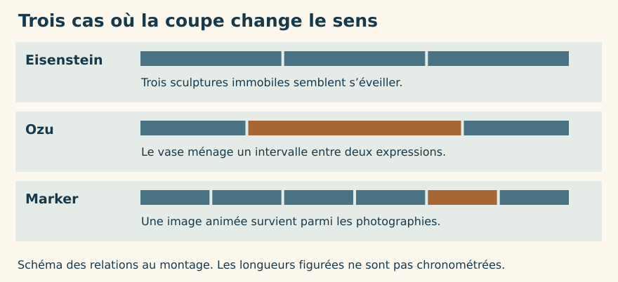

# BEL · AL — Études cinématographiques 2017 · Corrigé guidé

*Corrigé rédigé par IA, non officiel. Signalez toute erreur.*

**Lecture du rapport du jury** · GPT-6.2 Astra Ultra · vitesse non renseignée

**Rédaction** · GPT-6.2 Astra Ultra · vitesse non renseignée

**Autocontrôle** · GPT-6.2 Astra Ultra · vitesse non renseignée

« Y a-t-il un sens à parler de la juste durée d’un plan au cinéma ? » Composition de six heures.

## Tester une affirmation par un autre montage

Prenez trois moments. La vue comique de Lumière doit permettre de saisir un retournement. Les lions de pierre d’Eisenstein doivent conserver entre leurs attitudes un élan de métamorphose. Le vase chez Ozu ménage un intervalle entre deux expressions de Noriko. Pour chacun, décrivez l’effet prévisible d’un plan raccourci ou prolongé. Ces hypothèses de remontage font travailler le mot « juste » beaucoup plus précisément qu’un classement des cinéastes selon leur lenteur.

**Comment traiter l’expression « y a-t-il un sens » ?** Formulez d’abord l’hypothèse d’une règle objective, par exemple la durée suffisante pour identifier ce qu’on voit. Le vase d’Ozu permet de la réfuter sans conclure que tout se vaut. On identifie le vase bien avant d’avoir éprouvé le rôle temporel de l’intervalle.

**Un film qui semble ne comporter qu’un plan est-il un cas simple ?** Comparez *La Corde* et *L’Arche russe*. La continuité apparente du premier résulte de prises et de raccords, tandis que le parcours du second a été tourné d’un seul tenant. La question peut porter sur la longueur d’une prise ou sur l’expérience d’une continuité par le public. Précisez de laquelle vous parlez.

**Que peut répondre un spectateur qui s’ennuie ?** Sa réaction constitue un fait de réception, puis un point de départ pour l’argument. L’ennui devant *Empire* peut conduire à remarquer ce que l’on attendait d’un film et ce qu’il propose effectivement. On peut ensuite juger cette proposition, en revenant aux variations de lumière, au cadre immobile et à la situation de projection. L’intention attribuée à l’auteur ne clôt pas la discussion.

## Peut-on défendre une coupe ?

Un plan de vase dans *Printemps tardif* d’Ozu, en 1949, paraît durer bien au-delà du temps nécessaire pour reconnaître le vase. Faut-il en retrancher quelques secondes ? Le monteur saurait le faire au photogramme près. Le chronomètre ne saurait lui dire pourquoi. La question sur la « juste durée » n’invite donc pas seulement à comparer les films rapides et les films lents. Elle confronte une mesure disponible à un jugement qu’on aimerait pouvoir défendre. Quelles raisons donner au moment de couper, ou à la décision de ne pas couper encore ? Il faut distinguer les conditions physiques du plan, le temps que le film fait éprouver et la place depuis laquelle un spectateur juge cette expérience.

## Mesurer un plan ne suffit pas à lui fixer sa durée

Dans une copie montée, deux coupes franches permettent de compter précisément les photogrammes compris entre elles. À cadence constante, on obtient une durée de projection. La durée de l’enregistrement peut s’en écarter, notamment avec un ralenti. La durée de l’action représentée aussi. Lorsque Kubrick, dans *2001, l’Odyssée de l’espace*, fait se succéder un os lancé en l’air et un engin spatial, le raccord rapproche des formes et franchit un immense intervalle historique. Aucune des deux longueurs mesurées n’en donne la valeur. La « juste » durée ne peut donc être définie en la faisant simplement coïncider avec celle de l’histoire racontée.

Il existe néanmoins des limites techniques et des seuils de perception. À la fin du XIXe siècle, le métrage disponible borne une vue Lumière. *L’Arroseur arrosé* contient à l’intérieur de cette limite le temps d’installer une situation, de faire attendre son renversement et de le rendre lisible. La longueur de la bande n’aurait pas suffi à elle seule à régler les entrées, les gestes et l’attente comique. Dans *La Corde* de Hitchcock en 1948, plusieurs jonctions sont dissimulées en approchant l’objectif du dos d’un personnage. La scène peut alors sembler se poursuivre au-delà des limites d’un chargement de caméra. Faut-il mesurer chaque prise ou le mouvement que le public perçoit comme ininterrompu ? On obtient deux réponses exactes à des questions différentes. Dans *L’Arche russe* de Sokourov, une prise numérique parcourt réellement les salles de l’Ermitage d’un seul mouvement. La continuité est matériellement différente et répond à un autre projet, faire traverser plusieurs époques sans que le regard sorte du musée.

## Une durée devient juste par ce qui se passe dans le plan et autour de lui

Chez Eisenstein, une suite de plans très brefs peut construire un mouvement qui n’appartient à aucun d’eux isolément. Dans *Le Cuirassé Potemkine*, les images successives de trois lions de pierre, dans des attitudes différentes, font surgir le mouvement d’un réveil. Un arrêt prolongé sur chaque sculpture donnerait au spectateur tout loisir d’en examiner la facture et pourrait affaiblir la métaphore créée par leur enchaînement. Dans *L’Homme à la caméra*, Vertov arrête le mouvement et fait apparaître le travail de la monteuse devant la pellicule. Une suspension qui briserait l’élan du premier enchaînement est, dans le second cas, nécessaire pour rendre le médium intelligible. Il existe bien des raisons de préférer une durée à une autre, mais elles changent avec la relation que le montage veut produire.

Chez Tarkovski, le rythme dépend aussi de la façon dont le temps se fait sentir dans un plan. Une attente, un déplacement hésitant ou le changement d’une lumière peuvent modifier son intensité intérieure sans que sa durée chiffrée change. Dans *Jeanne Dielman* de Chantal Akerman, en 1975, la caméra stable laisse à une tâche domestique son épaisseur de gestes et d’efforts. La répétition des mêmes lieux au fil des journées rend un retard ou une maladresse sensibles. La première occurrence apprend à regarder, la suivante tire sa force de la mémoire de la précédente. Remplacer chaque activité par un rapide plan informatif permettrait encore de savoir que Jeanne a préparé un repas. On perdrait la possibilité d’éprouver le temps de ce travail et de repérer quand son organisation se dérègle. Le maintien du cadre décide ici de la visibilité sociale d’une activité.

À Kyoto, dans *Printemps tardif*, Ozu passe du visage de Noriko à un vase silencieux puis revient à elle. Son expression a changé. L’intervalle fait exister une transformation dont le film ne livre pas toutes les étapes psychologiques. Le plan de vase serait informativement complet après un instant. Sa place dans l’échange entre un père qui dort et sa fille éveillée réclame une autre échelle de temps. Chez Chris Marker, dans *La Jetée*, un bref mouvement d’ouverture des yeux devient au contraire un événement extraordinaire parce que le film a habitué son spectateur à un récit photographique composé presque entièrement d’images fixes. L’opposition entre les deux exemples permet de préciser ce que mesure un jugement de justesse. Il concerne ce qui devient sensible à cet endroit précis d’une œuvre.

## À qui la durée doit-elle paraître juste ?

Un monteur peut choisir un point de coupe en faisant primer l’émotion et le rythme sur une continuité spatiale parfaite, comme l’explique Walter Murch. Le spectateur peut cependant éprouver de l’ennui au moment où le cinéaste estime que l’attention devient plus libre. Qui se trompe ? Dans *Empire* de Warhol et John Palmer, en 1964, le cadrage de l’Empire State Building reste fixe pendant une projection d’un peu plus de huit heures. Attendre le prochain développement d’une intrigue rendrait presque chaque minute excédentaire. Suivre la variation des lumières, prendre conscience de ses propres absences ou mesurer la différence entre le temps enregistré et celui qu’on passe dans la salle appartient à une autre expérience. L’ennui peut en faire partie. L’affirmer ne rend pas automatiquement réussie toute prolongation.

Le jugement critique peut alors procéder par comparaison raisonnée. Que perdrait-on en coupant le vase plus tôt ? À quel moment devient-on capable de percevoir, dans un geste de Jeanne, l’écart avec les gestes de la veille ? Le mouvement des yeux chez Marker produirait-il le même effet après un long passage animé ? Ces questions invitent des spectateurs différents à revenir aux mêmes images et à confronter leurs réponses. Elles ne promettent pas qu’une seconde unique s’imposera à tout le monde. La justesse ressemble plutôt à une décision entre plusieurs possibilités, motivée par une attente construite dans le film et éprouvée devant lui.

Il y a donc un sens à parler de la juste durée d’un plan si l’on accepte de donner des raisons et de les mettre à l’épreuve sur l’œuvre. Le nombre de secondes reste une donnée indispensable pour décrire. Pour juger, il faut savoir ce que la coupe fait apparaître ou disparaître, quelle activité elle laisse enfin voir et quelle part d’interprétation elle confie à celui qui regarde.

[Feuillet du sujet, p. 2](https://www.ens-lyon.fr/sites/default/files/2017-11/17-bel-epreuves-en-arts_1506586794135_0.pdf#page=2) · [Rapport de l’écrit](https://www.ens-lyon.fr/sites/default/files/2018-03/Etudes%20cin%C3%A9matographiques_2017.pdf#page=1)

[Criterion, les durées de Jeanne Dielman](https://www.criterion.com/current/posts/1215-a-matter-of-time-jeanne-dielman-23-quai-du-commerce-1080-bruxelles) · [Criterion, le mouvement dans La Jetée](https://www.criterion.com/current/posts/485-la-jet-e-unchained-melody) · [MoMA, Empire](https://www.moma.org/collection/works/303039/)
