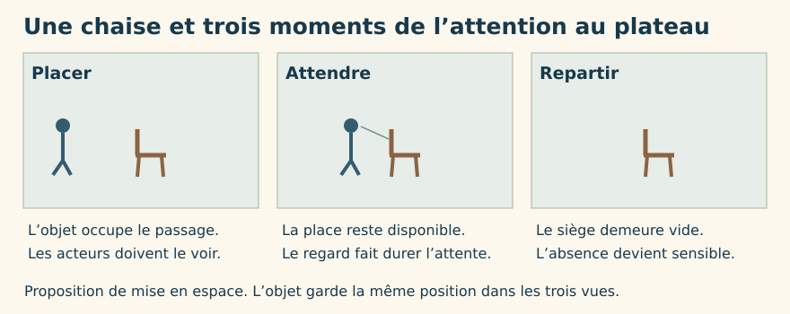

# BEL · AL — Études théâtrales 2017 · Corrigé brut

*Corrigé rédigé par IA, non officiel. Signalez toute erreur.*

**Lecture du rapport du jury** · GPT-6.2 Astra Ultra · vitesse non renseignée

**Rédaction** · GPT-6.2 Astra Ultra · vitesse non renseignée

**Autocontrôle** · GPT-6.2 Astra Ultra · vitesse non renseignée

Le sujet demande de commenter la proposition de Jean-Luc Mattéoli sur l’existence et l’action de l’objet vrai, jusque dans son immobilité. L’épreuve dure six heures.

## Que fait un objet quand personne ne le touche ?

Au théâtre, une chaise peut servir à l’acteur qui s’assied ou indiquer au public que la scène se passe dans une cuisine. Mais qu’advient-il si cette chaise reste inoccupée et que l’on voit, sur ses barreaux, les marques de nombreuses mains ? Le théâtre dispose alors d’une chose qui a déjà vécu ailleurs. Jean-Luc Mattéoli appelle « vrai » l’objet dont la réalité excède la fonction qu’on lui assigne. Dans le passage de son article retenu au concours, il affirme qu’une telle existence suffit à une action, jusque dans l’immobilité. La coupe de la citation abrège une allusion aux rapprochements de Kantor entre objets scéniques, œuvres et machines. La proposition vise un paradoxe propre à la représentation. Comment une chose soustraite à l’usage devient-elle partenaire d’un jeu, et que faut-il organiser sur scène pour qu’elle puisse agir en son nom propre ?

## Une chose apporte au théâtre un passé que la fiction n’a pas écrit

À Cracovie, en 1944, Tadeusz Kantor monte clandestinement *Le Retour d’Ulysse* d’après Wyspiański. Une roue de charrette boueuse, une planche usée, une chaise de cuisine et un haut-parleur comptent parmi les éléments réels introduits dans la pièce où a lieu la représentation. Une roue neuve peinte à l’imitation de la boue aurait pu faire comprendre l’idée d’un chariot. La roue récupérée introduit en plus une matière transformée avant son entrée en scène par des usages dont les spectateurs ne connaissent pas l’histoire exacte. Dans une ville occupée, le retour d’Ulysse s’inscrit ainsi parmi les restes du présent historique. Le spectacle peut les déplacer. Il ne peut remonter le temps pour décider tout ce qui leur est arrivé.

Cette antériorité explique la différence entre un accessoire et ce que Mattéoli nomme l’objet pauvre. Un accessoire peut être magnifique et jouer parfaitement son rôle dès lors qu’un acteur le saisit au moment prévu. Un objet abandonné ou déclassé peut offrir moins de services et davantage de prises à l’imagination. Une rayure, un pied irrégulier, la lourdeur d’une roue ne se réduisent pas au signifié « pauvreté ». Ils retiennent le regard et peuvent infléchir le rythme d’un déplacement. La pauvreté désigne ici une place dans le monde des usages et des valeurs. Elle n’est ni un certificat de vérité morale ni une propriété que le décorateur obtiendrait à coup sûr en vieillissant artificiellement tous ses meubles.

## L’action scénique comprend aussi ce qu’une présence fait faire aux autres

Que signifie donc « agir » ? Une chaise au milieu d’un passage modifie les distances entre deux acteurs. Si une interprète s’arrête devant elle sans la toucher, la suspension du geste est une action que le public peut suivre. L’objet reste à la même place. La relation entre la chaise, la personne et le public vient de changer. La durée compte autant que l’espace. Au début, une chaise vide peut passer pour une place disponible. Si quelqu’un l’attend longtemps du regard, le même vide peut devenir une absence. Cet essai de plateau est hypothétique. Il permet de comprendre pourquoi il serait réducteur de n’attribuer une activité qu’à ce qui se déplace.

Le texte des *Chaises* d’Ionesco organise autrement cette répartition. Deux vieillards multiplient les sièges pour accueillir des invités invisibles. Le texte prescrit des entrées de chaises et l’embarras croissant du jeu. Il ne dit pas à lui seul de quels matériaux étaient faits les sièges de telle production. Une fois réunis, les objets forment pourtant une assemblée tangible dont les occupants restent imaginaires. Leur accumulation resserre l’espace où les personnages circulent, puis les sièges, laissés en place, continuent à rendre sensible la foule qui manque. L’exemple ne prouve pas que n’importe quelle chaise de théâtre serait un objet retrouvé au sens de Kantor. Il distingue deux façons pour la matière d’agir, par l’usage dont elle conserve la trace ou par la contrainte réelle que sa présence exerce sur la scène.

## Reconnaître une autonomie sans retirer le jeu à ceux qui le font

Metteur en scène et interprètes interviennent cependant dès qu’un objet parvient à l’attention du public. Le tourne-disque que Mattéoli reproduit à propos du *Bestiaire forain* du Théâtre de la Licorne, créé en 2001 à Calais, possède déjà une forme reconnaissable et un mode d’emploi devenu moins familier. Avant qu’un son n’en sorte, la possibilité qu’il fonctionne ou qu’il reste muet crée une attente. Un spectateur y reconnaîtra un appareil qu’il a utilisé, un autre devra en découvrir l’usage. Il serait abusif d’attribuer d’avance à tous la même nostalgie. L’éclairage, le temps laissé au regard et la proximité des autres objets ont leur part dans ce que cette machine peut faire au présent.

La manipulation elle-même peut manifester une autonomie. Dans *La Classe morte* de Kantor en 1975, des adultes âgés retrouvent des bancs d’écoliers, et des mannequins d’enfants accompagnent leurs corps. Le rapprochement entre une personne vivante et une effigie inerte donne à voir le poids d’un passé impossible à rejoindre. Si l’on ne regarde que la prouesse des interprètes, on perd ce que la raideur de l’effigie oppose à leur jeu. Si l’on prétend que l’objet est capable d’émouvoir seul et dans toutes les circonstances, on perd le travail qui a rendu cette opposition sensible. L’expression « point n’est besoin » reconnaît une possibilité. Elle ne formule aucune interdiction de manipuler.

L’objet vrai agit donc selon des verbes différents. Il fait obstacle, rappelle, retarde, détourne une attention, propose à un acteur un geste qu’il n’avait pas prévu. La mise en scène ne lui communique pas toute cette force, puisqu’elle reçoit de lui une matière, une histoire et des limites. Elle rend possible une rencontre au cours de laquelle le spectateur éprouve ce qu’aucune définition préalable de la chose n’aurait entièrement annoncé.

[Feuillet du sujet, p. 3](https://www.ens-lyon.fr/sites/default/files/2017-11/17-bel-epreuves-en-arts_1506586794135_0.pdf#page=3) · [Rapport de l’écrit](https://www.ens-lyon.fr/sites/default/files/2018-03/Etudes%20th%C3%A9%C3%A2trales_2017.pdf#page=1)

[Jean-Luc Mattéoli, article original](https://journals.openedition.org/imagesrevues/125) · [Cricoteka, objets du Retour d’Ulysse](https://cricoteka.pl/wp-content/uploads/2021/01/Kantor_Widma_katalog.pdf) · [Presses universitaires de Rennes, L’Objet pauvre](https://pur-editions.fr/product/3100/l-objet-pauvre)
