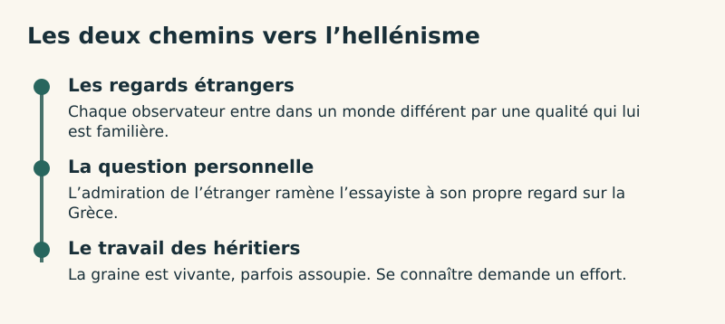

# BEL A/L — Grec moderne (commentaire et traduction) 2017 · Corrigé brut

*Corrigé rédigé par IA, non officiel. Signalez toute erreur.*

**Rédaction** · GPT-6.2 Astra Ultra · vitesse non renseignée

[Sujet officiel](https://www.ens-lyon.fr/sites/default/files/2017-11/17-bel-commentaire-et-traduction-lve_1506586192589_0.pdf#page=12) · [Rapport du jury](https://www.ens-lyon.fr/sites/default/files/2018-03/grec_moderne%202017.pdf#page=1)

Dimitris Pikionis, « Le problème de la forme » (1950). Le commentaire étudie le passage entier sur le rapport à l’hellénisme. La version couvre les lignes 15 à 28, depuis les controverses suscitées par les interprétations allemandes jusqu’à la connaissance de soi.

## Commentaire

Ο Πικιώνης ξεκινάει από μια φαινομενικά απλή διάκριση ανάμεσα στους «δικούς μας» και στους «ξένους» που αγάπησαν τον ελληνικό κόσμο. Θα περίμενε κανείς ότι η αρχαιότητα είναι οικεία στους πρώτους και ότι οι δεύτεροι πρέπει να διανύσουν κάποια απόσταση για να τη γνωρίσουν. Όσο προχωρεί όμως το δοκίμιο, τόσο πιο παράδοξο γίνεται το ερώτημα: μήπως ο ξένος έχει ήδη βρει τον δρόμο του προς την Ελλάδα, ενώ ο σημερινός Έλληνας χρειάζεται ακόμα να ανακαλύψει τον δικό του;

Η αρχική απαρίθμηση χωράει στην ίδια «χορεία» τους ποιητές και τους φιλοσόφους, τους φιλολόγους και τους τεχνοκρίτες. Η λέξη παρουσιάζει σαν κοινή κίνηση μια εργασία που ασκήθηκε σε διαφορετικά πεδία. Μέσα όμως στην κοινή αφοσίωση ξεχωρίζουν διαφορετικοί τρόποι να βλέπει κανείς. Ο Γάλλος διακρίνει το μέτρο και τη χάρη, ο Άγγλος την ποίηση, την αγωγή και τα πολιτικά ιδεώδη, ο Γερμανός τον μύθο και τη φιλοσοφία. Τα εθνικά αυτά πορτρέτα είναι σχηματικά· το ενδιαφέρον τους εδώ έγκειται στη λειτουργία τους μέσα στον συλλογισμό. Ο καθένας μπόρεσε να πλησιάσει το άλλο χάρη σε κάτι συγγενικό που ήδη διέθετε. Αν όμως αναγνωρίζει προπάντων τις δικές του αρετές στον ελληνικό κόσμο, κατά πόσο γνωρίζει τον κόσμο αυτό και κατά πόσο προβάλλει πάνω του τις επιθυμίες του;

Η παραχώρηση σχετικά με τις αμφισβητούμενες ερμηνείες του Γερμανού κρατά ανοιχτό το ερώτημα της ορθότητάς τους. Ο δοκιμιογράφος στρέφει το ενδιαφέρον του στην ένταση της επιθυμίας που τις γέννησε. Ο θαυμασμός γίνεται έρωτας· ο Βορράς με την ομίχλη και το σκοτάδι του ποθεί το φως της Μεσημβρίας. Ο αναγνώστης καλείται σε δεύτερο πρόσωπο να διακρίνει αυτή την κίνηση σχεδόν ανάμεσα στα στοιχεία του σύμπαντος. Τη στιγμή ακριβώς που η εικόνα αποκτά κοσμικές διαστάσεις, τη διακόπτει η προσωπική ερώτηση του συγγραφέα. Γιατί τον καταδιώκει η παρουσία του ξένου; Το ρήμα υποδηλώνει ότι πίσω από την έλξη κρύβεται και μια ανησυχία. Το ξένο βλέμμα τον υποχρεώνει να εξετάσει το δικό του.

Στην τελευταία παράγραφο η επανάληψη του «ζει» δίνει αρχικά την εντύπωση βεβαιότητας. Ο σπόρος της αρχαιότητας έχει ζωή στη χριστιανική Ελλάδα, στον λαό και στον ποιητή. Όταν όμως η φράση φτάνει σε «μας τους άλλους», ο σπόρος ζει εν υπνώσει. Η κληρονομιά επομένως δεν ισοδυναμεί με επίγνωση της κληρονομιάς. Το «εμείς» περιλαμβάνει και τον ομιλητή στην ευθύνη που γεννά η απόσταση αυτή. Η τελική προτροπή να μοιάσουμε με αυτό που πραγματικά είμαστε έχει παράδοξη μορφή: πρέπει να κατακτήσουμε ως έργο του μέλλοντος κάτι που ήδη μας συγκροτεί. Ο ξένος αρχίζει με τη διαφορά και ανακαλύπτει μια ομοιότητα. Ο οικείος αρχίζει με την υποτιθέμενη ομοιότητα και έχει μπροστά του τον δυσκολότερο άθλο, τη γνώση του εαυτού του.

## Version française

Je sais quelles querelles ont suscitées les interprétations de ce dernier… Et pourtant, quelle puissance d’admiration, quelle ferveur dans cette vénération… Sous cet amour que l’homme du Grand Nord porte à l’hellénisme, on croit presque discerner l’amour que se portent les éléments de l’univers… l’amour des brumes et des ténèbres du Nord pour la lumière du Midi…

Mais pourquoi cette présence de l’étranger me hante-t-elle ainsi ? Est-ce l’attrait de ces deux mondes opposés l’un pour l’autre qui me séduit, ou bien est-ce nous qui n’avons pas fait assez pour éclairer en nous le monde grec ?

Quel est donc ce lien qui nous unit à lui ? Oui, sa semence vit au sein de la chrétienté grecque. Elle vit dans l’âme du peuple et dans celle du poète. Mais elle vit encore aussi en nous autres, assoupie dans les profondeurs de notre être. Il ne s’agit plus ici d’un amour des contraires. Un tout autre exploit nous attend. Ressembler à ce que nous sommes réellement… Nous connaître nous-mêmes…
