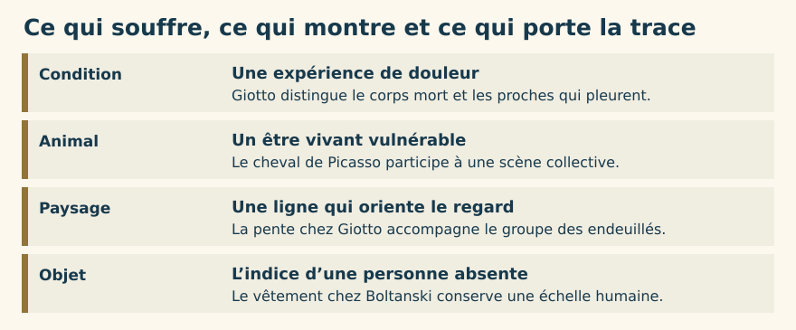

# BEL · AL — Histoire et théorie des arts 2017 · Corrigé guidé

*Corrigé rédigé par IA, non officiel. Signalez toute erreur.*

**Lecture du rapport du jury** · GPT-6.2 Astra Ultra · vitesse non renseignée

**Rédaction** · GPT-6.2 Astra Ultra · vitesse non renseignée

**Autocontrôle** · GPT-6.2 Astra Ultra · vitesse non renseignée

« Le corps humain est-il le seul motif pouvant incarner la douleur en art ? » Composition de six heures.

## Distinguer le sujet de la douleur et sa forme visible

Dans la fresque de Giotto, posez trois questions successives. Qui est représenté mort ? Qui éprouve le deuil ? Quels éléments conduisent nos yeux vers la réunion de ces personnes ? Aucune réponse ne se substitue aux deux autres. Cette distinction initiale empêche d’accumuler des représentations de morts comme si elles représentaient toutes une expérience de douleur.

**Avec quel exemple éprouver le mot « humain » ?** Placez le cheval de *Guernica* au centre de votre analyse. Décrivez sa place et son attitude avant toute identification symbolique. Sa vulnérabilité appartient au champ du vivant. Le rôle de l’arbre et du rocher chez Giotto relève, lui, d’un travail de composition et de transposition. Cette différence fait progresser le raisonnement.

**Un vêtement est-il la preuve d’une histoire précise ?** Il possède des plis et une taille qui permettent d’évoquer un corps. Rien dans ces marques ne livre à lui seul l’identité d’un propriétaire. L’accumulation organisée par Boltanski peut susciter un sentiment de perte sans faire de chaque pièce un document historique attribuable.

**Comment écarter une lecture arbitraire d’un paysage ?** Une montagne isolée ne suffit pas à signifier le deuil d’un artiste. Mobilisez une relation attestée avec des œuvres contemporaines, un lieu de travail ou une série. Chez Hodler, la confrontation avec les portraits de Valentine rend possible une lecture argumentée qui reste une interprétation.

## Donner un corps à l’invisible

Dans la *Lamentation* de Giotto à la chapelle des Scrovegni de Padoue, au début du XIVe siècle, quel personnage porte la douleur ? Le Christ est mort. Ce sont les vivants qui pleurent. Des visages se rapprochent du sien, des bras s’ouvrent et deux silhouettes assises nous tournent le dos. Une pente rocheuse entraîne le regard jusqu’au groupe où repose le corps. On serait tenté de dire que même le paysage prend part au deuil. Le fait-il au même titre que les humains ? Le verbe « incarner » engage cette difficulté. Un motif donne une forme sensible à une expérience qui, pour qui l’éprouve, n’est pas seulement visible. Le corps humain en est un lieu privilégié, mais sa présence suffit-elle et sa disparition rend-elle cette incarnation impossible ?

## Le geste rend perceptible une douleur dont il faut encore comprendre la situation

Le spectateur de Padoue peut reconnaître une attitude de lamentation avant de savoir nommer chaque personnage. Il ne lit pourtant pas un alphabet de gestes naturels et universels. Jean, penché vers le Christ, lance les bras en arrière. Les femmes vues de dos masquent en partie ce que d’autres regardent. De l’immobilité à l’emportement, plusieurs manières de vivre le même deuil se distribuent autour d’un corps inerte. La douleur se donne à voir dans des rapports entre des figures, dans une situation de dévotion et selon des conventions que d’autres cultures ou d’autres époques peuvent disposer différemment.

La chair représentée n’est donc pas une preuve suffisante. Un gisant funéraire aux traits apaisés peut évoquer l’attente d’une résurrection ou perpétuer un rang social. Son immobilité n’établit pas qu’il souffre. Inversement, un corps peu spectaculaire peut retenir un regard qui se soucie. Entre 1914 et 1915, Ferdinand Hodler fait des portraits et dessins de sa compagne Valentine Godé-Darel malade, puis morte. Le retour du peintre auprès du lit et la répétition du profil transforment la série. Un portrait isolé présente un visage à un moment donné. De feuille en feuille, les lignes et les intervalles changeants font éprouver la durée d’une veille. La souffrance de la malade et la douleur du témoin qui la perd restent deux expériences distinctes, même lorsque l’image les rapproche.

## L’animal peut souffrir, le paysage peut porter une plainte

Dans *Guernica*, peint pour le pavillon espagnol de l’Exposition internationale de Paris en 1937, Picasso donne une place centrale au cheval. Le cou se tend, la gueule s’ouvre, la tête se détache au milieu d’un enchevêtrement de formes anguleuses et de valeurs de gris. Ailleurs dans la toile, le visage levé d’une mère auprès de son enfant donne un répondant humain à l’ouverture de la gueule. Réduire le cheval à l’équivalent chiffré d’une nation ou d’une victime appauvrirait ce dialogue. L’animal figure comme un être vulnérable parmi les humains et comme un foyer de la composition qui rend sensible leur détresse commune. Sa douleur est pensable au sens propre. Elle n’exige pas que le peintre lui ait prêté un visage humain.

Il en va autrement de la pente de Giotto. Un relief ne fait pas l’expérience d’un deuil. Le mouvement oblique du rocher et l’arbre dénudé conduisent pourtant le regard et organisent la gravité de la scène. Retirons par la pensée les figures, le contexte religieux et l’ordre narratif de la chapelle. La ligne de terrain ne signifierait plus nécessairement une perte. C’est son articulation à une histoire et à des attitudes qui lui donne ce pouvoir. Le rapport du concours rapproche aussi les portraits de Valentine des paysages du Léman et des montagnes peints par Hodler. Une étendue calme peut rendre plus sensible la contraction du temps humain ou lui opposer la continuité du monde. Le lac n’a nul besoin de devenir un visage en larmes pour participer à une série sur la perte.

## Une matière peut porter la trace de quelqu’un qui manque

L’objet permet un autre déplacement. Dans les *Réserves* de Christian Boltanski, les vêtements usagés ont été portés et gardent l’échelle ou le pli d’un corps absent. L’abondance empêche cependant que chacun soit identifié à une personne dont nous connaîtrions l’histoire. La présentation en stock, l’éclairage et l’absence d’un propriétaire présent mettent le visiteur dans la situation de chercher quelqu’un à partir d’indices devenus insuffisants. Cette difficulté peut faire éprouver une perte collective. Elle ne transforme pas une veste en document probant sur la destinée individuelle de celui qui la possédait. L’écart entre la force d’une évocation et ce qu’atteste un objet fait partie de l’œuvre.

Une question éthique accompagne ces déplacements. Une expression douloureuse fortement codée peut susciter l’attention comme elle peut flatter le goût de l’effet. À l’inverse, une composition rigoureuse et belle n’abolit pas nécessairement ce dont elle invite à prendre soin. Chez Giotto, l’accord des gestes et des lignes rend perceptibles des réponses très différentes au deuil. Chez Picasso, l’abandon de la couleur et la dislocation des motifs rendent difficile de s’installer dans une contemplation sereine. Le jugement doit revenir aux moyens de l’œuvre et à ce qu’ils demandent au spectateur, plutôt qu’à une opposition abstraite entre beauté et vérité.

Le corps humain reste pour nous une mesure sensible et un lieu d’expérience irremplaçable. Il n’a pourtant pas le monopole de l’incarnation de la douleur. Un être animal peut en être le sujet, un lieu peut infléchir toute une scène et un objet garder l’empreinte d’une absence. Ces motifs incarnent à des titres différents. Reconnaître cette différence permet de faire droit à la douleur d’autrui sans l’assigner à une formule visuelle unique.

[Feuillet du sujet, p. 4](https://www.ens-lyon.fr/sites/default/files/2017-11/17-bel-epreuves-en-arts_1506586794135_0.pdf#page=4) · [Rapport de l’écrit](https://www.ens-lyon.fr/sites/default/files/2018-03/Histoire%20et%20th%C3%A9orie%20des%20arts_2017.pdf#page=1)

[Museo Reina Sofía, Guernica](https://museoreinasofia.es/en/collections/artwork/guernica-0/) · [Musée Jenisch Vevey, Hodler et Valentine](https://museejenisch.ch/expositions/ferdinand-hodler-revoir-valentine/) · [Centre Pompidou, Boltanski et les réserves](https://mediation.centrepompidou.fr/education/ressources/ENS-BOLTANSKI/ENS-boltanski.htm)
