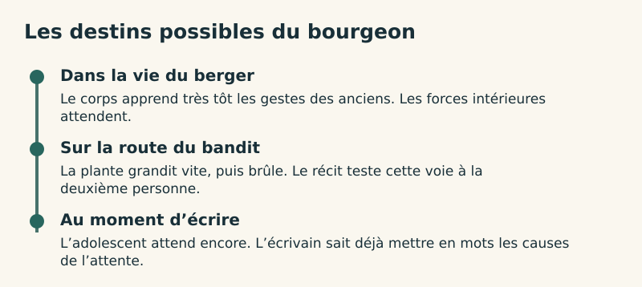

# BEL A/L — Italien (commentaire et traduction) 2017 · Corrigé guidé

*Corrigé rédigé par IA, non officiel. Signalez toute erreur.*

**Rédaction** · GPT-6.2 Astra Ultra · vitesse non renseignée

[Sujet officiel](https://www.ens-lyon.fr/sites/default/files/2017-11/17-bel-commentaire-et-traduction-lve_1506586192589_0.pdf#page=14) · [Rapport du jury](https://www.ens-lyon.fr/sites/default/files/2018-03/ITALIEN_2017.pdf#page=1)

Gavino Ledda, *Padre padrone. L’educazione di un pastore* (1975). Le commentaire suit l’extrait entier, de la comparaison avec le lièvre à l’attente de l’hiver. La version correspond aux lignes 7 à 24 du sujet.

## Construire le commentaire

**Qui peut décrire l’ignorance du berger ?** Relever l’ellipse de la phrase sur l’action et la pensée. La capacité de condenser ainsi son expérience appartient déjà à l’écrivain. Mettre en regard le cerveau que personne n’avait « cultivé » et l’invention botanique que le narrateur tire de cette image.

**Quelle issue offre la Sardaigne ?** Tester, avec les changements de personne, le scénario du bandit avant de retrouver le regard rétrospectif sur son évolution. Les bandes autrefois associées à un espoir de liberté servent désormais des intérêts particuliers. Puis la précision sur la taille fait intervenir un obstacle matériel à une autre carrière, celle des forces de l’ordre.

**Que sait le lecteur à la fin ?** L’été de l’adolescent reste celui de l’attente. Le fait même qu’il ait pu écrire une autobiographie atteste l’exercice des facultés restées en réserve. Cette différence entre temps vécu et temps de l’écriture peut donner sa conclusion au commentaire.

## Commentaire

Un lettore che aprisse *Padre padrone* alla ricerca di un paesaggio campestre troverebbe subito un pascolo singolare: la lepre deve guardarsi proprio da quei cani che tornano poi dal padrone all’ovile. Il mondo della pastorizia, che dovrebbe proteggere il giovane, gli fornisce le parole con cui riconoscersi preda. Il sottotitolo promette l’educazione di un pastore. Che cosa può dunque aver imparato il protagonista da una vita che gli ha impedito persino di crescere in altezza?

Il primo insegnamento è una particolare qualità dell’ascolto. Alla lepre che tende le orecchie corrisponde il giovane che va «a caccia» di notizie sugli emigrati: nello spazio di poche righe chi doveva sottrarsi al cacciatore è già capace di cercare qualcosa. Non sa ancora dare un nome all’oggetto del suo desiderio; dispone invece di una conoscenza precisa del lavoro. Il montone che feconda le pecore gli offre un termine di paragone per la propria innocenza, le mani hanno i calli, i muscoli sono induriti. L’autobiografo fa coesistere due età in un solo organismo. A vent’anni il pastore ha già imparato tutti i gesti degli anziani, ma non ha avuto il tempo di esercitare le proprie facoltà interiori. Le opposizioni fra molto e poco, fra l’agire e il pensare, si serrano fino a una frase priva di verbo finito. La concisione riproduce un bilancio impietoso, mentre l’invenzione linguistica di chi lo stila prova già quanto altro abbia saputo fare quel corpo.

La gemma sul legno secco sembra promettere che basterà aspettare la stagione giusta. Il seguito corregge la facilità della promessa. Se rimane fra i pastori, una forza intatta in lui non potrà sbocciare. Se prende la strada dei banditi, la pianta crescerà anche troppo presto e finirà bruciata. L’immagine non designa un destino naturale: serve a mettere alla prova due futuri possibili. Con il passaggio dall’«io» al «tu» il lettore è chiamato a percorrere per ipotesi il secondo. La violenza organizzata della società, a prima vista inafferrabile come il vento, finisce per acquistare ventose e bava. Chi credeva di liberare la propria forza rischia di diventare nutrimento per quella altrui. La successione delle immagini rende sensibile il rovesciamento prima che il narratore ne dia una spiegazione storica.

I racconti ascoltati nell’infanzia conservavano il ricordo di banditi temuti e ammirati; il narratore che scrive sa distinguere quella figura dal banditismo che cerca il profitto personale e di gruppo. Sa anche riconoscere come una fortuna ciò che al giovane mancò, l’incontro che l’avrebbe trascinato in quel giro. L’arruolamento, d’altra parte, presupponeva una statura che il lavoro precoce gli aveva impedito di raggiungere. La misura esatta, un metro e cinquantanove, fa di una consuetudine sociale una traccia leggibile nel corpo. Il bosco finale riprende allora la pianta di prima, ma la distribuzione della linfa è ineguale: grandi alberi si appropriano del cielo e delle sostanze del suolo, mentre lo sterpo boccheggia.

L’estate termina, nel brano, senza offrirgli la strada annunciata. Tuttavia chi parla sa già stabilire nessi fra il proprio corpo, l’economia dell’isola, le parole tramandate dai pastori. Questa capacità di passare dalle cose al pensiero sulle cose è precisamente quella di cui il giovane constatava la mancanza. Il libro che abbiamo tra le mani dà così un esito all’attesa che la scena narrata lascia aperta.

## Préparer la version

« Mi fecondava le pecore » demande un possessif français. « Dentro di me » maintient la distinction entre force musculaire et désir de conquête. Le participe sans auxiliaire dans « Lottato molto » appelle un français tout aussi elliptique. Au lieu de traduire *gemma* par « pierre précieuse », suivre le tronc et la saison de l’éclosion. « Non ce ne fu » reprend le manque de place dans le pays quitté par les émigrants. *Lì* ramène ensuite plusieurs fois le propos à l’univers pastoral que le jeune homme veut quitter.

## Version française

Et même si j’étais un berger sans malice, plus naïf que le bélier qui saillait mes brebis, en moi grondait un désir farouche de conquérir quelque chose dont je n’avais pas conscience. Les mains calleuses, les muscles durs, vieux déjà pour les travaux de tous les jours, endurci par les rigueurs du froid et de la chaleur, je restais intérieurement d’une extrême tendresse. Jusque-là je m’étais borné à agir sur la nature et à réagir à ses sollicitations. Les circonstances n’avaient guère fait appel à mes ressources intérieures. Beaucoup lutté, peu pensé. Mes mains et mes bras avaient beaucoup servi, mais mon cerveau, lui, n’avait jamais été vraiment cultivé. Toujours à se débattre au milieu des choses, jamais au-dessus d’elles. Pourtant, dans mon corps à la peau de cuir, il y avait un enthousiasme neuf, impossible à contenir. Mon moi, demeuré intact avec toutes ses ressources, cherchait le moyen de se libérer de la tyrannie que le corps avait dû lui imposer. Il était aux aguets, prêt à se réaliser, comme une réserve tenue en secret pour une éventuelle renaissance. À mon père j’avais dérobé toute la sagesse que lui-même avait dérobée aux anciens. À vingt ans, au travail, j’étais adulte moi aussi, « sage », « vieux ». Mais au-dedans de moi mes forces demeurèrent pareilles à des bourgeons sur un tronc sec, attendant leur saison pour éclore.

Je savais que ma voie ne serait pas celle de l’élevage. Il n’y avait plus de place là pour les bien-portants, tout comme il n’y en avait pas eu pour ceux qui avaient émigré en Australie ! J’étais vigoureux, en bonne santé et presque majeur. Or il n’y avait de place là que pour les vieux, les gens au dos courbé et les paralytiques. Et puis ce bourgeon qui aspirait à vivre au fond de moi, là, il n’aurait jamais pu s’ouvrir.
