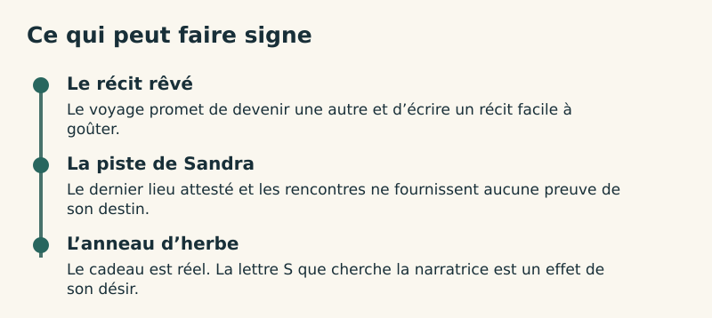

# BEL A/L — Polonais (commentaire et traduction) 2017 · Corrigé guidé

*Corrigé rédigé par IA, non officiel. Signalez toute erreur.*

**Rédaction** · GPT-6.2 Astra Ultra · vitesse non renseignée

[Sujet officiel](https://www.ens-lyon.fr/sites/default/files/2017-11/17-bel-commentaire-et-traduction-lve_1506586192589_0.pdf#page=16) · [Rapport du jury](https://www.ens-lyon.fr/sites/default/files/2018-03/POLONAIS_2017.pdf#page=1)

Joanna Bator, *Wyspa Łza* (2015), chapitre « Śpiew syren herbacianych ». La narratrice cherche au Sri Lanka les traces de Sandra Valentine. La version porte sur le premier paragraphe du récit, après l’épigraphe de Nicolas Bouvier.

## Construire le commentaire

**Qui est la flâneuse du début ?** Marquer les expressions de l’illusion et les infinitifs de la métamorphose rêvée. Comparer ensuite l’exotisme que l’on « assaisonne » au bonbon qui colle aux dents. On passe de la tentation d’une écriture facile à l’expérience physique de ses limites.

**Le voyage libère-t-il de toute référence ?** La voyageuse emprunte ses ailes à Bouvier. Son projet d’échapper aux obligations intertextuelles est lui-même formulé au moyen d’Ovide, puis des autoportraits mis en scène de Cindy Sherman. Cette contradiction se démontre dans l’ordre même du paragraphe.

**Qu’apprend-on de Sandra au monastère ?** Le récit de sa vie possible y est imaginé au cours d’une rencontre avec une moniale qui ne parle que cingalais. Le mode du possible empêche d’en faire un témoignage. Mettre enfin en regard deux activités réellement observables, l’écriture dans le carnet et le tressage de l’herbe, puis distinguer l’anneau reçu de la lettre S désirée.

## Commentaire

W rozdziale „Śpiew syren herbacianych” z książki Joanny Bator podróżniczka wreszcie dociera tam, gdzie po raz ostatni widziano żywą Sandrę Valentine. Jest to miejsce, które w opowieści detektywistycznej powinno dostarczyć najważniejszej wskazówki. Właśnie tu jednak narratorka stwierdza, że nie ma o co zaczepić opowieści. Jak pisanie może w ogóle toczyć się dalej, skoro nie udała się ani pogoń za cudzym śladem, ani ucieczka od samej siebie?

Na początku wyspa jest jeszcze obietnicą zmiany gatunku literackiego. Zamiast pisać o utracie, można by utkać lekką opowieść o podróżniczce, która je, modli się i kocha. Wtrącone „ach” zdradza stosunek narratorki do tej gotowej roli. Egzotyka byłaby przyprawą dozowaną dla podniebienia czytelnika, a łagodna opowieść przypominałaby na końcu akapitu cukierek, który zlepia zęby. To drugie porównanie odbiera słodyczy jej niewinność. Podobnie można usłyszeć różnicę między radosnym bzyczeniem skrzydełek zapożyczonym od Bouviera a brutalnym czasownikiem określającym próbę pozbycia się tkwiącej głęboko ciemności. Zmiana miejsca mogłaby oszukać nieznajomych, lecz nie usuwa tego, co narratorka nosi w ciele.

Drugi akapit ujawnia inną trudność tego przedstawienia: nawet kostium kobiety wolnej od zobowiązań powstaje z cudzych obrazów i słów. Cytat z Owidiusza przynosi ze sobą dawną tradycję przemiany, a fotografie Cindy Sherman podpowiadają, że w kolejnych wcieleniach można samemu być aktorką, modelem i widzem. Bohaterka widzi własne miny w lustrze jeszcze przed wyjazdem. Zamiast zniknąć bez śladu, chciałaby się sobie przyglądać. Tymczasem cień Sandry Valentine odwraca kierunek poszukiwania: ktoś naprawdę zniknął, a podróżniczka nie może dowolnie rozporządzać jego losem jak własnym przebraniem.

Wytwórnia herbaty i mokry dywan plantacji nie potwierdzają obietnicy barwnej egzotyki. Zielone otoczenie okazuje się równie monotonne jak śnieżne pustkowie, na którym przynajmniej znalazła się martwa papuga. Przy wodospadzie i przy stole pojawiają się szczegóły, z których mógłby powstać początek historii, ale żaden nie wyjaśnia tajemnicy. Najdłuższe spotkanie narracja zawdzięcza chwili, kiedy dwie kobiety nie mają wspólnego języka. Podczas gdy mniszka i narratorka siedzą obok siebie, opowiadanie przenosi Sandrę do wyobrażonego klasztoru, nadaje jej nowe imię i pozwala pozostać poza pragnieniem powrotu. Małe „mogło tak być” oddziela tę pięknie rozwiniętą możliwość od wiadomości o zaginionej.

Obie kobiety pracują jednocześnie rękami. Jedna wypełnia czarny zeszyt, druga splata źdźbło trawy. Pierścionek naprawdę zostaje podarowany, ale litera S, którą bohaterka chciałaby w nim rozpoznać, należy do porządku jej pragnienia. Ostatnie zdanie wraca do tkania z pierwszego akapitu. Tam można było z góry zaprojektować przyjemną tkaninę, tutaj splątane nitki szukają zaczepienia w czymś, co już się rozpada. Powstał zatem zapis poszukiwania wraz z jego porażkami: prawo do wyobraźni nie daje szukającej prawa do rozstrzygania, co spotkało drugą kobietę.

## Préparer la version

Le premier paragraphe commence par « Przyznaję » et finit sur le bonbon. L’épigraphe n’entre pas dans la version. *Flaneurka* invite à retrouver le féminin français « flâneuse ». *Łudziłam się* et *łudzą się* passent de l’aveu individuel à une illusion collective. Sauver ensuite le retour au « me » dans la phrase sur l’anonymat. À la douceur attendue répond la crudité du verbe *wyrzygać*. La note du sujet définit la *mordoklejka* par son effet sur les dents.

## Version française

J’avoue que je m’étais un peu bercée de l’illusion que je réussirais, sur l’île émeraude, à tisser l’aimable récit d’une flâneuse intercontinentale qui, ah ! mange, prie et aime. Après tout, pourquoi ne pas se réchauffer le cœur, à soi et aux autres, avec une pointe d’exotisme bien relevé ? Mais même ceux d’entre nous qui ne savent que trop bien qu’écrire n’est pas une plaisanterie, que c’est une activité particulière où peut se représenter la lutte du sujet avec la perte et, en fin de compte, avec la mort, s’imaginent parfois qu’en voyage il doit être possible de faire quelque chose de plus léger, de faire un peu bourdonner ses petites ailes, comme dit Bouvier, d’être un moment quelqu’un d’autre. Le fantasme de la mascarade se nourrit du voyage. Il permet de s’imaginer qu’on pourrait se trouver quelque part dans des dispositions de corps et d’esprit entièrement nouvelles, en un lieu où personne ne me connaît. Où personne ne sait rien de ce grumeau de ténèbres logé tout au fond et qu’il est impossible de dégueuler. Atterrir soudain, ô miracle, quelque part, par exemple en optimiste extravertie qui lie facilement connaissance, blonde au bout du monde et portée à raconter des histoires au goût bien doux, sucrées comme un caramel qui colle aux dents.
