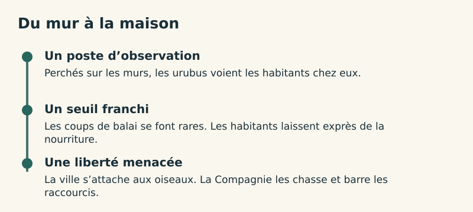

# BEL A/L — Portugais (commentaire et traduction) 2017 · Corrigé brut

*Corrigé rédigé par IA, non officiel. Signalez toute erreur.*

**Rédaction** · GPT-6.2 Astra Ultra · vitesse non renseignée

[Sujet officiel](https://www.ens-lyon.fr/sites/default/files/2017-11/17-bel-commentaire-et-traduction-lve_1506586192589_0.pdf#page=18) · [Rapport du jury](https://www.ens-lyon.fr/sites/default/files/2018-03/PORTUGAIS_2017.pdf#page=1)

José J. Veiga, *Sombras de reis barbudos* (1972). Lucas observe son père, les urubus et la Compagnie. La version commence avec les longues-vues et se termine lorsque la Compagnie se met à pourchasser les oiseaux.

## Commentaire

O narrador de *Sombras de reis barbudos* começa por admitir que não sabe ao certo o que se passa na cabeça de outra pessoa. Termina o trecho precisamente quando o pai vem dar uma explicação. Entre esses dois momentos, Lucas observa casas, bichos e muros com uma atenção que lhe permite contar mais do que ele próprio consegue explicar. Como essa diferença entre o que o menino vê e o que pode saber faz sentir o poder da Companhia?

A frase feita dos homens sobre as mulheres recebe de imediato a réplica das mulheres que conversavam com a mãe. Lucas faz uma experiência de raciocínio bastante justa: se as duas versões se equivalem, a dificuldade talvez seja a mesma para todos. Mas, ao aplicar a conclusão aos pais, esbarra num limite. A túnica bem passada quase não recebe um olhar do pai. Os cigarros são cada vez mais numerosos e o caderninho de antes desapareceu. São dados ao alcance de quem vive na casa. Já a reprimenda ou o rebaixamento são hipóteses do filho. O advérbio que atenua a sua pena mostra, aliás, que ele ainda tem alguma conta a ajustar com esse homem. Embora nada se conte diretamente sobre a vida na empresa, o leitor pode medir o peso dela pelo silêncio que se instalou em casa.

A passagem às lunetas parece abrir um recreio. No entanto, a primeira notícia que temos desses objetos é quase jurídica: escaparam à apreensão. E justamente quando sua posse ainda é permitida já não têm utilidade. Os urubus se aproximaram tanto que, em vez de ampliar o campo de visão, a luneta põe de repente um bico enorme diante do olho. A cena inverte então a posição do observador. Enquanto os moradores queriam ver os bichos de longe, agora são os bichos que, de cima dos muros, olham para os moradores dentro de casa. A parede que restringia o trânsito oferece aos urubus um pouso e acaba dando início a uma convivência que ninguém havia planejado.

O narrador retarda a mudança por meio de pequenos atos repetidos. Vem primeiro a vassourada, depois o osso esquecido de propósito; mais adiante o bicho dorme tão despreocupado que é preciso tomar cuidado para não pisar nele. Tanto a comparação com as galinhas quanto a do cachorro deslocam o urubu, ligado ao luto, para o domínio familiar. O gesto do idoso que dá a volta em torno de uma pena preta ainda guarda a memória do mau agouro. Já a criança anda com o bicho por uma corda frouxa. A aflição da cidade, quando a Companhia passa a perseguir as aves, torna coletivo um afeto que parecia tão improvável. Seria empobrecer essa mudança reduzir o urubu a um emblema fixo de ameaça: o que ele significa depende de quem o olha, de onde pousa e de quem o persegue.

A última enumeração de proibições imita o absurdo de um regulamento que toma ao pé da letra expressões como tapar o sol com a peneira. O leitor pode rir até chegar aos cacos de garrafa nos muros; de repente, o menino que costumava cortar caminho corre o risco de se ferir. Publicado no Brasil da ditadura militar, em 1972, o romance torna reconhecível um poder que quer ordenar até o gesto mais banal. A Companhia age por ordens, castigos e obstáculos físicos. Lucas narra por suposições, correções e comparações. O pai pode vir explicar a medida no fim, mas ao leitor já foi dado experimentar o que ela faz ao espaço de uma criança.

## Version française

Les longues-vues ne furent pas confisquées et l’on ne s’en servait d’ailleurs presque plus. Les urubus volaient déjà si bas et se posaient si près que longue-vue ou jumelles auraient plutôt gêné quiconque aurait encore voulu les observer. Il y avait même de quoi sursauter à braquer sa longue-vue et à tomber nez à nez avec cette énorme chose noire qui planait presque sur vous, assez près pour qu’on distingue la masse de chair grumeleuse qu’ils ont à la base du bec. À la fin ils ne se gênaient plus. Ils se posaient sur les murs et restaient là à nous regarder jusque dans nos maisons. De l’aube au crépuscule, ils nous regardaient, faisaient leur toilette ou sommeillaient, ces milliers de points noirs sur les murs. Quand on les chassait, ils s’envolaient paresseusement, faisaient un petit tour et se posaient de nouveau. On voyait bien qu’ils n’avaient aucune intention de déguerpir.

À part leur nombre qui effrayait, et leur couleur qui faisait penser au deuil, les urubus ne dérangeaient personne. Il suffisait d’un moment d’inattention pour qu’ils entrent dans les cuisines chaparder de la nourriture, ce qui se comprenait, vu que sur les murs il n’y avait rien à manger. Au début nous les chassions à coups de balai. Puis nous sommes devenus plus indulgents et nous leur avons facilité l’existence, jusqu’à faire semblant d’oublier des os et des morceaux de viande à leur portée pour pouvoir les observer et juger de leur intelligence.

Traités de la sorte, ils perdaient peu à peu leur méfiance et prenaient leurs quartiers chez nous. Ils se posaient sur les rebords des fenêtres ou sur les impostes des portes. Une fois en confiance, ils sautaient à l’intérieur et tournaient autour des gens, généralement des femmes. Ils semblaient avoir déjà remarqué que c’étaient elles qui s’occupaient le plus de la nourriture. Quand on les avait servis et qu’ils s’étaient gavés, ils se retiraient dans un coin, se pelotonnaient et dormaient comme des poules. C’était du nouveau de voir ces bêtes, autrefois si mal aimées, dormir sans défense sur les meubles et parfois même en travers du passage, au risque que quelqu’un de distrait leur marche dessus.

Les enfants eurent vite fait de s’en faire des amis. Presque chaque garçon (et chaque fille aussi) avait son urubu pour l’accompagner jusque dans la rue comme un petit chien. Il suivait de lui-même ou bien on le tirait par une corde passée sans la serrer autour de son cou, juste pour lui indiquer la direction. Seuls les plus âgés croyaient encore que l’urubu était un oiseau de mauvais augure, annonciateur de morts et de malheurs, et évitaient de le fréquenter de trop près. Quand une personne âgée voyait une plume noire à terre, elle se signait et faisait un détour pour ne pas marcher dessus. Mais, à la longue, tout le monde prit l’habitude de vivre dans l’intimité des urubus, et toute la ville eut de la peine pour eux quand la Compagnie se mit à leur donner la chasse.
