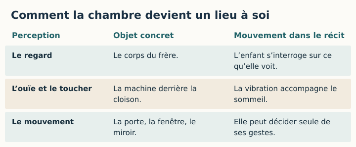

# BEL A/L · Portugais (thème Lyon) 2017 — Corrigé guidé

*Corrigé rédigé par IA, non officiel. Signalez toute erreur.*

**Rédaction** · GPT-6.2 Astra Ultra · vitesse non renseignée

Le sujet de quatre heures propose un extrait de *Avoir un corps* de Brigitte Giraud (2013). L’épreuve se déroule sans dictionnaire.

[Sujet officiel, p. 13](https://www.ens-lyon.fr/sites/default/files/2017-11/17-bel-epreuves-de-specailite-lyon_1506586608686_0.pdf#page=13) · [Rapport du jury, section du thème](https://www.ens-lyon.fr/sites/default/files/2018-03/PORTUGAIS_2017.pdf#page=4)

### Suivre un regard d’enfant

Cette proposition adopte le portugais européen. *Mudar a fralda*, *cose*, *secretária* et les pronoms enclitiques forment un ensemble cohérent. D’autres solutions brésiliennes, notamment *trocar a fralda* et *escrivaninha*, sont naturelles dans une traduction menée dans cet usage. L’enfant se pose une question sur les proportions du corps. Elle dit ensuite qu’à la maison un mot manque. Il faut garder l’indétermination de « cette chose » et la simplicité du vocabulaire. Le passage rend une observation familiale ordinaire à hauteur d’enfant.

### Donner une durée au bruit

Les phrases nominales, « accélérations, accalmies », « ordre et concentration », isolent des perceptions. Les compléter toutes par un verbe de description casserait cette alternance. La « mitraillette gentille » associe une forte cadence à la sécurité familière de la soirée. *Metralhadora mansa* maintient cet effet. Le rapport propose *tinido* pour « cliquetis ». *Matraquear* retient ici la répétition rapide de la machine. Le bruit ouvre la nuit et ses vibrations continuent à travers la cloison jusque dans le rêve.

### Rendre perceptible la liberté nouvelle

Dans la chambre neuve, chaque *posso* fait apparaître une action désormais à la disposition de l’enfant. L’emploi de *à chave*, *quando me apetece* et *a sós* donne des moyens très concrets à cette indépendance. À la fin, maintenez les mêmes sujets d’un verbe à l’autre. L’enfant laisse faire. Les courants d’air s’engouffrent, renversent les objets et font voler la poupée. C’est à cette poupée qu’elle envie la courbe du dos et le port de tête. La phrase commence ainsi par un mouvement de l’air et s’achève sur la manière dont l’enfant regarde un corps.

## Proposition de thème

Olho, observo o corpo do meu irmão quando a minha mãe lhe muda a fralda. Acho-o desproporcionado, pergunto se é normal. É espantosa a maneira como os pés se articulam na ponta das pernas, e a cabeça parece-me grande demais. Lá em casa não há palavra para dizer o que ele tem entre as pernas. Aquela coisa levanta-se para fazer chichi, enquanto a minha mãe o segura com uma mão em cima da mesa de mudar as fraldas.

A minha mãe cose à máquina, à noite, na sala, um ruído de metralhadora mansa. O pedal debaixo da mesa, acelerações, acalmias. As mãos mantêm o tecido bem esticado. Ordem e concentração. Cuidado com a agulha, que pode picar, furar os dedos. É o barulho do trabalho feito em casa que dá início à noite. Adormecer está ligado ao matraquear da máquina, e por vezes as vibrações acompanham-me até aos sonhos e percorrem todas as partes do meu corpo, do outro lado da divisória.

Tenho um quarto no apartamento novo, com uma porta que posso fechar à chave. Posso andar, meço o pequeno espaço a passos, dou a volta à cama. Posso puxar a cadeira da secretária e sentar-me, posso encostar-me à parede, escorregar devagar até ao chão, estender-me no linóleo, fingir-me de morta sem preocupar ninguém. Estou em minha casa, é a primeira vez que posso habitar o espaço todo, respirar aquele ar todo de uma só vez. Posso escolher abrir a janela, e as cortinas ondulam e trazem para o quarto os ruídos dos motores lá da rua. Posso fechá-la quando me apetece e preocupar-me apenas com os traços da minha cara que examino demoradamente ao espelho. Um frente a frente novo na intimidade do quarto, a sós, sem testemunhas. Observo o mais pequeno pormenor, a mais ínfima porção de pele, à frente, atrás. Invento uma série de contorções e nem tudo o que descubro me agrada. Deixo que as correntes de ar se metam por baixo da cama, derrubem os objetos nas prateleiras, façam voar a boneca que a minha tia trouxe da Andaluzia e a quem invejo a curva das costas e o porte da cabeça.

