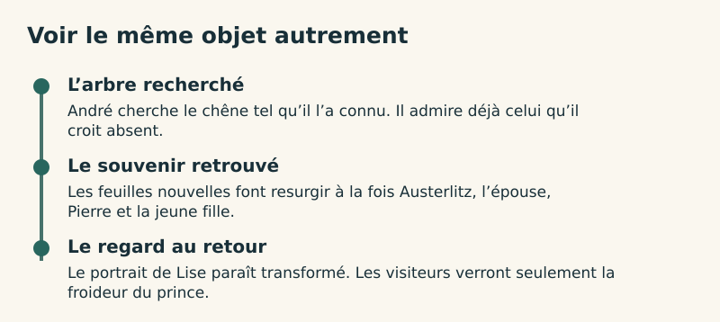

# BEL A/L — Russe (commentaire et traduction) 2017 · Corrigé brut

*Corrigé rédigé par IA, non officiel. Signalez toute erreur.*

**Rédaction** · GPT-6.2 Astra Ultra · vitesse non renseignée

[Sujet officiel](https://www.ens-lyon.fr/sites/default/files/2017-11/17-bel-commentaire-et-traduction-lve_1506586192589_0.pdf#page=20) · [Rapport du jury](https://www.ens-lyon.fr/sites/default/files/2018-03/RUSSE_2017.pdf#page=1)

Léon Tolstoï, *Guerre et Paix* (1869). Le commentaire suit le retour du prince André et ses réflexions chez lui. La version va de la journée de chaleur au jugement sur la vie à trente et un ans, jusqu’à l’incise du narrateur incluse.

## Commentaire

Князь Андрей возвращается домой по знакомой дороге и специально ищет дерево, которое поразило его месяц назад. Кажется, для того чтобы узнать дуб, достаточно посмотреть в нужную сторону. Однако Андрей уже любуется им и всё ещё спрашивает себя, куда он делся. В этой разнице между взглядом и узна́ванием намечена главная трудность отрывка: человек может почувствовать перемену в себе раньше, чем поймёт её и сумеет объяснить другим.

Сначала лес ощущается даже там, где его не видно: густая листва приглушает звон бубенчиков. Затем Толстой разделяет картину на левую, затенённую сторону и правую, влажную и блестящую; голоса соловьёв раздаются то близко, то далеко. Перед читателем возникает пространство, которое меняется по мере движения. Молодые ели входят в общую красоту леса, а в прежнем воспоминании князя старый дуб стоял особняком. Андрей ищет в настоящем то, с чем когда-то «были согласны» они оба. Множественное число превращает дерево почти в собеседника. Но этим собеседником прежде распоряжалась память самого героя: он узнал в нём собственные горе и недоверие. Чтобы увидеть нынешний дуб, Андрею приходится на миг потерять прежний.

Толстой не говорит, что старая кора исчезла. Из неё пробились листья, и шатёр, который они образовали, скрывает корявые пальцы. Ощущение обновления тоже не вытесняет трудного прошлого. Среди лучших минут вспоминаются и Аустерлиц, и мёртвое лицо жены с его укором. Определение «лучшие» вбирает в себя минуты, когда человеку открывалось что-то решающее, хотя переживание могло быть мучительным. Слово «вдруг» и повторяющийся союз «и» сближают разновременные впечатления: не успел читатель увидеть небо, как рядом уже переправа, девочка у окна и луна. Этот ряд завершается точной, почти прозаической цифрой — тридцать один год. Годится ли возраст для того, чтобы объявить жизнь законченной? Возвращение к другим людям начинается с отрицательного ответа. Затем на место краткого «нет» приходят длинная фраза и повтор «надо». Желание жить получает адресатов, прежде всего Пьера и девушку, чья жизнь до сих пор совершалась независимо от его собственной.

Во второй половине отрывка грамматический порядок двух глаголов особенно важен: князь решил ехать в Петербург, а причины решения придумал потом. Недавно та же способность рассуждать убеждала его в необходимости оставаться в деревне. Рассказчик обнаруживает подвижность разумных доводов; это не отменяет самого желания действовать. В кабинете меняется смысл ещё одного знакомого предмета. Лицо умершей жены на портрете больше не произносит страшных слов. Его выражение столь же мало закреплено навсегда, как облик старого дуба. Между зеркалом, в котором Андрей ищет своё лицо, и портретом, откуда на него смотрит другой человек, он снова переживает перемену, для которой ещё нет слов.

Читатель допущен к этим воспоминаниям, тогда как посетитель увидел бы особенно сухого и неприятно логичного хозяина. Этот последний поворот придаёт новое значение встрече в роще. Как дерево трудно было узнать по памяти, так князя невозможно узнать по одной его внешней строгости. Толстой даёт почувствовать обновление и одновременно показывает, какое расстояние остаётся между желанием Андрея жить вместе с людьми и тем, что они в данную минуту могут о нём знать.

## Version française

Il avait fait chaud toute la journée. Quelque part un orage couvait, mais seul un petit nuage avait jeté quelques gouttes sur la poussière de la route et sur les feuilles pleines de sève. À gauche, le bois était sombre, dans l’ombre. À droite, tout mouillé, luisant, il brillait au soleil et frémissait à peine au vent. Tout était en fleur. Les rossignols lançaient et roulaient leurs trilles, tantôt tout près, tantôt au loin.

« Oui, c’est ici, dans ce bois, qu’il y avait ce chêne avec qui j’étais si bien d’accord », se dit le prince André. « Mais où est-il donc ? » se demanda-t-il encore en regardant du côté gauche de la route. Et, sans s’en douter, sans le reconnaître, il admirait précisément le chêne qu’il cherchait. Le vieux chêne, tout transfiguré, déployait comme une tente sa sombre verdure gorgée de sève. Il s’abandonnait à la douceur des rayons du soir, en se balançant à peine. Ni doigts noueux, ni plaies, ni chagrin ancien, ni méfiance, rien de tout cela ne se voyait plus. De jeunes feuilles vigoureuses avaient percé l’écorce centenaire et dure, sans même une branchette, si bien qu’on ne pouvait croire que ce vieillard leur eût donné naissance. « Mais oui, c’est bien le même chêne », pensa le prince André. Et brusquement l’envahit, sans raison, un sentiment printanier de joie et de renouveau. Les plus beaux instants de sa vie lui revinrent soudain en mémoire, tous à la fois. Et Austerlitz avec son ciel si haut, et le visage mort de sa femme avec son air de reproche, et Pierre sur le bac, et la jeune fille émue par la beauté de la nuit, et cette nuit même, et la lune, tout cela lui revint d’un seul coup.

« Non, à trente et un ans, la vie n’est pas finie », décida soudain le prince André, définitivement, irrévocablement.
