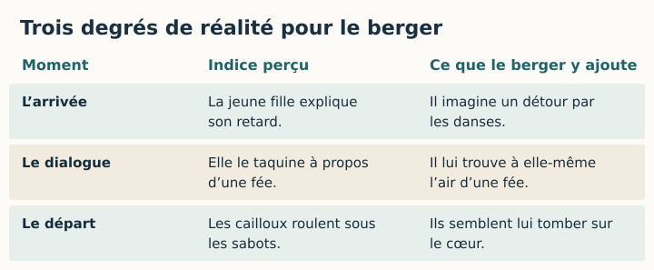

# BEL A/L · Russe (thème Lyon) 2017 — Corrigé guidé

*Corrigé rédigé par IA, non officiel. Signalez toute erreur.*

**Rédaction** · GPT-6.2 Astra Ultra · vitesse non renseignée

Le sujet de quatre heures propose un extrait de *Lettres de mon moulin, « Les étoiles »* de Alphonse Daudet (1879, selon le sujet). L’épreuve se déroule sans dictionnaire.

[Sujet officiel, p. 14](https://www.ens-lyon.fr/sites/default/files/2017-11/17-bel-epreuves-de-specailite-lyon_1506586608686_0.pdf#page=14) · [Rapport du jury, section du thème](https://www.ens-lyon.fr/sites/default/files/2018-03/RUSSE_2017.pdf#page=4)

### Séparer ce qu’elle dit et ce qu’il imagine

La jeune fille explique son retard à la descente du mulet. Le berger observe ses vêtements et lui prête une autre histoire. Le comparatif *легче было поверить* rend perceptible l’hypothèse sans transformer le détour par la danse en fait assuré. *Бывало* et les formes imperfectives du passé ouvrent le souvenir des hivers à la ferme. Écrivez *проходила через комнату* pour un déplacement qui traverse la salle, puis ramenez le regard sur la visite exceptionnelle du jour.

### Respecter l’adresse du dialogue

La jeune fille tutoie le berger. Lui se serait adressé à elle avec un *вы* respectueux. *Госпожа моя* suggère sa position sociale aussi bien que l’ascendant qu’elle exerce sur lui, nuance signalée par le rapport. Dans *тебе … быть одному*, le datif renvoie à la personne qui éprouve la solitude. La réponse qu’il retient aurait été unique, d’où le perfectif dans *я бы не солгал*. Gardez le contraste entre cette phrase qui lui vient à l’esprit et son impossibilité de prononcer le moindre mot.

### Passer de la taquinerie à la rêverie

La chèvre et la fée relèvent du conte. Les diminutifs permettent de préserver le jeu de la jeune fille sans ajouter de scène nouvelle. Elle compare les hypothétiques visiteuses de la montagne à des créatures merveilleuses, puis le berger lui trouve à elle-même l’air d’une apparition. Au dernier paragraphe, *мне казалось* restitue le statut de l’image. Les pierres roulent sous les sabots mais tombent aussi, dans la perception du berger, sur son cœur. Le récit peut alors passer du son qui s’éloigne à l’immobilité de celui qui écoute encore. Conservez la lacune entre crochets imprimée dans l’extrait, sans ajouter de transition narrative.

## Proposition de thème

Малыш заболел, а тётушка Норада гостила у своих детей. Всё это рассказала мне красавица Стефанетта, слезая с мула. Она ещё сказала, что приехала так поздно, потому что сбилась с дороги. Только, глядя на её праздничный наряд, на ленту в цветочек, нарядную блестящую юбку и кружева, легче было поверить, что она задержалась где-нибудь на танцах, чем что плутала в кустах в поисках дороги. Что за прелесть! Я не мог на неё наглядеться. По правде говоря, я никогда прежде не видел её так близко. Бывало, зимой, когда стада уже спустились на равнину и я возвращался вечером на ферму ужинать, она быстро проходила через комнату, почти не заговаривая со слугами, всегда разодетая и чуть-чуть надменная… А теперь она была здесь, передо мной, и только для меня. Как тут было не потерять голову?

[…]

— Так вот где ты живёшь, бедный мой пастух! Как же тебе, должно быть, скучно всё время быть одному! Что ты делаешь? О чём думаешь?

Мне хотелось ответить: «О вас, госпожа моя», и я бы не солгал. Но я так смутился, что не мог вымолвить ни слова. По-моему, она это заметила, и плутовке доставляло удовольствие своими шутками смущать меня ещё сильнее.

— А твоя милая, пастух, поднимается она сюда хоть иногда проведать тебя?.. Уж верно, это Золотая Козочка или та самая фея Эстерель, что бегает только по горным вершинам…

Да она и сама, пока говорила со мной, была похожа на фею Эстерель. Как мило она смеялась, откинув голову! А так спешила уехать, что всё её посещение показалось мне видением.

— Прощай, пастух.

— До свидания, госпожа моя.

И вот она уехала, увозя свои пустые корзинки.

Когда она скрылась из виду на тропинке, сбегавшей вниз, мне казалось, что камешки, катившиеся из-под копыт мула, один за другим падают мне на сердце. Я ещё долго-долго слышал их. До самого вечера я оставался словно в полусне и не смел пошевелиться, чтобы не спугнуть свою грёзу.

