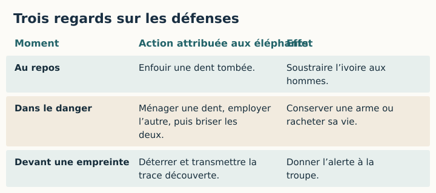

# ENS de Lyon · BEL A/L · Version latine 2017 — Corrigé brut

*Corrigé rédigé par IA, non officiel. Signalez toute erreur.*

**Rédaction** · GPT-6.2 Astra Ultra · vitesse non renseignée

Pline l’Ancien, « Les défenses des éléphants ». Épreuve de spécialité, trois heures.

## Version française

Les éléphants savent que le seul butin que l'on convoite chez eux réside dans leurs armes, que Juba appelle des cornes, mais qu'Hérodote, bien antérieur à lui, et l'usage commun nomment plus justement des dents. Aussi enfouissent-ils celles qui sont tombées par suite de quelque accident ou de la vieillesse. C'est là seulement que se trouve l'ivoire. Pour le reste, même dans ces défenses, la partie recouverte par le corps ne sert qu'à la manière d'un os. Il est vrai que tout récemment, faute de matière, on s'est mis à débiter même des os en plaques. C'est qu'on trouve désormais rarement des défenses de grande taille ailleurs qu'en Inde. Dans les autres contrées de notre monde, elles ont succombé aux exigences du luxe.

La blancheur des défenses permet de reconnaître la jeunesse de l'animal. Ces bêtes en prennent le plus grand soin. Elles ménagent la pointe de l'une pour qu'elle ne soit pas émoussée au combat. Avec l'autre, réservée aux travaux, elles arrachent des racines et déplacent des masses pesantes. Quand les chasseurs les ont cernés, les éléphants placent au premier rang ceux dont les défenses sont les plus petites, afin qu'on ne juge pas que le butin vaille le combat. À la fin, épuisés, ils brisent leurs défenses en les heurtant contre un arbre et paient de ce butin leur propre rançon.

Chez la plupart des animaux, il est étonnant qu'ils sachent pourquoi on les pourchasse, mais aussi que, en toute circonstance, ils sachent de quoi se garder. Si un homme qui erre tout bonnement dans un lieu désert vient à croiser un éléphant, celui-ci se montre doux et paisible, et va même, dit-on, jusqu'à lui indiquer son chemin. Mais que ce même animal remarque la trace d'un homme avant d'avoir vu l'homme lui-même, et l'on raconte qu'il tremble, craignant un piège, qu'il s'arrête pour flairer, regarde autour de lui, souffle de colère et se garde de marcher sur l'empreinte. Il la déterre et la présente à son plus proche voisin, qui la transmet au suivant, et le même signal va jusqu'au dernier. Alors la colonne, dit-on, fait demi-tour et revient sur ses pas en se mettant en ordre de bataille. Tant cette redoutable émanation persiste dans l'odeur que laissent les pas de tous les hommes, alors que la plupart d'entre eux ne vont même pas pieds nus !

[Sujet officiel, passage p. 3](https://www.ens-lyon.fr/sites/default/files/2017-11/17-bel-epreuves-de-specailite-lyon_1506586608686_0.pdf#page=3)
