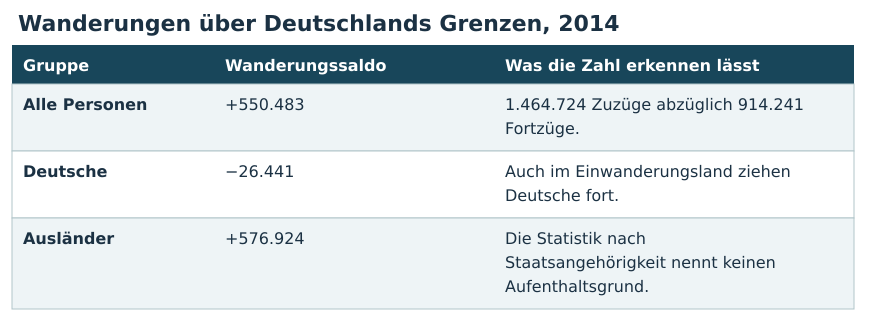

# BEL · B/L · Allemand 2017 — Corrigé guidé

*Corrigé rédigé par IA, non officiel. Signalez toute erreur.*

**Rédaction** · GPT-6.2 Astra Ultra · vitesse non renseignée

**Analyse et commentaire de textes ou documents en allemand.** Épreuve écrite à option de six heures, coefficient 3. Le fac-similé réunit cinq prises de parole et un tableau du Statistisches Bundesamt sur l’immigration, l’emploi et l’intégration.

## Arbeitskräfte, Schutzsuchende, Mitbürger

> [!INDICATION]
> Lisez la dernière ligne du document 6 horizontalement. Le *Wanderungssaldo* des ressortissants étrangers et celui des Allemands s’additionnent. La ligne ne donne ni le nombre de demandes d’asile ni le niveau de qualification.

Als Reichskanzler Caprivi 1891 vor dem Reichstag Handelsverträge verteidigte, fürchtete er um die Deutschen, die ihre Heimat auf der Suche nach besserer Arbeit verließen. Gut ein Jahrhundert später fragt ein Rundfunkmoderator den Arbeitsmarktforscher Herbert Brücker, wie viele Menschen Deutschland von außen gewinnen müsse. Die Umkehr der Blickrichtung wirft eine Frage auf, die über den Bedarf an Arbeitskräften hinausgeht. Was vermag die wirtschaftliche Betrachtung der Zuwanderung zu erklären, und an welchem Punkt verstellt sie den Blick auf die Eingewanderten selbst? Das Zahlenmaterial, zwei wirtschaftspolitische Stellungnahmen und Iris Alanyalis Familiengeschichte legen nahe, zunächst nach der Aussagekraft der Zahlen, dann nach der Reichweite der Politik und schließlich nach den Erfahrungen der Betroffenen zu fragen.

### Was Arbeitskräfte bewegt und was Wanderungszahlen erfassen

Caprivi setzt bei einer scheinbaren Unstimmigkeit an. Im Westen des Reichs kosten Lebensmittel mehr als im Osten, dennoch ziehen Arbeiter dorthin. Für die Entscheidung ist die Aussicht auf lohnende Arbeit offenbar wichtiger als der niedrige Preis eines einzelnen Gutes am Herkunftsort. Durch neue Absatzmärkte will der Kanzler die Beschäftigung zu Hause sichern. Seine Gegenüberstellung von Waren- und Menschenexport (Dok. 2, Schlussabsatz) macht die Auswanderung zur politischen Alternative, die er gerade vermeiden will. Der Blick auf Binnenwanderung erläutert eine Aussage über den Außenhandel. Er sollte daher weder mit einem Aufruf zur Auswanderung noch mit einer zeitlosen Regel über alle Flüchtlingsbewegungen verwechselt werden.

2014 verzeichnet das Statistische Bundesamt rund 1,46 Millionen Zuzüge. Erst wenn man die gut 914.000 Fortzüge abzieht, erhält man den Wanderungsüberschuss von 550.483 Personen. Bei Deutschen ist der entsprechende Saldo sogar negativ (Dok. 6, Zeile „Insgesamt“). Die zweite Beobachtung verleiht Caprivis Frage in einem Einwanderungsland durchaus noch Gewicht. Die Aufschlüsselung nach Herkunfts- und Zielgebieten zeigt zudem die Bedeutung der europäischen Mobilität. Selbst ein hoher positiver Saldo gegenüber Syrien sagt jedoch für sich genommen nichts über den rechtlichen Status oder die Ausbildung jeder einzelnen Person aus. Überdies geht die Statistik dem großen Flüchtlingszuzug von 2015 voraus. Wer ihre Gesamtzahl mit der Zahl neu gestellter Asylanträge gleichsetzt, wechselt unbemerkt sowohl die Kategorie als auch das Jahr.

Brückers Rechnung hat wiederum eine andere Bezugsgröße. Nach seiner Schätzung wären jährlich netto etwa 400.000 Personen nötig, um das Erwerbspersonenpotenzial zu halten. Selbst ein konstantes Arbeitsangebot bewahrt ein alterndes Land aber nicht vor einem wachsenden Verhältnis von Rentnern zu Erwerbstätigen. Um auch dieses Verhältnis zu stabilisieren, müsste der jährliche Zustrom dauerhaft noch höher sein. Ein einzelnes Jahr mit positivem Saldo löst folglich kein langfristiges Finanzierungsproblem. Zugleich widerspricht Brücker der Vorstellung, ein Neuankömmling nehme jeweils einem Einheimischen den Arbeitsplatz. Soweit beide unterschiedliche Arbeitsmarktsegmente besetzen, ergänzen sich ihre Tätigkeiten. Bereits ansässige ausländische Beschäftigte können demgegenüber in stärkerer Konkurrenz mit Neuankömmlingen stehen. Ob jemand gewinnt, hängt von der Stellung im Arbeitsmarkt ab.

### Von der Arbeitsmigration zum Recht auf Schutz

Warum lässt sich der Beschäftigungszuwachs seit 2011 nicht einfach in die Zukunft verlängern? Fetchenhauer und Hüther verweisen auf gut ausgebildete Arbeitskräfte aus der Eurozone und auf gezielte Zuwanderung aus Drittstaaten. Wer wegen einer konkreten Stelle umzieht, bringt andere Voraussetzungen mit als jemand, der vor einer Gefahr flieht und die Anerkennung seiner Ausbildung erst nach der Ankunft klären kann. Die Autoren betonen selbst die unsichere Datenlage zur Qualifikation der Flüchtlinge. Deshalb ist ihre Vermutung über durchschnittliche Bildungsunterschiede als vorläufige Einschätzung zu lesen. Entscheidend ist ihre Trennung von „Sollen und Sein“ (Dok. 4, Absatz nach der Kostendiskussion). Aus einem Schutzgebot folgt keine bestimmte Rendite. Umgekehrt würde ein wirtschaftlicher Aufwand den Schutzgrund nicht widerlegen.

Brückers Hinweis auf die geringe Zahl der Drittstaatsangehörigen, die unmittelbar über einen Arbeitsmarktzugang einreisen, berührt eine Schwierigkeit der Politik. Sie hat erheblichen Einfluss auf die Bedingungen, deren wirtschaftliche Folgen sie anschließend messen will. Waren Menschen mit unsicherer Bleibeperspektive von Sprachkursen ausgeschlossen, ist ein späterer Rückstand beim Berufseinstieg nicht allein Ausdruck individueller Fähigkeiten. Karl Brenke setzt genau dort an, wenn er die Eckpunkte des geplanten Integrationsgesetzes prüft. Sprachkurse können den Alltag strukturieren und Übergänge in Arbeit erleichtern, sofern genügend Plätze vorhanden sind. Eine räumliche Verteilung kann Kommunen entlasten und Konzentration verhindern. Dieselbe Beschränkung kann es jedoch erschweren, an einen Ort mit geeigneten Stellen umzuziehen. Diese Spannung ist anhand der konkreten Wirkung und nicht am Namen der Maßnahme zu beurteilen.

### Wann Beschäftigung Zugehörigkeit ermöglicht

> [!INDICATION]
> Dans le document 3, identifiez l’administration qui réclame la preuve de langue et celle qui soupçonne un emploi clandestin. Puis rapprochez l’ironie d’Alanyali du contraste que Brenke établit entre la participation à un programme et la reconnaissance au travail.

Brenke fragt, was eine kurzfristige gemeinnützige Beschäftigung vermittelt, wenn sie weder den Lebensunterhalt sichert noch in reguläre Arbeit führt. In der Arbeitslosenstatistik verschwinden die Teilnehmer womöglich früher, als sich ihre Lage verbessert. Seine Vermutung eines Wahlkalküls bleibt eine polemische Deutung. Sie benennt aber ein überprüfbares Problem: Eine sinkende Kennzahl und die Erfahrung, gebraucht zu werden, sind verschiedene Maßstäbe. Auch Werte werden nach seiner Auffassung im Zusammenleben erworben. Ein Kurs kann über Rechte und Institutionen informieren, aber er kann Zugehörigkeit nicht verfügen.

Alanyali zeigt in der Form eines rückblickenden Dialogs, was ein solcher Unterschied für eine Schülerin bedeutet. Die deutsche Behörde verlangt zur Einbürgerung einen ausformulierten Lebenslauf. Die Erzählerin ist stolz auf die bestandene Aufgabe und vermisst mit gespieltem Bedauern eine Schulnote. Im französischen Konsulat will ihr die Beamtin trotz ihrer Erklärungen nicht glauben, dass sie zur Klassenfahrt nach Paris reist. Der vermutete Wunsch nach Schwarzarbeit macht in den Augen der Beamtin die tatsächliche Biografie bedeutungslos. Alanyali kann erst widersprechen, als sie das Visum schon erhalten hat und bald den deutschen Pass bekommen wird. Die Pointe, sie sei nie wieder im Konsulat, wohl aber wieder in Paris gewesen, misst Bewegungsfreiheit an einem sehr praktischen Unterschied. Ihr Bildungsweg und ihre Bindung an Deutschland waren bereits Realität, als sie diese noch nachweisen musste.

Der Arbeitsmarkt erklärt wichtige Beweggründe und eröffnet Möglichkeiten der Teilhabe. Caprivis auf Wanderungsentscheidungen gerichteter Blick verliert deshalb seine Bedeutung nicht. Das Recht auf Schutz, die institutionellen Chancen auf einen Beruf und die Erfahrung, als Person ernst genommen zu werden, haben jedoch verschiedene Voraussetzungen. Gerade die Zusammenschau von Zahlen, politischen Entwürfen und einer einzelnen Stimme erlaubt es, ihren tatsächlichen Zusammenhang zu erfassen.

[Sujet commun, p. 7–12](https://www.ens-lyon.fr/sites/default/files/2017-11/ecrits-communs-optionnels-ses-2017_1506587060551.pdf#page=7) · [Rapport du jury](https://www.ens.psl.eu/sites/default/files/17_allemand_opt_ecrit.pdf)
