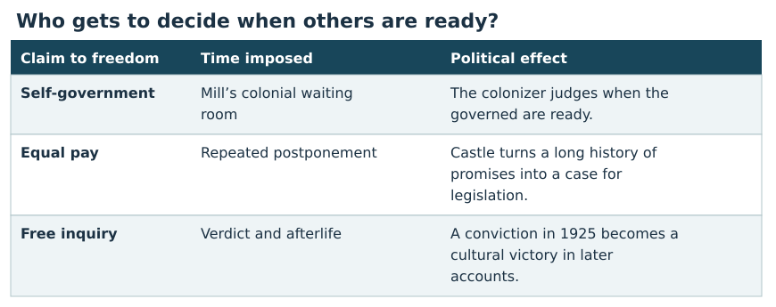

# BEL · B/L · Anglais 2017 — Corrigé guidé

*Corrigé rédigé par IA, non officiel. Signalez toute erreur.*

**Rédaction** · GPT-6.2 Astra Ultra · vitesse non renseignée

**Analyse et commentaire de textes ou documents en anglais.** Épreuve écrite à option de six heures, coefficient 3. La composition en anglais croise les perspectives des trois documents britanniques et des trois documents américains.

## Modernity and its Discontents

> [!INDICATION]
> A churchgoer can listen to a radio broadcast and a landowner can draw an industrial income. Start with such crossings. They make it possible to discuss how authors draw the line between tradition and modernity instead of assigning each document to a camp.

A rural English reader opens the *Daily Mail* under a thatched roof. A crowd gathers in a Tennessee town to defend or denounce evolution, while radio engineers prepare to broadcast the dispute. In these two scenes, taken from G. M. Trevelyan’s social history and John Aloysius Farrell’s account of the Scopes trial, modernity has arrived before anybody can decide whether to welcome it. The problem posed by the dossier is therefore more exacting than a balance sheet of gains and losses. Who can turn changes in how people live into an authoritative account of where history is going? The British and American texts suggest that a modern economy can sustain old hierarchies, that industrial freedom depends on where one looks for it, and that the promise of a common future gives some people considerable power over the time of others.

### The places where change becomes visible

For Trevelyan, writing in 1942 about late Victorian England, the survival of the country house is deceptive. Agricultural rents have fallen under pressure from American imports. Industrial investments or revenue from urban estates now help support the squire and his tenants. Town and country are thus already bound up economically when urban newspapers and the habits of educated townspeople enter the village. His lament for the loss of local traditions sits alongside evidence of genuine political emancipation. Literacy makes the metropolitan press available, yet the secret ballot and the extension of the franchise to agricultural labourers also loosen the landlord’s hold over a household’s vote. One may regret the spread of the same newspaper everywhere without wanting the squire to choose how everyone votes.

The Twelve Southerners likewise defend a local culture against the prestige of a national model. Their 1930 manifesto accepts the political outcome of the American Civil War while questioning whether Union victory settled the issue of how Southerners ought to live. Their preference for cultivating the soil leaves room for tools, artists and cities. The enemy is a hierarchy of ends in which any increase in output counts as an improvement in life. Yet the collective voice that speaks for ‘the South’ invites scrutiny. Its vision of agricultural vocation leaves little room for the experience of Black labourers whose freedom to choose a vocation had long been constrained. Trevelyan’s benign squire likewise looks different when observed from the polling booth. A defence of local difference can itself conceal differences within the locality.

### Can a worker recover at leisure what is lost at work?

Clark Kerr and his co-authors, writing in 1960, concede the discipline that large-scale production requires. There is no promise that a complicated plant will operate on the individual worker’s preferred timetable. Skilled work, the choice of employer and negotiated rules do allow some discretion. The larger compensations, however, come outside the factory, in the choice of residence, associations, education and leisure. Their imagined ‘New Bohemianism’ depends on just the bureaucracy from which independent spirits may wish to escape. In this account, freedom can move between different hours of the day without a loss in its overall value.

That assumption pinpoints the disagreement with the Agrarians. The speed of work, they argue, follows the consumer home. Advertising teaches people to desire the goods the industrial system can produce, so that a longer shopping list proves little about who shapes their desires. Barbara Castle supplies a practical test that neither model quite anticipates. A female industrial worker receiving less than a male colleague has fewer resources with which to exercise the supposed sovereignty of the consumer. In the House of Commons in 1970, Castle speaks at the second reading of a bill, where her object is to secure votes. Invoking the Trades Union Congress in 1888 and partial equal-pay gains in teaching and public employment, she turns precedent into an indictment of delay. Different groups of women have reached nominally the same future at different times. The intervention of workers, unions and Parliament is part of the explanation for the difference.

### Who writes the timetable of progress?

> [!INDICATION]
> Keep the date of each retrospective account in view. Farrell knows both the trial and its later theatrical afterlife. Distinguish the judicial result, its national audience and the conclusion he wishes a reader in 2009 to draw.

Dipesh Chakrabarty makes that question of timing central to the history of empire. Concepts such as citizenship, rights and popular sovereignty are indispensable to political argument across the world. Their European histories, however, do not entitle Europe to determine a schedule for everyone else. In his reading of John Stuart Mill, a liberal commitment to self-government could coexist with colonial rule because the colonized were deemed ‘not yet’ ready. The judge of readiness was also the beneficiary of postponement. Chakrabarty’s ‘waiting room of history’ gives spatial form to that political relation. Castle too exposes what an apparently universal principle can conceal. Unlike Mill’s colonial subjects, she can speak and act inside the institution that has kept others waiting. A transatlantic account of progress needs to register both the analogy and its limit.

Farrell’s retrospective headline awards modernity a victory even though Scopes was convicted. The machinery of the trial complicates any straight contest between a backward town and enlightened science. Local promoters saw publicity in a test case. Radio brought William Jennings Bryan’s opposition to evolutionary teaching to a modern mass audience. Bryan could also point to the Great War as evidence that technical advance had multiplied the capacity for destruction. When Clarence Darrow obtained qualifications to a literal reading of Genesis, the courtroom did not strike down the law. Theatre and cinema helped make the encounter a cultural victory decades later. The statue of Bryan and the presidential contenders who rejected evolution in the 2008 campaign bring the reader back to the limits of Farrell’s confident last sentence.

Modernity in these texts is both a set of material relationships and a claim about which experiences count as ahead or behind. Industrial income can keep a country gentleman in place, and a radio broadcast can magnify a religious objection to modern science. These are readily intelligible once one asks who owns resources, who has a vote and who tells the story afterwards. The dissenters ultimately put a precise challenge to the advocates of progress: to account for the unequal lives and conflicting memories that survive inside a supposedly common present.

[Sujet commun, p. 13–19](https://www.ens-lyon.fr/sites/default/files/2017-11/ecrits-communs-optionnels-ses-2017_1506587060551.pdf#page=13) · [Rapport du jury](https://www.ens.psl.eu/sites/default/files/17_BL_anglais_opt_ecrit.pdf)
