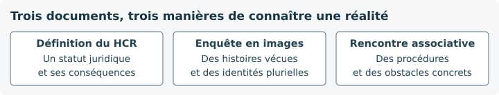

# BEL · B/L · Arabe 2017 — Corrigé brut

*Corrigé rédigé par IA, non officiel. Signalez toute erreur.*

**Rédaction** · GPT-6.2 Astra Ultra · vitesse non renseignée

Épreuve écrite de six heures. La consigne commune demande d’analyser et de commenter en arabe les trois documents des pages imprimées 15 à 18.

## Analyse et commentaire en arabe

**من الحق في الملجأ إلى الحق في الانتماء**

قد يعبر شخصان البحر نفسه وفي القارب نفسه، ثم تختلف الحماية التي يحق لكل منهما أن يطلبها بعد الوصول. وقد يبقى إنسان في المدينة نفسها أربعين عاما ويظل يصفها بأنها المكان الذي ينتظر فيه يوم العودة. بين هاتين المفارقتين تضعنا الوثائق الثلاث أمام سؤال يتجاوز عدد الوافدين إلى أوروبا: من يملك أن يصف إنسانا بأنه لاجئ أو مهاجر أو أوروبي؟ تجيب المفوضية السامية للأمم المتحدة لشؤون اللاجئين عن السؤال من جهة الخطر الذي فر منه الفرد، ويسأل مقال «رصيف» من جهة التجربة التي يرويها الفرد عن نفسه، ويبين تقرير «سوريا حرة» ما يحدث بين الخطر والتجربة حين تصير حياة المرء ملفا تتولاه إدارة وطنية. وقراءة الوثائق معا تقتضي التمييز بين شروط الحماية القانونية وبين الشروط المادية والاجتماعية التي تجعل تلك الحماية قابلة للعيش.

تستهل المفوضية نصها بإرجاع الملجأ إلى حضارات الشرق الأوسط القديم. لهذه البداية وظيفة تتجاوز إيراد شاهد تاريخي. فالقارئ الذي قد يتصور اللجوء مشكلة أوروبية مستجدة يكتشف أن حماية الفار أقدم من الدول التي تتفاوض اليوم بشأن استقباله. ثم ينتقل النص من الزمن الطويل إلى اتفاقية سنة 1951 وإلى تعريف أكثر تحديدا. مدار الحماية خوف له ما يبرره من الاضطهاد، وتعذر الاحتماء بالدولة التي يحمل المرء جنسيتها أو رفضه حمايتها بسبب ذلك الخوف. والمفارقة أن الدولة المفروض فيها أن تحميه قد تكون مصدر التهديد نفسه. من هنا لا يكفي تشابه الرحلة التي يقوم بها المهاجر الاقتصادي واللاجئ حتى يستوي وضعهما القانوني. وإذا جاز للأول أن يرجع إلى بلده، فقد يكلف الرجوع الثاني حريته أو حياته.

غير أن تعريف اللاجئ لا يصف جميع الذين اقتلعتهم الحرب. ففي التقرير الثالث يورد المحاضر، في يونيو 2015، أن أكثر من أحد عشر مليون سوري تركوا منازلهم، وأن نحو سبعة ملايين منهم انتقلوا إلى مكان آخر داخل سوريا. هؤلاء نازحون، ولم يصبحوا جميعا لاجئين خارج الحدود. أما معظم السوريين الذين عبروا الحدود آنذاك فاستقبلتهم دول الجوار. بهذا التصحيح يتغير معنى عبارة «أزمة أوروبية». أوروبا مقصد لبعض اللاجئين ومكان لنزاع سياسي حول استقبالهم، أما مجال النزوح نفسه فأوسع منها بكثير. كذلك يضم المقال الثاني، عمدا، وافدين حديثين وأبناء مهاجرين عاشوا في أوروبا منذ ولادتهم. ذلك التوسع يخدم سؤال الهوية، لكنه لا يلغي التمييز الذي تصر عليه المفوضية حين يتعلق الأمر بالحقوق.

يضع تقرير ندوة «سوريا حرة» التعريف المجرد أمام مسألة عملية. فإذا كان طالب الحماية يصل إلى بلد ساحلي أولا، فهل ينبغي أن يستقر العبء كله على البلد الذي صادف أن يقع على طريقه؟ يعرض المحاضر أثر قاعدة البلد الأول كما يشرحها في الندوة، ويذكر إيطاليا واليونان وبلغاريا. لا يحدد موقع الميناء قدرة الدولة على تمويل الإيواء، ولا يحدد المكان الذي يأمل القادم أن يعيد بناء حياته فيه. وهكذا تتوزع المسؤولية توزيعا غير متكافئ، داخل الاتحاد نفسه وبين الاتحاد والدول المجاورة لسوريا. والمقارنة مع أزمات العراق وكوسوفو تنقل النقاش من وصف وصول استثنائي إلى مساءلة طريقة أوروبية متكررة في تقاسم أعبائه.

وللوصول إلى فرنسا وجه آخر لا تظهره الأعداد. فقد يحق للمرء أن يطلب مسكنا أو مساعدة اجتماعية، ويظل عاجزا عن قراءة رسالة وصلت بالبريد تحدد موعدا أو تطلب ورقة. المسافة هنا قصيرة بين حق مقرر وحق يضيع، لكن عبورها يحتاج إلى مترجم أو جمعية أو شخص يفسر للوافد ما ينبغي فعله. لذلك يختم التقرير بوقت الأسئلة وبمشاركة مسؤولة في جمعية فرنسية. تنتقل المعرفة من المحاضر إلى مستمعين يستطيعون طلب إيضاح، خلافا للصيغة العامة التي تخاطب بها المفوضية جمهور موقعها. تظل حدود هذه الشهادة واضحة: إنها تعرض ما قيل في ندوة سنة 2015، وتشرح صعوبات بعينها، ولا تقدم حكما واحدا على كل إدارة أوروبية.

تبدأ مقالة «رصيف» باستفهام عن الهوية الأوروبية، ثم تنقل عن تحقيق مصور نشرته «ناشونال جيوغرافيك». ولوسيط الصورة هنا أهمية. حين نتبع ضرر الحرب في صوت فقده طفل، أو في بكاء رجل مسن كلما تذكر قريته، لا يعود الرقم كافيا. وفي المقابل تستطيع الصور المؤثرة أن تختزل إنسانا في الدور الذي لقيه فيه المصور، دور الضحية. تتجاوز بعض الشهادات ذلك الاختزال حين تتيح لصاحبها أن يسمي انتماءاته بنفسه. فرجل تركي يعيش في برلين منذ سنة 1970 يظل يرى إقامته انتظاراً للعودة. ويمارس موسيقيون وأبناء مهاجرين انتماءاتهم في حاضر أوروبي لا يمحو تاريخ أسرهم. وتجمع منسقة الموسيقى إيبك بين كونها تركية وألمانية وإنسانة ومثلية، ثم تتحدث عن صعوبة تقبل ألمانيا أبناء المهاجرين الأتراك. لا تكفي إذن مدة الإقامة لتفسير الهوية، كما أن ما يختاره الفرد لنفسه لا يضمن أن يعترف به الآخرون.

على هذا الضوء تكتسب عبارة «الأوروبيين الجدد» معناها المزدوج. فهي تفتح للاجئين وأبناء المهاجرين مكانا في صورة أوروبا، لكنها قد تظل صفة يطلقها المجتمع المضيف على أشخاص يريد بعضهم العودة أو ينتمي إلى أكثر من مكان. يستطيع القانون أن يحدد متى يحتاج شخص إلى حماية عاجلة، وتستطيع الإدارة أن تهيئ شروط البدء من جديد، أما الانتماء فيتكون أيضا في اللغة والعمل والذاكرة ونظرة الجيران. الصلة الأعمق بين النصوص أن حق الأمان يسبق السؤال عن هوية صاحبه. وقد يختار ذلك الشخص لاحقا أن يكون أوروبيا، أو أن يعود إلى بلده، أو أن يعيش بين ثقافتين، وهو في الحالات كلها أدرى من استمارة اللجوء بوصف حياته.

## Repères de lecture

[Fascicule commun, pages 20 à 23 du PDF](https://www.ens-lyon.fr/sites/default/files/2017-11/ecrits-communs-optionnels-ses-2017_1506587060551.pdf#page=20)
