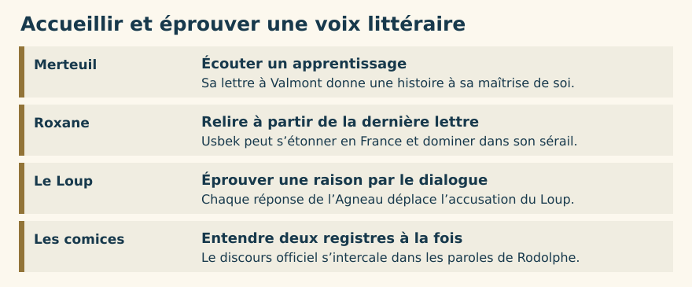

# BEL · BL — Composition française 2017 · Corrigé brut

*Corrigé rédigé par IA, non officiel. Signalez toute erreur.*

**Lecture du rapport du jury** · GPT-6.2 Astra Ultra · vitesse non renseignée

**Rédaction** · GPT-6.2 Astra Ultra · vitesse non renseignée

**Autocontrôle** · GPT-6.2 Astra Ultra · vitesse non renseignée

**Révision (tour 1)** · GPT-6.2 Astra Ultra · vitesse non renseignée · 26 novembre 2026

« Lire l’œuvre d’un écrivain dont on récuse radicalement les options pose un problème ; pour qu’un texte prenne un sens, il faut y engager sa liberté, faire le silence en soi, et y installer une voix étrangère. Cela m’est impossible si la fausseté des valeurs admises par l’auteur est trop flagrante, si sa vision du monde me paraît puérile ou odieuse. »

Simone de Beauvoir, Tout compte fait (1972), Paris, Gallimard, collection « Folio », p. 212.

Vous direz comment ce point de vue éclaire votre propre conception du rapport à la littérature.

## À qui faisons-nous place en lisant ?

Dans une lettre, la marquise de Merteuil invite Valmont à admirer la discipline avec laquelle elle a appris à régler ses gestes et ses expressions. Si je refuse immédiatement d’entendre qui profite de cette habileté, je manque quelque chose de l’inégalité des moyens d’agir qui s’offrent à une femme dans *Les Liaisons dangereuses*. Si je la suis sans réserve, je risque aussi de trouver admirable ce qui lui permet de soumettre les autres. Il faut donc considérer ce qui se passe entre les deux moments, celui où je laisse une voix étrangère résonner et celui où je la juge. Dans *Tout compte fait*, Simone de Beauvoir présente l’engagement libre du lecteur comme une condition du sens. Elle passe ensuite à la première personne pour désigner le seuil où cet engagement lui devient impossible. Je reconnais dans cette différence entre une condition générale et une limite singulière une difficulté féconde. Comment faire place à un texte dont on refuse l’orientation sans feindre une adhésion qui détruirait précisément la liberté de lire ?

## Accorder du temps à une parole que je ne possède pas

Le silence que Beauvoir demande au lecteur est un travail. Il peut être plus facile de reconnaître à la première page un ensemble d’idées connues que de suivre la façon étrange dont les mots d’autrui s’enchaînent. Dans la lettre 81 du roman de Laclos, Merteuil transforme son apprentissage de l’apparence en autobiographie conquérante. Les étapes de l’observation, de la dissimulation et du contrôle de soi se répondent comme les degrés d’une formation. Le lecteur doit consentir à suivre cette logique jusque dans le détail des gestes. Il comprend alors comment une situation d’infériorité sociale peut devenir le point de départ d’une puissance de contrainte. Le sens du passage ne se déposait pas tout fait derrière le mot « libertine ». Il fallait le laisser changer au fil de la lecture.

L’expérience s’étend aux voix dont l’existence même dérange l’ordre de l’œuvre. À la fin des *Lettres persanes*, Roxane écrit enfin à Usbek selon ses propres termes. Le lecteur avait appris à regarder la France par les yeux d’un voyageur persan capable de découvrir l’étrangeté des coutumes les mieux établies. Une femme tenue sous sa domination lui retourne l’exercice. La lettre finale contraint à reprendre tout ce qu’on croyait connaître de la liberté d’esprit d’Usbek. Accueillir une voix étrangère signifie ici réviser l’hospitalité déjà accordée à une autre. Le roman fait dépendre cette découverte d’un lecteur qui se souvient et qui sait revenir sur ses premières sympathies.

## Une lecture peut réellement se rompre

La formule de Beauvoir se durcit quand elle dit ce qui « m’est impossible ». Une opposition politique ordinaire ou un désaccord de goût n’épuisent pas ce qu’elle décrit. Continuer la lecture d’un livre dont chaque effet suppose qu’on juge risible quelqu’un qu’on tient pour digne de respect peut exiger une complicité que l’on refuse. Le rapport rappelle des exemples donnés autour de la citation. Beauvoir soupçonne une mise en scène édifiante de soi dans la correspondance de George Sand et perd confiance dans le récit des *Antimémoires* de Malraux. La difficulté touche autant au crédit accordé à une parole qu’à l’opinion affichée par une personne. Une phrase peut être belle et le rapport qu’elle me propose avec l’expérience racontée me paraître faussé.

Le témoignage autobiographique rend ce problème particulièrement aigu. Je lis un livre de mémoires à la fois comme une composition et comme la parole de quelqu’un qui se porte garant de ce qu’il donne à voir. Si le travail de la phrase fait systématiquement de l’auteur le seul être lucide parmi des silhouettes méprisables, ma difficulté ne se réduit pas à l’indignation devant une idée isolée. La distribution de la parole en produit l’effet tout au long du livre. Refuser cet effet constitue encore un exercice de ma liberté. Ce serait manquer la loyauté du témoignage de Beauvoir que de décréter qu’un bon lecteur peut toujours surmonter une telle résistance. Je peux comprendre certains procédés et rester incapable d’habiter le monde qu’ils construisent.

Le danger inverse existe. Dans « Le Loup et l’Agneau » (livre I, fable X), l’agneau se tient en aval du loup et répond ainsi à l’accusation de troubler son eau. Il réfute l’accusation suivante par sa date de naissance. Quand le loup invoque un frère, l’agneau répond qu’il n’en a pas. Les motifs du procès deviennent de moins en moins personnels, jusqu’à englober les bergers et les chiens. J’aurais donc tort de tenir la première maxime, sur la « raison du plus fort », pour une profession de foi du fabuliste. La formule finale, « sans autre forme de procès », me fait mesurer l’intervalle entre les raisons successivement alléguées et l’issue acquise d’avance. J’ai dû écouter le loup jusqu’au bout pour découvrir de quel côté de son raisonnement la fable me place.

## Relire la forme du désaccord

Il existe dès lors plusieurs façons de poursuivre un livre auquel on ne peut plus faire le même crédit. On peut le lire comme document sur les valeurs d’un milieu ou pour comprendre comment une société a rendu certaines opinions recevables. Pareille enquête produit un sens réel. Elle n’est pas identique à l’expérience de lecture que Beauvoir décrit. Je ne peux pas opposer la seule existence d’un commentaire savant à l’aveu qu’un livre ne « prend » plus. Il reste pourtant une autre possibilité, intérieure à l’expérience littéraire elle-même. Une œuvre peut faire de la distance entre des voix le moyen par lequel elle suscite mon jugement.

Aux comices agricoles de *Madame Bovary*, les propos de Rodolphe à Emma alternent avec les annonces de prix prononcées sur l’estrade. Si j’isole les mots du séducteur, je peux les approuver ou les mépriser. Si j’entre dans le rythme du montage verbal, les promesses d’exception se croisent avec le langage public de la récompense et de l’évaluation. C’est leur voisinage qui rend audible ce qu’aucune des voix ne voudrait dire d’elle-même. L’ironie ne garantit pas que je doive toujours trancher en faveur de celui qui l’organise. Elle ouvre une tâche qui demeure au lecteur, examiner à qui profite le rire, sur qui tombe le jugement, si la phrase réserve à Emma une part d’expérience que son partenaire ne comprend pas.

Dans la deuxième partie, chapitre VIII, Emma remue les doigts pendant que Rodolphe lui serre la main. La phrase narrative retient deux explications du geste, une tentative de dégager sa main ou une réponse à la pression. Rodolphe en retient une seule et s’écrie « Vous ne me repoussez pas ! » Je puis partager sa certitude si je passe trop vite sur l’alternative grammaticale. Relire la phrase me rend la possibilité qu’il vient d’écarter. J’y découvre une limite dont j’ai moi-même fait l’épreuve en lisant, celle de ma disposition à croire l’interprète le plus affirmatif.

## Conclusion

Je retiens ainsi de Beauvoir que la littérature ne réclame pas une liberté moins exigeante que la vie commune. Elle demande le temps d’une attention dont je ne connais pas d’avance les effets. Je peux suspendre une réaction pour entendre la forme qu’une voix donne à son monde, lui opposer une autre voix, puis préciser les raisons d’un refus. Il m’arrivera de fermer le livre. Une lecture libre peut aussi avoir pour résultat de savoir mieux pourquoi je ne puis continuer, et de distinguer ce refus motivé de la simple habitude de n’entendre que moi.

[Énoncé officiel, p. 21](https://www.ens-lyon.fr/sites/default/files/2017-11/2017-ecrits-communs-ses_1506586985330_0.pdf#page=21) · [Rapport du jury](https://www.ens.psl.eu/sites/default/files/17_francais_com_ecrit.pdf)
