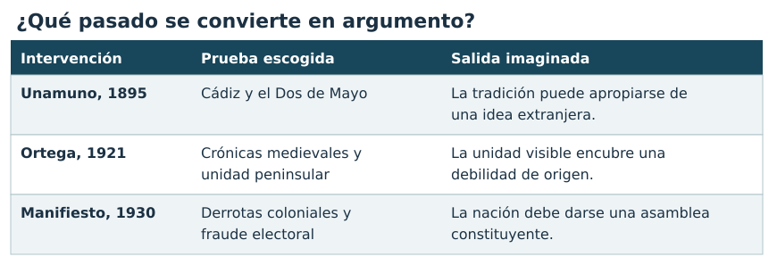

# BEL · B/L · Espagnol 2017 — Corrigé brut

*Corrigé rédigé par IA, non officiel. Signalez toute erreur.*

**Rédaction** · GPT-6.2 Astra Ultra · vitesse non renseignée

**Analyse et commentaire de textes ou documents en espagnol.** Épreuve écrite à option de six heures, coefficient 3. Le commentaire porte sur trois écritures du « mal espagnol », de l’essai de 1895 au manifeste républicain de décembre 1930.

## ¿Qué quiere decir regenerar España?

Cuando Miguel de Unamuno publica *En torno al casticismo* en 1895, todavía no se han perdido Cuba, Puerto Rico y Filipinas. Sería por tanto un anacronismo hacer del desastre de 1898 la causa de todas las interrogaciones que suscita España en los tres documentos. En 1921 José Ortega y Gasset retrocede hasta la Edad Media para averiguar si tiene sentido hablar de decadencia. En diciembre de 1930, en cambio, los firmantes de un manifiesto republicano buscan precisamente en las derrotas coloniales y en el gobierno reciente los títulos de su acusación. ¿Cómo puede una misma preocupación por el futuro de España justificar tanto una reconsideración de la tradición como una ruptura de régimen? La respuesta depende de dónde se sitúe el origen del mal, de quién esté autorizado a interpretarlo y de quién pueda actuar en nombre de la nación.

### ¿Un mal venido de fuera o una debilidad interna?

Unamuno comienza escuchando dos voces. Los defensores de lo castizo se quejan a gritos de la corriente europea; los que ansían una intervención extranjera murmuran en confianza. La imagen del río desbordado presenta ya una dificultad para el primer grupo. Lo que amenaza al molinero es también lo que hace funcionar el molino. El segundo grupo incurre en el error inverso al atribuir a la conquista, por sí misma, una virtud regeneradora. El deseo atribuido a Renan durante la guerra franco-prusiana y la sumisión predicada por Jeremías sitúan esa tentación fuera de una supuesta extravagancia nacional. Ambos extremos confunden el choque entre pueblos con el modo en que esos pueblos hacen suyas las ideas ajenas.

Ortega cambia la pregunta mediante una operación lógica. La decadencia sólo es pensable con respecto a un estado anterior de salud. Si las mismas deficiencias se observan incluso durante los siglos que se juzgaban gloriosos, deja de bastar la explicación por una desgracia sobrevenida. La fórmula paradójica según la cual «la anormalidad ha sido lo normal» le permite pasar de la patología adquirida a los «defectos de constitución». Los republicanos de 1930, por el contrario, sí designan agentes a los que pedir cuentas. A los restos humanos de Annual y Monte Arruit se añaden las prácticas del caciquismo y la conducta del rey. La coexistencia de estos males importa más al manifiesto que su genealogía medieval. Al responsabilizar al régimen hace imaginable que otro régimen obre de otra manera.

### Tres trabajos sobre el pasado

La paradoja más fértil de Unamuno se encuentra en su lectura del Dos de Mayo. La resistencia a una invasión francesa pudo expresarse con las formas del clasicismo francés y en nombre de una libertad que debía mucho a 1789. En Cádiz, Martínez Marina creyó reanudar una tradición de Cortes al tiempo que proyectaba en el pasado un ideal nuevo. Lo castizo resulta capaz de transformación precisamente allí donde los partidarios de la pureza querrían hallar una frontera. La reja que desgarra la tierra prepara el surco, pero también troncha una flor. El recuerdo de Burns concede a esta pérdida un valor que la pura contabilidad del progreso pasaría por alto. La metáfora del arado explica una apropiación costosa, no una apología de la guerra.

Ortega recomienda cotejar las crónicas medievales españolas con las francesas. La variedad de impulsos que él lee en las segundas le sirve para caracterizar por contraste la escasez de minorías directoras en España. Hay que atribuir el diagnóstico al ensayista: la diversidad temática de unas crónicas, por sí sola, no prueba el carácter de toda una población. Su imagen de una «embriogenia defectuosa» convierte una selección histórica en un rasgo de origen. Queda la objeción de la expansión de fines del siglo XV. Ortega la resuelve distinguiendo la capacidad del instrumento y la de quienes lo manejan: la concentración de recursos bajo una misma corona permitió grandes empresas sin corregir la debilidad social de fondo. El aparente contraejemplo termina reforzando su tesis.

### ¿Quién encarna a la nación que viene?

En los dos ensayos, la voz que ordena las pruebas tiene mucho peso. Unamuno invita a sus lectores a abandonar dos posiciones simétricas; Ortega orienta a los jóvenes investigadores hacia los siglos medios. El comité de 1930 también se dirige a un público, pero aspira a transformarlo en sujeto político. Desde el vocativo «¡Españoles!» y la escena del pueblo en la calle, presenta la revolución como respuesta a una voluntad que le precede. La serie de oficios y condiciones reúne incluso a propietarios y braceros, patronos y obreros. No documenta por encuesta una unanimidad ya existente: busca producirla, ofreciendo a grupos enfrentados un agravio común ante la arbitrariedad.

Los firmantes afrontan una objeción moral decisiva. Si la violencia caracteriza a quienes han sustituido la ley por la fuerza, ¿cómo justificar un levantamiento? Sostienen que los caminos legales se han cerrado, que las Cortes ofrecidas prolongarían el fraude y que bajo la tiranía la revolución puede restituir el derecho. El razonamiento pretende legitimar un gobierno provisional desde el presente y reservar a una futura asamblea constituyente el ejercicio de la soberanía nacional. Entre ambas atribuciones queda una tensión: el comité necesita afirmar la existencia de un pueblo unido antes de que éste pueda expresarse en elecciones libres. La exclamación «¡Viva España con honra!» recoge el eco de 1868, así que incluso el llamamiento a archivar la monarquía busca en la historia nacional palabras con que romper con ella.

Regenerar España adquiere, pues, sentidos difícilmente intercambiables. Unamuno devuelve movilidad a una tradición que unos defienden y otros desprecian como un bloque. Ortega pone en duda que se pueda recobrar una salud perdida y confía en una nueva dirección intelectual. Los republicanos convierten acusaciones históricas en la demanda inmediata de un poder constituyente. Su coincidencia más profunda reside en que cada propuesta de futuro exige volver a leer un pasado cuya significación sigue en disputa.

[Sujet commun, p. 24–29](https://www.ens-lyon.fr/sites/default/files/2017-11/ecrits-communs-optionnels-ses-2017_1506587060551.pdf#page=24) · [Rapport du jury](https://www.ens.psl.eu/sites/default/files/17_BL_espagnol_opt_ecrit.pdf)
