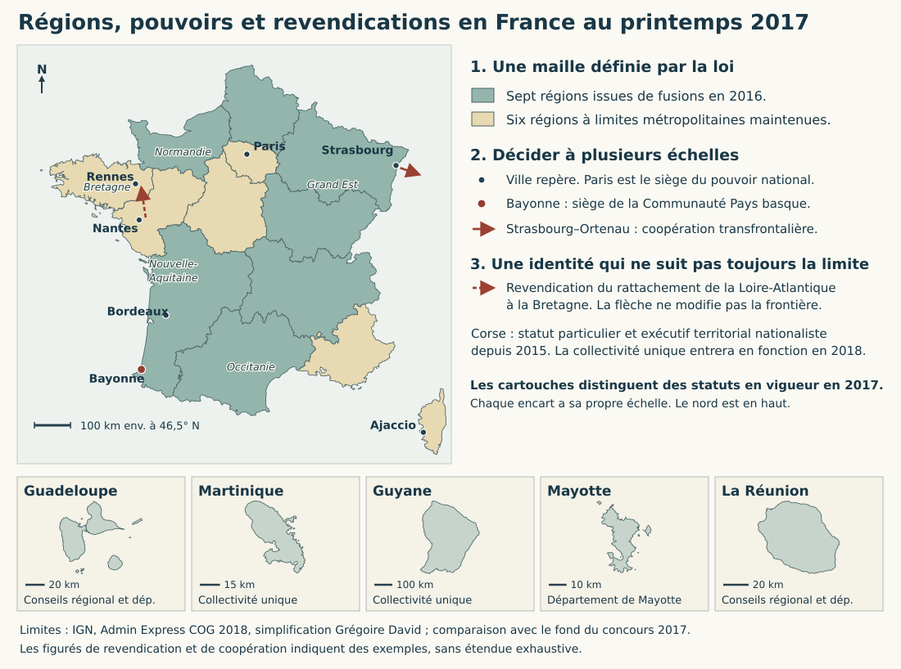

# BEL · BL — Géographie 2017 · Corrigé guidé

*Corrigé rédigé par IA, non officiel. Signalez toute erreur.*

**Lecture du rapport du jury** · GPT-6.2 Astra Ultra · vitesse non renseignée

**Rédaction** · GPT-6.2 Astra Ultra · vitesse non renseignée

**Autocontrôle** · GPT-6.2 Astra Ultra · vitesse non renseignée

« Régions, régionalismes et pouvoirs en France. » Dissertation à option de six heures. La feuille demande des exemples précis et au moins une production graphique. La page suivante fournit un fond de carte de la métropole et des DROM.

## Construire le croquis avec le devoir

Le fond officiel place les limites des treize régions métropolitaines à côté de cinq cartouches ultramarins. Commencez par lire les limites sans attribuer à leur tracé une signification culturelle. Coloriez les sept ensembles issus de fusions en 2016. L’autre teinte identifie les limites maintenues. Ajoutez ensuite les cas de l’argumentation. Le repère près de Bayonne signale une intercommunalité et le lien sur le Rhin une coopération transfrontalière. Aucun de ces signes n’ajoute une dix-neuvième région.

**Comment lire l’exemple de Nantes ?** Nantes est le chef-lieu des Pays de la Loire. Une demande de rattachement de la Loire-Atlantique à la Bretagne révèle une autre géographie que celle des pouvoirs régionaux actuels. La flèche de revendication signale une demande et doit se distinguer du trait de frontière existant.

**Pourquoi donner une échelle spécifique aux cartouches ?** Les superficies et les distances en jeu n’ont rien de comparable d’une île à la Guyane. Le croquis place un repère de distance dans chacun des encarts. Ils documentent des situations institutionnelles différentes que leur position sur la page ne suffit pas à situer.

**Comment répondre au pluriel « pouvoirs » ?** Nommez, à chaque échelle, qui décide et avec quels moyens. Le Parlement délimite, les élus régionaux orientent une politique économique, les communes mettent en commun certaines compétences, les associations cherchent à convaincre. Cette répartition est indispensable à l’explication d’un territoire vécu et gouverné.

## Qui a le pouvoir de faire région ?

Bayonne se trouve en Nouvelle-Aquitaine, dans le département des Pyrénées-Atlantiques. Depuis le 1er janvier 2017, la ville appartient aussi à une communauté d’agglomération qui réunit les 158 communes du Pays basque français. Une même adresse renvoie donc à plusieurs territoires dont aucun ne suffit à dire qui décide de quoi, ni à quel espace une personne se sent appartenir. Une région administrative a des limites juridiques. Une région fonctionnelle s’organise par des flux et des centres. Une région vécue ou revendiquée suppose des pratiques, des appartenances et parfois un projet de reconnaissance. Le régionalisme qualifie cette affirmation et peut aller de la mise en valeur d’une langue à une revendication politique. Le pouvoir est ici la capacité de tracer, de financer, de représenter ou d’imposer une décision à d’autres acteurs. Comment les acteurs qui dessinent, vivent ou revendiquent des régions transforment-ils la répartition du pouvoir en France ? La réponse se place au printemps 2017, après le redécoupage métropolitain.

## Le pouvoir national institue des territoires de décision

La région française est le résultat d’une histoire de l’aménagement et de la décentralisation. Les établissements publics régionaux créés en 1972 ne disposaient pas de la même légitimité que les conseils élus par la population. La loi du 2 mars 1982 engage un transfert de pouvoir exécutif vers les élus locaux et fait de la région une collectivité territoriale. La première élection des conseillers régionaux au suffrage universel direct a lieu en 1986. Le préfet de région continue d’incarner l’État. Le président et les élus du conseil régional délibèrent sur des compétences de la collectivité. Les habitants du même périmètre rencontrent ainsi deux chaînes de responsabilité distinctes. Déconcentration et décentralisation ne sont pas interchangeables.

La loi du 16 janvier 2015 modifie la délimitation des régions. Au 1er janvier 2016, la métropole en compte treize, Corse comprise, contre vingt-deux auparavant. La loi NOTRe du 7 août 2015 traite notamment de la répartition des compétences et renforce le rôle régional en matière de développement économique. Le schéma régional de développement économique, d’innovation et d’internationalisation fixe des orientations sur lesquelles se règlent notamment des interventions auprès des entreprises. Fusionner un territoire et lui confier une compétence sont deux décisions différentes. Bordeaux voit s’étendre son aire de chef-lieu, jusqu’à Poitiers et Limoges, sans pour autant gouverner tous leurs services et tous les investissements. Élus, services déconcentrés, intercommunalités et acteurs économiques interviennent selon des périmètres qui se croisent.

Le croquis distingue les sept régions métropolitaines qui résultent d’une fusion des six qui conservent leurs limites. La teinte ne mesure ni richesse ni force d’un attachement identitaire. Elle rend visible une décision nationale qui ne touche pas tous les espaces de la même façon. Les cinq cartouches ultramarins invitent à changer d’échelle et de statut.

## Les appartenances régionales débordent ou découpent les circonscriptions

L’exemple breton révèle un décalage très concret. La région administrative réunit quatre départements, alors que des organisations qui se réfèrent à la Bretagne historique revendiquent le rattachement de la Loire-Atlantique, située dans les Pays de la Loire. Nantes et Rennes exercent par ailleurs des fonctions métropolitaines distinctes. Un réseau économique entre les deux villes, l’enseignement du breton ou l’appartenance de communes à une même collectivité ne sont pas équivalents. Une association culturelle, un chef d’entreprise et un élu peuvent tracer des cartes différentes de l’espace qui leur importe. Le désaccord concerne aussi les équipements, les sièges et l’aire dans laquelle on compte les électeurs.

Au Pays basque, des mobilisations d’élus et d’associations de la société civile ont contribué à la naissance de la communauté d’agglomération en janvier 2017 par fusion de dix intercommunalités. L’aire nouvellement instituée acquiert des moyens de coordination et de projet. En revanche, elle demeure une intercommunalité dans la grande région Nouvelle-Aquitaine. Un attachement territorial peut donc déboucher sur une institution à une autre échelle que celle du conseil régional. Il ne faut pas non plus prêter une revendication politique identique à toute la population de langue ou de culture basque. C’est la coalition d’acteurs et la traduction juridique du compromis qui donnent à cet exemple sa portée géographique.

En Corse, l’insularité ne produit pas à elle seule un consensus politique. Le statut de collectivité territoriale de Corse et l’Assemblée de Corse fournissent aux forces politiques un lieu pour débattre de la langue, de l’accès au foncier ou des transports entre île et continent. Le succès d’une coalition nationaliste aux élections territoriales de décembre 2015 transforme l’équilibre du pouvoir dans cette institution. Il ne vaut pas vote unanime sur l’indépendance. Au printemps 2017, les deux départements corses existent encore comme collectivités. La collectivité de Corse qui doit s’y substituer avec la collectivité territoriale n’entre en fonction qu’au 1er janvier 2018. Le calendrier compte autant que le contour insulaire.

## Les rapports de pouvoir changent lorsqu’on change d’échelle

Dans l’Est, l’Alsace a rejoint une région administrative beaucoup plus vaste, le Grand Est. Strasbourg est aussi au cœur d’un ensemble de mobilités quotidiennes et de coopérations avec l’Ortenau allemand. L’Eurodistrict, organisé en groupement européen de coopération territoriale en 2010, permet à des responsables locaux de conduire des projets communs de part et d’autre du Rhin. Il ne redessine pas la frontière entre les deux États. La même ville tient ainsi sa fonction de chef-lieu d’une décision française et son rôle de coopération d’un réseau transfrontalier. Ces deux positions ne s’annulent pas. Elles ouvrent des interlocuteurs et des moyens d’action différents.

L’outre-mer empêche de confondre la carte des dix-huit régions au sens géographique et un modèle uniforme de gouvernement régional. En Guadeloupe et à La Réunion, conseil départemental et conseil régional exercent en 2017 des compétences différentes sur un même territoire. En Guyane et en Martinique, depuis les élections de décembre 2015, une collectivité territoriale unique exerce les compétences précédemment réparties entre le département et la région. À Mayotte, le Département exerce depuis 2011 des compétences départementales et régionales. Les distances au pouvoir central, les échanges avec les territoires voisins et les moyens attribués aux exécutifs locaux ne sont pas lisibles dans la seule surface de l’encart. Des choix statutaires différents peuvent donc correspondre à une inscription commune dans la République.

La région apparaît finalement comme une échelle disputée de la vie collective. L’État peut en changer les frontières et les compétences, des élus transformer un mandat en politiques territoriales, des habitants contester la légitimité d’une limite et des partenaires transfrontaliers créer des possibilités d’action nouvelles. Aucun de ces pouvoirs ne dessine toute la carte. Les décalages entre eux expliquent pourquoi des limites administratives très fermes peuvent coexister avec des appartenances multiples et des espaces de coopération ouverts.

[Énoncé officiel, p. 1](https://www.ens-lyon.fr/sites/default/files/2017-11/ecrits-communs-optionnels-ses-2017_1506587060551.pdf#page=1) · [Rapport du jury](https://www.ens.psl.eu/sites/default/files/17_geographie_opt_ecrit.pdf) · [Ministère, compétences de la loi NOTRe](https://www.ecologie.gouv.fr/politiques-publiques/loi-portant-nouvelle-organisation-territoriale-republique-notre) · [Communauté d’agglomération Pays basque, compétences](https://www.communaute-paysbasque.fr/linstitution/nos-missions-et-notre-fonctionnement) · [Eurodistrict Strasbourg–Ortenau, histoire](https://www.eurodistrict.eu/fr/histoire) · [Grégoire David, limites régionales d’après IGN Admin Express 2018, Licence ouverte](https://github.com/gregoiredavid/france-geojson)
