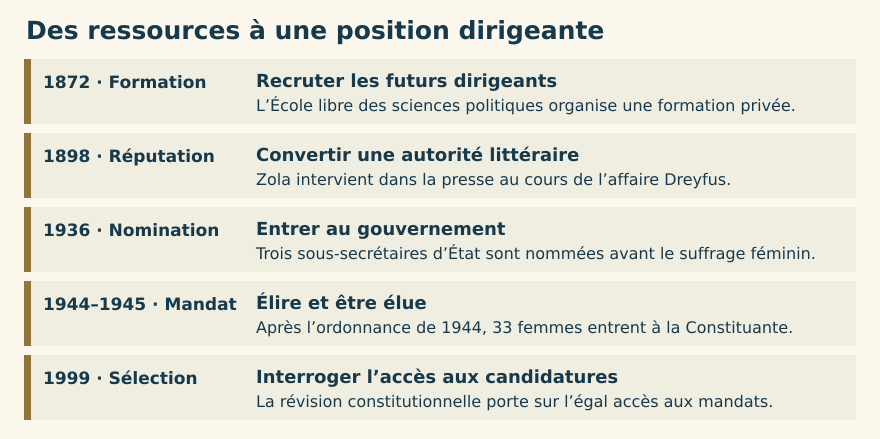

# BEL · BL — Histoire contemporaine 2017 · Corrigé guidé

*Corrigé rédigé par IA, non officiel. Signalez toute erreur.*

**Lecture du rapport du jury** · GPT-6.2 Astra Ultra · vitesse non renseignée

**Rédaction** · GPT-6.2 Astra Ultra · vitesse non renseignée

**Autocontrôle** · GPT-6.2 Astra Ultra · vitesse non renseignée

« Les élites en France de 1870 à la fin du XXe siècle ». Dissertation commune de six heures.

## Comparer les voies d’accès au pouvoir

Préparez trois colonnes, ressource initiale, institution qui la reconnaît, possibilité de la convertir. Un propriétaire peut obtenir un mandat grâce à des relations locales. Un écrivain peut transformer son autorité littéraire en intervention politique en publiant dans la presse. Un haut fonctionnaire peut poursuivre sa carrière dans la direction d’une entreprise. Ces trajectoires ne se déduisent ni d’un revenu unique ni d’une liste de fonctions. Elles donnent une unité au pluriel du sujet.

**Comment éviter une rupture purement politique en 1914 ?** Montrez ce que la guerre change dans la coopération entre l’administration, les grandes entreprises et les organisations de travailleurs. Le rôle d’Albert Thomas permet de suivre le déplacement des compétences reconnues et de préparer l’analyse du pouvoir des experts après 1945.

**Comment intégrer les femmes autrement que dans une parenthèse ?** Comparez trois seuils, les nominations sans droit de suffrage en 1936, l’accès juridique aux mandats et les premières élues en 1944–1945, puis la discussion de 1999. Chacun répond à un obstacle différent, nomination, droit et sélection des candidatures.

**Quelle comparaison faire entre République et Vichy ?** Distinguez la destruction d’une légitimité électorale, la promotion de certains techniciens et l’exclusion légale de groupes entiers. L’itinéraire d’un individu ne suffit pas à attribuer une conduite à une profession. À la Libération, les modes de légitimation changent plus vite que toutes les compétences et les fortunes disponibles.

## Qui a qualité pour décider ?

En 1872, Gambetta salue à Grenoble l’avènement de nouvelles couches sociales. La même année, Émile Boutmy fonde l’École libre des sciences politiques, établissement privé destiné à repenser la formation des dirigeants après la défaite. L’élection semble ouvrir une voie à des hommes que leur naissance ne destinait pas au pouvoir. La construction d’institutions de sélection peut aussi réserver l’accès aux fonctions nouvelles à ceux qui disposent déjà des bonnes ressources. À la fin du XXe siècle, la discussion sur la parité politique montre que le problème demeure, mais que son objet s’est déplacé. On peut avoir le droit de voter et d’être élue depuis un demi-siècle et rester fort minoritaire parmi les législateurs.

Les élites désignent les minorités qui disposent durablement d’un pouvoir de décision, de ressources économiques ou d’une autorité reconnue dans un domaine. La fortune, la notoriété et la capacité de gouverner n’ont ni les mêmes sources ni les mêmes effets. Comment la démocratie électorale, les crises politiques et l’accroissement du rôle de l’État ont-ils modifié la sélection et les relations entre ces groupes, sans rendre égales les chances d’y accéder ?

## 1870–1914. Des règles de légitimité nouvelles, des héritages puissants

La première Assemblée de la République, élue en 1871, compte une majorité monarchiste. La propriété foncière et les réseaux de famille, particulièrement efficaces dans certaines campagnes, restent convertibles en mandats. Le régime républicain finit pourtant par s’imposer et dispose, dans les années 1880, de moyens durables de formation et d’enracinement. Le suffrage masculin, l’affirmation de la Chambre et la presse politique valorisent les talents d’orateur et les réseaux locaux de médecins, d’avocats ou de professeurs. Un avocat possédait certes déjà le temps et les compétences requis pour prendre la parole publiquement. Le renouvellement des professions représentées au Parlement ne signifie donc pas que les ouvriers et les ouvrières décident désormais à proportion de leur nombre. L’école primaire gratuite et obligatoire élargit l’instruction, mais le secondaire long et les études supérieures restent des filtres sociaux déterminants.

Dans le même temps, l’industrialisation accroît le pouvoir d’autres élites. Au Creusot, les Schneider dirigent une grande entreprise, pèsent sur la vie locale et occupent des fonctions politiques. Ce cumul montre qu’une distinction entre bourgeoisie économique et personnel républicain ne correspond pas à deux mondes clos. Le prestige de l’ingénieur formé dans une grande école peut renforcer l’autorité des propriétaires, autant qu’ouvrir des fonctions de direction à des hommes extérieurs à leur famille. Dans la haute société, fortunes mobilières, patrimoines fonciers et alliances matrimoniales permettent aussi des rapprochements entre bourgeoisie d’affaires et aristocratie.

L’affaire Dreyfus rend visibles de tout autres concurrences. La parole des chefs militaires, forte du prestige du corps et de ses hiérarchies, est publiquement contestée par des parlementaires, des juristes, des journalistes et des écrivains. En 1898, Zola mobilise dans la presse une renommée littéraire acquise hors de l’administration. Le mot « intellectuels » prend dans cette crise une signification politique. Il ne désigne pas une élite unanime. Des auteurs de premier plan défendent des positions antagonistes. Le pluralisme se lit ici dans la capacité de contester publiquement ceux qui prétendent détenir seuls la compétence pour juger une affaire d’État.

## 1914–1944. Les crises déplacent les compétences et éprouvent les fidélités

La Grande Guerre exige une coopération plus étroite entre administrations, dirigeants d’entreprises, ingénieurs et représentants du travail. Le socialiste Albert Thomas devient ministre de l’Armement en 1916. Sa trajectoire témoigne d’un mode de légitimation où l’organisation d’une grande production et la négociation avec les représentants professionnels comptent au sein du gouvernement. L’expérience ne supprime ni les conflits sociaux ni la propriété privée. Elle accroît la visibilité de spécialistes et d’organisations dont l’État a besoin. Après 1918, associations d’anciens combattants, syndicats et partis structurés font aussi apparaître des porte-parole dont l’autorité ne vient pas d’une fortune patrimoniale.

Les années trente mettent à l’épreuve le crédit de ces médiateurs. Les dénonciations des « deux cents familles » attaquent la concentration du pouvoir économique et l’influence prêtée aux grands actionnaires de la Banque de France. Le slogan rassemble des mécontentements, sans tenir lieu d’une description exacte de tous les milieux dirigeants. En 1936, les accords de Matignon reconnaissent comme interlocuteurs des représentants du patronat et de la CGT. Des syndicalistes peuvent peser sur la politique sociale sans détenir les moyens de production. Le gouvernement Blum nomme aussi trois femmes sous-secrétaires d’État alors que les Françaises ne sont toujours pas électrices aux élections nationales. La distinction entre une nomination exceptionnelle et l’accès ordinaire aux mandats apparaît avec une netteté particulière.

L’Empire oblige à préciser l’échelle du sujet. L’élection de Blaise Diagne comme député du Sénégal en 1914 illustre une possibilité d’ascension parlementaire dans le cadre singulier des Quatre Communes. Elle ne donne pas à l’ensemble des populations de l’Empire des droits politiques identiques. Administrateurs métropolitains, élus et intermédiaires locaux disposent d’autorités inégales. Parler d’élites « en France » implique donc de suivre certaines trajectoires impériales jusqu’aux lieux où se décide la politique nationale, sans assimiler les positions des colonisés à celles des autorités coloniales.

Le régime de Vichy, en 1940, détruit les institutions parlementaires qui soutenaient une partie des élites républicaines. Il valorise hiérarchie, expertise et représentation professionnelle, tout en excluant les Juifs de nombreuses fonctions selon ses lois antisémites. Des membres des anciens groupes dirigeants composent avec le régime, s’engagent dans la collaboration ou dans la Résistance. Aucun milieu n’a ici une conduite unique. À la Libération, l’épuration, les engagements résistants et la délégitimation de Vichy reclassent les réputations et le personnel politique. L’épuration économique, variable et limitée par les besoins de reconstruction, n’a pas pour effet de faire disparaître le patronat antérieur.

## De 1944 à la fin du siècle. L’État ouvre des voies et produit de nouvelles sélections

L’ordonnance du 21 avril 1944 reconnaît aux Françaises les droits d’électorat et d’éligibilité. Trente-trois femmes entrent à la première Assemblée constituante en 1945. La même année est créée l’École nationale d’administration. Ces deux événements transforment l’accès au pouvoir de façons différentes. L’un lève une exclusion juridique. L’autre unifie une voie de recrutement de la haute administration et donne davantage de poids au concours. Sa préparation exige cependant informations, temps et ressources scolaires très inégalement répartis. Le mérite mesuré par le classement peut prendre la relève du nom de famille affiché tout en reconduisant une partie des écarts hérités. Les travaux de Bourdieu et Passeron sur les études supérieures dans *Les Héritiers* en 1964 rendent ces conditions plus visibles.

Nationalisations, planification et reconstruction accroissent après 1945 la place des ingénieurs, des hauts fonctionnaires et des dirigeants de grandes entreprises publiques. Les passages entre cabinets ministériels, administrations et directions d’entreprises permettent de convertir une compétence publique en autorité économique. La Ve République valorise l’exécutif, les proches conseillers et les hauts fonctionnaires appelés aux fonctions politiques. L’élection présidentielle au suffrage universel direct, effective pour la première fois en 1965, accroît aussi l’importance de l’aptitude à parler à un public national. La télévision confère à certains journalistes et producteurs un pouvoir nouveau de sélection des personnes et des causes visibles.

L’élargissement des études secondaires et supérieures transforme les attentes d’accès aux fonctions de direction. Mai 1968 prend aussi pour cible l’autorité des mandarins universitaires. L’existence d’un vaste public étudiant et de nouvelles tribunes ne supprime pourtant pas la distinction entre les filières de masse et les formations sélectives. De même, la décentralisation des années 1980 élargit les domaines d’action des élus locaux, tandis que les privatisations et l’intégration européenne multiplient les lieux de carrière et de décision des dirigeants. Les circulations entre ces lieux rendent moins pertinente une opposition simple entre État et affaires. Des critiques de la technocratie ou de la fermeture des partis se développent à mesure que deviennent visibles ces passages.

À la fin du siècle, le décalage entre progression scolaire des femmes et présence encore très minoritaire au Parlement suscite la révision constitutionnelle de 1999 en faveur de l’égal accès aux mandats. Il résume un trait de toute la période. L’abolition d’un obstacle ne garantit ni des trajectoires identiques ni une influence égale dans toutes les institutions. De 1870 à la fin du XXe siècle, les titres permettant de prétendre diriger se sont diversifiés, le diplôme, l’élection et l’expertise publique se sont affirmés, et les personnes exposées à l’autorité ont gagné des moyens de la contester. Le pouvoir durable de certaines minorités s’explique moins par leur permanence à l’identique que par leur faculté d’adapter et de convertir leurs ressources.

[Énoncé officiel, p. 2](https://www.ens-lyon.fr/sites/default/files/2017-11/2017-ecrits-communs-ses_1506586985330_0.pdf#page=2) · [Rapport du jury](https://www.ens.psl.eu/sites/default/files/17_histoire_com_ecrit.pdf)
