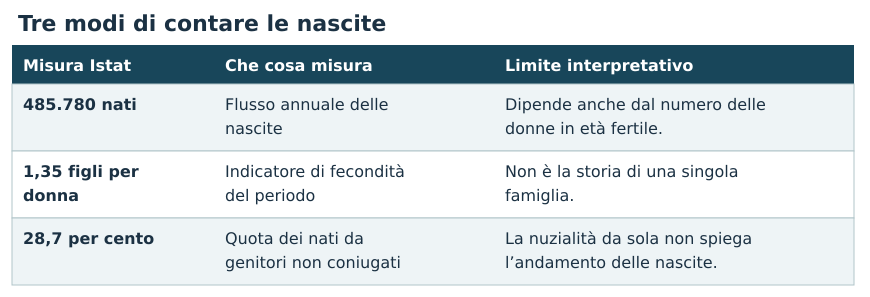

# BEL · B/L · Italien 2017 — Corrigé brut

*Corrigé rédigé par IA, non officiel. Signalez toute erreur.*

**Rédaction** · GPT-6.2 Astra Ultra · vitesse non renseignée

**Analyse et commentaire de textes ou documents en italien.** Épreuve écrite à option de six heures, coefficient 3. Le dossier demande d’analyser en italien les six documents sur la natalité, dont une campagne du ministère de la Santé et la réponse de Roberto Saviano.

## Di chi è il tempo delle nascite?

Nell’Arenaccia raccontata da Matilde Serao una coppia con molti figli può ritrovarsi a condividere perfino la cucina. Nell’Italia del Fertility Day è invece il rinvio della maternità a preoccupare il ministero della Salute. Accostando queste due scene, il dossier mette in discussione l’apparente evidenza della parola «problema». Chi stabilisce che i figli sono troppi o troppo pochi? All’inchiesta napoletana rispondono la storia delle politiche familiari ricostruita da Anna Treves, il racconto in prima persona di Eleonora Mazzoni e i dati dell’Istat. Nel 2016 lo scarto tra queste prospettive si trasforma in polemica pubblica: alla campagna ministeriale replica Roberto Saviano su Facebook. Per capire che cosa sia in gioco, occorre passare dal conteggio delle nascite alle condizioni materiali della scelta, poi dalla scelta alla rappresentazione pubblica del corpo femminile.

### Contare le nascite, vedere le famiglie

Nel 2015 l’Istat registra 485.780 nuovi nati, quasi diciassettemila in meno rispetto all’anno precedente. Il numero assoluto dipende anche dalle dimensioni delle generazioni che possono diventare genitori. Invece il passaggio da 1,46 figli per donna nel 2010 a 1,35 nel 2015 riguarda la fecondità del periodo. La distinzione aiuta a leggere la diminuzione dei primi figli, che spiega oltre il 73 per cento del calo della fecondità complessiva fra i due anni, senza attribuire a ciascuna donna una deliberata rinuncia. Nemmeno il matrimonio basta a definire la famiglia: mentre calano le nozze, quasi il 29 per cento dei nati del 2015 ha genitori non coniugati. L’istituto rende visibile una pluralità che difficilmente entra nel breve slogan di una campagna.

Serao conta a sua volta: accosta le ventisette lire d’affitto al bilancio mensile delle famiglie che possono accedere alle case dette «del popolo». Ma il suo conto serve a smascherare un equivoco sociale. Le case sono tutte affittate, quindi l’investimento riesce, eppure i poveri rimangono nei bassi. Perfino gli impiegati devono subaffittare o dividere l’alloggio. La ripetizione di «stringendosi» traduce una cifra in un gesto; il bucato alle finestre rende percepibile il sovraffollamento. Il giudizio morale che accompagna questa descrizione rivela anche i pregiudizi dell’osservatrice nei confronti dei gruppi popolari. Trasferire quel quadro al presente come se l’Italia avesse semplicemente invertito le proprie preferenze farebbe perdere ciò che accomuna le due epoche: un dato collettivo non dice quanto costi a una famiglia avere un figlio in condizioni dignitose.

### La libertà che un intervento pubblico può allargare o restringere

Treves individua nel governo Prodi del 1996 una discontinuità. Dopo il fascismo il proposito dichiarato di orientare le nascite aveva suscitato diffidenza. Livia Turco lo riporta nell’agenda di governo facendo leva sull’«autonomia femminile». La formula contiene un’ipotesi precisa: se si mettono al mondo meno figli di quanti se ne desiderino, la bassa natalità può rivelare una mancanza di libertà. Orari di lavoro, accesso alla casa e costo della cura diventano così oggetti della politica familiare. L’assegno universale evocato da Chiara Saraceno è una proposta, distinta nel testo dai provvedimenti già avviati. La storica conserva tuttavia l’immagine dell’ingresso del potere nei «talami coniugali». Il fine democratico non elimina la tensione fra interesse collettivo e intimità.

Il romanzo *Le difettose* rende sensibile ciò che sfugge anche alla più attenta storia delle istituzioni. Carla, docente quasi quarantenne, legge Seneca in sala d’attesa mentre un’infermiera scandisce cognomi e numeri. Alla disciplina che la protagonista crede di poter esercitare su se stessa si oppone un tempo da trascorrere senza la garanzia di alcun risultato. Le frasi brevi con cui ricorda di avere sempre lavorato e prodotto fanno sentire l’urto fra etica professionale e attesa. La dottoressa ragiona in percentuali, Carla rivendica il suo caso particolare. Si può comprendere l’utilità clinica di una probabilità e, insieme, il dolore di chi la riceve come un verdetto. Le compagne si osservano, si sostengono, talvolta ripetono su altre donne gli stessi giudizi che subiscono. Il titolo restituisce con crudezza la parola che uno sguardo esterno potrebbe applicare loro.

### Il tempo della clessidra e quello del dibattito

La figura della donna che porge una clessidra verso chi guarda traduce l’età fertile in sabbia che scorre. La mano ingrandita dalla prospettiva si protende fuori dal manifesto, quasi consegnasse a ogni spettatrice il proprio conto alla rovescia. La contrapposizione fra bellezza e fertilità privilegia la destinataria femminile. Nel medesimo documento il logo con il nodo e l’invito «Parliamo di salute» sembrano invece aprire una conversazione. Fra queste due immagini cambia il posto assegnato al pubblico: ora interlocutore, ora destinatario di un richiamo. La campagna dà una forma visibile al tempo biologico, ma lascia fuori campo l’orario di lavoro, il desiderio del partner e l’incertezza delle coppie già in cura che il romanzo fa entrare in scena.

Saviano sfrutta la rapidità e l’indirizzo diretto del post per rovesciare il dispositivo. La finta esclamazione festosa iniziale e l’anafora del «Lei» trasformano la ministra Lorenzin in interlocutrice pubblica. Il nodo rosso adottato dal ministero gli appare inattaccabile solo perché privo di un contenuto preciso. Le responsabilità che egli evoca sono invece concrete: la tutela delle lavoratrici, il costo della procreazione assistita, il finanziamento della ricerca e le disuguaglianze nell’accesso alle cure. L’infertilità maschile ricordata nel post incrina la scena tutta femminile del manifesto. Si può rilevare il carattere polemico delle sue accuse senza confonderle con le osservazioni dell’Istat. Quando ricorda il rischio di perdere il posto durante la gravidanza, il suo argomento dà un contenuto contemporaneo agli ostacoli già nominati da Turco.

Il dossier ricostruisce così il tragitto di un numero che, passando di voce in voce, diventa un giudizio morale. Il declino è documentabile. Il senso da attribuire a ogni nascita o a ogni mancata nascita resta legato a persone che incontrano condizioni diverse. Le opere di Serao e di Mazzoni rendono percepibile proprio questa distanza fra l’intenzione dichiarata di un’istituzione e l’esperienza di chi abita una casa, siede in una sala d’attesa o riceve un messaggio dal ministero.

[Sujet commun, p. 30–35](https://www.ens-lyon.fr/sites/default/files/2017-11/ecrits-communs-optionnels-ses-2017_1506587060551.pdf#page=30) · [Rapport du jury](https://www.ens.psl.eu/sites/default/files/17_BL_italien_opt_ecrit.pdf)
