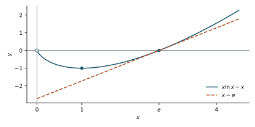
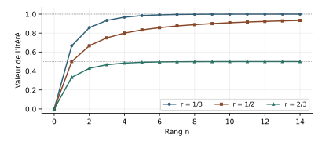

# Banque B/L · Composition de mathématiques 2017 · Corrigé guidé

*Corrigé rédigé par IA, non officiel. Signalez toute erreur.*

**Rédaction** · GPT-6.2 Astra Ultra · vitesse non renseignée

**Révision (tour 1)** · GPT-6.2 Astra Ultra · vitesse non renseignée

Écrit de quatre heures, sans calculatrice. La composition comporte un exercice et deux problèmes indépendants. Le jury note chaque réponse sur quatre avant pondération. Les coefficients des 50 rubriques totalisent 62,5, soit 250 points pour les réponses. Le jury annonce une note brute sur 258 et décrit séparément son appréciation de la rédaction et de l’honnêteté. [Sujet de la session](https://www.ens-lyon.fr/sites/default/files/2017-11/2017-ecrits-communs-ses_1506586985330_0.pdf#page=3) · [Rapport du jury](https://www.ens.psl.eu/sites/default/files/17_maths_com_ecrit.pdf).

Le fascicule commun aux ENS Ulm, Lyon, Paris-Saclay, à l’ENSAE et à l’ENSAI donne la couverture en page 3 et les six pages de questions en pages 4 à 9.

## Exercice · Répartition de balles dans des urnes

### Question E.1a

> [!INDICATION]
> Remplacer successivement le logarithme par zéro et par un.

#### Solution

Avec $f(x)=x\ln x-x$, on trouve $f(1)=-1$ et $f(e)=e-e=0$.

### Question E.1b

> [!INDICATION]
> En zéro, poser $x=e^{-t}$. À l’infini, factoriser par $x$.

#### Solution

Quand $x=e^{-t}\to0^+$, $f(x)=-(t+1)e^{-t}\to0$. Quand $x\to+\infty$, les deux facteurs de $x(\ln x-1)$ tendent vers $+\infty$, donc $f(x)\to+\infty$.

### Question E.1c

> [!INDICATION]
> Chercher les changements de signe de la dérivée.

#### Solution

Pour $x>0$, $f'(x)=\ln x$. La fonction décroît strictement sur $]0,1]$ de la limite $0$ au minimum $-1$, puis croît strictement sur $[1,+\infty[$ de $-1$ vers $+\infty$. La tangente au minimum est horizontale.

Le domaine exclut son extrémité gauche. La valeur inscrite en $0^+$ est la limite calculée en E.1b.
$$\begin{array}{c|ccccc}x&0^+&&1&&+\infty\\ \hline f'(x)&&-&0&+&\\f(x)&0&\searrow&-1&\nearrow&+\infty\end{array}$$

### Question E.1d

> [!INDICATION]
> Utiliser la pente et l’ordonnée du point d’abscisse $e$.

#### Solution

La pente vaut $f'(e)=1$ et le point de contact est $(e,0)$. La tangente $\Delta$ a donc pour équation $y=x-e$.

### Question E.1e

> [!INDICATION]
> Placer le minimum, le point de contact et la limite au bord.

#### Solution

Le point $(0,0)$ est exclu du domaine. Puisque $f''(x)=1/x>0$, la courbe se situe au-dessus de sa tangente des deux côtés du point $(e,0)$.

### Question E.2

> [!INDICATION]
> Intégrer d’abord sur un segment qui commence en un réel strictement positif.

#### Solution

Pour $0<\varepsilon<n$, $\int_\varepsilon^n\ln x\,dx=f(n)-f(\varepsilon)$. La limite de $f(\varepsilon)$ vaut zéro par E.1b. L’intégrale impropre converge donc et vaut $n\ln n-n=n\ln(n/e)$.

### Question E.3a

> [!INDICATION]
> Majorer la fonction par sa valeur à l’extrémité droite.

#### Solution

Sur $]i-1,i]$, $\ln x\le\ln i$. En intégrant sur cet intervalle de longueur un, on a $\int_{i-1}^i\ln x\,dx\le\ln i$. Pour $i=1$, l’intégration se fait en passant à la limite comme en E.2.

### Question E.3b

> [!INDICATION]
> Sommer sur les intervalles de longueur un.

#### Solution

La relation de Chasles et E.3a donnent $n\ln(n/e)=\int_0^n\ln x\,dx\le\sum_{i=1}^n\ln i=\ln(n!)$.

### Question E.4a

> [!INDICATION]
> Écrire le coefficient binomial avec un produit de $k$ facteurs au numérateur.

#### Solution

Comme chacun des facteurs $n,n-1,\ldots,n-k+1$ est au plus $n$, on obtient $\binom nk=n(n-1)\cdots(n-k+1)/k!\le n^k/k!$.

### Question E.4b

> [!INDICATION]
> Appliquer la borne sur la factorielle au rang $k$.

#### Solution

Par E.3b, $k!\ge(k/e)^k$. Ainsi $\binom nk\le n^k/k!\le(ne/k)^k$.

### Question E.5a

> [!INDICATION]
> Suivre uniquement les lancers qui atteignent l’urne 1.

#### Solution

Chaque balle atteint l’urne 1 avec probabilité $1/n$, indépendamment des autres. La somme de ces $n$ indicatrices suit la loi binomiale de paramètres $n,1/n$. Pour $0\le k\le n$, $\mathbb P(X_1=k)=\binom nk n^{-k}(1-1/n)^{n-k}$.

### Question E.5b

> [!INDICATION]
> Comparer la probabilité que deux urnes soient toutes les deux pleines au produit des probabilités marginales.

#### Solution

Si $n\ge2$, les événements $X_1=n$ et $X_2=n$ sont incompatibles alors que chacun a probabilité $n^{-n}>0$. L’indépendance mutuelle est donc impossible. Si $n=1$, la famille se réduit à la constante $X_1=1$ et satisfait la définition d’indépendance.

### Question E.5c

> [!INDICATION]
> Prendre le logarithme de la probabilité obtenue pour $k=0$.

#### Solution

Pour $n\ge2$, $\mathbb P(X_1=0)=(1-1/n)^n$. Son logarithme $n\ln(1-1/n)$ tend vers $-1$. La limite cherchée est $e^{-1}$.

### Question E.5d

> [!INDICATION]
> Additionner les espérances des indicatrices.

#### Solution

Chaque indicatrice a pour espérance $1/n$. En sommant sur les $n$ balles, on obtient $\mathbb E X_1=1$.

### Question E.5e

> [!INDICATION]
> Dans la somme de queue binomiale, utiliser un rapport de série géométrique indépendant de $k$.

#### Solution

Les urnes ont même loi. Pour $k\ge j\ge3$, E.4b donne $\mathbb P(X_i=k)\le\binom nk n^{-k}\le(e/k)^k\le(e/j)^k$. Comme $e/j<1$, la somme de $k=j$ à $n$ est inférieure ou égale à la somme géométrique jusqu’à l’infini, soit $(e/j)^j/(1-e/j)$.

### Question E.5f

> [!INDICATION]
> Employer la borne de l’union et prendre le logarithme du majorant.

#### Solution

Posons $j=\lceil c\ln n/\ln\ln n\rceil$, qui appartient à $[3,n]$ pour $n$ assez grand. L’événement demandé est l’union des $\{X_i\ge j\}$. Sa probabilité est donc au plus $n(e/j)^j/(1-e/j)$. Or $j\sim c\ln n/\ln\ln n$ et $\ln j\sim\ln\ln n$. Le logarithme du majorant est $\ln n+j-j\ln j-\ln(1-e/j)=(1-c+o(1))\ln n\to-\infty$. La probabilité tend vers zéro.

L’hypothèse $c>1$ intervient à la toute dernière étape. En effet, si $L=\ln n$ et $\ell=\ln L$, l’arrondi modifie $cL/\ell$ de moins d’une unité et $\ln j=\ell-\ln\ell+\ln c+o(1)$. Ainsi $j\ln j/L\to c$ tandis que $j/L\to0$. Comme $X_i$ est entier, dépasser ou atteindre le seuil réel au sens de l’énoncé équivaut exactement à $X_i\ge j$.

## Problème A · Itérations d’une fonction génératrice

### Question A.1

> [!INDICATION]
> Comparer chaque terme au poids de probabilité correspondant.

#### Solution

Pour $s\in[0,1]$, $0\le p_ks^k\le p_k$. La somme des $p_k$ pour $k\ge0$ vaut un. La série à partir de $k=1$ converge donc par comparaison.

### Question A.2

> [!INDICATION]
> Évaluer séparément le terme constant.

#### Solution

En zéro tous les termes de degré positif s’annulent, d’où $f(0)=p_0$. En un, $f(1)=\sum_{k\ge0}p_k=1$. On a aussi $0\le f(s)\le1$, ce qui assure que tous les itérés sont définis.

### Question A.3a

> [!INDICATION]
> Déterminer les masses restantes à partir de la somme totale.

#### Solution

Si $p_0=p_1=1/2$, les autres probabilités sont nulles. Donc $f(s)=(1+s)/2$ et $u_{n+1}=(1+u_n)/2$.

### Question A.3b

> [!INDICATION]
> Soustraire le point fixe aux deux membres.

#### Solution

Avec $z_n=u_n-1$, on obtient $z_{n+1}=(u_n-1)/2=z_n/2$. C’est une suite géométrique de raison $1/2$, de terme initial $u_0-1$.

### Question A.3c

> [!INDICATION]
> Revenir à la variable initiale après itération.

#### Solution

L’expression $z_n=2^{-n}(u_0-1)$ donne $u_n=1+(u_0-1)2^{-n}$ pour tout $n\ge0$.

### Question A.4

> [!INDICATION]
> Utiliser la limite de la puissance géométrique.

#### Solution

Puisque $2^{-n}\to0$, l’expression de A.3c donne $u_n\to1$, y compris si $u_0=1$.

### Question A.5a

> [!INDICATION]
> Appliquer la formule déterministe pour chaque valeur de la variable uniforme.

#### Solution

On a $V_n=1+2^{-n}(V-1)$ et $0\le V_n\le1$, donc l’espérance existe. Comme $\mathbb E V=1/2$, la linéarité donne $\mathbb E V_n=1-2^{-n-1}$.

### Question A.5b

> [!INDICATION]
> Examiner l’intégrale près du bord gauche de la loi uniforme.

#### Solution

La valeur en $V=0$ est sans effet car cet événement est négligeable. Pourtant $\int_\varepsilon^1 dv/v=-\ln\varepsilon\to+\infty$. La variable $1/V_0$ n’a donc pas d’espérance finie.

### Question A.5c

> [!INDICATION]
> Repérer la nouvelle borne inférieure du dénominateur.

#### Solution

Pour $n\ge1$, $V_n\ge1-2^{-n}>0$, donc $1/V_n$ est bornée. Avec la densité uniforme initiale, $\mathbb E(1/V_n)=2^n\int_0^1(2^n-1+v)^{-1}dv=2^n\ln(2^n/(2^n-1))$.

### Question A.6

> [!INDICATION]
> Identifier une série géométrique convergente jusque pour $s=1$.

#### Solution

Pour $0<r<1$ et $0\le s\le1$, $rs<1$. La série donne $f(s)=(1-r)\sum_{k\ge0}(rs)^k=(1-r)/(1-rs)$.

### Question A.7a

> [!INDICATION]
> Reconnaître un carré parfait.

#### Solution

On peut choisir $P(x)=1-2x$, car $(1-2x)^2=1-4x+4x^2$.

### Question A.7b

> [!INDICATION]
> Factoriser l’équation en utilisant le point fixe déjà connu.

#### Solution

Comme $1-rs>0$, l’équation $f(s)=s$ devient $rs^2-s+1-r=(s-1)(rs+r-1)=0$. Un est toujours solution. L’autre racine $a=(1-r)/r>0$ appartient à $[0,1]$ si et seulement si $r\ge1/2$. Pour $r=1/2$ elle coïncide avec un.

### Question A.8

> [!INDICATION]
> Étudier le signe de l’écart à la diagonale et utiliser la croissance pour ne pas franchir un point fixe.

#### Solution

La fonction $f$ est strictement croissante et continue, et $f(s)-s=r(s-1)(s-a)/(1-rs)$. Si $r\le1/2$, cet écart est positif pour $s<1$. Les itérés croissent, sont majorés par un et leur limite est un point fixe, donc $1$. Si $r>1/2$, on a $a<1$. Pour $u_0<a$, les itérés croissent sans dépasser $a$ car $f(a)=a$. Pour $a<u_0<1$, ils décroissent en restant au-dessus de $a$, et leur limite est au plus $u_0<1$. Dans les deux cas le seul point fixe possible est $a$. Enfin $u_0=a$ et $u_0=1$ donnent des suites constantes.

Au seuil $r=1/2$, la convergence est particulièrement lente. Si $u_0<1$, posons $d_n=1-u_n$. Comme $f(s)=1/(2-s)$, on obtient $d_{n+1}=d_n/(1+d_n)$. L’inversion donne $1/d_{n+1}=1+1/d_n$, donc $1-u_n=1/(n+1/(1-u_0))$. Pour $r>1/2$, le point fixe $1$ demeure accessible à la seule suite initialisée en $1$, car toute autre valeur initiale est attirée par $a$.

### Question A.9

> [!INDICATION]
> Comparer les termes de deux séries de même indice.

#### Solution

Si $0\le s\le t\le1$, on a $p_ks^k\le p_kt^k$ pour tout $k\ge1$. En sommant et en ajoutant $p_0$, on obtient $f(s)\le f(t)$.

### Question A.10

> [!INDICATION]
> Borner la queue indépendamment de $s$, y compris au point $1$.

#### Solution

Pour tout $K\ge1$, $\sup_{0\le s\le1}\sum_{k\ge K}p_ks^k\le\sum_{k\ge K}p_k\to0$. Les polynômes formés des sommes partielles convergent uniformément vers $f$ sur $[0,1]$. La limite uniforme de fonctions continues est continue sur tout le segment.

On peut détailler l’argument au point $s_0$, y compris aux extrémités. Étant donné $\varepsilon>0$, choisissons $K$ de sorte que $\sum_{k\ge K}p_k<\varepsilon/3$, indépendamment de $s$. Le polynôme $P_{K-1}(s)=\sum_{k<K}p_ks^k$ est continu en $s_0$. Pour $s$ assez proche de $s_0$, sa variation est inférieure à $\varepsilon/3$. Les deux queues, l’une en $s$, l’autre en $s_0$, ont chacune un module inférieur à $\varepsilon/3$. Il en résulte $|f(s)-f(s_0)|<\varepsilon$.

## Problème B · Matrices compagnes

### Question B.1a

> [!INDICATION]
> Développer le polynôme avant de remplir la dernière colonne.

#### Solution

On a $Q(X)=X^3-3X^2+4$. La sous-diagonale vaut un et la dernière colonne contient les opposés des coefficients par degrés croissants, d’où $C_Q=\begin{pmatrix}0&0&-4\\1&0&0\\0&1&3\end{pmatrix}$.

### Question B.1b

> [!INDICATION]
> Lire les coefficients dans la dernière colonne en changeant leur signe.

#### Solution

La dernière colonne de $C_R$ est $(3,-2)^t$, donc $R(X)=X^2+2X-3$.

### Question B.1c

> [!INDICATION]
> Comparer la factorisation de $R$ au déterminant de $tI-C_R$.

#### Solution

On a $R(X)=(X-1)(X+3)$ et $\det(tI-C_R)=t(t+2)-3$. Les racines $1,-3$ de $R$ sont exactement les deux valeurs propres de $C_R$.

### Question B.1d

> [!INDICATION]
> Compter les espaces propres distincts en dimension deux.

#### Solution

Les deux valeurs propres réelles distinctes fournissent deux vecteurs propres indépendants. Ainsi $C_R$ est diagonalisable sur $\mathbb R$.

### Question B.2a

> [!INDICATION]
> Examiner si la dernière colonne appartient à l’espace engendré par les précédentes.

#### Solution

Les $n-1$ premières colonnes sont $E_2,\ldots,E_n$ et engendrent l’hyperplan de première coordonnée nulle. Si $a_0=0$, la dernière colonne y appartient, donc le rang vaut $n-1$ et le noyau est de dimension un. Si $a_0\ne0$, elle complète une base et le rang vaut $n$, la dimension du noyau zéro. Le raisonnement vaut aussi en dimension un avec l’espace nul pour hyperplan.

### Question B.2b

> [!INDICATION]
> Relier la valeur propre zéro à l’existence d’un noyau non trivial.

#### Solution

Zéro est valeur propre si et seulement si $\ker C_P\ne\{0\}$. Par B.2a cela équivaut à $a_0=0$, soit $P(0)=0$.

### Question B.2c

> [!INDICATION]
> Regarder un mineur triangulaire de taille $n-1$.

#### Solution

Dans $C_P-\lambda I$, les lignes $2,\ldots,n$ et colonnes $1,\ldots,n-1$ forment une matrice triangulaire supérieure à diagonale un. Le rang est donc au moins $n-1$, d’où $\dim\ker(C_P-\lambda I)\le1$. Pour $n=1$, cette borne est automatique.

### Question B.3

> [!INDICATION]
> Tester la linéarité sur la droite des matrices scalaires, y compris pour les petits degrés.

#### Solution

Pour $A=tI_n$, on obtient $P(A)=P(t)I_n$. La linéarité imposerait $P(t)=tP(1)$ pour tout réel $t$, impossible pour un polynôme unitaire de degré $n\ge2$. Pour $n=1$, l’application est $A\mapsto A+a_0I_1$, linéaire exactement lorsque $a_0=0$.

### Question B.4a

> [!INDICATION]
> Multiplier la matrice de taille deux puis former le polynôme en elle.

#### Solution

On trouve $C_R^2=\begin{pmatrix}3&-6\\-2&7\end{pmatrix}$. En ajoutant $2C_R-3I_2=\begin{pmatrix}-3&6\\2&-7\end{pmatrix}$, il vient $M_R=0$.

### Question B.4b

> [!INDICATION]
> Lire les images des premiers vecteurs canoniques dans les colonnes.

#### Solution

Pour $j<n$, la colonne $j$ donne $C_PE_j=E_{j+1}$. Une récurrence partant de $E_1$ établit $E_k=C_P^{k-1}E_1$ pour $2\le k\le n$.

### Question B.4c

> [!INDICATION]
> Choisir le premier vecteur de la chaîne obtenue précédemment.

#### Solution

Avec $X=E_1$, la famille $(X,C_PX,\ldots,C_P^{n-1}X)$ coïncide avec $(E_1,\ldots,E_n)$, qui est une base.

### Question B.4d

> [!INDICATION]
> Interpréter la dernière colonne comme la relation qui ferme la chaîne.

#### Solution

On a $C_P^nE_1=C_PE_n=-\sum_{j=0}^{n-1}a_jE_{j+1}=-\sum_{j=0}^{n-1}a_j C_P^jE_1$. En transférant tous les termes à gauche, on obtient $M_PE_1=P(C_P)E_1=0$.

### Question B.4e

> [!INDICATION]
> Faire commuter le polynôme de la matrice avec ses puissances.

#### Solution

Pour $1\le k\le n$, $M_PE_k=M_PC_P^{k-1}E_1=C_P^{k-1}M_PE_1=0$. Toutes les colonnes de $M_P$ sont donc nulles.

La commutation utilisée ici résulte de l’écriture $M_P=\sum_{j=0}^n a_j C_P^j$, avec $a_n=1$. Chaque puissance commute avec $C_P$ et donc avec $C_P^{k-1}$. C’est ce qui permet de transporter l’annulation sur le premier vecteur à toute la base.

### Question B.5a

> [!INDICATION]
> Appliquer les puissances de la matrice à un vecteur propre.

#### Solution

De $C_PX=\lambda X$ on déduit par récurrence $C_P^jX=\lambda^jX$, y compris au rang zéro. Leur combinaison linéaire donne $M_PX=P(\lambda)X$.

### Question B.5b

> [!INDICATION]
> Associer la nullité de la matrice à la non-nullité du vecteur propre.

#### Solution

Par B.4e et B.5a, $0=P(\lambda)X$. Comme $X\ne0$, $P(\lambda)=0$.

### Question B.6a

> [!INDICATION]
> Résoudre les lignes du bas vers le haut en laissant libre la dernière coordonnée.

#### Solution

La ligne $i+1$ donne $x_i=\lambda x_{i+1}+a_ix_n$ pour $1\le i<n$. Au premier pas $x_{n-1}=(a_{n-1}+\lambda)x_n$. Chaque nouvelle substitution multiplie le polynôme précédent par $\lambda$ et ajoute $a_i$. Par récurrence, $x_{n-k}=(a_{n-k}+\lambda a_{n-k+1}+\cdots+\lambda^{k-1}a_{n-1}+\lambda^k)x_n$.

### Question B.6b

> [!INDICATION]
> Normaliser la dernière coordonnée puis utiliser la racine pour la première ligne.

#### Solution

Posons $x_n=1$ et, en descendant, $x_i=a_i+\lambda x_{i+1}$ pour $i=n-1,\ldots,1$. Les lignes $2$ à $n$ sont satisfaites. La première impose $\lambda x_1+a_0=0$, dont le membre gauche est $P(\lambda)$ par développement. Elle est donc satisfaite aussi. Le vecteur ainsi explicité en B.6a est non nul et associé à $\lambda$. En dimension un la même prescription donne simplement $X=(1)$.

### Question B.7a

> [!INDICATION]
> Comparer la somme des dimensions des espaces propres au degré du polynôme.

#### Solution

Supposons $d=\sum_i\alpha_i\ge1$ pour que la matrice compagne ait une taille positive. Les valeurs propres sont exactement les $\lambda_i$ pour lesquels $\alpha_i>0$ par B.5 et B.6. Chaque espace propre a dimension un par B.2c. La matrice est diagonalisable si et seulement si le nombre d’indices de multiplicité positive vaut $d$, autrement dit si et seulement si tous les $\alpha_i$ appartiennent à $\{0,1\}$. Si tous sont nuls, le polynôme $1$ sort du cadre $n\ge1$ de l’énoncé.

### Question B.7b

> [!INDICATION]
> Choisir un polynôme qui possède une racine multiple et aucune autre racine.

#### Solution

Pour $n\ge2$, la matrice compagne de $X^n$ a des uns sur la sous-diagonale et des zéros ailleurs. Sa seule valeur propre est zéro, son espace propre est de dimension un, donc elle n’est pas diagonalisable.
