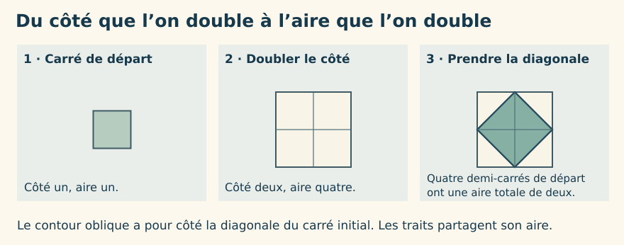

# BEL · BL — Philosophie 2017 · Corrigé brut

*Corrigé rédigé par IA, non officiel. Signalez toute erreur.*

**Lecture du rapport du jury** · GPT-6.2 Astra Ultra · vitesse non renseignée

**Rédaction** · GPT-6.2 Astra Ultra · vitesse non renseignée

**Autocontrôle** · GPT-6.2 Astra Ultra · vitesse non renseignée

**Révision (tour 1)** · GPT-6.2 Astra Ultra · vitesse non renseignée

« Qu’est-ce que penser ? » Dissertation commune de six heures.

## À quel moment ai-je commencé à penser ?

J’attends sur un quai. Des chiffres défilent sur un écran et, sans m’en rendre compte, j’en répète intérieurement le dernier. Puis une difficulté m’arrête. Le train que j’attends est affiché à la fois comme déjà parti et comme retardé. Je regarde les colonnes, je compare les heures, je distingue deux numéros de train. Ai-je commencé à penser au moment de la difficulté, ou bien en répéter un chiffre était-ce déjà penser ? Le verbe désigne aussi bien ce qui se présente à l’esprit que l’activité par laquelle on cherche à comprendre. Écarter le premier sens ferait oublier que les idées nous viennent. Se satisfaire du premier rendrait incompréhensible l’effort qu’il faut quelquefois pour en former une. Il s’agit de définir un acte assez largement pour y reconnaître le doute et l’imagination, assez précisément pour comprendre la différence entre subir une succession et en examiner les rapports.

## Une présence à soi qui peut faire place à l’absent

Descartes, dans la deuxième des *Méditations métaphysiques*, ne limite pas la chose pensante à la personne qui raisonne correctement. Douter, vouloir, imaginer, sentir appartiennent aux manières dont cette chose s’éprouve. Je peux douter que je me trouve réellement devant ce quai. Encore faut-il que ce doute ait lieu pour moi. Cette expérience donne une première détermination de la pensée. Une modification physique de l’écran n’est pas encore la même chose que l’apparition de cette modification à quelqu’un. Même une croyance erronée possède une réalité comme acte. Le rêveur qui croit entendre un train se trompe peut-être sur son objet, mais cette erreur suppose une présentation de quelque chose qui peut être absent.

Cette ouverture à l’absent se voit mieux lorsqu’on distingue perception et reprise. Une horloge sonne plusieurs coups. Au dernier, les premiers ne résonnent plus, pourtant je peux les compter ensemble. La conscience actuelle est déjà habitée par ce qu’elle retient et par ce qu’elle attend. Elle peut aussi évoquer sans le juger un air de musique, une silhouette ou une phrase. Si l’on réservait le nom de pensée au calcul délibéré, on rendrait incompréhensible le matériau sur lequel porte un calcul. Des rapprochements apparaissent avant que nous les ayons décidés. L’imagination n’est pas une lacune de la pensée. Elle lui présente des possibilités que la perception actuelle ne donne pas.

Mais identifier purement et simplement toute pensée à ce passage de représentations laisse une difficulté intacte. Une remarque en appelle une autre, comme un nom rappelle une chanson. Ce qui vient ensuite a pu être causé par ce qui précède. Ai-je pour autant une raison de l’affirmer ? La réponse attendue à ma question sur les trains exige un autre type de liaison.

## Faire une différence dont on puisse répondre

Dans le *Théétète*, Platon fait décrire la pensée comme une conversation de l’âme avec elle-même. L’idée est moins celle d’une petite voix intérieure que celle d’une possibilité de questionner ce que l’on vient d’avancer. Je suppose que le train est parti. Qu’est-ce qui me le fait dire ? Une heure affichée, mais cette heure peut être celle prévue et non celle constatée. La seconde hypothèse transforme la valeur de la première donnée. Je peux procéder ainsi avec des mots, un diagramme ou une série de gestes. Ce qui importe est qu’une possibilité devienne l’objet d’un examen au lieu d’entraîner aussitôt une conduite.

L’épreuve géométrique d’un carré rend cette opération visible. Je souhaite doubler l’aire d’un carré de côté un. Ma première idée est de doubler son côté. Il suffit de tracer les deux figures pour voir que j’ai construit quatre carrés de départ. Je trace maintenant la diagonale du petit carré et construis sur elle un carré nouveau. Quatre demi-carrés initiaux le remplissent, soit une aire égale à deux. L’important n’est pas ici le résultat numérique. J’ai appris à distinguer deux rapports que mon premier geste confondait, le rapport entre les longueurs et le rapport entre les aires. Une cause explique pourquoi j’ai commencé par copier et agrandir mon dessin. Une raison permet de comprendre pourquoi je corrige cette première opération. Le dialogue socratique du *Ménon* met précisément en scène cette distance entre l’assurance d’avoir une réponse et la découverte du problème.

Une pianiste improvise une fin que personne, elle comprise, n’avait anticipée. Pendant qu’elle cherche, elle ne formule aucune proposition sur les notes. Un accompagnateur substitue pourtant un dernier accord à celui qu’elle vient de jouer. Elle reprend la phrase et lui fait entendre pourquoi cet accord ferme trop tôt une tension qui devait durer. Le premier essai avait déjà un sens que sa reprise rend discutable. S’il fallait pouvoir dire sa raison avant de jouer, on manquerait ici le moment de l’invention. Si chaque suite de touches constituait par elle-même une pensée, rien ne distinguerait cette fin de celle que ferait entendre une main posée au hasard. Penser peut prendre cette forme intermédiaire : l’activité découvre, en s’exerçant, une différence à laquelle elle se reconnaît tenue.

Cette possibilité de répondre de ses liaisons ne suppose aucune infaillibilité. Je peux hasarder une hypothèse, négliger une objection et me tromper en toute bonne foi. Elle ne suppose pas davantage une inspection verbale de chacun de mes gestes. La géomètre entraînée voit d’un coup la relation que j’ai laborieusement reconstruite. Si une difficulté surgit, sa vision peut cependant être reprise, communiquée et corrigée. Une pensée naissante et une pensée formée n’occupent pas le même temps, mais l’une peut devenir l’autre.

## Une activité personnelle que d’autres peuvent reprendre

Que se passe-t-il lorsque je montre mon carré à une autre personne ? Ce que je lui transmets n’est pas le souvenir de mon illumination. Je lui propose une construction qu’elle peut refaire ou contester. Les symboles et les mots substituent à une suite privée d’apparitions des rapports accessibles à plusieurs points de vue. Le langage reçu des autres peut aussi m’enfermer dans des réponses toutes faites. Répéter « il faut doubler » avant d’avoir demandé quoi reproduit une formule et déplace le problème. Penser par soi-même demande donc de pouvoir prendre une distance avec l’expression collective tout en disposant des distinctions qu’elle rend possibles.

Notre définition ne peut être tirée d’un lieu extérieur à la pensée. Lorsque je compare le rêve, le doute et la démonstration, j’exerce l’activité que je voudrais définir. Ce cercle serait vicieux si ma conclusion se contentait de supposer ce qu’elle affirme. Il devient instructif si une opération que je peux décrire rend perceptible sa propre condition. Dans le cas du carré, un dessin résiste à l’attente, l’objection est formulée, un autre rapport est construit et autrui peut en contrôler la justesse. J’identifie ainsi la pensée en acte sans m’arroger un accès à toutes les pensées du monde.

Penser, au sens large, c’est pouvoir se rendre présent quelque chose, même quand cet objet manque ou quand sa réalité est douteuse. Au sens exigeant que fait apparaître l’enquête, c’est reprendre les rapports de cette présentation, en essayer d’autres et se laisser corriger par ce qu’on y découvre. Les deux sens se tiennent. Sans ce qui survient, la pensée n’aurait rien à interroger. Sans la possibilité de reprendre ce qui survient, nous ne comprendrions pas ce qui sépare le passage d’une idée de la transformation d’un jugement.

[Énoncé officiel, p. 1](https://www.ens-lyon.fr/sites/default/files/2017-11/2017-ecrits-communs-ses_1506586985330_0.pdf#page=1) · [Rapport du jury](https://www.ens.psl.eu/sites/default/files/17_BL_philosophie_com_ecrit.pdf)
