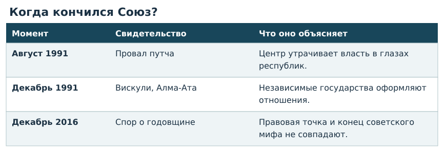

# BEL · B/L · Russe 2017 — Corrigé brut

*Corrigé rédigé par IA, non officiel. Signalez toute erreur.*

**Rédaction** · GPT-6.2 Astra Ultra · vitesse non renseignée

**Analyse et commentaire de textes ou documents en russe.** Épreuve écrite à option de six heures, coefficient 3. Le dossier demande une composition en russe sur le vingt-cinquième anniversaire de la disparition de l’URSS.

## 25 лет после распада СССР

В декабре 2016 года исполнилось двадцать пять лет Беловежским соглашениям, но у этой годовщины в России нет общепризнанного названия. Отмечать ли рождение Содружества Независимых Государств или оплакивать гибель Советского Союза? Чтобы понять остроту вопроса, стоит сопоставить три газетных жанра. Олег Артюков восстанавливает ход событий и предоставляет слово трём участникам нынешней политической жизни. В интервью, подписанном Михаилом Зубовым, вопрос о цвете календарного дня открывает спор о причинах распада. Семён Новопрудский, напротив, выносит в заглавие колонки вызывающее слово «Зомбиленд». Почему акт, призванный положить конец правовой неопределённости, до сих пор допускает столь разные толкования? Надо различить прекращение государственной власти, оформление её наследства и дальнейшую жизнь образа Союза.

### Когда решение стало возможным

В изложении Артюкова особенно важно отсутствие готового текста у руководителей России, Украины и Белоруссии по приезде в Вискули. Юридическое обоснование нашлось во время встречи. В 1922 году в основании СССР участвовали четыре республики. Закавказская Федерация с 1936 года уже не существовала. Таким образом, представители трёх остальных сочли себя вправе расторгнуть соглашение своих предшественников. Между этим рассуждением и утверждением, будто трое создали саму историческую возможность распада, лежит большая дистанция. В Алма-Ате к ним присоединились ещё восемь руководителей: решение превратилось в более широкое соглашение республик. Отставка Горбачёва и спуск флага 25 декабря придали перемене зримую форму, когда переговоры о преемстве уже состоялись.

К этой хронологии Новопрудский добавляет августовский путч. Парадокс в том, что защитники прежнего порядка, пытаясь отстранить Горбачёва, ускорили его крушение. Даже республики, ещё не торопившиеся выйти из Союза, убедились в бессилии центра. Личный пример автора, наблюдавшего происходящее из Узбекистана, меняет географию рассказа. Судьба государства решалась также оценками, которые давали Москве за пределами России. Право свободного выхода, предусмотренное статьёй 72 Конституции 1977 года, объясняет, на что могли ссылаться республики. Один только этот пункт не устанавливал способа ликвидации всего Союза. Именно разницу между записанной нормой и практически осуществимой процедурой обнаруживает вопрос журналиста в интервью.

### Кто несёт ответственность

Образ «скорой помощи» в интервью предлагает мысленный эксперимент. Больной умер, пока машина была в пути. Врач должен выдать справку, поскольку без неё невозможно даже вступить в наследство. Аналогия отделяет установление смерти от её причины, но всё же оставляет участникам встречи важную работу: именно форма документа определяет, как будут строиться отношения бывших республик. Если союзные правила выхода вырабатывались вслед за провозглашением суверенитета, требование буквально их исполнить предполагает наличие власти, которая уже не могла добиться исполнения. Автор ответа напоминает и о настроениях в самой России. Призывы Распутина и Солженицына к выходу из Союза осложняют позднейший рассказ, в котором российский народ оказывается исключительно жертвой чужой воли.

Для Жириновского, напротив, ратификация означает вину, причём вина возлагается на коммунистов, заседавших в российском парламенте. Точное число депутатов придаёт обвинению вид протокола, однако назвать голосовавших ещё не значит объяснить, почему распалась огромная страна. Новопрудский отказывается сделать виновником одного Горбачёва. Имперские обязательства превосходили хозяйственные возможности СССР, что особенно наглядно обнаружила война в Афганистане. Объясняя проигранную гонку вооружений, собеседник Зубова тоже говорит о разрушительной нагрузке на экономику. Приводимая им доля военных расходов служит доводом участника разговора и требует независимой проверки. Оба автора объясняют уязвимость системы, а путч и документы декабря помогают понять последовательность событий.

### Чья память определяет будущее

У Железняка опыт совместной жизни многонационального населения становится ресурсом добровольного сотрудничества. Его слова о «достижении консенсуса» рисуют СНГ как пример уважения к самостоятельности государств. Перечень организаций расширяет перспективу: от Евразийского экономического союза до Европейского союза и ООН. Однако собственно СНГ и более тесный экономический союз имеют разный состав и разные обязательства. Категоричность утверждения о мире также уязвима: российско-грузинская война 2008 года, выход Грузии из СНГ и конфликт вокруг Украины показывают пределы институционального согласия. Ссылка на официальный сайт «Единой России» позволяет понять, чью картину сотрудничества доносит Артюков.

У политолога Макаренко мерой оценки служат одновременно судьбы людей и сравнение возможных исходов. Государства получили самостоятельность, но для миллионов граждан прежние внутренние границы стали межгосударственными. Слова «меньшим из зол» сохраняют обе стороны опыта. Этой двойственностью объясняется и колебание собеседника Зубова: сегодня день кажется ему чёрным, через четверть века люди, возможно, оценят предотвращённую войну иначе. У Новопрудского будущее зависит от более болезненного пересмотра. Смешивая образы Киевской Руси, империи и СССР, современники воображают непрерывную державную историю. Но православная традиция и советский антиклерикализм плохо складываются в единое целое. «Зомбиленд» называет политическую жизнь давно исчезнувшего государства в представлениях живых.

Двадцать пять лет спустя стороны спорят, таким образом, и о предмете годовщины. Юридическое событие датируется, а утрата власти началась раньше и пересмотр памяти продолжается дольше. Если видеть в декабре лишь преступление трёх руководителей, то исчезает роль республик и общества. Если праздновать только мирное создание СНГ, то теряются личные утраты и последующие конфликты. Достоинство сопоставления трёх текстов в том, что оно возвращает всем этим уровням их собственное время и их собственных действующих лиц.

[Sujet commun, p. 36–39](https://www.ens-lyon.fr/sites/default/files/2017-11/ecrits-communs-optionnels-ses-2017_1506587060551.pdf#page=36) · [Rapport du jury](https://www.ens.psl.eu/sites/default/files/17_russe_opt_ecrit.pdf)
