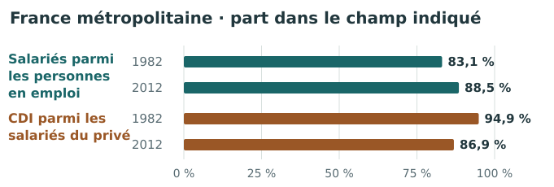
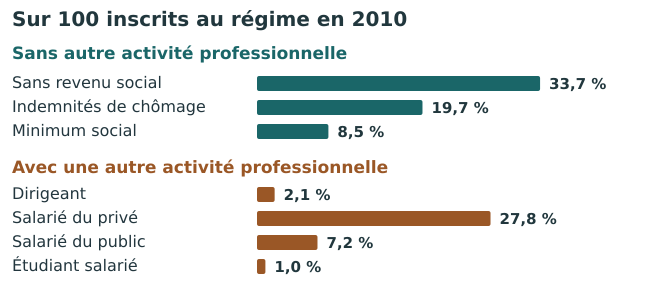

# BEL · B/L — Sciences sociales 2017 · Corrigé brut

*Corrigé rédigé par IA, non officiel. Signalez toute erreur.*

**Lecture du rapport du jury** · GPT-6.2 Astra Ultra · vitesse non renseignée

**Rédaction** · GPT-6.2 Astra Ultra · vitesse non renseignée

## Vers la fin du salariat ?

En France métropolitaine, entre 1982 et 2012, la proportion de salariés parmi les personnes en emploi augmente de 83,1 % à 88,5 %. Pourtant, un jeune qui trouve un poste dans le secteur privé en 2012 a de bonnes raisons de douter qu’il bénéficie un jour de la même stabilité que ses parents. On peut ainsi éprouver la fragilité d’une institution au moment même où elle rassemble une fraction croissante des travailleurs.

Le salariat désigne une relation dans laquelle une personne met son travail à la disposition d’un employeur en échange d’une rémunération et sous son autorité. En droit du travail, le pouvoir de donner des directives, de contrôler l’exécution et de sanctionner les manquements caractérise la subordination. L’indépendant vend une prestation ou un produit pour son propre compte et assume le risque de son activité. Un indépendant peut dépendre économiquement d’un client et un salarié expérimenté jouir d’une large autonomie dans son travail. Le statut et les conditions concrètes d’activité doivent donc être distingués. Avec la « société salariale » étudiée par Robert Castel, le salariat désigne aussi une organisation où l’emploi ouvre des droits et inscrit les individus dans des collectifs durables.

Le recul du CDI privé, les inégalités de salaire et l’apparition de travailleurs de plateforme indiquent-ils le remplacement de cette forme d’emploi, ou un partage plus inégal des sécurités qu’elle procure ? L’extension historique du salariat et les raisons économiques de sa persistance permettent d’abord de situer le changement. Les transformations se concentrent ensuite sur certaines trajectoires. Le déplacement des frontières de l’entreprise oblige enfin à repenser le lien entre activité, subordination et protection.

## I. La relation salariale demeure au centre de l’organisation du travail

**Pourquoi une entreprise embauche-t-elle ?** Si chaque tâche exigeait un contrat commercial séparé, il faudrait sans cesse chercher un prestataire, convenir d’un prix et vérifier ce qui a été livré. Pour Coase, la firme économise une partie de ces coûts de transaction en organisant plusieurs opérations sous une autorité commune (document 6). Un employeur peut réaffecter un salarié d’une tâche à l’autre dans le cadre du contrat. Cet avantage est particulièrement important quand on connaît mal à l’avance la nature des adaptations nécessaires. Il a une limite, car la coordination interne a elle aussi un coût. Il n’en résulte ni que toute production doive être intégrée, ni que le progrès technique conduise nécessairement à l’externaliser. Coase ajoute qu’une rémunération fixe ne définit pas à elle seule la firme. Un prestataire peut facturer un forfait et un salarié recevoir une part variable.

Cette organisation a pris une dimension collective. Le recul de l’agriculture familiale et le développement de grandes organisations industrielles, commerciales et administratives ont étendu l’emploi salarié. Les luttes et les politiques sociales ont progressivement associé à la relation d’emploi la couverture des accidents du travail, des assurances sociales et des droits à la retraite. La protection s’étend aussi hors des périodes effectivement travaillées. C’est en ce sens que Castel parle d’une forme de « propriété sociale » offerte à ceux qui ne vivent pas de leur patrimoine. La statistique de la salarisation comprend notamment les agents publics, même si le fonctionnaire relève d’un statut et perçoit un traitement. Prendre le seul CDI privé pour unité de mesure ferait disparaître une partie de l’institution.

La France du dossier reste une économie de salariés. À l’intérieur du secteur privé, le nombre de CDI passe même d’environ 12,87 à 15,43 millions entre 1982 et 2012, tandis que leur part descend de 94,9 % à 86,9 % (document 1). Les deux mouvements sont compatibles parce que le nombre total d’emplois salariés du privé augmente. La salarisation gagne 5,4 points dans l’ensemble de l’emploi alors que la part des CDI perd 8 points au sein des seuls salariés du privé. Ces indicateurs répondent à deux questions différentes.

## II. L’érosion de la stabilité se concentre sur certaines trajectoires

Un stock décrit les personnes en poste à une date donnée. Un flux dénombre les entrées pendant une période. Alors que le CDI domine le stock, sa part dans les embauches privées, de 44 % en 1982, tombe sous 10 % à la fin du graphique en 2011 (document 2). Les missions d’intérim et les CDD de moins de trois mois occupent désormais la majeure partie des embauches. Un poste durable ne donne lieu qu’à une entrée, alors que le même besoin de travail couvert par une succession de contrats brefs engendre de multiples entrées. On peut donc vivre une série de recrutements sans qu’augmente d’autant le nombre de postes. Cette rotation reporte une part des variations de la demande sur les travailleurs qui risquent l’interruption de leur revenu et de leur ancienneté.

La segmentation ne se limite pas à un modèle théorique de marché primaire stable et de marché secondaire précaire. Elle laisse des traces précises. En 2012, 43 % des salariés privés de 15 à 24 ans sont en CDD et 7,3 % en intérim. Les plus de 50 ans sont en CDI à 93,8 %. La part de CDI atteint 94,3 % chez les cadres et professions intellectuelles supérieures, contre 68,9 % chez les ouvriers non qualifiés. La part des CDD est plus élevée chez les femmes, celle de l’intérim chez les hommes. Ces comparaisons transversales ne préjugent pas de l’avenir de chaque jeune. Elles expliquent néanmoins pourquoi l’accès à un logement ou à un crédit peut devenir difficile pour certains malgré une insertion statistique dans le salariat. Le temps partiel subi peut encore affaiblir la sécurité d’un CDI. Les tableaux de contrats ne mesurent pas sa fréquence.

À l’autre extrémité de la distribution, la sécurité du statut peut aller de pair avec une différenciation croissante des gains. Entre 1998 et 2005, le montant moyen déclaré dans la catégorie fiscale « salaires et assimilés » progresse de 3,1 % pour les neuf premiers déciles réunis et de 51,4 % pour les 0,01 % les mieux rémunérés (document 3). Cette série mesure des évolutions de moyennes de groupes. Elle ne donne ni leurs parts de la masse salariale ni le parcours des mêmes personnes. Daniel Cohen explique comment le traitement de texte permet à un cadre de corriger et saisir lui-même son courrier. L’outil complète certaines qualifications et réduit la demande d’une tâche séparée de dactylographie (document 5). La réorganisation peut également intensifier le travail en réduisant les temps morts. Ce mécanisme aide à comprendre la coexistence de gains et de pertes au sein du salariat, sans établir à lui seul la cause de l’envolée des très hautes rémunérations.

## III. Aux frontières du salariat, le risque et l’autorité se redistribuent

Le régime de l’auto-entrepreneur, entré en vigueur en 2009, facilite le démarrage et le cumul d’une activité à son compte. Il s’ajoute aux formes anciennes d’indépendance des artisans, agriculteurs ou professions libérales. L’enquête de 2010 présentée par Sarah Abdelnour montre la diversité des usages. Parmi les inscrits, 37 % se déclarent auparavant salariés stables et 29 % au chômage (tableau 4a). Au moment observé, 27,8 % cumulent avec un salariat du privé et 7,2 % avec un salariat public (tableau 4b). Pour certains, un salaire régulier permet de tester une clientèle. Pour d’autres, créer sa propre activité constitue une issue à l’absence d’emploi. Sans autre activité professionnelle, 19,7 % de l’ensemble des inscrits perçoivent des indemnités de chômage et 8,5 % un minimum social. L’assurance liée à la trajectoire d’emploi et l’assistance sous condition de ressources soutiennent alors différemment le passage à l’indépendance. Les deux tableaux ne permettent pas de suivre individuellement les anciens chômeurs et les anciens salariés.

Une plateforme peut à son tour réduire le coût de la rencontre entre un chauffeur et un passager. Une firme peut ainsi faire réaliser une prestation hors de son effectif, pendant que le chauffeur finance son véhicule et assume une part du coût de l’attente. Le cas d’Uber concerne ici les **États-Unis**. Parmi les chauffeurs observés, 19,1 % des chauffeurs Uber ont de 18 à 29 ans, contre 8,5 % des chauffeurs de taxi, et la part des femmes atteint respectivement 13,8 % et 8 % (tableau 7a). Les diplômes de niveau *undergraduate* ou de troisième cycle sont plus fréquents chez les premiers. Sur la durée d’activité, 51 % des chauffeurs Uber déclarent moins de quinze heures hebdomadaires, contre 4 % des taxis (tableau 7b). Une activité d’appoint est plausible pour une partie des premiers. On ne connaît pourtant ni les autres revenus de chacun, ni son souhait de travailler davantage, ni ses frais. Les deux enquêtes comparées ont en outre des modes de collecte distincts.

Ces situations posent une question de régulation. Lorsque le client commande un résultat mais que le prestataire choisit véritablement ses clients, ses prix et l’organisation de son travail, l’indépendance a un contenu économique. Si un intermédiaire détermine au contraire l’exécution, en contrôle les conditions et peut en sanctionner les écarts, le lien de subordination doit être examiné à partir des pratiques. Des horaires brefs ou un faible revenu ne permettent pas de conclure seuls à une requalification. Entre ces cas, un donneur d’ordre peut déplacer des coûts vers des sous-traitants qui emploient eux-mêmes des salariés. Ce qui sort du périmètre d’une firme peut ainsi demeurer dans le salariat à l’échelle de l’économie.

## Conclusion

Les données ne dessinent pas une marche uniforme vers la disparition du salariat. La firme conserve des raisons d’organiser durablement le travail et le salarié reste la figure majoritaire de l’emploi en France. L’évolution décisive concerne les chances de disposer d’une carrière continue, d’un revenu prévisible et de protections collectives. Ces chances se différencient à l’intérieur du salariat, tandis que l’indépendance peut tantôt s’appuyer sur sa sécurité, tantôt laisser le travailleur seul face au risque. Pour juger d’une éventuelle « fin », il faut donc suivre trois évolutions distinctes dans le temps. Elles concernent la part des statuts, la répartition concrète du pouvoir sur le travail et les droits qui survivent aux changements d’emploi.

## Sources

[Feuillet individuel, ENS-PSL](https://www.ens.psl.eu/IMG/file/concours/2017/BL/2017_BL_sujet_sciences%20sociales.pdf) · [Fascicule de Lyon, p. 10 à 20](https://www.ens-lyon.fr/sites/default/files/2017-11/2017-ecrits-communs-ses_1506586985330_0.pdf#page=10) · [Rapport du jury de sciences sociales](https://www.ens.psl.eu/sites/default/files/17_sciences_sociales_com_ecrit.pdf)
