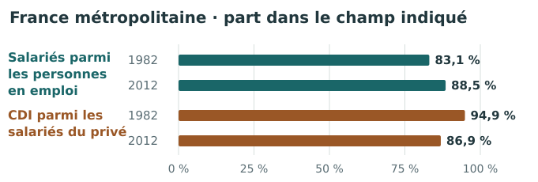
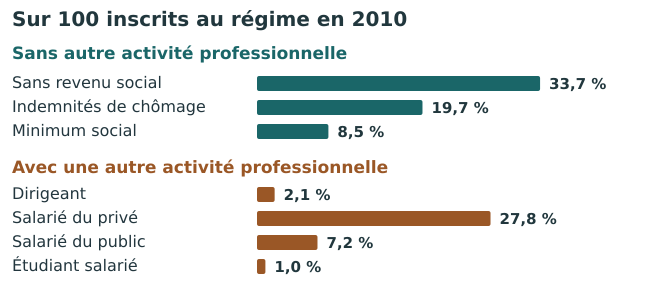

# BEL · B/L — Sciences sociales 2017 · Corrigé guidé

*Corrigé rédigé par IA, non officiel. Signalez toute erreur.*

**Lecture du rapport du jury** · GPT-6.2 Astra Ultra · vitesse non renseignée

**Rédaction** · GPT-6.2 Astra Ultra · vitesse non renseignée

## Définir ce qui pourrait prendre fin

L’écrit commun de six heures pose une seule question, « Vers la fin du salariat ? ». Prenez le cas d’une caissière qui enchaîne deux CDD puis passe en CDI. Pendant ces trois contrats, elle travaille toujours sous l’autorité d’un employeur contre rémunération. Ce qui change est sa prévisibilité d’emploi. Prenez ensuite un graphiste à son compte qui n’a qu’un donneur d’ordre. Il dépend fortement de son client pour son revenu, mais établir une subordination juridique demanderait d’examiner les directives, les contrôles et les sanctions effectivement exercés. Le mode de rémunération, le statut, la sécurité et la dépendance sont quatre dimensions à relier.

Le mot « vers » exige d’examiner une tendance à la date du concours. Commencez par écrire deux hypothèses qui pourraient être départagées par les faits. Dans la première, les indépendants remplacent les salariés. Dans la seconde, le salariat demeure majoritaire tandis que l’emploi durable, les garanties et la maîtrise des trajectoires se répartissent de plus en plus inégalement. La dissertation doit expliquer ce qui permettrait de confondre les deux évolutions.

## Lire le dossier avant de choisir ses comparaisons

| Pièce | Lecture contrôlée | Ce qu’elle permet d’argumenter |
|---|---|---|
| 1 · Enquêtes Emploi, 1982 et 2012 | Salariés dans l’emploi, 83,1 % puis 88,5 %. CDI parmi les salariés privés, 94,9 % puis 86,9 %. En 2012, 43 % des 15–24 ans salariés du privé sont en CDD. | Un statut peut gagner du terrain tout en offrant des garanties très différentes. |
| 2 · Embauches privées, 1982–2011 | La part des CDI dans les entrées est de 44 % au départ et inférieure à 10 % à la fin. Les aires empilées donnent des parts de flux. | La brièveté répétée des contrats explique pourquoi le flux diffère du stock. |
| 3 · Données fiscales, 1998–2005 | Le salaire et assimilé moyen des P0–90 augmente de 3,1 %, celui des P99,99–100 de 51,4 %. Ce dernier groupe représente une personne sur dix mille. | Une différenciation peut toucher jusqu’aux salariés les mieux rémunérés. |
| 4a et 4b · Auto-entrepreneurs, 2010 | 37 % avaient un emploi salarié stable avant l’inscription. 27,8 % déclarent cumuler avec un emploi privé et 7,2 % avec un emploi public. | L’activité à son compte peut compléter un salaire. Les deux tableaux ne constituent pas un tableau de transitions individuelles. |
| 5 · Cohen, 2006 | Le traitement de texte transfère au cadre des tâches auparavant confiées à une dactylo. La réorganisation peut aussi augmenter le temps effectivement travaillé par heure de présence. | La technique modifie les tâches et les pouvoirs de négociation sans déterminer à elle seule le nombre de salariés. |
| 6 · Coase, 1937 | Chercher des partenaires et négocier chaque transaction coûte des ressources. La coordination par l’autorité évite une partie de ces coûts. | Le recours relatif au marché et à la firme dépend des coûts respectifs des deux arrangements. |
| 7a et 7b · Chauffeurs aux États-Unis | Les femmes représentent 13,8 % des chauffeurs Uber observés, contre 8 % des taxis. Sous 15 heures hebdomadaires, les parts sont de 51 % et 4 %. | Les profils et les usages de l’activité diffèrent. Le niveau de revenu et le statut des taxis restent à établir. |

Pour vérifier la lecture du document 1, calculez deux différences. La salarisation progresse de 5,4 points, la part des CDI dans le privé diminue de 8 points. Les deux dénominateurs sont différents. En revanche, 12,867 puis 15,427 millions de CDI sont bien deux effectifs du même champ. Leur hausse d’environ 2,56 millions empêche d’interpréter la diminution de la part comme une diminution absolue. Le document 1 indique également que le taux de chômage au sens du BIT passe de 6,5 % à 9,4 %. Son dénominateur comprend les chômeurs, alors que le taux de salarisation rapporte les salariés aux personnes en emploi.

## Construire une dissertation possible

### Introduction

En France, l’emploi salarié est plus fréquent en 2012 qu’en 1982, et pourtant la multiplication des missions brèves rend plausible l’annonce de sa « fin ». Le paradoxe disparaît-il si l’on précise ce qu’un salarié peut attendre de son statut ? Juridiquement, il met sa force de travail à disposition d’un employeur contre rémunération et sous sa subordination. Historiquement, l’emploi lui a également assuré un accès à des garanties collectives qui s’étendent à la maladie, au chômage ou à la vieillesse. Examiner la fin du salariat exige de suivre à la fois les façons de produire et les protections acquises au cours du travail. Nous montrerons pourquoi le statut salarié s’est consolidé, avant d’examiner la diversité des situations qu’il recouvre, puis la difficulté de localiser les risques et le pouvoir aux frontières de l’indépendance.

### I. Expliquer la permanence de la relation salariale

Un atelier pourrait acheter séparément chaque opération et payer chaque nouvelle commande aux conditions du marché. Lorsqu’il importe de réorganiser vite les tâches, le temps de recherche, la négociation et le contrôle de chaque transaction deviennent coûteux. La relation d’emploi autorise des ajustements au sein de l’organisation. C’est l’apport de Coase. La firme peut aussi se révéler coûteuse à administrer. L’arbitrage dépend donc des activités, et le caractère fixe ou variable de la rémunération ne suffit pas à dresser la frontière.

À ce premier mécanisme s’ajoute une construction historique. Robert Castel a montré comment des droits sociaux ont attaché l’individu à des collectifs au-delà du versement du salaire de la semaine. Les assurances sociales et les conventions collectives, l’ancienneté et la retraite donnent au statut une portée supérieure au versement courant. La salarisation de l’économie doit en outre beaucoup à des emplois de services et à l’emploi public. On comprend alors que la proportion des salariés ait progressé de 83,1 % à 88,5 % en trente ans. Une forte présence statistique n’assure cependant à chacun ni emploi durable ni revenu suffisant.

### II. Montrer comment une institution majoritaire se fragmente

Imaginez dix postes, dont neuf sont occupés toute l’année et un fait l’objet de douze contrats mensuels. Si les neuf postes durables étaient déjà occupés au début de l’année, les douze embauches observées seraient brèves, mais neuf postes sur dix resteraient stables. Cet exemple construit éclaire les documents 1 et 2. Les CDI restent majoritaires parmi les salariés privés. La rotation des CDD et des missions d’intérim courts les rend, en revanche, très visibles au moment de l’entrée en emploi. Le risque de discontinuité se concentre différemment selon l’âge et la qualification. En 2012, moins d’un salarié privé de 15 à 24 ans sur deux est en CDI (49,7 %), contre 93,8 % des plus de 50 ans. Un CDI à temps partiel peut aussi laisser une personne en quête d’un complément d’heures.

L’évolution des rémunérations différencie le salariat jusque dans ses fractions supérieures. En base 100 en 1998, le montant moyen des « salaires et assimilés » aboutit à 103,1 en 2005 pour les neuf premiers déciles réunis et à 151,4 pour le centième du centile le plus élevé. Il s’agit de croissances cumulées. Le champ fiscal inclut notamment certaines indemnités et rémunérations de non-salariés. Daniel Cohen décrit une évolution susceptible d’accroître ces écarts. Un cadre désormais équipé reprend une tâche de saisie qui occupait un poste distinct. Les outils rendent certaines compétences plus productives et en substituent d’autres. Une économie de poste peut aussi venir d’une intensification du travail des personnes qui restent. Le dossier établit une dispersion des évolutions salariales, mais ne mesure pas la part qu’y prend ce mécanisme technique.

### III. Examiner qui organise le travail et qui supporte ses risques

Le régime de l’auto-entrepreneur constitue parfois une transition ou un complément. Parmi les inscrits en 2010, 29 % étaient auparavant au chômage. D’autres avaient un emploi stable et certains conservent un salaire. Dans le tableau 4b, 33,7 % n’ont ni autre activité professionnelle ni revenu social, 19,7 % n’ont pas d’autre activité et perçoivent des indemnités de chômage, 8,5 % n’ont pas d’autre activité et perçoivent un minimum social. Ces pourcentages portent sur **l’ensemble des inscrits**. Passer à l’indépendance peut faire porter les aléas des commandes sur l’individu, tandis qu’une indemnité d’assurance ou une ressource d’assistance amortit des risques différents. On ne peut déduire de l’inscription qu’un poste salarié a disparu.

Aux États-Unis, l’application étudiée par Hall et Krueger permet à un passager de trouver rapidement un chauffeur. Ce gain de coordination peut favoriser le recours à des travailleurs juridiquement indépendants. Une partie d’entre eux y consacre peu d’heures, et les conducteurs Uber interrogés sont plus jeunes et plus fréquemment diplômés que les chauffeurs de taxi auxquels les auteurs les comparent. Le rapprochement des deux tableaux suggère une diversité d’usages. Il ne démontre pas quels conducteurs cumulent avec un salaire, ni quel statut ils souhaiteraient. Pour apprécier leur indépendance économique, il faudrait examiner la possibilité de fixer les prix, de diversifier la clientèle et de refuser des courses. Pour établir une éventuelle subordination, il faudrait en outre savoir qui donne des directives, qui contrôle et qui sanctionne. Plus largement, une entreprise peut transférer une activité à un prestataire qui emploie lui-même des salariés. Le déplacement de sa frontière modifie le partage des responsabilités sans abolir la relation salariale.

### Conclusion

La progression du salariat dans l’emploi français et la diffusion de situations de travail instables sont deux faits compatibles. Les entreprises continuent d’avoir besoin de coopération durable, tandis que les modalités de recrutement et l’accès aux protections créent des écarts entre travailleurs. Aux frontières de l’entreprise, le cumul et la sous-traitance brouillent l’assimilation de l’indépendance juridique à la maîtrise de son activité. Ce qui est mis à l’épreuve en 2017 est la capacité du salariat à garantir à tous une continuité de droits et de revenus comparables.

## Sources

[Feuillet individuel, ENS-PSL](https://www.ens.psl.eu/IMG/file/concours/2017/BL/2017_BL_sujet_sciences%20sociales.pdf) · [Fascicule de Lyon, p. 10 à 20](https://www.ens-lyon.fr/sites/default/files/2017-11/2017-ecrits-communs-ses_1506586985330_0.pdf#page=10) · [Rapport du jury de sciences sociales](https://www.ens.psl.eu/sites/default/files/17_sciences_sociales_com_ecrit.pdf)
