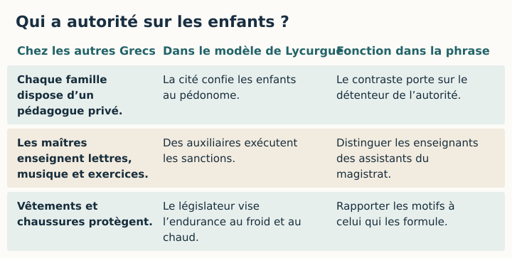

# BEL B/L — Version grecque 2017 · Corrigé brut

*Corrigé rédigé par IA, non officiel. Signalez toute erreur.*

**Rédaction** · GPT-6.2 Astra Ultra · vitesse non renseignée

**Révision (tour 1)** · GPT-6.2 Astra Ultra · vitesse non renseignée

[Sujet officiel](https://www.ens-lyon.fr/sites/default/files/2017-11/ecrits-communs-optionnels-ses-2017_1506587060551.pdf#page=5) · [Édition de repérage](https://raw.githubusercontent.com/PerseusDL/canonical-greekLit/master/data/tlg0032/tlg010/tlg0032.tlg010.perseus-grc2.xml)

Le feuillet « L’éducation spartiate » donne Xénophon, *La République des Lacédémoniens*, II, 1–4. Le grec commence dans le § 1 à *Τῶν μὲν τοίνυν ἄλλων Ἑλλήνων* et s’achève au dernier mot du § 4, *παρεσκευάσθαι*. La garde commune aux deux langues prévoit quatre heures pour la version choisie à l’inscription.

## Proposition de version

Parmi les autres Grecs, ceux donc qui prétendent élever leurs fils le mieux possible font ainsi. Dès que leurs enfants comprennent ce qu’on leur dit, ils placent aussitôt auprès d’eux des serviteurs chargés de les accompagner et les envoient aussitôt chez des maîtres pour apprendre les lettres, la musique et les exercices de la palestre. En outre, ils amollissent les pieds de leurs enfants en les chaussant. À force de leur faire changer de vêtements, ils gâtent leur corps. Quant à la nourriture, ils prennent pour mesure l’appétit de l’enfant.

Lycurgue, lui, au lieu de laisser chaque père préposer en particulier à ses enfants des esclaves comme pédagogues, mit à leur tête un homme pris parmi ceux à qui sont confiées les plus hautes charges. C’est lui qu’on appelle le pédonome. Il lui donna pouvoir de réunir les enfants, de les surveiller et, si l’un d’eux se montrait négligent, de le châtier sévèrement. Il lui adjoignit aussi des jeunes gens parvenus à l’âge d’homme, munis de fouets pour infliger les punitions chaque fois qu’il le faudrait. Aussi le respect et l’obéissance règnent-ils ensemble à Sparte, l’un et l’autre à un haut degré.

Au lieu de faire amollir leurs pieds par des chaussures, il prescrivit aux enfants de les endurcir en allant pieds nus. Il pensait que, s’ils s’y exerçaient, ils graviraient bien plus aisément les pentes raides, descendraient les pentes plus sûrement et seraient plus rapides pour sauter, s’élancer d’un bond et courir.

De même, au lieu de les laisser s’amollir sous leurs vêtements, il fit de l’usage d’un seul manteau pendant toute l’année une habitude pour eux. Il pensait qu’ils seraient ainsi mieux préparés à affronter le froid comme la chaleur.

