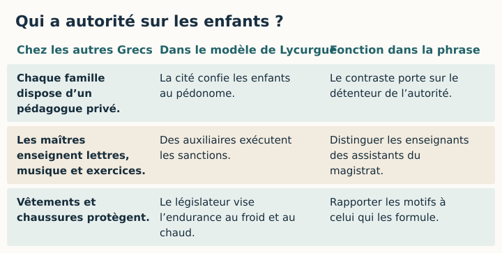

# BEL B/L — Version grecque 2017 · Corrigé guidé

*Corrigé rédigé par IA, non officiel. Signalez toute erreur.*

**Rédaction** · GPT-6.2 Astra Ultra · vitesse non renseignée

[Sujet officiel](https://www.ens-lyon.fr/sites/default/files/2017-11/ecrits-communs-optionnels-ses-2017_1506587060551.pdf#page=5)

Xénophon, *La République des Lacédémoniens*, passage du chapitre II sur l'éducation. Le sujet est intitulé « L'éducation spartiate ».

## Lire et construire le passage

**Retrouver le sujet.** Le génitif initial *τῶν ἄλλων Ἑλλήνων* a une valeur partitive. Les sujets des premiers verbes sont « ceux qui prétendent élever leurs fils le mieux ». Avec *ὁ δὲ Λυκοῦργος*, Xénophon passe au législateur singulier. Le premier tableau présente ce que font encore les autres Grecs, le second les mesures qu'il attribue à Lycurgue.

**Deux autorités bien distinctes.** Le *παιδαγωγός* privé est un serviteur qui accompagne l'enfant, à distinguer de ses maîtres d'école. À Sparte, le *παιδονόμος* est le magistrat chargé des enfants de la cité. Le relatif *ἐξ ὧνπερ* renvoie à la catégorie des hommes choisis pour les plus grandes charges. Les jeunes gens munis du fouet sont les auxiliaires du pédonome. *Ὅπως* marque le but de cette attribution. *Αἰδώς* exprime le respect mêlé de retenue et *πειθώ* l'obéissance dans ce contexte.

**Suivre la pensée attribuée au législateur.** Les participes *νομίζων* encadrent les attentes de Lycurgue. Dans la première série, *εἰ … ἀσκήσειαν* pose l'hypothèse de l'entraînement. Les comparatifs opposent la montée, plus aisée, à la descente, plus sûre. Le dernier infinitif parfait, *παρεσκευάσθαι*, désigne l'état de préparation qui en résulterait. Ces mobiles appartiennent à la présentation de Xénophon.

## Proposition de version

Parmi les autres Grecs, ceux donc qui se targuent de donner la meilleure éducation à leurs fils, dès que les enfants comprennent ce qu’on leur dit, placent aussitôt auprès d’eux des serviteurs comme pédagogues et les envoient sans attendre chez des maîtres pour apprendre les lettres, la musique et les exercices de la palestre. En outre, ils amollissent les pieds des enfants en les chaussant, ils gâtent leurs corps en changeant leurs vêtements et, pour la nourriture, c’est le ventre des enfants qui leur sert de mesure.

Lycurgue, lui, au lieu de laisser chacun donner en particulier à ses fils des esclaves pour pédagogues, préposa à la direction des enfants un homme pris parmi ceux auxquels sont confiées les plus hautes charges, et qui porte le nom de pédonome. Il lui donna le pouvoir de rassembler les enfants et, en les surveillant, de châtier sévèrement celui qui se montrerait négligent. Il mit aussi à sa disposition, parmi les jeunes gens parvenus à l’âge d’homme, des porteurs de fouet pour punir chaque fois qu’il le faudrait. Aussi trouve-t-on là tout à la fois beaucoup de respect et beaucoup d’obéissance.

Au lieu de leur amollir les pieds en les chaussant, il prescrivit de les endurcir en allant pieds nus. Il estimait que, s’ils s’y exerçaient, ils graviraient bien plus aisément les pentes raides, descendraient plus sûrement les escarpements, et gagneraient en rapidité pour sauter, bondir et courir. Et, au lieu de laisser leurs corps s’amollir sous les vêtements, il voulait les habituer à ne porter qu’un seul manteau toute l’année, dans la pensée qu’ils seraient ainsi mieux préparés à supporter aussi bien le froid que la chaleur.
