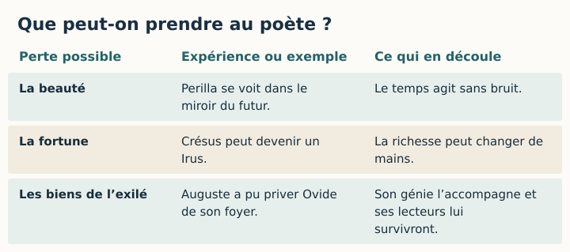

# BEL B/L — Version latine 2017 · Corrigé brut

*Corrigé rédigé par IA, non officiel. Signalez toute erreur.*

**Rédaction** · GPT-6.2 Astra Ultra · vitesse non renseignée

[Sujet officiel](https://www.ens-lyon.fr/sites/default/files/2017-11/ecrits-communs-optionnels-ses-2017_1506587060551.pdf#page=4) · [Rapport du jury](https://www.ens.psl.eu/sites/default/files/17_latin_opt_ecrit.pdf)

Ovide, *Tristes*, III, 7, v. 29–50. Le sujet numérote un passage de vingt-deux vers dans lequel le poète exilé s'adresse à Perilla.

## Proposition de version

Laisse donc, toi si savante, les prétextes à l’inaction et reviens aux nobles arts, aux travaux qui te sont sacrés. Ce gracieux visage qui est le tien, les longues années l’abîmeront, et une ride de vieillesse marquera ton front, le temps venu. La vieillesse qui fait tant de ravages portera la main sur ta beauté, elle qui s’approche d’un pas sans bruit. Et quand quelqu’un dira de toi « Elle a été belle », tu en souffriras et tu te plaindras que ton miroir te mente.

Tes biens sont modestes, alors que tu mériterais tant d’en avoir de grands. Mais suppose-les égaux aux plus immenses fortunes. La Fortune, on le sait, donne et ravit tout ce qui lui plaît, et tel qui tout à l’heure était un Crésus se trouve soudain un Irus. Sans entrer dans le détail, rien de ce que nous possédons n’échappe à la mort, hormis les biens du cœur et du talent.

Vois-moi. Bien que je sois privé de ma patrie, de vous et de mon foyer, bien que l’on m’ait ravi tout ce que l’on a pu m’enlever, mon génie, lui, m’accompagne encore et j’en ai la jouissance. Sur lui César n’a pu exercer aucun droit. Que le premier venu mette fin à ma vie d’une épée cruelle, ma renommée pourtant me survivra quand je serai mort. Et tant que, du haut de ses collines, la Rome de Mars, victorieuse, contemplera le monde entier soumis, on me lira.

