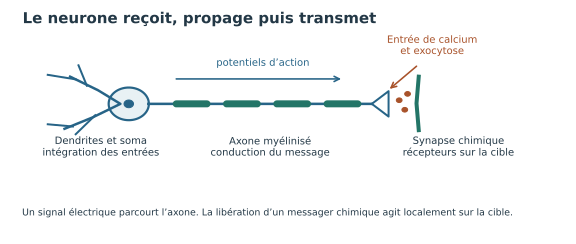
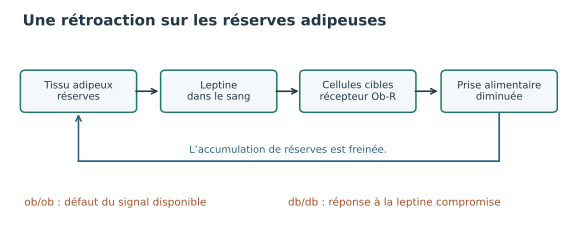
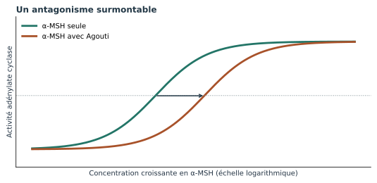
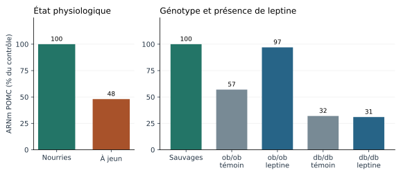
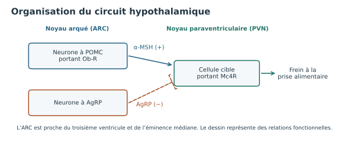
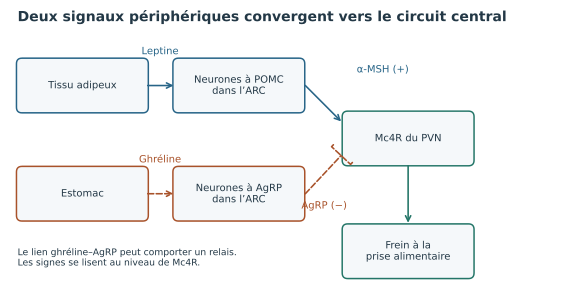

# ENS de Lyon — Second concours, Biologie-biochimie 2017 · Corrigé guidé

*Corrigé rédigé par IA, non officiel.*

**Rédaction (tour 1)** · GPT-6.2 Astra Ultra · vitesse non renseignée

Les 25 questions sur la communication nerveuse et hormonale, le circuit hypothalamique et les signaux périphériques sont traitées intégralement. La question 16 couvre les deux graphiques et l’interprétation physiologique. Son mécanisme expérimental d’ablation est hors couverture. Les valeurs lues sur les figures sont approximatives.

## I. Communication nerveuse et hormonale

### Question 1 — Du potentiel d’action à la communication chimique

> [!INDICATION]
> Suivre un signal depuis les dendrites jusqu’au récepteur de la cellule cible. Comparer aussi ce qui est commun aux deux communications.

#### Solution

**Le neurone recueille et intègre des signaux.** Ses dendrites et son corps cellulaire reçoivent de nombreuses entrées. Les courants synaptiques produisent des variations locales et graduées du potentiel membranaire. Selon le récepteur et les ions concernés, ces variations favorisent ou freinent le déclenchement d’un potentiel d’action. Leur sommation dans le temps et dans l’espace détermine si le segment initial de l’axone atteint le seuil.

**L’axone conduit un message électrique.** Les gradients de sodium et de potassium, entretenus notamment par la pompe sodium-potassium, et la perméabilité sélective de la membrane expliquent le potentiel de repos. Au seuil, l’ouverture transitoire de canaux sodiques dépendant du voltage favorise l’entrée de sodium et la dépolarisation. L’inactivation de ces canaux et la sortie de potassium permettent la repolarisation. Le potentiel d’action se régénère le long de l’axone, de nœud en nœud dans un axone myélinisé. Son amplitude est sensiblement constante. L’information peut être portée par la fréquence des potentiels d’action et par les neurones recrutés.

**La terminaison convertit l’activité électrique en sécrétion.** L’arrivée d’un potentiel d’action ouvre des canaux calciques. L’entrée de calcium provoque la fusion de vésicules avec la membrane présynaptique. Le neurotransmetteur diffuse dans la fente puis se fixe à des récepteurs de la cellule cible. Celle-ci peut être un neurone, une cellule musculaire ou une cellule sécrétrice. Recapture, diffusion ou dégradation limitent la durée du signal. Certains neurones neuroendocriniens libèrent aussi un messager dans le sang. Un circuit nerveux peut ainsi coordonner rapidement des organes éloignés et commander une réponse hormonale.

| Propriété | Message nerveux à synapse chimique | Message hormonal endocrine |
|---|---|---|
| Trajet | Propagation électrique dans l’axone, puis diffusion chimique sur une courte distance | Sécrétion dans le milieu intérieur puis transport sanguin |
| Sélection de la cible | Connexion anatomique et récepteur du neurotransmetteur | Exposition au messager circulant et expression du récepteur |
| Codage | Fréquence et organisation des décharges, quantité de messager libérée | Concentration du messager au cours du temps, parfois pulsatile |
| Délai et durée usuels | Transmission synaptique souvent rapide, effets parfois prolongés | Délai de transport et de réponse variable, effets parfois durables |
| Points communs | Libération régulée d’un messager, reconnaissance spécifique, transduction, extinction du signal | Les mêmes quatre propriétés s’appliquent |

## II.A. Contrôle périphérique

### Question 2 — Deux maillons possibles du contrôle

> [!INDICATION]
> Un même comportement peut traduire une anomalie de la production d’un signal ou de la réponse à celui-ci.

#### Solution

Chez les deux lignées, une consommation accrue et un excédent de réserves sont associés. On peut envisager un signal de satiété insuffisant, une cible insensible à ce signal ou un signal stimulant la prise alimentaire devenu excessif. Des dépenses énergétiques modifiées pourraient aussi contribuer à la masse observée. Les mutations touchent deux gènes distincts, ce qui autorise deux défauts différents dans une même voie. Le seul aspect des animaux ne permet pas encore d’attribuer ces rôles.

### Question 3 — Ce que révèle une circulation commune

> [!INDICATION]
> Commencer par le couple sauvage–sauvage. Chercher quel partenaire répond à un produit circulant et quel partenaire peut le fournir.

#### Solution

Le couple de deux souris sauvages sert de référence. Au contact du sang d’une sauvage, la souris ob/ob réduit sa consommation et sa masse, tandis que la sauvage conserve son comportement. Un signal sanguin peut donc agir sur ob/ob. Avec une souris db/db, la partenaire sauvage ou ob/ob manifeste une diminution extrême de sa prise alimentaire. La souris db/db, elle, continue de grossir. Le modèle le plus simple est celui d’un **signal endocrine qui freine la prise alimentaire**. Il ferait défaut chez ob/ob, dont la cible reste sensible. Chez db/db, son activité circulante paraît élevée, mais sa propre cible répond peu ou pas. La figure ne donne encore ni l’identité du messager ni celle du récepteur.

### Question 4 — Effet de la leptine selon le génotype

> [!INDICATION]
> Comparer les lots au sein de chaque souche. Les échelles de temps et de quantité changent d’un couple de panneaux au suivant.

#### Solution

Chez ob/ob, sous leptine, la consommation passe d’environ 12 à 4–7 g par jour et la masse descend d’environ 65 à 38 g au dernier point. Les témoins conservent une prise proche de 12–14 g par jour et ne présentent pas cette baisse de masse. Chez db/db, les trois séries restent voisines, en particulier pour la masse. Chez les souris sauvages, l’effet existe mais est plus modeste, avec une baisse initiale de la consommation, puis une masse moyenne légèrement inférieure au témoin. La leptine est donc un signal anorexigène, au sens physiologique d’un signal qui réduit la prise de nourriture, et ob/ob répond à l’apport du messager manquant. La comparaison chez db/db indique une résistance au signal.

### Question 5 — Identifier le produit du gène OB

> [!INDICATION]
> Pour chaque piste, lire d’abord la hauteur puis l’intensité de la bande. Une bande sombre à la même hauteur indique davantage de produit reconnu.

#### Solution

Une bande reconnue par l’anticorps anti-leptine apparaît dans la piste de la levure exprimant OB et à la même hauteur dans le plasma sauvage, sous le repère 19,4 kDa, vers 16 kDa. **OB code la leptine.** Aucune bande comparable n’est décelable chez ob/ob. Une bande particulièrement intense apparaît chez db/db. Cette souche possède donc de la leptine circulante malgré son hyperphagie, en accord avec une anomalie de réponse. Une absence de bande signifie que la forme reconnue ne dépasse pas le seuil de détection.

### Question 6 — Localiser l’expression du messager

> [!INDICATION]
> Le Northern blot détecte un ARN. Préciser quel tissu porte la bande et quel lien peut être fait avec la protéine du plasma.

#### Solution

La sonde complémentaire de l’ARNm OB donne une bande intense dans la piste du tissu adipeux. Aucune bande nette comparable n’est visible dans les autres tissus testés, notamment cerveau, intestin, estomac, pancréas, poumon, testicule, cœur et foie. Le tissu adipeux est donc une source principale de l’ARNm et, compte tenu du résultat plasmatique, une source vraisemblable de la leptine circulante. Le document mesure l’abondance d’ARN, sans mesurer directement le débit de sécrétion.

### Question 7 — Trouver la cible de la leptine

> [!INDICATION]
> Distinguer la molécule qui renseigne sur les réserves et la protéine qui reçoit ce renseignement.

#### Solution

On recherche un partenaire capable de reconnaître la leptine puis de transmettre son signal aux cellules qui commandent la prise alimentaire. Une protéine membranaire, Ob-R, est un candidat attendu pour une hormone protéique circulante, peu susceptible de traverser librement la bicouche lipidique. Le phénotype db/db suggère un récepteur absent ou non fonctionnel, voire une atteinte de sa voie de signalisation. L’interaction seule ne suffit pas à démontrer que DB code Ob-R.

### Question 8 — Comparer les deux groupes de volontaires

> [!INDICATION]
> Lire les barres dans l’unité de l’axe et interpréter les symboles pour la comparaison réellement testée.

#### Solution

Dans le groupe qualifié de mince dans le sujet, la production passe d’environ 7,5 à 3 ng par 100 g de masse corporelle et par minute entre les deux prélèvements, différence signalée comme significative. Dans le groupe avec obésité, les moyennes restent proches de 11 et de 10,5 dans la même unité, et leur différence est annoncée non significative. La production est donc conservée et se maintient à un niveau élevé dans cet échantillon. L’analogie la plus proche est celle de db/db, dont la leptine est présente malgré le phénotype. Ces données humaines ne déterminent ni le génotype ni la cause individuelle de l’obésité.

### Question 9 — Boucle de rétroaction périphérique

> [!INDICATION]
> Le modèle doit fonctionner chez la souris sauvage, puis expliquer pourquoi une même augmentation des réserves ne corrige pas les deux phénotypes mutants.

#### Solution

Chez la souris sauvage, lorsque les réserves adipeuses augmentent, le tissu adipeux peut libérer davantage de leptine. Le signal circulant est reconnu par une cible munie d’Ob-R. La réduction de la prise alimentaire limite ensuite l’accroissement des réserves. Cette boucle de rétroaction est négative. Chez ob/ob, un signal de départ fonctionnel fait défaut et l’apport de leptine rétablit une réponse. Chez db/db, le signal est disponible mais son effet est compromis au niveau de la réception ou de la transduction.

## II.B. Contrôle central

### Question 10 — Agouti et activation de Mc1R

> [!INDICATION]
> Lire séparément le témoin sans récepteur, le déplacement des courbes à récepteur présent et l’effet d’une augmentation d’Agouti.

#### Solution

Dans le panneau A, sans Mc1R, l’activité reste faible avec ou sans Agouti lorsque la concentration en α-MSH augmente. Dans B, avec Mc1R, l’α-MSH augmente l’activité adénylate cyclase. La courbe de réponse, sigmoïde en abscisse logarithmique, est décalée vers la droite par Agouti. Il faut davantage d’α-MSH pour une réponse intermédiaire, et un effet maximal voisin reste accessible. Dans C, à concentration d’α-MSH constante, l’augmentation d’Agouti diminue l’activité. Ces résultats sont **compatibles avec un antagonisme compétitif et surmontable**, sans constituer une mesure directe de l’occupation du site. Mc1R est couplé à la voie de l’adénylate cyclase qui forme l’AMPc.

### Question 11 — Une expression ectopique

> [!INDICATION]
> Comparer chaque tissu à son homologue, puis repérer la taille des ARN. Distinguer expression d’un ARN et identité de la protéine.

#### Solution

Chez les souris a/a, un faible signal est visible surtout dans la peau. Chez les hétérozygotes porteurs de l’allèle jaune, un ARN de taille apparente voisine de 1,35 kb apparaît dans tous les tissus présentés, y compris cerveau, foie, poumon, rate et rein, avec des intensités variables. L’allèle est associé à une expression étendue, dite ectopique, et accrue dans certains tissus. Une anomalie de régulation peut donc suffire. Une protéine Agouti conservant son activité, présente en excès ou en un lieu inhabituel, est une hypothèse simple. Le Northern blot ne donne ni sa séquence ni sa quantité.

### Question 12 — Deux comparaisons génétiques appariées

> [!INDICATION]
> Les barres blanches et hachurées représentent deux lignées de référence différentes. Comparer chaque mutant à son témoin.

#### Solution

Dans la lignée Agouti, les hétérozygotes jaunes consomment environ 5,0 g par jour contre 3,7 chez a/a. Dans l’autre lignée, les animaux dépourvus de Mc4R consomment environ 5,1 g par jour contre 3,5 chez leurs témoins. Les deux écarts sont indiqués significatifs. La perte de Mc4R augmente donc la prise alimentaire, ce qui suggère un rôle inhibiteur de la voie Mc4R chez l’animal sauvage. La ressemblance des phénotypes invite à étudier un mécanisme commun.

### Question 13 — Relier pelage et prise alimentaire

> [!INDICATION]
> Utiliser le récepteur propre à chaque tissu et l’expression anormale d’Agouti dans le cerveau.

#### Solution

Dans la peau, la stimulation de Mc1R par l’α-MSH favorise la production d’eumélanine sombre. Agouti réduit cette stimulation, ce qui favorise relativement la phéomélanine jaune. Dans le cerveau des animaux porteurs de l’allèle jaune, l’expression ectopique d’Agouti pourrait fournir suffisamment de protéine pour antagoniser aussi Mc4R dans le noyau paraventriculaire. Le frein anorexigène normalement activé par l’α-MSH devient moins efficace. La consommation augmente, ce qui peut contribuer à l’accumulation des réserves. L’expression cérébrale d’un ARN et la ressemblance avec le déficit en Mc4R soutiennent ce modèle sans démontrer à elles seules la concentration locale d’Agouti.

### Question 14 — Identifier les neurones à AgRP

> [!INDICATION]
> Distinguer le lieu du marquage de l’ARN du lieu où le peptide pourrait exercer son effet.

#### Solution

Dans la coupe A, le marquage apparaît dans des groupes cellulaires du noyau arqué, de chaque côté du troisième ventricule et au voisinage de l’éminence médiane. Les cellules identifiées comme neurones y expriment l’ARNm d’AgRP. Le peptide pourrait être acheminé vers leurs terminaisons, puis libéré auprès de neurones cibles. Son analogie avec Agouti suggère un antagonisme local des récepteurs aux mélanocortines, en particulier Mc4R. L’image ne localise pas les terminaisons et ne montre pas directement la sécrétion.

### Question 15 — Variation du signal AgRP avec l’état énergétique

> [!INDICATION]
> Comparer A et B pour la même sonde, puis donner le signe de l’effet attendu sur la voie Mc4R.

#### Solution

Le signal de l’ARNm AgRP est plus intense et plus étendu dans les cellules du noyau arqué de l’animal à jeun que chez l’animal nourri. Cela suggère une expression accrue d’AgRP dans cet état. Une libération accrue du peptide diminuerait l’action de l’α-MSH sur Mc4R et lèverait une partie du frein central à la prise alimentaire. Les neurones à AgRP seraient donc orexigènes. L’intensité du marquage de l’ARN ne mesure ni leurs décharges ni la quantité de peptide libéré.

### Question 16 — Rôle physiologique de la population à AgRP

> [!INDICATION]
> Comparer les deux séries dans chacun des panneaux et distinguer la prise alimentaire de la masse.

#### Solution

**Lecture des résultats, portée partielle.** Les deux groupes partent de valeurs proches. Dans le groupe étudié, la prise alimentaire atteint au dernier point environ un cinquième de sa valeur initiale, tandis que le témoin reste proche de sa référence. La masse baisse aussi dans le premier groupe, alors qu’elle se maintient ou augmente légèrement chez les témoins. Dans l’hypothèse donnée d’une perte des neurones à AgRP, leur intégrité contribue donc au maintien d’une prise alimentaire normale chez ces animaux. Le document soutient une contribution nécessaire dans ces conditions. Le mécanisme expérimental d’ablation est hors couverture.

### Question 17 — Établir le rôle d’une activation transitoire

> [!INDICATION]
> Comparer t2 aux deux périodes qui l’encadrent, puis lire le panneau c selon le nombre de neurones concernés.

#### Solution

En l’absence de stimulation, la prise reste faible aux trois temps. Lors de la stimulation de la population à AgRP, elle augmente en t2, autour de 0,8 g, puis revient en t3 près de la valeur basse de t1. L’écart t1–t3 est annoncé non significatif. Plus le nombre de neurones concernés augmente dans le panneau c, plus la quantité consommée augmente, d’environ 0,1 à 0,85 g entre les classes extrêmes. L’activité de cette population est donc suffisante pour accroître transitoirement la prise alimentaire dans les conditions étudiées. Ce résultat complète les indices apportés par les figures 11 et 12.

### Question 18 — Une seconde population aux effets opposés

> [!INDICATION]
> Relier le précurseur POMC à son produit actif et le produit au récepteur hypothalamique.

#### Solution

Les neurones à POMC pourraient former, après maturation de ce précurseur, de l’α-MSH libérée aux terminaisons. L’α-MSH stimulerait Mc4R sur des cellules cibles du noyau paraventriculaire et renforcerait le frein à la prise alimentaire. On prédit donc une fonction anorexigène des neurones à POMC, opposée à celle des neurones à AgRP. La production de l’ARNm POMC indique la possibilité de cette voie sans établir toutes les étapes du modèle.

### Question 19 — Expression de POMC et réception du signal leptine

> [!INDICATION]
> Dans chaque panneau, rapporter les barres à leur propre contrôle. Demander dans quelle lignée la leptine restaure la valeur de référence.

#### Solution

Dans A, la quantité d’ARNm de POMC chez les souris à jeun est proche de 48 % de celle des souris nourries. Dans B, les souris ob/ob témoins sont vers 55–60 % de la valeur sauvage. En présence de leptine elles remontent vers 95–100 %. Les animaux db/db restent autour de 30 % dans les deux conditions. Un signal leptine fonctionnel favorise donc le maintien d’une expression élevée de POMC. Il peut restaurer l’expression chez ob/ob, mais sa réception ou sa transmission est compromise chez db/db. Le paramètre mesuré est l’abondance d’ARNm, qui dépend de sa production et de sa stabilité.

### Question 20 — Deux marqueurs dans un même neurone

> [!INDICATION]
> Utiliser la forme du corps cellulaire et les prolongements comme repères homologues entre canaux.

#### Solution

Les images des deux canaux concernent la même coupe. Le même corps cellulaire et les mêmes prolongements sont reconnaissables avec le signal rouge associé à POMC et le signal vert associé à Ob-R. Au moins le neurone illustré porte donc les deux marqueurs et peut être une cible directe de la leptine. Cette coexpression à l’échelle cellulaire ne démontre ni une interaction physique entre POMC et Ob-R ni une généralité à tous les neurones à POMC.

### Question 21 — Du tissu adipeux aux noyaux hypothalamiques

> [!INDICATION]
> Placer noyau arqué et noyau paraventriculaire à deux étages différents. Identifier ce que montre la coupe et ce qui relève du modèle.

#### Solution

La leptine plasmatique renseigne sur les réserves adipeuses. Le noyau arqué (ARC) borde le troisième ventricule près de l’éminence médiane. Cette situation rend plausible l’accès à des signaux périphériques, directement ou via des échanges avec le liquide céphalorachidien. Les coupes ne démontrent pas leur trajet exact. Dans l’ARC, des neurones à POMC portent Ob-R. L’augmentation de POMC liée à la leptine favorise, dans le modèle, la libération d’α-MSH vers le noyau paraventriculaire (PVN). L’activation de Mc4R y réduit la prise alimentaire. Les neurones à AgRP de l’ARC exercent une action opposée sur cette même voie. Une diminution du signal leptine et l’augmentation observée de l’expression d’AgRP en situation de déficit énergétique concourent à lever le frein. Le signe d’un effet direct d’Ob-R sur les neurones à AgRP n’a pas été établi par ces documents.

## II.C. Contrôle par le tube digestif

### Question 22 — Rythme de la ghréline plasmatique

> [!INDICATION]
> Aligner les trois repères des repas avec les maxima et les chutes du signal.

#### Solution

La ghréline plasmatique augmente à l’approche des trois repas, avec des maxima diurnes voisins de 650–700 pg/mL, puis diminue après les repas. Elle fluctue aussi pendant la nuit. Cette chronologie suggère qu’un signal produit surtout par l’estomac pourrait participer au déclenchement de la prise alimentaire, et que l’arrivée des aliments pourrait contribuer à sa diminution. Le suivi temporel chez les volontaires établit une association.

### Question 23 — Deux hormones de signes opposés

> [!INDICATION]
> Commencer par les deux premières barres. Pour les suivantes, repérer quel paramètre reste constant.

#### Solution

En quatre heures, les souris témoins consomment environ 3 g, contre 1 g dans le groupe leptine seule. En présence de leptine, les quantités progressent d’environ 1,2 à 2,2 puis 5 g à mesure que la ghréline augmente. La ghréline exerce donc un effet orexigène qui contrecarre l’effet anorexigène de la leptine, jusqu’à dépasser la moyenne témoin dans la dernière condition. Il s’agit d’un **antagonisme fonctionnel** à l’échelle du comportement. Ces mesures ne supposent pas que les deux hormones se fixent sur le même récepteur.

### Question 24 — Situer AgRP dans la réponse à la ghréline

> [!INDICATION]
> Associer la comparaison ghréline–anticorps à l’image de l’ARNm, puis vérifier le signe de l’α-MSH dans les deux contextes.

#### Solution

En deux heures, la consommation est proche de 3,2 g avec la ghréline et de 2,9 g avec AgRP, contre une référence de 0,25–0,5 g donnée par le texte. L’anticorps anti-AgRP ramène la réponse à la ghréline autour de 1 g. L’α-MSH la ramène autour de 1,2 g et réduit aussi la réponse à AgRP, vers 0,5 g. Sur les coupes, le signal de l’ARNm AgRP est plus intense en présence de ghréline. Ces observations soutiennent une action de la ghréline au moins en partie relayée par les neurones à AgRP, dont l’effet s’oppose fonctionnellement à celui de l’α-MSH. Elles laissent ouvertes d’autres voies de transmission.

### Question 25 — Un récepteur prédit

> [!INDICATION]
> Transformer l’association entre ghréline et expression d’AgRP en hypothèse cellulaire vérifiable.

#### Solution

Une action directe suppose à la surface de ces neurones un **récepteur de la ghréline**, capable de transmettre le signal à l’intérieur de la cellule. La présence de ce récepteur expliquerait comment un signal extracellulaire augmente l’activité ou l’expression d’AgRP. La figure 19 ne localise pas ce récepteur. Une cellule intermédiaire entre ghréline et neurones à AgRP reste compatible avec ses résultats.

### Question 26 — Combiner signaux des réserves et du tube digestif

> [!INDICATION]
> Faire converger deux branches sur le récepteur Mc4R. Conserver la distinction entre observations, relations physiologiques et liaisons proposées.

#### Solution

Le tissu adipeux produit la leptine. Dans l’ARC, elle peut agir sur des neurones à POMC munis d’Ob-R, favoriser l’expression de POMC puis, dans le modèle, le signal α-MSH. L’activation de Mc4R du PVN renforce le frein à la prise alimentaire. L’estomac produit la ghréline, dont les pics précèdent les repas. Elle favorise la voie des neurones à AgRP de l’ARC, directement ou par un relais. AgRP s’oppose au signal mélanocortinergique et lève une partie du frein. La consommation résulte de l’intégration de ces signaux opposés. L’évolution des réserves agit en retour sur le signal adipeux. Le récepteur de la ghréline sur les neurones à AgRP demeure une prédiction de ce dossier.

